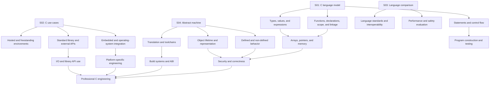
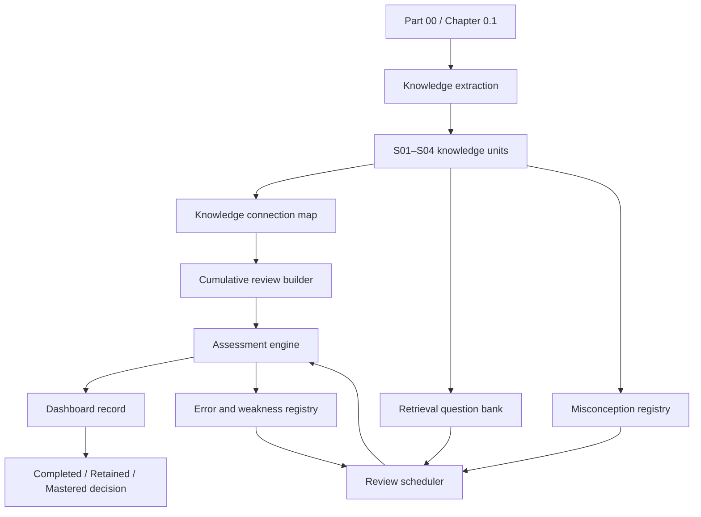

# 00.01 — What Is C?

**Part:** 00 — Orientation, History, and Working Environment  
**Chapter:** 0.1 — Introducing the C language  
**Level:** L0 — Discover  
**Prerequisites:** None  
**Chapter source ID:** `C23-P00-CH01`  
**Knowledge-unit namespace:** `C23-P00-CH01-Sxx-*`  
**Primary language baseline:** C23 — ISO/IEC 9899:2024  
**Status:** Publication candidate; code verification and standards-source audit recorded below  
**Scope:** 0.1.1–0.1.4

> **The chapter in one sentence:** C is a general-purpose programming language whose small, explicit core lets programmers describe computations and data structures while implementations translate those descriptions for very different machines and environments.

This chapter starts at L0, but it is not limited to beginner slogans. Every topic moves from a plain-language model to a working C example, then to the boundary of what the language actually guarantees. Professional C work begins when a programmer can tell the difference between what the source says, what the C standard promises, what a compiler chooses, and what a platform supplies.

---

## Chapter contract

After studying this chapter, a learner should be able to:

1. Describe C as procedural, structured, and system-oriented without treating those labels as formal standard categories.
2. Name important domains where C is used and distinguish ISO C facilities from operating-system, processor, board, and vendor interfaces.
3. Compare C with C++, Objective-C, Rust, Java, Python, and assembly without making universal claims about speed, safety, or superiority.
4. Explain the C abstract machine and why a C statement does not map one-to-one to a processor instruction.
5. Classify a claim as a C-language guarantee, implementation-defined choice, unspecified behavior, undefined behavior, optional facility, extension, or historical rule.
6. Build and inspect a small hosted C23 program using a strict diagnostic profile.

### Importance and retention map

| Knowledge unit | Importance | Why it matters |
|---|---|---|
| `C23-P00-CH01-S01` | Core | Establishes the language's programming model and vocabulary |
| `C23-P00-CH01-S02` | Core | Connects language properties to engineering use cases |
| `C23-P00-CH01-S03` | Core | Prevents false equivalence and simplistic language rankings |
| `C23-P00-CH01-S04` | Critical | Establishes the boundary between C semantics and a real implementation |

**Prerequisite links:** None; this is an L0 entry chapter. Later chapters should reactivate these units when teaching types, expressions, functions, arrays, pointers, object lifetime, translation, I/O, portability, security, and external APIs.

### Standards and compiler decision

This curriculum uses **C23 as its teaching baseline** because the curriculum-wide CTM specification identifies C23 (ISO/IEC 9899:2024) as its language scope. This is also a sound professional choice for a current C curriculum: learners should understand the current language definition rather than silently learning a historical subset as though it were current.

That does **not** mean every example must use a newly introduced C23 feature. The examples here deliberately use stable, foundational C constructs so that the chapter teaches the language model rather than a list of new syntax. C23-specific changes are introduced when they matter to the topic.

Compiler support is a separate engineering variable. A compiler's `-std=c23` mode selects a language dialect; it does not prove that every C23 feature is implemented perfectly. The verification record at the end names the compiler version and limits of the test.

### How the six-step structure works

Each sub-chapter uses the same six steps, in this exact order:

1. **Core idea** — one precise sentence.
2. **Mental model** — an accessible model and its limits.
3. **Technical mechanism** — how the language, implementation, or library behaves, with runnable C where useful.
4. **Formal boundary** — what is guaranteed, implementation-defined, unspecified, undefined, optional, extended, or historical.
5. **Practical consequence** — what a programmer should do differently.
6. **Retrieval question** — a prompt to reconstruct the idea without rereading.

The repetition of this structure is intentional: the explanations change; the retrieval path remains familiar.

---

# 0.1.1 — C as a procedural, structured, system-oriented language

**Knowledge-unit ID:** `C23-P00-CH01-S01`  
**Retrieval item ID:** `C23-P00-CH01-S01-RET-01`  
**Importance:** Core

## 1. Core idea

**C is a general-purpose language in which programs commonly organize computation into functions, express control flow with statements, and manipulate typed objects through explicitly written operations.**

“Procedural,” “structured,” and “system-oriented” are useful descriptions of how C is commonly used. They are not three formal language modes or labels that the C standard assigns to a translation unit.

## 2. Mental model — a process that transforms state

Imagine a workshop with a repeatable process:

- **Objects and values** are the materials and their current state.
- **Expressions** calculate values.
- **Statements** perform actions or select the next action.
- **Blocks** group declarations and statements into a region.
- **Functions** give a name and interface to a reusable operation.
- **Pointers** can let a function refer to an object owned elsewhere.

This model explains why C is often called procedural: a program is frequently designed as a collection of procedures that transform data.

It also explains structured programming: `if`, `switch`, loops, blocks, and function calls let the programmer express decisions and repetition explicitly.

**Where the model stops:** C is not merely a top-to-bottom script. The language has formal rules for expression evaluation, sequencing, object lifetime, types, and side effects. A compiler may transform the implementation of a program while preserving the behavior required by the C abstract machine. C also has `goto`; “structured” is a design approach, not a ban enforced by the grammar.

### Three descriptions, precisely separated

| Description | What it means in practice | What it does not mean |
|---|---|---|
| **Procedural** | Programs often divide work into functions with parameters, return values, and documented effects. | C does not require one particular function decomposition or prohibit other design styles. |
| **Structured** | Blocks, selection, iteration, and function calls make control flow explicit and composable. | C does not forbid `goto`, recursion, function pointers, or callbacks. |
| **System-oriented** | C exposes types, object representation constraints, pointers, storage duration, and interfaces suitable for close interaction with an implementation or platform. | C does not make every hardware operation portable ISO C or guarantee direct access to arbitrary physical memory. |

## 3. Technical mechanism — functions, objects, and control flow

Study this complete program:

```c
#include <stdio.h>

static int square(int value)
{
    return value * value;
}

int main(void)
{
    const int input = 7;
    const int result = square(input);

    if (result > 40) {
        puts("The result is greater than 40.");
    } else {
        puts("The result is 40 or less.");
    }

    printf("%d squared is %d\n", input, result);
    return 0;
}
```

Build it:

```sh
gcc -std=c23 -Wall -Wextra -Wpedantic -Wconversion \
    -Wshadow -Wstrict-prototypes -Wformat=2 -Wundef \
    square.c -o square
```

Run it:

```sh
./square
```

Expected output:

```text
The result is greater than 40.
7 squared is 49
```

Trace the program:

1. `main` is the startup function for this hosted example.
2. `input` and `result` are objects declared with type `const int`. Their values are established by initialization.
3. `square` is a function: it receives an `int` parameter and returns an `int`.
4. The call `square(input)` computes the result used to initialize `result`.
5. `if` selects one of two blocks according to the controlling expression.
6. `puts` and `printf` use the hosted standard I/O library.
7. `return 0` reports successful termination to the hosted environment.

The `static` on `square` gives the function name internal linkage: it is not exposed as an external name to other translation units. That is a declaration/linkage property, not a synonym for “procedural.”

### A function contract

For the example, the contract is simple:

- **Input:** any `int` value for which `value * value` is representable as an `int`.
- **Output:** the mathematical square of that value.
- **Effects:** no externally visible state is modified.
- **Precondition:** multiplication must not overflow the range of `int`.

This last point matters. The function is not defined for every possible `int` input if the mathematical product cannot be represented. A beginner may read `return value * value;` as “always multiply”; a professional asks whether the operation is valid for the entire input domain.

### What “system-oriented” looks like

C can express the shape of low-level data and pass references to storage:

```c
#include <stddef.h>
#include <stdio.h>

static void set_first(int *values, size_t count, int replacement)
{
    if (values != NULL && count > 0) {
        values[0] = replacement;
    }
}

int main(void)
{
    int samples[] = {10, 20, 30};

    set_first(samples, sizeof samples / sizeof samples[0], 99);
    printf("%d %d %d\n", samples[0], samples[1], samples[2]);
    return 0;
}
```

Expected output:

```text
99 20 30
```

The function receives a pointer and a count. It can modify the first array element through the pointer. The caller supplies the count because a pointer parameter does not automatically carry the size of the pointed-to array.

This example previews a central C engineering habit: **a pointer is not a complete memory-safety contract**. Validity, bounds, lifetime, and mutability must be established separately.

## 4. Formal boundary — descriptions are not guarantees

The labels “procedural,” “structured,” and “system-oriented” are explanatory classifications. ISO C specifies language syntax, constraints, semantics, translation, and library behavior; it does not mandate a software architecture.

| Category | Boundary for this sub-chapter |
|---|---|
| **Defined behavior** | Valid function definitions and calls, blocks, selection statements, iteration statements, and object accesses have specified semantics when their constraints and preconditions are met. |
| **Implementation-defined** | Some implementation properties relevant to systems work must be documented by the implementation. Examples include certain representation, alignment, and environment choices. |
| **Unspecified** | The standard may permit multiple possibilities without requiring the implementation to document which is chosen. Code must not rely on a particular permitted choice. |
| **Undefined** | If a program reaches a situation for which the standard imposes no requirements, the source does not have a portable behavioral contract. Signed integer overflow is one familiar example. |
| **Extension** | A compiler may accept extra keywords, attributes, built-ins, or inline assembly. These are not automatically ISO C23. |
| **Optional** | A standard feature may be conditional or optional where the standard says so; availability must be checked rather than assumed. |
| **Historical** | K&R C and older standard editions are valuable context, but their rules must not be presented as current C23 rules without qualification. |

**Standards map (verified against WG14 N3220, the public text carrying the ISO/IEC 9899:2024 designation):**

- Clause 6.8: statements and blocks, including selection, iteration, and jump statements.
- Clause 6.9.2: function definitions.
- Clause 6.2.2: linkage of identifiers.
- Clause 6.2.4: storage durations of objects.
- Clause 3.5: behavior terminology; see 3.5.1, 3.5.3, and 3.5.4 for implementation-defined, undefined, and unspecified behavior.

The standard does not define “procedural language” as a formal category for C. Treat the three labels as useful engineering descriptions, not normative terms.

## 5. Practical consequence

When designing a C program:

- Give each function one clear responsibility and state its input, output, side effects, and preconditions.
- Prefer blocks, `if`, `switch`, and loops when they make the control-flow intent easier to verify.
- Do not confuse a declaration's storage-class specifier with a high-level programming paradigm.
- For pointer parameters, document the valid object, element count, mutability, and lifetime expected from the caller.
- Check arithmetic preconditions before assuming an expression is valid for all values of its type.
- Separate portable ISO C from platform-specific access mechanisms.

A useful code-review question is:

> Which object is read or modified, by which operation, under what type, bounds, lifetime, and sequencing conditions?

## 6. Retrieval question

Without looking back, define “procedural,” “structured,” and “system-oriented” in C. Then explain why none of those labels guarantees that a C program can safely access any hardware address or that each source statement becomes one machine instruction.

---

# 0.1.2 — What C is used for

**Knowledge-unit ID:** `C23-P00-CH01-S02`  
**Retrieval item ID:** `C23-P00-CH01-S02-RET-01`  
**Importance:** Core

## 1. Core idea

**C is used in many kinds of software when its explicit data model, implementation control, mature toolchains, and ability to interface with platform facilities fit the engineering constraints.**

C is not only for kernels or microcontrollers, and it is not automatically the best language for every performance-sensitive task.

## 2. Mental model — portable language core, platform-specific boundary

Picture a reusable engine connected to different vehicles:

- The **C-language core** contains types, expressions, functions, objects, control flow, and standard-library facilities.
- The **platform boundary** contains operating-system calls, processor instructions, device registers, startup code, ABI rules, and vendor libraries.
- The **build environment** connects source code to a particular target through a compiler, linker, libraries, and configuration.

The same algorithm can often be reused across targets. The code that opens a device, configures an interrupt, maps a file, or accesses a peripheral usually depends on a platform contract.

**Limit of the model:** The boundary is not always a clean line. An ABI, compiler option, runtime library, startup file, or target header can affect how apparently ordinary C code integrates with the system. “Written in C” does not mean “runs unchanged everywhere.”

## 3. Technical mechanism — domains and their real constraints

| Domain | Why C is useful | What the project must still handle |
|---|---|---|
| **Operating systems and kernels** | Explicit data structures, low-level interfaces, and control over runtime assumptions | Privileged operations, boot/startup, interrupts, memory mapping, synchronization, and kernel-specific APIs |
| **Embedded systems** | C can target constrained processors and work with vendor toolchains and device interfaces | Device manuals, memory limits, timing, startup, interrupt rules, compiler support, and hardware-specific access |
| **Compilers and language tools** | C can implement lexers, parsers, interpreters, code generators, and runtime components | Language correctness, diagnostics, target-specific code generation, and complex input validation |
| **Databases and storage engines** | C can implement compact data structures, storage formats, and performance-sensitive components | Crash consistency, concurrency, I/O semantics, data integrity, and operating-system integration |
| **Networking** | C can implement protocol parsers, packet-processing routines, and socket-based services | Socket APIs are platform interfaces; parsing untrusted input requires strict bounds and validation |
| **Applications and libraries** | C can provide command-line tools, native libraries, media components, and reusable APIs | UI frameworks, deployment, platform integration, and external dependencies |

### Example: a bounded byte-processing routine

This is ordinary ISO C. It counts occurrences of a byte value in a supplied buffer. It could be one small component of a packet parser, storage engine, file reader, or embedded protocol implementation.

```c
#include <stddef.h>
#include <stdio.h>

static size_t count_byte(const unsigned char *data,
                         size_t length,
                         unsigned char target)
{
    size_t count = 0;

    for (size_t i = 0; i < length; ++i) {
        if (data[i] == target) {
            ++count;
        }
    }

    return count;
}

int main(void)
{
    const unsigned char packet[] = {
        0x10, 0x20, 0x10, 0x30, 0x10
    };

    const size_t matches =
        count_byte(packet, sizeof packet, 0x10);

    printf("matching bytes: %zu\n", matches);
    return 0;
}
```

Expected output:

```text
matching bytes: 3
```

Why this pattern matters:

- `unsigned char` is appropriate for inspecting byte values.
- `size_t` is the standard type used for object sizes and array indexing quantities.
- The loop indexes only elements from `0` to `length - 1`.
- The caller supplies the length instead of expecting the pointer to reveal the array's size.
- The function contract still requires `data` to designate at least `length` readable elements whenever `length` is nonzero.

The example is not a complete packet parser. It demonstrates a bounded operation that a larger parser can use after validating the input buffer.

### Hosted and freestanding environments

C distinguishes two execution environments:

- A **hosted environment** provides the hosted execution model and the standard-library facilities specified for that environment. A conventional desktop command-line program with `main` and `stdio` is a familiar example.
- A **freestanding environment** is one where execution may occur without the benefit of an operating system. The startup function and the additional library facilities available to the program are implementation-defined, subject to the standard's minimum requirements.

Do not equate “hosted” with desktop and “freestanding” with microcontroller as an absolute rule. They are standard execution-environment categories, not marketing labels for device types.

## 4. Formal boundary — ISO C versus external interfaces

| Category | Boundary for C use cases |
|---|---|
| **Defined behavior** | ISO C defines core language operations and standard-library facilities when their specified preconditions are met. The byte-counting example is defined when its pointer/length contract is valid. |
| **Implementation-defined** | Type ranges, object representations, alignment, startup behavior in freestanding environments, and other documented choices can affect target integration. |
| **Unspecified** | Do not depend on a particular choice where the standard permits several without requiring documentation. |
| **Undefined** | Out-of-bounds access, invalid pointer use, and other invalid operations can destroy the program's portable behavioral contract. Validate input lengths before indexing. |
| **Extension** | Inline assembly, compiler intrinsics, vendor pragmas, and nonstandard built-ins require toolchain-specific documentation. |
| **Optional** | A freestanding implementation need not provide the full hosted library. Other standard facilities can also be conditional or optional where specified. |
| **Historical** | Old embedded examples may rely on compiler conventions, older language editions, or undocumented assumptions. Verify before reusing them. |

**Standards map (verified against WG14 N3220):**

- Clause 5.1.2.1: execution environments.
- Clause 5.1.2.2: freestanding environment.
- Clause 5.1.2.3: hosted environment.
- Clause 7: standard library.
- Clause 6.10.10: predefined macros, including conditional feature-related information.

**External boundary:** A POSIX socket call, Windows API, MCU register definition, interrupt controller, DMA engine, or vendor peripheral library is not defined merely by ISO C. Use the relevant external specification and compiler/ABI documentation.

## 5. Practical consequence

Before choosing C for a project, write down:

1. The target execution environment: hosted or freestanding.
2. The required compiler, linker, ABI, C dialect, and runtime.
3. Which facilities are ISO C and which are supplied by the OS, board vendor, processor, or compiler.
4. Memory, timing, concurrency, safety, and deployment constraints.
5. How input bounds, failure paths, malformed data, and portability assumptions will be tested.

For embedded work, never copy a register address from a random example and call it portable C. Confirm the address and access protocol from the target's authoritative hardware documentation and toolchain contract.

## 6. Retrieval question

Name four domains in which C is used. For two of them, separate the work that can be expressed in ISO C from the work that depends on an operating system, processor, board, or vendor interface.

---

# 0.1.3 — C compared with C++, Objective-C, Rust, Java, Python, and assembly

**Knowledge-unit ID:** `C23-P00-CH01-S03`  
**Retrieval item ID:** `C23-P00-CH01-S03-RET-01`  
**Importance:** Core

## 1. Core idea

**C differs from other languages in its abstraction facilities, type and memory models, runtime assumptions, and safety mechanisms, so a useful comparison evaluates a concrete task rather than declaring a universal winner.**

## 2. Mental model — compare responsibilities, not syntax

Imagine choosing tools for a project:

- One tool may provide more abstractions and runtime services.
- Another may make ownership and lifetime constraints more explicit.
- Another may expose processor instructions directly.
- Another may optimize for rapid expression and a rich managed runtime.

C's characteristic trade-off is a relatively compact language model with explicit types, functions, pointers, and object-lifetime rules, while many higher-level policies are delegated to program design, libraries, the implementation, and the platform.

**Limit of the model:** Languages overlap. C++ can be written procedurally; Rust can call C libraries; Java can use native code; Python can orchestrate native extensions; assembly can be part of a C build. A language label alone does not determine a whole system's architecture or measured performance.

## 3. Technical mechanism — a fair comparison

| Language | Relationship to C | Distinguishing facilities | Important boundary |
|---|---|---|---|
| **C** | This chapter's subject | Functions, structs, explicit pointer operations, standard library, implementation-level control | The programmer must satisfy type, bounds, lifetime, and pointer rules; many platform facilities are external |
| **C++** | Shares syntax and historical lineage with C, but is a distinct language | Classes, templates, overloading, RAII, exceptions, standard containers, multiple paradigms | C++ is not simply “C plus classes”; C and C++ have separate standards and compatibility rules |
| **Objective-C** | Adds a Smalltalk-style object model and message syntax to a C-derived language environment | Dynamic message dispatch, classes, protocols, runtime integration | Objective-C is a separate language with its own runtime and ecosystem; it is not ISO C |
| **Rust** | Supports interoperability with C through foreign-function interfaces | Ownership and borrowing, algebraic data types, pattern matching, strong memory-safety design | Rust's guarantees differ from C's; an FFI boundary still needs correct data-layout, lifetime, and error contracts |
| **Java** | A higher-level language commonly executed on a managed virtual machine | Garbage collection, class-based abstractions, exceptions, managed runtime | Java's execution model is not the ISO C abstract machine; native integration is a separate boundary |
| **Python** | A high-level language widely used for scripting and application logic | Dynamic typing, concise syntax, extensive libraries, interactive workflows | Common Python implementations rely on a runtime; native extensions may be written in C or other languages |
| **Assembly** | Represents instructions for a specific processor architecture | Direct expression of instruction-set operations, registers, and target-specific details | Assembly is architecture-specific; instruction sets, calling conventions, and assemblers differ |

### C and assembly: source language versus target instructions

C source is not a textual list of processor instructions. A compiler translates C according to the selected implementation and target. The output depends on the architecture, compiler, optimization settings, ABI, and surrounding program.

Assembly expresses instructions for a specific instruction set. C expresses operations in the C language model and lets the implementation choose a valid translation.

That freedom is not a defect. It is what lets one C program be compiled for different targets while retaining the required language-level behavior.

### C and C++: related, not interchangeable

C and C++ share a great deal of syntax, but their standards are separate. A C source file should not be assumed to be a valid C++ translation unit, and code accepted by a C++ compiler should not automatically be described as ISO C.

The same discipline applies to Objective-C: C syntax inside an Objective-C project does not make the Objective-C runtime part of ISO C.

### A tiny contrast: the same conceptual operation

C:

```c
static int square(int value)
{
    return value * value;
}
```

Python:

```python
def square(value):
    return value * value
```

The Python spelling is shorter. That fact alone says nothing about the speed, safety, memory use, or maintainability of a complete application. The language runtimes, type systems, compilers/interpreters, libraries, and workload matter.

## 4. Formal boundary — standards do not transfer between languages

| Category | Boundary for language comparison |
|---|---|
| **Defined behavior** | A guarantee is always relative to a particular language and version. A construct valid in C23 is not automatically valid or equivalent in C++, Rust, Java, or Python. |
| **Implementation-defined** | This is a defined C standards category. Other languages have their own implementation and runtime rules; do not casually transfer C terminology to them. |
| **Unspecified** | In C, this has a specific standards meaning: multiple possibilities are permitted without requiring the implementation to document which is chosen. It is not a synonym for randomness. |
| **Undefined** | C undefined behavior means the C standard imposes no requirements for that situation. It is not the same concept as a Java exception, Rust panic, or Python exception. |
| **Extension** | GNU C features and vendor-specific facilities are not automatically portable ISO C, C++, or Rust. |
| **Optional** | Optional or conditional status is determined by the relevant language standard and implementation; do not infer it from a language comparison chart. |
| **Historical** | C, C++, and Objective-C have related histories, but current rules come from separate specifications. K&R C is not the C23 definition. |

### Short historical orientation

The broad lineage is useful context, but it must not be confused with a standards rule:

- **BCPL and B** preceded C and influenced its early design.
- **C** emerged in the early 1970s in the context of Unix development.
- **K&R C** became widely known through the 1978 book *The C Programming Language*.
- **C89/C90** standardized a widely used form of C.
- **C95** amended C90.
- **C99** introduced important language and library changes, including several features familiar in modern C.
- **C11** added facilities including atomics and threads support, with some features conditional.
- **C17/C18** primarily corrected defects rather than introducing a large new feature set.
- **C23**, published as ISO/IEC 9899:2024, is the current baseline used in this curriculum.

The labels C89 and C90 refer to the ANSI and ISO publication sequence for the same standard text, not two unrelated languages. Historical names and publication dates should be checked against authoritative references when used in formal bibliographic work.

## 5. Practical consequence

When choosing or comparing languages:

- Compare the same task, input, and deployment environment.
- Compare safety guarantees and failure modes, not only syntax.
- Include runtime, libraries, tooling, debugging, ecosystem, deployment, and team constraints.
- Treat C and C++ as distinct languages even when code looks similar.
- Treat C-to-Rust and C-to-Python native interfaces as explicit contracts involving calling conventions, data layout, ownership/lifetime, and error handling.
- Benchmark equivalent workloads under documented build and measurement conditions.
- Inspect generated assembly only when answering a target-specific question.

A defensible engineering decision sounds like this:

> “We selected C for this component because the target toolchain, ABI, deployment constraints, and existing interfaces fit the project, and we have a plan for bounds checking, testing, and platform-specific dependencies.”

It does not sound like this:

> “C is always faster, so C is automatically the best.”

## 6. Retrieval question

Choose two languages from the comparison table. State one concrete design difference between them, then explain why that difference does not prove that one language is always faster, safer, or better.

---

# 0.1.4 — The abstract model of a C program and its relationship to the machine

**Knowledge-unit ID:** `C23-P00-CH01-S04`  
**Retrieval item ID:** `C23-P00-CH01-S04-RET-01`  
**Importance:** Critical

## 1. Core idea

**C defines program meaning through a standards-based abstract machine, while a conforming implementation translates and executes the program on a real system in a way that satisfies the behavior the standard requires.**

The abstract machine is a semantic model, not a physical processor that must literally exist inside the computer.

## 2. Mental model — contract, translator, and target

Think of three layers:

1. **C source:** the programmer expresses objects, values, expressions, statements, and functions.
2. **C abstract machine:** the standard defines how those constructs are interpreted and what behavior is required.
3. **Implementation and target:** compiler, runtime, libraries, linker, operating system, processor, and device realize the program in a particular environment.

A conforming implementation has freedom in *how* it realizes required behavior. It does not have freedom to violate the C requirements for a program whose behavior is defined.

**Limit of the model:** A real toolchain is not always a simple three-box pipeline. Preprocessing, compilation, assembly, linking, loading, startup, and runtime support can be separate or combined. Some programs are freestanding and do not use an ordinary operating-system process model. ISO C does not prescribe every executable-file format or hardware startup detail.

## 3. Technical mechanism — translation, execution, and observable behavior

A useful simplified view is:

```text
C source files
     |
     v
Translation environment
(preprocessing and translation)
     |
     v
Implementation output
(object files, executable, or another target form)
     |
     v
Execution environment
(startup, runtime, libraries, platform services)
     |
     v
Processor and system perform operations
```

This diagram is conceptual. It is not a requirement that every compiler use separate tools or produce a conventional executable.

### Translation and execution

The C standard describes translation phases and execution environments. A hosted toolchain commonly performs preprocessing, compilation, assembly, and linking. A freestanding toolchain may use a different startup path and library configuration.

The abstract machine gives the language-level meaning of constructs such as:

- **Objects:** regions of data storage that can hold values.
- **Types:** determine which values and operations are valid and how objects are interpreted.
- **Expressions:** compute values and may have side effects.
- **Statements and blocks:** define execution structure and scope.
- **Functions:** define callable units of computation.
- **Storage duration:** determines an object's lifetime category.
- **Observable behavior:** externally visible effects that constrain valid implementation transformations.

### A complete hosted example

```c
#include <stdio.h>

int main(void)
{
    int count = 3;
    count = count + 4;

    printf("count = %d\n", count);
    return 0;
}
```

Expected output:

```text
count = 7
```

At the C level:

- `count` is an object of type `int`.
- Its initial value is `3`.
- The expression `count + 4` computes a value.
- Assignment stores the resulting value in `count`.
- `printf` performs a standard I/O operation.
- Returning from the initial call to `main` terminates the hosted program as specified.

The C standard does not require `count` to live in a particular physical register or memory address. If an implementation can preserve the required observable behavior without materializing a source-level object exactly as written, it may do so.

### Why the compiler may transform code

Consider:

```c
static int add_one(int value)
{
    return value + 1;
}
```

A compiler may:

- keep the function as a separate callable routine;
- inline it into a caller;
- use a target instruction with an immediate operand;
- combine the calculation with surrounding work;
- remove a computation whose result cannot affect observable behavior.

The exact choice depends on the target and build. The C standard does not mandate one assembly instruction for one C statement.

This is often summarized by the *as-if rule*: an implementation may use any translation strategy that produces the behavior required by the standard. That freedom is why source-level reasoning must begin with C semantics, not guesses about registers.

### Hosted versus freestanding startup

For a hosted implementation, the standard specifies `main` as the ordinary startup function, with the forms and constraints described in the standard. For a freestanding implementation, the name and type of the startup function are implementation-defined.

Therefore:

- `int main(void)` is correct for the hosted examples in this chapter.
- It is not a universal startup rule for every C target.
- Embedded startup code and linker scripts are part of the target toolchain/platform contract.

## 4. Formal boundary — classify the claim before relying on it

These categories are not interchangeable.

| Category | Exact working meaning | Engineering response |
|---|---|---|
| **Defined behavior** | The standard specifies the behavior when the program construct and its preconditions are valid. | Rely on the stated guarantee; preserve its constraints. |
| **Implementation-defined behavior** | The standard permits a choice and requires the implementation to document how the choice is made. | Read the target implementation's documentation; do not assume another implementation makes the same choice. |
| **Unspecified behavior** | The standard permits two or more possibilities and imposes no requirement to document which one is chosen. | Do not depend on one particular permitted choice. |
| **Undefined behavior** | The standard imposes no requirements for the situation. | Prevent the invalid condition; a successful build or one apparently correct run does not repair it. |
| **Extension** | A compiler or platform supplies a facility outside the selected ISO C definition. | Record the exact toolchain/platform contract and isolate the dependency where portability matters. |
| **Optional / conditional feature** | A facility is standardized but not universally required, or support is conditional as stated by the standard. | Check the implementation's declared support and documentation. |
| **Historical rule** | A statement belongs to an earlier C edition or old compiler practice. | Identify the edition; do not silently teach it as C23. |

### Distinctions that professionals must keep separate

- **Implementation-defined is not undefined.** An implementation-defined choice must be documented.
- **Unspecified is not implementation-defined.** The implementation need not document which permitted possibility it chooses.
- **Undefined does not mean “the program will crash.”** It means the standard imposes no requirements for that situation.
- **An extension is not automatically bad.** It may be useful and documented, but it is not a portable ISO C guarantee.
- **Optional does not mean obsolete.** It means availability is not universally required.
- **Historical does not mean useless.** It means the rule must be identified with its original language edition.

### Hosted/freestanding is a different axis

Hosted and freestanding describe execution environments. Defined, implementation-defined, unspecified, and undefined describe behavior categories. Do not collapse these two classification systems.

For example, a freestanding implementation has implementation-defined startup details. That does not mean all behavior in a freestanding program is implementation-defined; ordinary C language rules still apply where specified.

### Standards map — verified references

The following clause references were checked against **WG14 N3220**, the publicly available text carrying the designation ISO/IEC 9899:2024:

- **3.5.1:** implementation-defined behavior.
- **3.5.3:** undefined behavior.
- **3.5.4:** unspecified behavior.
- **5.1.1.2:** translation phases.
- **5.1.2.1:** execution environments.
- **5.1.2.2:** freestanding environment.
- **5.1.2.3:** hosted environment, startup, execution, and termination.
- **5.1.2.4:** program semantics and the abstract machine.
- **6.2.4:** storage durations of objects.
- **6.2.5:** types.
- **6.2.6:** representations of types.
- **6.8:** statements and blocks.
- **6.9.2:** function definitions.

N3220 is the public WG14 text used for this audit; the published ISO edition and applicable corrections remain the final authority for formal compliance work. If a future edition, corrigendum, or target-specific claim has not been checked, record it as **“to be verified with authoritative source”** rather than inventing a clause.

## 5. Practical consequence

When reasoning about a C program, use this order:

1. Identify the selected C language version and compiler mode.
2. Identify the objects, types, scopes, and lifetimes involved.
3. Apply the C rules for expressions, statements, function calls, and side effects.
4. Classify any behavior that depends on a standard-permitted choice.
5. Separate ISO C requirements from compiler extensions and platform APIs.
6. Inspect generated assembly, ABI details, or hardware documentation only when the engineering question requires them.
7. Record the compiler, version, target, options, and test conditions when reporting results.

Do not use one successful run as proof of correctness. A run demonstrates what happened on one build and environment; standards reasoning determines what the program is entitled to rely on.

## 6. Retrieval question

Explain the difference between the C abstract machine and a physical processor. Then classify each statement:

1. “The implementation must document the choice.”
2. “The standard permits several possibilities but does not require a documented choice.”
3. “The standard imposes no requirements for this situation.”
4. “The compiler provides this facility outside the selected ISO C dialect.”
5. “The facility is standardized but is not required of every implementation.”

---

# Misconception Defense Registry

**Registry policy:** The records below are anticipated misconception patterns derived from the chapter's concepts. They are not claims that this learner has already expressed these beliefs. An anticipated case becomes an observed learner error only after a diagnostic answer provides evidence. The repair loop follows ROADMAP section 7: expose → elicit reasoning → identify assumption → teach rule/model → contrast → re-test later.

## `MIS-P00-CH01-S01-01` — “C is just a sequence of commands”

- **Incorrect belief:** A C program is only a top-to-bottom list of machine-like commands.
- **Correct explanation:** C has typed objects, expressions, functions, blocks, selection, iteration, and formal evaluation/sequence rules. Source statements do not map one-to-one to processor instructions.
- **Why plausible:** Introductory examples often show short programs whose statements appear in a simple sequence.
- **Relevant chapter:** 0.1.1 — `C23-P00-CH01-S01`.
- **Code example:**
  ```c
  static int twice(int x) { return x * 2; }
  int main(void) {
      int value = 4;
      if (value > 0) value = twice(value);
      return value == 8 ? 0 : 1;
  }
  ```
- **Diagnostic question:** Which part defines a reusable operation, which part selects a path, and which object stores the changing state?
- **Correction exercise:** Refactor a straight-line calculation into a function and an `if` block. Explain the function's input, output, and side effects. Re-test later with a loop.
- **Related misconceptions:** `MIS-P00-CH01-S01-02`, `MIS-P00-CH01-S04-01`.

## `MIS-P00-CH01-S01-02` — “Structured C means `goto` does not exist”

- **Incorrect belief:** C is structured, therefore the language forbids jumps.
- **Correct explanation:** C includes labels and `goto`. Structured programming is a design discipline supported by blocks, selection, iteration, and functions; it is not a prohibition encoded into C.
- **Why plausible:** Many courses teach structured control flow and discourage unnecessary jumps.
- **Relevant chapter:** 0.1.1 — `C23-P00-CH01-S01`.
- **Code example:**
  ```c
  int main(void) {
      int status = 0;
      goto finished;
      status = 1;
  finished:
      return status;
  }
  ```
- **Diagnostic question:** Does the existence of `goto` contradict the fact that C provides structured statements?
- **Correction exercise:** Explain the difference between a language capability and a recommended design style. Rewrite the example without `goto`, then describe one controlled cleanup situation in which a jump may be considered.
- **Related misconceptions:** `MIS-P00-CH01-S01-01`.

## `MIS-P00-CH01-S02-01` — “C is only for operating systems and embedded devices”

- **Incorrect belief:** C has no meaningful role in databases, compilers, networking, libraries, or applications.
- **Correct explanation:** C is used in many domains. Its suitability depends on project constraints, platform interfaces, available libraries, and engineering trade-offs.
- **Why plausible:** Beginner material often introduces C through kernels and microcontrollers.
- **Relevant chapter:** 0.1.2 — `C23-P00-CH01-S02`.
- **Code example:** The bounded `count_byte` routine in 0.1.2 is a realistic building block for parsers, storage components, and embedded protocol code.
- **Diagnostic question:** Which part of a network service can be written as ISO C, and which part might require an operating-system socket API?
- **Correction exercise:** Choose three domains in the use-case table. For each, name one C-language responsibility and one external platform/library responsibility.
- **Related misconceptions:** `MIS-P00-CH01-S02-02`, `MIS-P00-CH01-S04-02`.

## `MIS-P00-CH01-S02-02` — “C source is automatically portable to every microcontroller”

- **Incorrect belief:** If code is written in C, it will work unchanged on every microcontroller.
- **Correct explanation:** ISO C improves portability of language-level behavior, but targets differ in implementation characteristics, startup, libraries, memory maps, peripheral interfaces, and toolchain support.
- **Why plausible:** C is widely used in embedded development and often described as portable.
- **Relevant chapter:** 0.1.2 — `C23-P00-CH01-S02`.
- **Code example:** A `volatile` qualifier does not by itself define a universal hardware register address, access width, ordering protocol, or device-specific side effect.
- **Diagnostic question:** Does ISO C assign the same UART register address and access protocol to every microcontroller?
- **Correction exercise:** For a hypothetical UART register, list the information required from the processor/board manual, compiler documentation, and platform header before writing an access routine.
- **Related misconceptions:** `MIS-P00-CH01-S04-02`, `MIS-P00-CH01-S04-03`.

## `MIS-P00-CH01-S03-01` — “C++ is just C with classes”

- **Incorrect belief:** C++ is C plus classes, and every valid C program is necessarily valid C++ with identical semantics.
- **Correct explanation:** C and C++ are distinct languages with separate standards, keyword sets, type rules, and compatibility constraints.
- **Why plausible:** Their syntax and history overlap, and many small examples compile in both.
- **Relevant chapter:** 0.1.3 — `C23-P00-CH01-S03`.
- **Code example:** A construct accepted by a C compiler under `-std=c23` is not proven valid C++ merely because the syntax resembles C++.
- **Diagnostic question:** What evidence is needed before claiming a C translation unit is valid under a particular C++ standard?
- **Correction exercise:** Compile a small shared-syntax example in both a named C23 mode and a named C++ mode. Research one rule that differs and explain the difference with each language's own specification.
- **Related misconceptions:** `MIS-P00-CH01-S03-02`.

## `MIS-P00-CH01-S03-02` — “C is always faster because it is lower-level”

- **Incorrect belief:** Every C program will always outperform an equivalent program in Python, Java, Rust, or C++.
- **Correct explanation:** Performance depends on algorithm, workload, implementation, compiler/runtime optimizations, libraries, memory behavior, and measurement. C allows explicit control but guarantees no universal ranking.
- **Why plausible:** C is commonly compiled to native code and is used in performance-sensitive components.
- **Relevant chapter:** 0.1.3 — `C23-P00-CH01-S03`.
- **Code example:** No single code fragment proves a universal speed claim; a meaningful comparison requires equivalent work and controlled measurements.
- **Diagnostic question:** What must be held constant in a benchmark comparing C and another language?
- **Correction exercise:** Design a benchmark plan specifying algorithm, inputs, compiler/interpreter versions, optimization settings, warm-up, measurement method, and correctness checks.
- **Related misconceptions:** `MIS-P00-CH01-S03-01`.

## `MIS-P00-CH01-S04-01` — “One C statement always becomes one machine instruction”

- **Incorrect belief:** Every C statement maps directly to one processor instruction in the same order.
- **Correct explanation:** C defines semantics through an abstract machine. Implementations may generate different instruction sequences and transformations while preserving required behavior.
- **Why plausible:** Introductory diagrams often present compilation as a direct line-by-line conversion.
- **Relevant chapter:** 0.1.4 — `C23-P00-CH01-S04`.
- **Code example:**
  ```c
  static int add_one(int value) { return value + 1; }
  ```
  The compiler may inline the function or use different instructions on different targets.
- **Diagnostic question:** Does ISO C require a particular assembly instruction for `value + 1`?
- **Correction exercise:** Compile the same function at two optimization levels or for two targets. Compare assembly and identify which differences are implementation choices while the C-level result remains required.
- **Related misconceptions:** `MIS-P00-CH01-S01-01`, `MIS-P00-CH01-S04-02`.

## `MIS-P00-CH01-S04-02` — “The C abstract machine is a real virtual processor”

- **Incorrect belief:** A physical or software processor must literally execute every C abstract-machine step.
- **Correct explanation:** The abstract machine is a conceptual semantic model used to specify program behavior. An implementation may use any translation/execution strategy that satisfies the standard.
- **Why plausible:** The word “machine” suggests a concrete CPU or virtual machine.
- **Relevant chapter:** 0.1.4 — `C23-P00-CH01-S04`.
- **Code example:** In the `count` example, C specifies the object and operations but does not require a particular physical register or memory address for `count`.
- **Diagnostic question:** Must an implementation materialize every source-level variable if it can preserve required observable behavior without doing so?
- **Correction exercise:** Explain the source → abstract semantics → implementation/target model in your own words. Mark which statements are C guarantees and which are common toolchain stages.
- **Related misconceptions:** `MIS-P00-CH01-S04-01`, `MIS-P00-CH01-S04-03`.

## `MIS-P00-CH01-S04-03` — “If it works on my compiler, the standard guarantees it”

- **Incorrect belief:** A successful build and stable output on one compiler prove that behavior is portable C23.
- **Correct explanation:** A compiler may accept extensions, make documented implementation-defined choices, or produce an observed result for code whose behavior is unspecified or undefined. One run does not establish a language guarantee.
- **Why plausible:** Repeated local tests create confidence, and diagnostics do not identify every portability assumption.
- **Relevant chapter:** 0.1.4 — `C23-P00-CH01-S04`.
- **Code example:** A GNU extension accepted in GNU dialect mode is not automatically strictly conforming ISO C23.
- **Diagnostic question:** What evidence distinguishes an ISO C23 guarantee from an extension or implementation-defined choice?
- **Correction exercise:** Classify every dependency in a compiler-specific example as ISO C, implementation-defined, unspecified, undefined, extension, or external platform API. Locate the relevant documentation and isolate nonportable code.
- **Related misconceptions:** `MIS-P00-CH01-S02-02`, `MIS-P00-CH01-S03-01`.

---

# C23 Retention Protocol

This chapter uses the standards-retention method in ROADMAP section 14. Every standards-sensitive item must be version-aware, source-aware, and explicit about the limits of its claim.

## Version-aware record

- [x] Language baseline stated: C23 / ISO/IEC 9899:2024.
- [x] Exact clause references included only where checked against WG14 N3220.
- [x] Normative language rules distinguished from explanatory teaching models.
- [x] Implementation-defined, unspecified, and undefined behavior kept separate.
- [x] Optional/conditional facilities distinguished from extensions.
- [x] Compiler behavior not treated as proof of standard conformance.
- [x] Hosted/freestanding execution environment distinguished from behavior categories.
- [x] Historical C editions identified as historical rather than silently substituted for C23.
- [ ] Before a formal compliance release, compare every cited passage against the published ISO edition and applicable corrections.

## Standards distinction drill

| Category | Diagnostic prompt | Correct response target |
|---|---|---|
| Defined behavior | Does the standard specify this behavior under the stated preconditions? | Identify the guarantee and its constraints |
| Implementation-defined | Must the implementation document its choice? | Yes; find the implementation documentation |
| Unspecified | Are multiple possibilities permitted without a documentation requirement? | Yes; do not rely on one choice |
| Undefined | Does the standard impose no requirements for this situation? | Yes; prevent the invalid situation |
| Extension | Is this facility outside the selected ISO C language definition? | Identify compiler/vendor documentation |
| Optional feature | Is the facility standardized but not universally required? | Check the implementation's support |
| Historical rule | Does this statement belong to an earlier C edition? | Name the edition and compare with C23 |

**Evidence-based recall:** Some questions require standards lookup, not memory alone. Example: “Find the C23 rule that defines the abstract machine, restate it in plain English, and identify the exact limit of what it guarantees.”

## Historical/version discipline

Use this hierarchy when reviewing a standards-sensitive claim:

1. Published ISO/IEC 9899:2024 text and applicable corrections.
2. WG14 committee documents, with document status clearly identified.
3. Compiler implementation documentation for implementation-specific behavior.
4. Platform/ABI/processor/OS documentation for external interfaces.
5. Reputable secondary references for orientation, never as a substitute for the normative source when a claim is standards-critical.

Do not quote a clause from memory. If not verified, write **“to be verified with authoritative source”** and withhold the stronger claim.

---

# Error and Weakness Registry

The table below is a **seed inventory of chapter-specific risk patterns**, not an assertion that the learner has made these errors. Set a record to `Open` only after an actual answer, code submission, or explanation demonstrates the error.

| Error ID | Chapter | Concept | Error type | Incorrect reasoning | Correct reasoning | Severity | Repair exercise | Re-test date | Status |
|---|---|---|---|---|---|---|---|---|---|
| `ERR-P00-CH01-01` | 0.1.1 | Procedural model | Conceptual | C is only a sequence of commands | Functions, objects, expressions, blocks, and control flow define a richer model | Core | Trace and refactor a small program | Set after diagnosis | Seed / not observed |
| `ERR-P00-CH01-02` | 0.1.1 | Structured programming | Recall | C has no `goto` | C has jump statements; structured programming is a style | Supporting | Compare structured and jump-based control flow | Set after diagnosis | Seed / not observed |
| `ERR-P00-CH01-03` | 0.1.2 | Use cases | Recall | C is only for kernels and embedded systems | C is used across several software domains | Core | Map domains to C and platform responsibilities | Set after diagnosis | Seed / not observed |
| `ERR-P00-CH01-04` | 0.1.2 | Portability | Standards | C source runs unchanged on every device | Platform, ABI, libraries, and hardware interfaces differ | Critical | Audit a hypothetical peripheral access | Set after diagnosis | Seed / not observed |
| `ERR-P00-CH01-05` | 0.1.3 | Language identity | Conceptual | C++ is C plus classes | C and C++ have separate language standards | Core | Compare a construct under both standards | Set after diagnosis | Seed / not observed |
| `ERR-P00-CH01-06` | 0.1.3 | Performance | Reasoning | C is always fastest | Performance is workload- and implementation-dependent | Supporting | Design a fair benchmark | Set after diagnosis | Seed / not observed |
| `ERR-P00-CH01-07` | 0.1.4 | Abstract machine | Conceptual | One C statement equals one instruction | Compiler translation is not one-to-one | Critical | Inspect assembly for two build configurations | Set after diagnosis | Seed / not observed |
| `ERR-P00-CH01-08` | 0.1.4 | Standard evidence | Standards | One successful run proves a C guarantee | Observed behavior is not a standards proof | Critical | Classify a compiler-specific example | Set after diagnosis | Seed / not observed |

### Error classification and repair routing

| Error class | Typical evidence | Appropriate repair |
|---|---|---|
| Knowledge gap | Cannot recall a term or basic fact | Short free-recall prompt and concise explanation |
| Conceptual error | Uses an inaccurate mental model | Contrastive explanation and a new example |
| Reasoning error | Knows terms but draws an invalid conclusion | Step-by-step trace and justification |
| Application error | Cannot use the concept in code | Small implementation task with constraints |
| Standards error | Confuses a guarantee with implementation behavior | Standards lookup and behavior classification |
| Engineering error | Ignores platform, testing, or maintenance constraints | Design review or implementation audit |

A syntax mistake must not automatically trigger a full conceptual re-teaching session. Record the actual reasoning, severity, repair, and a real re-test date only after diagnosis.

---

# Knowledge Connection Map

This map shows the relationships introduced by this chapter. It is conceptual and does not replace the exact prerequisite metadata in the curriculum.



| Connection | Relationship | Later use |
|---|---|---|
| Types, values, expressions | S01/S04 establish that C operations are typed | Type conversion, arithmetic, expression evaluation |
| Functions, declarations, linkage | S01 introduces functions and internal linkage | Function contracts, multi-file programs, translation units |
| Statements and control flow | S01 introduces blocks, selection, and iteration | Branch/loop tracing and program design |
| Arrays, pointers, and memory | S01/S02 establish pointer-plus-length reasoning | Bounds, object lifetime, allocation, string correctness |
| Hosted/freestanding | S02/S04 establish environment distinctions | Embedded startup and standard-library availability |
| Standard library/external APIs | S02 separates language facilities from platform services | I/O, OS APIs, networking, device drivers |
| Translation and toolchains | S04 separates source semantics from implementation stages | Compiler flags, linking, ABI, optimization |
| Behavior categories | S01/S04 establish standards vocabulary | Portability, undefined-behavior diagnosis, security |
| Language comparison | S03 avoids false equivalence | Interoperability and technology selection |

### Connection prompts

- Which later topic needs the distinction between an array object and a pointer object?
- Which later topic depends on knowing that a pointer parameter does not carry an array's length?
- Which later topic needs the difference between a standard-library function and an operating-system API?
- Which later topic uses the distinction between an abstract C object and its target representation?
- Which later topic depends on separating implementation-defined behavior from undefined behavior?

---

# Pitfall box

> **Pitfall — “It works on my machine” is not a standards argument.**
>
> A successful compile and one expected output establish only what happened for one compiler, version, target, set of options, and run. They do not prove that the source is strictly conforming C23. Identify the language mode, check the applicable rule, classify behavior, and inspect extensions and platform dependencies separately.

---

# Retrieval and Cumulative Review

## Retrieval modes

Use the modes from the CTM blueprint rather than relying on recognition-only flashcards.

| Mode | Chapter prompt |
|---|---|
| **Free recall** | Define C without using “fast” or “low-level” as the whole explanation. |
| **Precision recall** | Distinguish procedural, structured, and system-oriented. |
| **Code prediction** | Predict the output of the `square` or `count_byte` example and explain why. |
| **Error diagnosis** | Explain why a pointer without a valid length/lifetime contract is insufficient. |
| **Contrastive retrieval** | Distinguish C from C++, and the abstract machine from assembly. |
| **Transfer retrieval** | Explain which parts of a hypothetical embedded sensor application are ISO C and which are platform-specific. |

## Chapter review

1. Reconstruct the core idea of all four knowledge units without rereading.
2. Define the important terms and behavior categories.
3. Trace one code example and explain each object's role.
4. Write or modify a small function that accepts a pointer and a length.
5. Diagnose one misconception from the registry.
6. Explain at least three connections to later chapters.
7. Complete the short mastery assessment below.

## Part-end review contribution

When Part 00 is reviewed, this chapter contributes evidence to all seven mandatory ROADMAP items:

1. **Core concept recall:** explain what C is.
2. **Definitions and distinctions:** paradigm labels, hosted/freestanding, language versus implementation, behavior categories.
3. **Code reading:** trace a function call, object update, and selection statement.
4. **Code writing:** write a bounded function and a small hosted `main`.
5. **Error diagnosis:** classify a portability or abstract-machine misconception.
6. **Prerequisite connections:** this chapter has no prerequisites; identify the later units it supports.
7. **Short mastery assessment:** score recall, explanation, application, diagnosis, and integration.

The part-end review must mix this material with other Part 00 chapters; it must not merely repeat this chapter's questions.

## Cross-part review

Reactivate this chapter when reviewing:

- Parts 2–5: types, expressions, control flow, and functions.
- Parts 6–8: arrays, pointers, type structures, object model, and memory.
- Parts 9–11: I/O, translation, and library use.
- Parts 12–15: concurrency, numerics, C23, and behavior/portability.
- Parts 17–20: algorithms, toolchains, security, and professional engineering.
- Parts 21–22: external API boundaries, standards lookup, audit, and evaluation.

These are ROADMAP groupings, not claims that every chapter in those parts has a direct prerequisite edge to this chapter.

## Curriculum-wide review

Do not attempt to recall all 175 chapters in one sitting. Sample rotating sets that include critical knowledge, previously weak knowledge, high-dependency knowledge, overdue knowledge, and concepts from different levels.

## Suggested retrieval schedule

Use the CTM default intervals as a starting point:

**Day 0 → Day 1 → Day 3 → Day 7 → Day 14 → Day 30 → Day 60 → Day 90**

Adjust the interval according to performance. Weak retrieval gets a targeted repair and earlier re-test; reliable knowledge gets less frequent review. Do not create multiple cards that ask the same fact in nearly identical wording.

---

# Practical Reinforcement Project — C Environment Report

This chapter belongs to the Part 0–4 reinforcement stage: small command-line programs that strengthen basic language and environment concepts.

## Project: report the C execution environment

Write a hosted C program that:

1. Prints a short program name and version string.
2. Prints `sizeof(char)`, `sizeof(int)`, and `sizeof(void *)` using `%zu`.
3. Prints the value of `__STDC_VERSION__` when defined.
4. Explains in a comment that the reported sizes describe this implementation, not every C implementation.
5. Uses only standard C facilities and compiles in C23 mode.

**Constraints:**

- No compiler extensions.
- No assumptions that `int` or pointers have a universal byte size.
- No hard-coded claim that the target is 32-bit or 64-bit.
- Warnings enabled.
- Output must identify that the report is specific to the current implementation.

**Memory target:** connect language-level types and `sizeof` to implementation characteristics without confusing the two.

---

# Assessment Record

**Assessment status:** Not assessed. This is the initial chapter record, not a learner score. Reading the chapter, compiling the examples, or completing a review schedule does not by itself demonstrate retention or mastery.

## Scoring model

| Score | Meaning | Evidence |
|---:|---|---|
| **0** | Cannot answer or performs the task incorrectly | No usable recall or application |
| **1** | Major gaps; substantial help required | Important terms or reasoning are incorrect |
| **2** | Partially correct; inconsistent or incomplete | Main idea is present but boundaries or application are weak |
| **3** | Correct and independent | Explains and applies the concept without help |
| **4** | Correct, clear, and transferable | Handles a new context, justifies boundaries, and identifies assumptions |

## Initial dimension record

| Dimension | Score (0–4) | Evidence / notes |
|---|---:|---|
| Recall | — | Not assessed; test all four core ideas |
| Explanation | — | Not assessed; explain C's model without slogans |
| Application | — | Not assessed; write and trace a bounded byte-processing function |
| Diagnosis | — | Not assessed; classify one portability misconception |
| Integration | — | Not assessed; connect C semantics to a real platform boundary |

### Mastery gate

Use the ROADMAP's three statuses:

- **Completed:** the learner has studied the chapter.
- **Retained:** essential knowledge can be retrieved after a delay.
- **Mastered:** the learner can explain, apply, diagnose, and transfer independently.

Do not mark this chapter Mastered merely because it has been read or its scheduled reviews have been completed. Mastery requires all six criteria:

1. Critical concepts are retrieved accurately.
2. The principal mechanisms are explained in the learner's own words.
3. Important distinctions are handled correctly.
4. The application task is completed.
5. Critical misconceptions are avoided.
6. Knowledge survives a later cumulative review.

A critical concept scoring 0 or 1 cannot be considered mastered even if the overall average is high. Scores are management aids, not measurements of intelligence or permanent knowledge.

---

# Quality Assurance and Verification Record

## Content accuracy

- [x] All four sub-chapters from the source `Chapter scope` are covered.
- [x] Every sub-chapter follows the six required steps in order.
- [x] Knowledge-unit IDs are preserved exactly.
- [x] “Procedural,” “structured,” and “system-oriented” are identified as explanatory labels, not normative C categories.
- [x] ISO C is separated from platform APIs and compiler extensions.
- [x] Hosted and freestanding environments are not confused with behavior categories.
- [x] The abstract machine is not described as a physical CPU.
- [x] The behavior vocabulary is kept distinct.
- [x] Historical context is not silently substituted for C23.
- [x] No universal performance ranking is claimed.

## Standards evidence

The clause references listed in this chapter were checked against WG14 N3220, a publicly available text carrying the ISO/IEC 9899:2024 designation. The cited clauses are used for the narrow topics identified in the standards maps. The public committee text is a verification aid; the published ISO edition and applicable corrections remain authoritative for formal conformance work.

## Code verification

The complete examples were compiled and executed in a hosted Debian GNU/Linux environment with:

```text
Compiler: GCC 14.2.0
Dialect: -std=c23
Warnings:
  -Wall -Wextra -Wpedantic -Wconversion -Wshadow
  -Wstrict-prototypes -Wformat=2 -Wundef
```

The examples intentionally use foundational C constructs rather than relying on newly added C23 syntax. GCC 14.2's C23 mode is not a claim that GCC 14 implements every C23 feature completely. Compiler support must be checked against the release-specific GCC C status documentation.

**Interpretation limit:** 4/4 successful compile-and-run checks establish that these exact examples work with this recorded compiler, flags, and environment. They do not prove complete C23 conformance, portability to every implementation, or the correctness of every possible input to a function.

## Review workload

This chapter is designed to be sustainable:

- Short sessions: definitions, distinctions, and free recall.
- Longer sessions: code tracing, writing, diagnosis, and transfer.
- Prioritize critical unit S04 and any prerequisite knowledge needed by the current study.
- Do not duplicate retrieval cards.
- When a review is missed, resume with critical prerequisites and current needs rather than attempting the entire backlog at once.

---

# Anti-Forget Dashboard Record

This chapter's dashboard is an initial state record. It does not pretend that the learner has already completed reviews or demonstrated retention.

| Metric | Chapter-level meaning | Initial value |
|---|---|---|
| Chapters completed | Has the learner studied the chapter? | Not yet recorded |
| Chapters retained | Has essential knowledge been retrieved after a delay? | Not assessed |
| Chapters mastered | Has independent explanation, application, diagnosis, and transfer been demonstrated? | Not assessed |
| Critical knowledge at risk | Is S04 weak, overdue, or inconsistently retrieved? | Unknown |
| Reviews due | Which scheduled retrieval is currently due? | Day 0 after first study |
| Overdue reviews | Which scheduled retrievals were missed? | None recorded |
| Open misconceptions | Which incorrect mental models have been demonstrated by evidence? | None observed; registry contains anticipated patterns |
| Weak prerequisite concepts | Which prerequisite knowledge obstructs this chapter? | No formal prerequisites |
| Cumulative assessment results | What is the delayed mixed-review evidence? | Not assessed |
| Standards verification status | Have cited rules been checked against authoritative material? | WG14 N3220 checked; published-ISO audit remains a release check |

### Status definitions

- **Mastered:** independent delayed retrieval and application have been demonstrated.
- **Retained:** essential knowledge was successfully retrieved after a delay.
- **At risk:** retrieval is weak, overdue, or inconsistent.
- **Needs repair:** an important misconception or failed assessment requires correction.
- **Not assessed:** evidence is insufficient.

Do not assign Mastered merely because a review schedule was completed.

---

# Standard CTM Review Session

Default session length: **20–30 minutes**. Adjust to the task; the duration is a planning aid, not a rigid requirement.

| Step | Activity | Suggested duration | Required action for this chapter |
|---:|---|---:|---|
| 1 | Free recall | 3–5 min | Write what C is and recall the four knowledge-unit themes without looking |
| 2 | Precision check | 3–5 min | Distinguish procedural/structured/system-oriented, hosted/freestanding, and behavior categories |
| 3 | Code reasoning | 5–8 min | Predict, trace, modify, or diagnose one C program |
| 4 | Connection review | 3–5 min | Explain how this chapter supports types, pointers, memory, toolchains, and platform APIs |
| 5 | Error repair | 3–5 min | Correct one important misconception or weakness using a contrasting example |
| 6 | Review scheduling | 1–2 min | Record evidence and set the next review interval |

The session should produce an observable artifact: a written explanation, code trace, corrected program, standards note, or design decision. Merely rereading the page is not a retrieval result.

---

# Implementation Architecture

The chapter-level mechanisms fit into the reusable CTM architecture:



## Seven operational components

| Component | Responsibility | Chapter implementation |
|---|---|---|
| Knowledge Extractor | Identifies what must be remembered | Four stable knowledge units S01–S04 |
| Knowledge Graph | Tracks dependencies and relationships | Connection map and later-topic links |
| Question Bank | Stores retrieval and application exercises | Retrieval prompts, review set, project |
| Misconception Registry | Tracks recurring incorrect beliefs | Eight concrete anticipated patterns with repair tasks |
| Review Scheduler | Determines when knowledge should be reviewed | Day 0–90 suggested intervals, adjusted to performance |
| Assessment Engine | Evaluates retrieval, explanation, and application | 0–4 dimensions and critical mastery gate |
| Retention Dashboard | Shows progress and weaknesses | Dashboard record above |

The first implementation can be manual in a spreadsheet or database. No special software is required to begin.

---

# Non-Negotiable CTM Rules Applied to This Chapter

1. **Retrieval before rereading:** attempt the chapter retrieval set before reopening the explanation.
2. **Understanding before memorization:** explain the mental model and its limits before memorizing labels.
3. **Application after explanation:** write, trace, or modify a runnable program after studying a mechanism.
4. **Distinctions must be tested:** contrast implementation-defined, unspecified, undefined, extension, optional, and historical.
5. **Misconceptions must be tracked:** convert a seed misconception into an observed error only after evidence; repair and re-test it.
6. **Prerequisites must be reinforced:** this chapter has no formal prerequisites, but later chapters must reactivate the knowledge they depend on.
7. **Cumulative reviews are mandatory:** use chapter, part, cross-part, and curriculum review scopes.
8. **C23 accuracy is mandatory:** do not silently substitute K&R, C90, C99, C11, or compiler-extension behavior for C23.
9. **Standards lookup is a skill:** verify the rule and its limit against the authoritative source.
10. **Mastery requires evidence:** completion, retention, and mastery remain separate statuses.
11. **Review workload must remain sustainable:** prioritize critical knowledge; do not punish missed reviews with an unmanageable backlog.
12. **The system must adapt:** weak concepts receive more support; reliable concepts receive less frequent review.

---

# Final Chapter Blueprint

| Element | Chapter implementation |
|---|---|
| Scope | Four source sub-chapters; L0 entry point; C23 baseline |
| Memory layers | Atomic (definitions), conceptual (mental models), procedural (code tracing/writing), relationship (connection map), engineering judgment (platform and standards decisions) |
| Retrieval modes | Free recall, precision recall, code prediction, error diagnosis, contrastive retrieval, transfer retrieval |
| Review intervals | Day 0, 1, 3, 7, 14, 30, 60, 90; adjusted to performance |
| Cumulative scopes | Chapter, Part, Cross-part, Curriculum |
| Learning statuses | Completed, Retained, Mastered |
| Operational components | Knowledge extractor, knowledge graph, question bank, misconception registry, review scheduler, assessment engine, retention dashboard |

### Recommended quality implementation order

1. **Foundation:** preserve identifiers, source scope, metadata, and importance classes.
2. **Retrieval:** establish the six retrieval modes and schedule.
3. **Assessment:** use the 0–4 scale and mastery gates.
4. **Memory connections:** link prerequisite and downstream concepts without inventing prerequisite metadata.
5. **Misconception defense:** keep anticipated patterns distinct from observed learner errors.
6. **Curriculum coverage:** include this chapter in Part 00 and the cross-part review sets.
7. **Monitoring:** update dashboard metrics only when evidence exists.
8. **Quality assurance:** audit standards accuracy, code behavior, duplication, and workload sustainability.

# References

1. **ISO/IEC 9899:2024 — Programming languages — C.** Official ISO catalogue: <https://www.iso.org/standard/82075.html>.
2. **WG14 N3220 — ISO/IEC 9899:2024 text.** Public committee document used for the clause checks in this chapter: <https://www.open-std.org/jtc1/sc22/wg14/www/docs/n3220.pdf>.
3. **GCC — C standards support status.** Release-specific implementation support: <https://gcc.gnu.org/projects/c-status.html>.
4. **GCC manual — C dialect options.** Documents language-mode options such as `-std=c23`: <https://gcc.gnu.org/onlinedocs/gcc/C-Dialect-Options.html>.
5. **Clang — C language status.** Release-specific C23 support information: <https://clang.llvm.org/c_status.html>.
6. **cppreference — C language history.** Secondary orientation source for the historical sequence; not a normative standard: <https://en.cppreference.com/w/c/language/history>.

**Source discipline:** Language claims belong to the C standard. Compiler claims belong to compiler documentation. OS, ABI, processor, board, and peripheral claims belong to their respective authoritative specifications. If a claim cannot be traced to the right source, mark it **to be verified with authoritative source** rather than presenting it as established fact.

---

*File path: `part-00-orientation-history-toolchain/00.01-what-is-c.md`*
