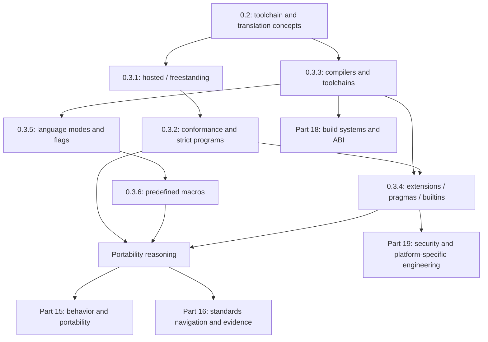

# 00.02 — Implementations and Conformance

**Part:** 00 — ORIENTATION, HISTORY, AND WORKING ENVIRONMENT  
**Chapter level and prerequisites (source):** `L0; prerequisite: 0.2`  
**Chapter source ID:** `C23-P00-CH03`  
**Source outline:** `Kurikulum_C_Final.txt`  
**Status:** Publication-ready teaching chapter. Standards-sensitive claims have been checked against ISO/IEC 9899:2024 and the cited implementation documentation. Compiler support depends on release and target; re-check the cited status pages when updating this chapter.

> **Chapter objective:** By the end of this chapter, you should be able to distinguish hosted and freestanding environments, explain what a conforming implementation guarantees, select a language mode explicitly, recognize extensions, and interpret conformance macros without treating a single macro value as a portability certificate.

---

## How to Read This Chapter

C is a standardized language, but C programs are still translated and executed by a particular implementation for a particular target. Therefore, keep these three questions separate:

1. **What does ISO C promise?** The language standard answers this question.
2. **What does this implementation select or provide?** Compiler, target, runtime, and configuration documentation answer this question.
3. **What actually happened in this build?** The command line, compiler/linker logs, tests, and execution environment provide the evidence.

Do not collapse these questions into the statement, “My compiler supports C.” Support for a language *mode* does not automatically mean that every feature, library, target, or conformance requirement is fully supported.

### Quick Concept Map

| Term | Question it answers |
|---|---|
| Hosted / freestanding | Which execution environment and library facilities are provided? |
| Conforming implementation | What obligations does the implementation have toward programs that satisfy the standard's rules? |
| Strictly conforming program | How completely does the program avoid non-portable dependencies? |
| Compiler / toolchain | Which programs and components translate, link, and execute the code? |
| Extension | Which facilities outside ISO C are provided by the implementation? |
| `-std=...` | Which language dialect or revision is requested during translation? |
| Predefined macros | What information does the implementation expose about its mode and environment? |

---

## Learning and Retention Map

- **Knowledge-unit namespace:** `C23-P00-CH03-Sxx-*`
- **Chapter importance:** Critical — this chapter provides the foundation for reading compiler documentation, evaluating portability, and separating standard guarantees from implementation behavior.
- **Prerequisite:** `0.2` remains the official prerequisite. Connect this chapter to the prerequisite's knowledge unit when its ID is available; do not invent a prerequisite ID.
- **Review scopes:** Chapter → Part → Cross-part → Curriculum.
- **Memory layers:** Atomic (macro names and values), Conceptual (hosted vs. freestanding), Procedural (selecting flags and inspecting a build), Relationship (standard–compiler–target–runtime), and Engineering judgment (setting portability boundaries).

---

# 0.3.1 — Hosted and Freestanding Implementations

**Knowledge-unit ID:** `C23-P00-CH03-S01`  
**Importance:** Critical  
**Retrieval item ID:** `C23-P00-CH03-S01-RET-01`  
**Candidate misconception ID:** `MIS-P00-CH03-S01-01`

## 1. Core Idea

ISO C defines two execution environments: **hosted** and **freestanding**. Their primary differences concern the startup model and the library facilities guaranteed by the implementation—not merely whether the computer has an operating system.

## 2. Mental Model

Think of C as a set of rules for writing programs, while the execution environment is the “stage” on which a program starts and interacts with its surroundings.

- In a **hosted environment**, the implementation provides a general application environment, with startup through `main` and the hosted standard library facilities.
- In a **freestanding environment**, program execution may take place without the benefit of an operating system. The implementation determines the startup function and the library facilities available beyond the required minimum subset.

The analogy “desktop application versus firmware” helps illustrate common cases, but it is not a formal definition. The presence or absence of an operating system is not, by itself, a sufficient test for classifying an implementation. The execution-environment contract defined by the standard and the implementation is what matters.

## 3. Technical Mechanism

### Hosted Environment

When a hosted environment is provided, program startup occurs through a function named `main`. Common standard forms include:

```c
int main(void)
{
    return 0;
}
```

or:

```c
int main(int argc, char *argv[])
{
    (void)argc;
    (void)argv;
    return 0;
}
```

Equivalent forms and other implementation-defined forms are also possible under the standard's rules. `main` is not called by the program's own C code before the runtime; the execution environment starts the program by calling the designated startup function.

A hosted environment provides the hosted standard library. This makes examples such as `printf` and `fopen` relevant to hosted implementations, but each function must still be used according to its own interface and header requirements.

### Freestanding Environment

In a freestanding environment:

- the name and type of the function called at startup are implementation-defined;
- library facilities available beyond the minimum required by the standard are implementation-defined;
- the effect of program termination is implementation-defined.

A freestanding program must not assume that `main` is a universal entry point. Firmware, boot code, kernels, and embedded targets often use startup code, linker scripts, runtimes, or specialized ABIs. Those details come from the toolchain and target, not from a universal `main` rule.

C23 also specifies a subset of facilities that a conforming freestanding implementation must accept. The list and its exceptions are addressed in Clause 4; do not replace them with the inaccurate claim that “freestanding has no standard library at all.”

### Example: Minimal Hosted Program

Save as `hosted_hello.c`:

```c
#include <stdio.h>

int main(void)
{
    puts("hosted: main executed");
    return 0;
}
```

Build and run it with a hosted toolchain:

```sh
gcc -std=c17 -Wall -Wextra -Wpedantic -Werror hosted_hello.c -o hosted_hello
./hosted_hello
```

Expected output:

```text
hosted: main executed
```

This example demonstrates that the program was successfully built and run with that toolchain on that host. It does **not** demonstrate that the same binary can run on a freestanding target.

### `-ffreestanding` Is Not a Magic Switch

With GCC and similar compilers, `-ffreestanding` changes the compiler's assumptions about the environment and can affect predefined macros such as `__STDC_HOSTED__`. However, adding this option to a command does not, by itself, provide startup code, a linker script, runtime-function implementations, device drivers, or all requirements of a conforming freestanding implementation. The target, runtime, libraries, and linking process must still be supplied and verified.

## 4. Formal Boundary

Primary references: ISO/IEC 9899:2024 (C23), Clause 4 and §§5.1.2.1–5.1.2.3. WG14 working draft N3220 contains the public C23 text used as the basis for checking this chapter.

- §5.1.2.1 defines the two execution environments and describes startup and termination in general.
- §5.1.2.2 describes the freestanding environment: the startup function, additional library facilities, and the effect of termination are implementation-defined.
- §5.1.2.3 describes the hosted environment and startup through `main`.
- Clause 4 defines the obligations of conforming hosted and freestanding implementations, including the freestanding library subset.

**Important:** “Freestanding” does not mean “without a compiler,” “without any library,” or “without any standard library functions.” Those are incorrect generalizations. Some minimum facilities remain required by the conformance rules; other facilities depend on the implementation.

## 5. Practical Consequence

When starting a project, explicitly document:

1. the execution target (hosted OS or freestanding target);
2. the startup function and runtime being used;
3. the available libraries and headers;
4. the linking and deployment process;
5. which parts are guaranteed by ISO C and which are determined by the vendor or platform.

For an ordinary CLI application, use hosted assumptions and `main`. For firmware or a kernel, do not copy hosted startup assumptions without checking the target and toolchain documentation.

> **Pitfall — `-ffreestanding` is not proof of conformance.** The flag changes compiler mode and assumptions; it does not automatically turn the entire toolchain into a conforming freestanding implementation.

## 6. Retrieval Question

Without looking at the material: What are C's two execution environments, how does startup differ between them, and why does `-ffreestanding` alone fail to prove that a target satisfies every freestanding requirement?

---

# 0.3.2 — Conforming Implementations, Strictly Conforming Programs, and Execution Environments

**Knowledge-unit ID:** `C23-P00-CH03-S02`  
**Importance:** Critical  
**Retrieval item ID:** `C23-P00-CH03-S02-RET-01`  
**Candidate misconception ID:** `MIS-P00-CH03-S02-01`

## 1. Core Idea

A **conforming implementation** satisfies the obligations imposed by the standard, while a **strictly conforming program** limits itself to standard-defined features and does not make its output depend on unspecified, undefined, or implementation-defined behavior.

## 2. Mental Model

Think of the standard as a two-sided contract:

- the implementation promises to accept and process specified classes of programs;
- a strictly conforming program does not request guarantees beyond that contract.

A program that “compiles on my computer” is not necessarily strictly conforming. Conversely, a program may deliberately use vendor facilities and still be a *conforming program* for that particular implementation, but it is no longer strictly conforming.

### Three Terms That Must Not Be Confused

| Term | Practical meaning |
|---|---|
| Conforming implementation | A hosted implementation is required to accept every strictly conforming program. A freestanding implementation is required to accept strictly conforming programs within the library limits specified by Clause 4. |
| Strictly conforming program | Uses only language and library features specified by the standard; its output does not depend on unspecified, undefined, or implementation-defined behavior; and it does not exceed minimum implementation limits. |
| Conforming program | A program that an individual conforming implementation can accept. It may depend on non-portable features of that implementation. |

Strict conformance does not mean “code without `#ifdef`.” C23 explicitly permits conditional use of features when that use is protected by an appropriate conditional-inclusion directive. The key requirement is that the program continue to satisfy the contract on the relevant implementations.

### Distinguishing Categories of Behavior

Do not label all of these categories “compiler-dependent.”

- **Defined behavior:** the standard specifies the behavior that must occur.
- **Implementation-defined behavior:** the standard permits an implementation choice and requires that choice to be documented.
- **Unspecified behavior:** the standard permits multiple possibilities without requiring the implementation to document which one it chooses.
- **Undefined behavior:** the standard imposes no requirements for the situation.
- **Extension:** an additional facility beyond the ISO C facilities promised by the standard; the implementation's documentation supplies its additional rules.
- **Implementation limit:** a minimum limit required by the standard; a strictly conforming program must not exceed the guaranteed minimum limit.

### Example: Output That Depends on Implementation-Defined Information

The size of `int` is not specified as one universal number. The following program can still be accepted, but its output depends on the implementation:

```c
#include <limits.h>
#include <stdio.h>

int main(void)
{
    printf("int bits (including padding, if any): implementation-specific\n");
    printf("INT_MAX = %d\n", INT_MAX);
    return 0;
}
```

`INT_MAX` is the correct way to inspect the implementation's limit, rather than guessing that `int` is always 32 bits. This example displays information supplied by the implementation; it is not an example of output that must be identical on every system.

### Strictly Conforming Programs and Extensions

A simple example that uses only standard facilities:

```c
#include <stdio.h>

int main(void)
{
    puts("ISO C standard library");
    return 0;
}
```

Compare it with a GNU statement expression:

```c
int main(void)
{
    int value = ({ int temporary = 7; temporary; });
    return value != 7;
}
```

The `({ ... })` form is a GNU extension, not ISO C syntax. GCC may accept the second program in GNU dialect mode, but successful compilation does not make it strictly conforming ISO C.

## 4. Formal Boundary

Reference: ISO/IEC 9899:2024, Clause 4, “Conformance.” In N3220 §4:

- paragraph 5 defines a strictly conforming program;
- paragraph 7 describes conforming hosted/freestanding implementations, extensions, and conforming programs;
- the footnote explains that strictly conforming programs are intended to be maximally portable, whereas conforming programs may depend on non-portable implementation features.

An implementation may provide extensions, provided that those extensions do not alter the behavior of strictly conforming programs. The existence of an extension does not automatically make a compiler “non-conforming”; the standard constrains how extensions interact with strictly conforming programs.

## 5. Practical Consequence

When claiming that a program is “portable,” check more than compile success:

- Are all identifiers, syntax, and library facilities part of the selected standard?
- Does the output depend on an implementation-defined choice?
- Is there unspecified or undefined behavior?
- Does the program exceed a guaranteed minimum limit?
- Are extensions implicitly enabled through GNU dialect mode or vendor headers?

If an application deliberately targets one platform, a non-portable dependency can be a valid engineering decision. Record that dependency as part of the platform contract; do not describe the program as strictly conforming.

> **Pitfall — “accepted by the compiler” is not synonymous with “strictly conforming.”** A compiler may accept an extension, invalid code as an extension, or code whose behavior is not guaranteed by the standard.

## 6. Retrieval Question

Explain the difference between a conforming implementation, a strictly conforming program, and a conforming program. Then classify the use of `({ ... })` in GCC GNU mode: does it prove that the program is strictly conforming?

---

# 0.3.3 — GCC, Clang/LLVM, MSVC, TinyCC, and Other Implementations

**Knowledge-unit ID:** `C23-P00-CH03-S03`  
**Importance:** Core  
**Retrieval item ID:** `C23-P00-CH03-S03-RET-01`  
**Candidate misconception ID:** `MIS-P00-CH03-S03-01`

## 1. Core Idea

GCC, Clang, MSVC, TinyCC, and other compilers are implementations with different language, library, target, extension, and conformance support. A compiler's name alone is not enough to determine what a build can do.

## 2. Mental Model

A compiler is not a single “C enabled” switch. It is more like a combination of layers:

1. a frontend that reads C;
2. a backend that generates code for the target architecture;
3. an assembler and linker;
4. a runtime and standard library;
5. build configuration, sysroot, SDK, and target ABI.

Two machines that both run “GCC” may have different GCC versions, targets, libraries, and options. Therefore, a result on one machine does not automatically apply to another.

## 3. Technical Mechanism

### How to Compare Implementations

| Implementation | What to inspect | Safe note |
|---|---|---|
| GCC | version, `-std=`, `-W...`, target triple, runtime/libc, C status documentation | GCC documentation provides feature-status tables by language revision. GCC 15 makes C23 the default; still select the mode explicitly for reproducible builds. |
| Clang/LLVM | Clang version, target, resource headers, sysroot, C feature status | The Clang status page lists C23 support as partial and provides feature-status details. Do not equate acceptance of `-std=c23` with implementation of every C23 feature. |
| MSVC | Visual Studio/toolset version, `/std:`, Windows SDK, target | The Microsoft documentation reviewed lists `/std:c11` and `/std:c17`; do not assume full C23 mode merely because a newer C++ option exists. Verify the documentation for the actual toolset. |
| TinyCC (TCC) | version/fork, target, libraries, language-mode options | The inspected TCC usage documentation lists `-std=c99` and `-std=c11`; do not infer C23 support from another compiler's options. |
| Embedded/vendor compiler | version, MCU/CPU, ABI, startup, libraries, extensions | Such compilers often provide target-specific intrinsics, pragmas, startup code, and libraries; document them as part of the platform. |

**Date-sensitive note:** Compiler support changes. This table is not a ranking and does not claim that every version in a compiler family has identical capabilities. Before locking a project toolchain, check the official status pages and record the exact version in use.

### A Compiler Is Not the Same as a Toolchain

- The compiler translates source code.
- The assembler converts assembly into object code.
- The linker combines object files and libraries.
- The runtime/startup code prepares the execution environment.
- The standard library provides the APIs specified by the standard.
- The SDK/sysroot provides headers and libraries for the target.

A compiler may accept C23 source while linking fails because the target library lacks a required function or header. Alternatively, compilation may succeed while the binary cannot run because the runtime or ABI is incompatible.

### Build Inventory

For GCC/Clang:

```sh
gcc --version
gcc -dumpmachine
gcc -v
```

or:

```sh
clang --version
clang -print-target-triple
clang -v
```

Also record the complete build command. `-std=c23` without the compiler version and target is not a reproducible build record.

## 4. Formal Boundary

ISO C specifies the standardized language and library. ISO C does not require every vendor to use the same compiler, backend, ABI, operating system, or command-line interface.

Language mode is only one dimension of conformance. Overall conformance remains tied to the implementation, execution environment, and requirements of the standard. Claims about compiler feature support must refer to the documentation for the relevant version.

**Implementation sources reviewed:**

- GCC C status: https://gcc.gnu.org/projects/c-status.html
- Clang C status: https://clang.llvm.org/c_status.html
- Microsoft C/C++ property pages: https://learn.microsoft.com/en-us/cpp/build/reference/c-cpp-prop-page
- TinyCC usage/options: https://github.com/TinyCC/tinycc

## 5. Practical Consequence

Before choosing a compiler for a project:

1. determine the minimum required language revision;
2. determine the target and ABI;
3. check support for the language features actually used;
4. check the available libraries and headers;
5. test compilation, linking, and execution on the intended target;
6. save the compiler version, flags, SDK/sysroot, and test results.

For cross-compiler projects, create a CI matrix. At a minimum, build with a GCC-family compiler and an independent compiler such as Clang when both are available for the relevant target. A second compiler helps reveal hidden assumptions; it is not mathematical proof that a program is portable.

> **Pitfall — “GCC supports C23” is too vague.** State the GCC version, target, language mode, features used, and test status. The same rule applies to Clang, MSVC, TCC, and other vendor compilers.

## 6. Retrieval Question

Why is “I use GCC” insufficient to reproduce a build? Name at least four toolchain components or metadata items that must be recorded.

---

# 0.3.4 — Compiler Extensions, Pragmas, Builtins, and Portability Boundaries

**Knowledge-unit ID:** `C23-P00-CH03-S04`  
**Importance:** Core  
**Retrieval item ID:** `C23-P00-CH03-S04-RET-01`  
**Candidate misconception ID:** `MIS-P00-CH03-S04-01`

## 1. Core Idea

Extensions, pragmas, and builtins provide implementation-defined additional capabilities. They can be useful, but they create portability contracts that must be recognized, contained, and documented.

## 2. Mental Model

Think of ISO C as the commonly agreed public road. An extension is a special lane opened by a vendor. That lane may be faster or provide hardware access, but drivers must know the vendor's rules and must not assume the lane exists everywhere.

This analogy does not mean that every extension is dangerous. Extensions are engineering tools; problems arise when vendor dependencies go unnoticed.

## 3. Technical Mechanism

### Extensions

Example: GNU statement expression:

```c
int square_plus_one(int x)
{
    return ({ int temporary = x * x; temporary + 1; });
}
```

This is accepted in GCC GNU dialect mode, but it is not ISO C syntax. A portable version is:

```c
int square_plus_one(int x)
{
    int temporary = x * x;
    return temporary + 1;
}
```

If an extension is used for a real reason—such as a SIMD intrinsic, register access, or compiler feature—wrap and isolate its use so that the core code does not become scattered with vendor dependencies.

### `#pragma`

A `#pragma` is a preprocessing directive used to communicate implementation-defined instructions, except for standard pragmas defined by ISO C.

Example of a standard pragma related to floating-point behavior:

```c
#pragma STDC FENV_ACCESS ON
```

This pragma has standardized meaning within the context specified by the standard. By contrast, vendor pragmas such as `#pragma GCC diagnostic`, `#pragma clang diagnostic`, or MCU-specific pragmas have their own vendor-defined contracts.

Do not assume that an unrecognized pragma always causes an error. The standard recommends that implementations diagnose unrecognized pragmas, but this is a recommended practice; actual implementation behavior must still be checked.

### Builtins

Builtins are facilities recognized by the compiler, often without an ordinary standard-library function call. GCC and Clang include families such as `__builtin_*`. Their names, types, semantics, target requirements, and optimization behavior must be checked in the documentation for the compiler being used.

Do not guess a builtin's semantics from its name. If an equivalent standard facility exists, prefer it for portable code. If a vendor builtin is genuinely required, place it in one adaptation layer and provide a fallback when feasible.

### Extension Isolation Pattern

```c
/* platform_bits.h */
#ifndef PLATFORM_BITS_H
#define PLATFORM_BITS_H

#if defined(__GNUC__) || defined(__clang__)
    /* Example: vendor family macro detected; this does not prove every builtin exists. */
    #define PROJECT_HAS_GNU_FAMILY_COMPILER 1
#else
    #define PROJECT_HAS_GNU_FAMILY_COMPILER 0
#endif

#endif
```

The macro above detects a compiler family that defines it. It does not prove that the target CPU supports a particular intrinsic or that the compiler version provides the required builtin. Use an official vendor feature test and/or a build probe for that purpose.

## 4. Formal Boundary

Primary references: ISO/IEC 9899:2024 §6.10.8 (`#pragma`) and Clause 4 (conformance/extensions).

- Standard pragmas have rules defined by the standard.
- Non-standard pragmas have implementation-defined behavior.
- Implementations are encouraged to diagnose unrecognized pragmas; this recommendation is not a guarantee that every compiler will reject them.
- Implementations may provide extensions, but extensions must not alter the behavior of strictly conforming programs.

Do not confuse:

- **implementation-defined behavior:** a choice permitted by the standard and required to be documented;
- **extension:** an additional feature that is not part of the ISO C facilities required by the standard;
- **compiler bug:** an implementation failure to follow a rule it is required to follow;
- **conditional feature:** a standard facility whose support is conditional under the standard's mechanisms.

A single vendor facility may have more than one relevant classification (for example, a vendor pragma is an extension whose effects are specified by vendor documentation). Use the correct category rather than calling everything “undefined.”

## 5. Practical Consequence

For every extension used, record:

- the extension name and vendor;
- the minimum compiler version verified;
- the required target/architecture;
- documentation of its semantics and limitations;
- a fallback, or the reason no fallback exists;
- the file or code layer where the extension is permitted;
- build tests that verify the required configuration.

Use ISO mode (`-std=c23`, `-std=c17`, and so on) as the baseline when the project intends to restrict extensions. GNU mode (`-std=gnu23`, `-std=gnu17`) explicitly enables the GNU dialect. Diagnostic options such as `-Wpedantic` help identify some extensions, but they do not prove conformance.

> **Pitfall — a `__` prefix does not make an identifier portable.** Builtin names and identifiers with double underscores often belong to implementation-reserved namespaces. Do not present them as ISO C APIs.

## 6. Retrieval Question

What is the difference between a standard pragma and a vendor pragma? If a program uses `__builtin_*`, what information must be recorded before claiming that the code is portable?

---

# 0.3.5 — Language Versions and Selecting `-std=c90`, `c99`, `c11`, `c17`, or `c23`

**Knowledge-unit ID:** `C23-P00-CH03-S05`  
**Importance:** Critical  
**Retrieval item ID:** `C23-P00-CH03-S05-RET-01`  
**Candidate misconception ID:** `MIS-P00-CH03-S05-01`

## 1. Core Idea

The `-std=` option selects the language dialect/revision requested from the compiler. Selecting a revision explicitly makes a build more predictable, but it does not guarantee that every feature from that revision has been implemented completely.

## 2. Mental Model

Think of `-std=` as selecting an edition of a rulebook. Selecting the 2024 edition tells the compiler which language rules you want to use. However, the compiler is an implementation that may not yet cover every detail of that edition, and the library and target may have separate limitations.

## 3. Technical Mechanism

### Commonly Encountered Revisions

| Common mode | Revision | Commonly specified `__STDC_VERSION__` macro value |
|---|---|---:|
| C90 / C89 | ISO C 1990 / ANSI C 1989 | Macro not available in C90 |
| C95 | Amendment 1 | `199409L` |
| C99 | ISO C 1999 | `199901L` |
| C11 | ISO C 2011 | `201112L` |
| C17 / C18 | ISO C 2017/2018 publication | `201710L` |
| C23 | ISO/IEC 9899:2024 | `202311L` |

C23 is commonly called C23 because of the revision cycle and proposal name, although the published International Standard is ISO/IEC 9899:2024. For C23, the specified version macro value is `202311L`.

### GCC/Clang Option Forms

```sh
# ISO mode (without the GNU dialect)
gcc -std=c17 -Wall -Wextra -Wpedantic -Werror source.c -o app

# GNU mode (ISO revision plus GNU extensions)
gcc -std=gnu17 -Wall -Wextra source.c -o app
```

For C23, compilers that support the final option name use:

```sh
gcc -std=c23 -Wall -Wextra -Wpedantic -Werror source.c -o app
```

Older compilers may provide the experimental name `-std=c2x`. This is a development/preview mode in that implementation, not proof that every detail of ISO/IEC 9899:2024 is available. Do not silently replace `c23` with `c2x` in build documentation.

### ISO Mode vs. GNU Mode

- `-std=c17` requests ISO C17 mode.
- `-std=gnu17` requests GNU C17 mode, which also enables GNU extensions.
- `-std=c23` requests ISO C23 mode.
- `-std=gnu23` requests GNU C23 mode.

This distinction matters for portability. If a project wants vendor extensions to be visible, do not let the compiler default select the dialect accidentally.

### Recommended Diagnostic Flags

For GCC/Clang ISO C exercises:

```sh
-std=c23 -Wall -Wextra -Wpedantic -Werror -pedantic-errors
```

Meaning:

- `-std=c23`: request C23 mode;
- `-Wall -Wextra`: enable commonly useful warning groups;
- `-Wpedantic`: request diagnostics for deviations from the selected ISO mode;
- `-Werror`: treat warnings as errors;
- `-pedantic-errors`: treat diagnostics required by pedantic mode as errors.

This flag set is a **training diagnostic profile**, not a certification that the compiler or program is 100% conforming. Some additional warnings depend on compiler version. For production code, the warning policy should be tested and agreed upon by the team.

MSVC uses different `/std:` options. The Microsoft documentation reviewed lists `/std:c11` and `/std:c17`; do not copy `-std=c23` to MSVC or infer C23 support from `/std:clatest` without checking the current toolset documentation.

### Do Not Rely on Defaults

The default language mode can change between compiler versions. One verified example from GCC documentation: GCC 15 changed the default C mode from GNU17 to GNU23. A build that omits `-std=` can therefore change behavior after a compiler upgrade.

## 4. Formal Boundary

- The `-std=` option is a compiler interface, not syntax required by ISO C.
- Available option names and revisions depend on the implementation.
- `-std=c23` selects a language mode; it does not guarantee implementation of every C23 feature or the entire C23 standard library.
- `-std=gnu23` is not pure ISO mode; it permits GNU extensions.
- `-pedantic` and warning flags are vendor diagnostic mechanisms, not formal proof that a program is strictly conforming.
- C23 is ISO/IEC 9899:2024 (Edition 5, published October 2024). WG14 draft N3220 is the public source used to inspect the text; it does not establish that every compiler has completed its implementation.

## 5. Practical Consequence

For every project:

1. specify the minimum language revision in project documentation;
2. set the language option explicitly in the build system;
3. use ISO mode when extensions are not wanted;
4. enable appropriate diagnostics;
5. record the compiler version and target;
6. run CI after compiler upgrades;
7. do not interpret `__STDC_VERSION__` as a complete list of available features.

> **Pitfall — C23 mode does not mean C23 feature-complete.** A compiler may accept `-std=c23` while its official status page still marks some features as partial, unknown, or unsupported.

## 6. Retrieval Question

What is the difference between `-std=c17` and `-std=gnu17`? Why can a build that does not set `-std=` produce different results after a compiler update?

---

# 0.3.6 — `__STDC__`, `__STDC_VERSION__`, `__STDC_HOSTED__`, and Conformance Macros

**Knowledge-unit ID:** `C23-P00-CH03-S06`  
**Importance:** Critical  
**Retrieval item ID:** `C23-P00-CH03-S06-RET-01`  
**Candidate misconception ID:** `MIS-P00-CH03-S06-01`

## 1. Core Idea

Standard predefined macros provide clues about an implementation, language revision, and execution-environment type. However, none of these macros is, by itself, a certificate that every feature, library, target, and project portability claim has been satisfied.

## 2. Mental Model

Think of macros as labels on a package:

- `__STDC__`: a signal of the implementation's conformance to ISO C;
- `__STDC_VERSION__`: a label for the language revision reported for the translation mode;
- `__STDC_HOSTED__`: a label for the type of execution environment.

Labels help select code paths, but they do not replace inspecting the package contents. To verify a specific feature, use the feature-test macro defined for that feature, compiler documentation, or a build probe.

## 3. Technical Mechanism

### Core Macros

| Macro | Meaning | Interpretation limit |
|---|---|---|
| `__STDC__` | A standard macro with value `1` for a conforming implementation under the relevant standard requirements | Does not prove that the program uses no extensions or that every C23 feature is complete |
| `__STDC_VERSION__` | Identifies the C standard revision reported by the implementation | Not available in C90 mode; the value indicates the mode/revision, not the complete status of every feature |
| `__STDC_HOSTED__` | `1` for a hosted implementation and `0` for a freestanding implementation | Does not describe the startup function, linker script, or every target library in detail |

In C23, `__STDC_VERSION__` has the value `202311L`. This value is an integer constant suitable for preprocessor checks.

### Example: Inspecting Macros

Save as `macro_probe.c`:

```c
#include <stdio.h>

int main(void)
{
#ifdef __STDC__
    printf("__STDC__ = %d\n", __STDC__);
#else
    puts("__STDC__ is not defined");
#endif

#ifdef __STDC_VERSION__
    printf("__STDC_VERSION__ = %ld\n", (long)__STDC_VERSION__);
#else
    puts("__STDC_VERSION__ is not defined");
#endif

#ifdef __STDC_HOSTED__
    printf("__STDC_HOSTED__ = %d\n", __STDC_HOSTED__);
#else
    puts("__STDC_HOSTED__ is not defined");
#endif

    return 0;
}
```

Build with:

```sh
gcc -std=c17 -Wall -Wextra -Wpedantic -Werror macro_probe.c -o macro_probe
./macro_probe
```

Common values for GCC hosted C17 are `__STDC__ = 1`, `__STDC_VERSION__ = 201710`, and `__STDC_HOSTED__ = 1`. Always inspect the actual values reported by the toolchain in use.

### Checking the Revision with Conditional Compilation

```c
#include <stdio.h>

#if defined(__STDC_VERSION__) && __STDC_VERSION__ >= 202311L
# define PROJECT_C23_MODE 1
#else
# define PROJECT_C23_MODE 0
#endif

int main(void)
{
#if PROJECT_C23_MODE
    puts("Compiler reports C23 language mode or later.");
#else
    puts("Compiler does not report C23 language mode.");
#endif
    return 0;
}
```

Pay attention to the word **reports**. This code checks only the macro defined by the compiler. It does not prove that every C23 feature is available or bug-free.

### More Specific Feature-Test Macros

For optional facilities or particular headers/libraries, the standard may provide more specific macros. Examples include `__STDC_NO_*__` macros for particular facilities and header-version macros of the form `__STDC_VERSION_XXXX_H__` in C23. Interpret each specific macro according to the rules for its associated feature or header.

Do not use the following as the only check for every C23 feature:

```c
#if __STDC_VERSION__ >= 202311L
    /* Assume every C23 feature is available. */
#endif
```

Use the feature test relevant to the facility actually required.

### Vendor Macros

Compilers may provide additional macros such as `__GNUC__`, `__clang__`, `_MSC_VER`, or target-CPU macros. These are useful for conditional compilation, but they are not ISO C macros. Detecting a compiler family is also insufficient to detect a particular feature version or CPU capability.

## 4. Formal Boundary

Primary references: ISO/IEC 9899:2024 §§6.10.10.2 (mandatory macros), 6.10.10.1 (predefined macro rules), and the macro requirements associated with relevant headers/features.

- `__STDC__` and `__STDC_HOSTED__` are predefined macros with values specified by the standard for implementations meeting the relevant requirements.
- `__STDC_VERSION__` indicates the language revision; for C23 its value is `202311L`.
- C90 predates the standard-version macro introduced in later revisions; code must check `defined(__STDC_VERSION__)` before comparing its value.
- Vendor macros are not ISO C guarantees.
- A language-mode macro does not prove that a library, target ABI, or every optional/conditional feature is available.

**Formatting note:** `202311L` is an integer literal of type `long int`. When printing it with `printf`, use a matching format specifier. The example above converts it to `long` and uses `%ld`.

## 5. Practical Consequence

Use macros for narrow, verifiable decisions:

- detect a minimum language mode;
- detect hosted/freestanding status when the code genuinely has different paths;
- detect a specific feature-test macro before using an optional facility;
- detect a vendor/target only within a documented adaptation layer.

Avoid turning one macro into a compiler-quality “score.” If a build requires a specific feature, create a small compile test for that feature and run it for every supported compiler/target combination.

> **Pitfall — `__STDC_VERSION__ >= 202311L` does not mean “all of C23 is available.”** The macro identifies the reported language revision, not a feature-completeness table or an implementation-quality guarantee.

## 6. Retrieval Question

Explain the purpose of the three core macros. If a compiler reports `__STDC_VERSION__ == 202311L`, what may and may not be concluded about C23 feature support?

---

# Misconception Defense Registry

This registry contains **concrete, testable misconception cases**. They are diagnostic cases relevant to this chapter, not claims that a particular learner has made these mistakes. A case should be marked resolved only after the learner's diagnostic response and retest have been observed.

| Misconception ID | Incorrect belief | Correct explanation | Why it seems plausible | Relevant chapter | Code/example | Diagnostic question | Correction exercise | Related misconception |
|---|---|---|---|---|---|---|---|---|
| `MIS-P00-CH03-01` | “One successful compile on one machine proves that a program is conforming and portable.” | Compile success shows only that the specific toolchain/configuration accepted the source; strict conformance, execution environment, extensions, and behavior must be audited separately. | The local toolchain is often the only environment tested. | 0.3.1–0.3.6 | A GNU-mode program that builds successfully but uses a statement expression. | Does one compiler's build result prove that a program is strictly conforming on every conforming implementation? | Test the program in ISO mode, identify extensions, and state the limits of the portability claim. | `MIS-P00-CH03-S02-01`, `MIS-P00-CH03-S05-01` |
| `MIS-P00-CH03-S01-01` | “Freestanding means there is no standard library at all and a program cannot use standard headers.” | C23 Clause 4 still specifies a subset of library facilities that a conforming freestanding implementation must accept; other facilities are implementation-defined. | Many firmware projects use small libraries or vendor runtimes, so practical experience is mistaken for a universal rule. | 0.3.1 | Compare a program that uses only facilities in the freestanding minimum subset with one that calls `printf`. | Is `printf` required in every conforming freestanding implementation? Which subset is guaranteed? | Create two lists: the Clause 4 minimum facilities and the additional facilities that must be verified for a particular target. | `MIS-P00-CH03-S02-01` |
| `MIS-P00-CH03-S02-01` | “If the compiler accepts the source, the source is strictly conforming.” | A compiler may accept extensions or non-strict programs; strict conformance imposes tighter limits on features and behavior categories. | Compile success is often treated as the only measure of correctness. | 0.3.2 | GNU statement expression `({ ... })`. | Does acceptance of GNU syntax prove that the syntax is specified by ISO C? | Compile the example in GNU and ISO modes; mark the parts that are not ISO C. | `MIS-P00-CH03-S04-01` |
| `MIS-P00-CH03-S03-01` | “All recent GCC versions have the same features and libraries.” | Version, target, configuration, sysroot, runtime, and libraries affect actual capabilities. | The same product name suggests a single uniform toolchain. | 0.3.3 | Compare `gcc --version`, `gcc -dumpmachine`, and compile/link results. | Why can two GCC installations accept the same language while failing to link differently? | Create a build manifest recording the compiler, target, flags, SDK/sysroot, and libraries. | `MIS-P00-CH03-S05-01` |
| `MIS-P00-CH03-S04-01` | “If a `#pragma` does not produce an error, it must be standard and portable.” | Vendor pragmas may be accepted or ignored depending on the implementation; acceptance does not prove that a pragma is specified by ISO C. | Many unrecognized pragmas do not stop compilation. | 0.3.4 | Compare `#pragma STDC FENV_ACCESS ON` with `#pragma GCC diagnostic`. | Which source defines the semantics of a vendor pragma? | Look up each pragma in the standard and vendor documentation, then classify it. | `MIS-P00-CH03-S02-01` |
| `MIS-P00-CH03-S05-01` | “`-std=c23` guarantees that the compiler supports all of C23.” | The flag selects a language mode; the feature-status table may still show partial/unknown support, and libraries/targets have separate limits. | The option name looks like a declaration of complete support. | 0.3.5 | Compare the mode option with GCC/Clang feature-status pages. | What is the difference between accepting a flag, implementing a feature, and providing a library API? | Select three C23 features used by a project; create separate compile probes and record each feature's status. | `MIS-P00-CH03-S03-01` |
| `MIS-P00-CH03-S06-01` | “If `__STDC_VERSION__` is `202311L`, every C23 feature must be available.” | The macro reports a language revision; specific feature support must be checked through feature-test macros, documentation, or build probes. | A single version number looks easy to use for every decision. | 0.3.6 | `#if __STDC_VERSION__ >= 202311L` detects only the reported mode. | Does this macro test the availability of every C23 function/header? | Select one optional feature, find its correct feature-test macro, and create a compile probe that uses it. | `MIS-P00-CH03-S05-01` |

### Required Repair Loop

1. Present the diagnostic question without revealing the answer.
2. Ask the learner to explain the reasoning, not merely select an option.
3. Identify the exact incorrect assumption.
4. Explain the relevant model and standard rule.
5. Provide a contrasting example that changes one important condition.
6. Retest later with a different example.

Reading a correction is not the same as resolving a misconception. Mark a case resolved only after the learner can explain and apply the distinction to a new case.

---

# Error and Weakness Registry

The following registry provides an **operational template and examples of failure modes relevant to this chapter**. These examples are risks to test for, not records that a particular learner has failed. For an actual learner record, enter the date, response evidence, severity, and status based on observed results.

| Error ID | Chapter | Concept | Error type | Incorrect reasoning / symptom | Correct reasoning | Severity | Repair exercise | Retest | Status |
|---|---|---|---|---|---|---|---|---|---|
| `ERR-P00-CH03-01` | 0.3.1 | Hosted vs. freestanding | Conceptual | Assumes `-ffreestanding` automatically provides target startup and libraries. | A compiler flag does not replace startup objects, linker scripts, runtime, ABI, or target libraries. | Critical | Diagram the target startup path and label what is supplied by the compiler, vendor SDK, linker, and board support package. | Not scheduled | Open — example risk; not assessed for a learner |
| `ERR-P00-CH03-02` | 0.3.2 | Strict conformance | Reasoning | Infers strict conformance from compile success. | Compile success proves only acceptance by that toolchain/configuration; extensions and behavior categories still require an audit. | Critical | Audit a snippet using a GNU statement expression and explain why it is not ISO C. | Not scheduled | Open — example risk; not assessed for a learner |
| `ERR-P00-CH03-03` | 0.3.3 | Toolchain identity | Implementation | Records “GCC” without version, target, or sysroot. | A build must be reproducible using complete compiler and environment metadata. | Core | Create a build manifest from `--version`, target triple, flags, and library paths. | Not scheduled | Open — example risk; not assessed for a learner |
| `ERR-P00-CH03-04` | 0.3.4 | Vendor extension | Design | Calls vendor builtins in many modules without an isolation layer. | Isolate extensions and document requirements/fallbacks so portability can be managed. | Core | Refactor one builtin into a wrapper and add a fallback or a target-only justification. | Not scheduled | Open — example risk; not assessed for a learner |
| `ERR-P00-CH03-05` | 0.3.5 | Language mode | Configuration | Relies on the compiler default, allowing an upgrade to change the dialect. | Set `-std=`/`/std:` explicitly and audit toolchain changes. | Critical | Remove implicit defaults from the build and run CI with the pinned compiler version. | Not scheduled | Open — example risk; not assessed for a learner |
| `ERR-P00-CH03-06` | 0.3.6 | Predefined macros | Recall / reasoning | Uses `__STDC_VERSION__` as the only test for all C23 features. | Use feature-specific macros/probes and feature documentation. | Critical | Create one compile probe for an optional facility and compare it with a general version check. | Not scheduled | Open — example risk; not assessed for a learner |

### Learner Recordkeeping Rules

Every observed error must record: Error ID, date, observed answer/artifact, the assumption that caused the error, correction, severity, repair exercise, retest date, and status (`Open`, `Recovering`, `Resolved`). Do not convert the example risks above into learner history without evidence.

---

# Knowledge Connection Map

This map shows conceptual relationships; it does not replace the curriculum's official prerequisite metadata.



### Relationships You Must Be Able to Explain

- **Prerequisite 0.2 → 0.3.3:** Understanding translation is necessary to distinguish the compiler, linker, runtime, and libraries.
- **0.3.1 ↔ 0.3.2:** The execution environment determines which implementation obligations are relevant; conformance explains the guarantees for particular programs.
- **0.3.3 → 0.3.5:** The compiler and its version determine which language-mode options are available.
- **0.3.5 → 0.3.6:** The selected mode is reflected in the predefined macros reported by the implementation.
- **0.3.4 ↔ 0.3.2:** Extensions can make a program implementation-dependent and affect claims of strict conformance.
- **0.3.6 → 0.3.4:** Vendor macros can help select extension paths, but macro detection does not prove that every facility is available.
- **0.3.2/0.3.4/0.3.5 → Parts 15/16:** Behavior classification, standards auditing, and evidence evaluation require distinguishing the standard from the implementation.

---

# Runnable Lab — Verifying Modes, Macros, and Extensions

The following four tests demonstrate observable behavior. They were run on **GCC 14.2.0, target x86_64-linux-gnu, hosted Linux**, using `-std=c2x` because the compiler available in the verification environment does not provide the final `-std=c23` option name. GCC 14.2 reports `__STDC_VERSION__` as `202000L` in this mode. This is a pre-final implementation result, not the final C23 value `202311L`.

## Compiler Flags

The ISO diagnostic profile used for Tests 1–3:

```sh
-std=c2x -Wall -Wextra -Wpedantic -Werror -pedantic-errors
```

Test 4 deliberately uses GNU dialect mode without `-Wpedantic`, then verifies that the extension is rejected in ISO mode with pedantic errors enabled.

## Test 1 — Hosted Startup and Standard I/O

`lab01_hosted.c`:

```c
#include <stdio.h>

int main(void)
{
    puts("PASS: hosted main and puts");
    return 0;
}
```

Command:

```sh
gcc -std=c2x -Wall -Wextra -Wpedantic -Werror -pedantic-errors \
    lab01_hosted.c -o lab01_hosted
./lab01_hosted
```

Expected output:

```text
PASS: hosted main and puts
```

What this proves: the hosted toolchain tested can build and run a simple program using `main` and `puts`.

What this does not prove: the program was not tested on a freestanding target, and this result is not a certificate of GCC's complete conformance.

## Test 2 — Observing Predefined Macros

`lab02_macros.c`:

```c
#include <stdio.h>

int main(void)
{
#ifdef __STDC__
    printf("__STDC__=%d\n", __STDC__);
#else
    puts("__STDC__ undefined");
#endif

#ifdef __STDC_VERSION__
    printf("__STDC_VERSION__=%ldL\n", (long)__STDC_VERSION__);
#else
    puts("__STDC_VERSION__ undefined");
#endif

#ifdef __STDC_HOSTED__
    printf("__STDC_HOSTED__=%d\n", __STDC_HOSTED__);
#else
    puts("__STDC_HOSTED__ undefined");
#endif

    return 0;
}
```

Command:

```sh
gcc -std=c2x -Wall -Wextra -Wpedantic -Werror -pedantic-errors \
    lab02_macros.c -o lab02_macros
./lab02_macros
```

Output in the verification environment:

```text
__STDC__=1
__STDC_VERSION__=202000L
__STDC_HOSTED__=1
```

Do not copy `202000L` as the final C23 value. It is the result from the tested GCC 14.2 `c2x` mode.

## Test 3 — Conditional Compilation Based on the Reported Revision

`lab03_version_gate.c`:

```c
#include <stdio.h>

#if defined(__STDC_VERSION__) && __STDC_VERSION__ >= 202000L
# define MODE_LABEL "C23-era draft mode or later"
#elif defined(__STDC_VERSION__) && __STDC_VERSION__ >= 201710L
# define MODE_LABEL "C17 mode"
#elif defined(__STDC_VERSION__) && __STDC_VERSION__ >= 201112L
# define MODE_LABEL "C11 mode"
#else
# define MODE_LABEL "older or unreported mode"
#endif

int main(void)
{
    puts(MODE_LABEL);
    return 0;
}
```

Command:

```sh
gcc -std=c2x -Wall -Wextra -Wpedantic -Werror -pedantic-errors \
    lab03_version_gate.c -o lab03_version_gate
./lab03_version_gate
```

Output in the verification environment:

```text
C23-era draft mode or later
```

This check deliberately uses the `202000L` threshold so it can detect the draft mode tested. To check final C23, use `202311L` and a compiler that reports the final value. The label “C23-era” must not be confused with confirmation that every C23 feature is available.

## Test 4 — GNU Extension Accepted in GNU Mode and Rejected in ISO Mode

`lab04_gnu_extension.c`:

```c
int main(void)
{
    int value = ({ int temporary = 7; temporary; });
    return value != 7;
}
```

Test GNU mode:

```sh
gcc -std=gnu2x -Wall -Wextra -Werror \
    lab04_gnu_extension.c -o lab04_gnu_extension
./lab04_gnu_extension
```

Expected result: the program exits with status `0`.

Test ISO mode:

```sh
if gcc -std=c2x -Wall -Wextra -Wpedantic -Werror -pedantic-errors \
    lab04_gnu_extension.c -o lab04_iso_extension 2>lab04_iso.log
then
    echo "FAIL: GNU statement expression unexpectedly accepted"
    exit 1
else
    echo "PASS: ISO pedantic mode rejected GNU statement expression"
fi
```

Expected output:

```text
PASS: ISO pedantic mode rejected GNU statement expression
```

The compilation failure in the second test is the **expected** result, not a lab failure. A statement expression is a GNU extension; this test demonstrates why success in GNU mode does not prove that the source is strictly conforming.

## Verification Record

| Test | Expected condition | Actual result | Status |
|---|---|---|---|
| 1 — Hosted startup | Build and run; output matches | `PASS: hosted main and puts` | **PASS** |
| 2 — Macro probe | Macros can be read; values match GCC 14.2 `c2x` | `1`, `202000L`, `1` | **PASS** |
| 3 — Version gate | C23-era draft path is selected | `C23-era draft mode or later` | **PASS** |
| 4 — GNU extension | GNU mode runs successfully; ISO pedantic mode rejects it | GNU exit `0`; ISO compilation rejected | **PASS** |

**Verification summary:** 4 of 4 test cases passed on GCC 14.2.0 / x86_64-linux-gnu / hosted Linux with the commands shown. Final C23 mode (`-std=c23`) was not tested on this compiler because the available version uses `-std=c2x`. This result does not claim that GCC 14.2 is fully conforming to ISO/IEC 9899:2024.

For reproduction, save the source, compiler version, target triple, build command, stdout, stderr, and exit status with the test results. Never label a test that was not run as PASS.

---

# C23 Standards and Source Verification Record

| Topic | Primary reference | Verified point | Evidence status |
|---|---|---|---|
| Standard identity | ISO/IEC 9899:2024, ISO catalogue | Edition 5; published October 2024 | Verified against ISO catalogue |
| Conformance | ISO/IEC 9899:2024, Clause 4; WG14 N3220 §4 | Strictly conforming program, conforming implementation, extensions | Verified against WG14 document |
| Hosted/freestanding | ISO/IEC 9899:2024, §§5.1.2.1–5.1.2.3 | Two execution environments; startup/library distinctions | Verified against WG14 document |
| Pragmas | ISO/IEC 9899:2024, §6.10.8 | Standard pragma rules and implementation-defined non-standard pragma behavior | Verified against WG14 document |
| Predefined macros | ISO/IEC 9899:2024, §§6.10.10.1–6.10.10.2 | Mandatory macro definitions and C23 version value | Verified against WG14 document |
| GCC support | GCC C status page | C23 mode availability and feature status; GCC 15 default change | Verified against GCC project documentation |
| Clang support | Clang C status page | C23 mode listed as partial; feature status varies | Verified against LLVM/Clang documentation |
| MSVC support | Microsoft Learn C/C++ property pages | `/std:c11` and `/std:c17` options listed | Verified against Microsoft documentation; C23 status requires re-check for the selected toolset |
| TinyCC support | TinyCC project usage/options | Documented `-std=c99` and `-std=c11` options in inspected source | Verified against project source; release/fork-specific |

### Standards and Version Notes

1. ISO catalogue: https://committee.iso.org/standard/82075.html
2. WG14 N3220 (public C23 working draft carrying ISO/IEC 9899:2024 text): https://www.open-std.org/jtc1/sc22/wg14/www/docs/n3220.pdf
3. WG14 project/revision list: https://www.open-std.org/JTC1/SC22/WG14/www/projects.html
4. GCC C status: https://gcc.gnu.org/projects/c-status.html
5. GCC C dialect options (`-ffreestanding`, `-std=`): https://gcc.gnu.org/onlinedocs/gcc/C-Dialect-Options.html
6. GCC 15 changes: https://gcc.gnu.org/gcc-15/changes.html
7. Clang C status: https://clang.llvm.org/c_status.html
8. Microsoft C/C++ property pages: https://learn.microsoft.com/en-us/cpp/build/reference/c-cpp-prop-page
9. TinyCC project source: https://github.com/TinyCC/tinycc

**Source distinction:** ISO/IEC 9899:2024 is the published International Standard. N3220 is the WG14 document used to inspect the public C23 text; when citing clause numbers, cross-check them against the organization's copy of the ISO standard if a contractual audit requires it. GCC/Clang/Microsoft/TinyCC documentation describes their implementations; it does not replace ISO C.

If a claim is not supported by a primary source or the appropriate implementation documentation, mark it **“to be verified with authoritative source”** and do not present it as fact. The “verified” status in this table applies only to claims explicitly summarized in the Verified point column.

---

# Retrieval and Cumulative Review

## Chapter Review

Perform retrieval before opening the material:

1. Explain hosted vs. freestanding, including startup and libraries.
2. Distinguish a conforming implementation, a strictly conforming program, and a conforming program.
3. Name the toolchain layers that must be recorded.
4. Classify extensions, standard pragmas, vendor pragmas, and builtins.
5. Explain ISO mode vs. GNU mode and the risks of compiler defaults.
6. Interpret the three predefined macros without making excessive claims.

After answering, open the material and mark the parts that were incorrect. Do not simply reread the entire chapter.

## Retrieval Question Bank

| Retrieval ID | Prompt | Retrieval mode | Expected evidence |
|---|---|---|---|
| `C23-P00-CH03-S01-RET-01` | How do hosted and freestanding environments differ in startup and libraries? | Precision recall + explanation | Mentions `main`, implementation-defined startup, and the freestanding library subset |
| `C23-P00-CH03-S02-RET-01` | What are the requirements for strict conformance, and how does it differ from a conforming program? | Contrastive retrieval | Mentions standard features, behavior categories, limits, and extensions |
| `C23-P00-CH03-S03-RET-01` | What metadata is required to make a compiler build reproducible? | Transfer retrieval | Version, target, flags, sysroot/SDK, libraries, linker/runtime |
| `C23-P00-CH03-S04-RET-01` | How do extensions, pragmas, and builtins affect portability? | Classification + diagnosis | Separates standard from vendor facilities and mentions isolation/documentation |
| `C23-P00-CH03-S05-RET-01` | Why does `-std=c23` not prove feature completeness? | Explanation + evidence lookup | Mode selection vs. per-feature support |
| `C23-P00-CH03-S06-RET-01` | What can be inferred from `__STDC__`, `__STDC_VERSION__`, and `__STDC_HOSTED__`? | Precision recall + transfer | Meaning and limits of each macro |

## Cumulative Review

### Chapter Scope

Use all six knowledge units and the six retrieval IDs above. Mix definitions, code diagnosis, and configuration choices; do not merely repeat questions with the same wording.

### Part Scope

Include this chapter in the Part 00 end-of-part review, which must contain the roadmap's seven components:

1. core concept recall;
2. definitions and distinctions;
3. code-reading problems;
4. code-writing exercises;
5. error diagnosis;
6. prerequisite connections;
7. short mastery assessment.

Example Part 00 prompts:

- From a build command, identify the compiler, target, mode, and extension risks.
- Read a macro-probe result and determine which conclusions are valid and invalid.
- Explain why firmware does not automatically use `main`.
- Rewrite source that uses a GNU extension in ISO C when there is no technical reason to retain the extension.

### Cross-Part Scope

Connect only to actual prerequisites and knowledge units that use these concepts. Relevant groups in the roadmap include:

- Parts 0–1: toolchain, vocabulary, and translation;
- Parts 10–11: preprocessing, translation units, headers, and libraries;
- Parts 15–16: behavior/portability and standards navigation;
- Part 18: build systems, ABI, and optimization;
- Part 21: the boundary between ISO C and external APIs.

### Curriculum Scope

Rotate through critical knowledge, knowledge that has previously been weak, high-dependency knowledge, and knowledge that has not been reviewed for a long time. Do not test all 175 chapters in one session.

---

# Assessment Record

## 0–4 Scoring Rubric

| Score | Meaning | Evidence |
|---:|---|---|
| 0 | Unable to answer or task is incorrect | Does not recognize the core distinction |
| 1 | Major gap; substantial assistance required | Recalls terminology but confuses the rules |
| 2 | Partially correct; inconsistent or incomplete | Handles a direct case but fails on variations |
| 3 | Correct and independent | Explains and applies the rule to a relevant case |
| 4 | Correct, clear, and transferable | Analyzes a new case, tests evidence, and explains the limits of a claim |

## Assessment Dimensions

| Dimension | Score (0–4) | Evidence / notes |
|---|---:|---|
| Recall | — | Not assessed for a learner |
| Explanation | — | Not assessed for a learner |
| Application | — | Not assessed for a learner |
| Diagnosis | — | Not assessed for a learner |
| Integration | — | Not assessed for a learner |

**Assessment status:** Not assessed. A blank score is not a zero; no learner response has been evaluated. Record the date, prompt, artifact, and scoring rationale when an assessment is actually performed.

**Mastery gate:** Do not mark a critical concept as mastered if it receives a score of 0 or 1, even when the average across other dimensions is high. Mastery also requires delayed retrieval and independent application; reading the chapter or completing the four lab tests is not evidence of learner mastery.

---

# Standard Review Session (20–30 Minutes)

| Step | Activity | Suggested time | Action for this chapter |
|---:|---|---:|---|
| 1 | Free recall | 3–5 min | Write down three distinctions: hosted/freestanding, conforming/strictly conforming, ISO/GNU mode |
| 2 | Precision check | 3–5 min | Define the three predefined macros and the behavior categories |
| 3 | Code reasoning | 5–8 min | Predict the macro-probe output and analyze the GNU extension |
| 4 | Connection review | 3–5 min | Connect the toolchain to translation, the build system, and portability |
| 5 | Error repair | 3–5 min | Repair one open misconception/error |
| 6 | Review scheduling | 1–2 min | Record the score and schedule the next retrieval |

The roadmap's initial schedule is Day 0, 1, 3, 7, 14, 30, 60, and 90. Adjust it based on performance; do not force fixed intervals while the learner is still failing a critical prerequisite.

---

# Quality Assurance Checklist

Before accepting the chapter or a revision:

- [ ] All six subchapters in the chapter scope are present.
- [ ] Every subchapter follows the six required steps in the required order.
- [ ] All six Knowledge-unit IDs, Retrieval IDs, and Candidate Misconception IDs are preserved.
- [ ] Standards claims cite clauses or are marked as unverified.
- [ ] Hosted/freestanding is not reduced to “OS present/OS absent.”
- [ ] A conforming implementation is not confused with a strictly conforming program.
- [ ] GCC, Clang, MSVC, and TinyCC are discussed with version/documentation limits.
- [ ] Extensions, pragmas, builtins, and conditional features are not conflated.
- [ ] `-std=` is distinguished from implementation feature completeness.
- [ ] A version macro is not used as a certificate of feature completeness.
- [ ] Code described as runnable includes build commands and expected results.
- [ ] Tests that were not run are not labeled PASS.
- [ ] The Misconception Defense Registry contains concrete cases, diagnostic questions, correction exercises, and relationships.
- [ ] The Error and Weakness Registry distinguishes example risks from learner errors that were actually observed.
- [ ] The Knowledge Connection Map includes prerequisites and cross-concept relationships.
- [ ] Pitfall boxes highlight likely mistakes.
- [ ] Assessment uses the 0–4 scale and does not invent learner scores.
- [ ] Retrieval questions and cumulative reviews are available at chapter, part, cross-part, and curriculum scopes.
- [ ] Compiler claims are re-checked when toolchain versions change.

---

# Related System-Wide Confusion Families

Select only the families genuinely relevant to this chapter:

- **Preprocessor:** macros, conditional inclusion, pragmas, and translation modes.
- **Behavior:** defined, implementation-defined, unspecified, and undefined behavior.
- **Portability:** standard guarantees, implementation choices, extensions, targets, and libraries.
- **Declarations / translation:** compiler, translation unit, linking, and runtime boundary.

Other families such as arrays/pointers, memory, I/O, and concurrency are not forced into this chapter as primary material; connect them only when an example or actual prerequisite requires it.

---

## Chapter Completion Statement

This chapter is complete when the learner can explain all six subchapters, audit simple portability claims, select a language mode explicitly, interpret macros within their proper limits, and demonstrate reproducible build results. **Completed**, **Retained**, and **Mastered** are distinct statuses: mastery requires evidence of delayed retrieval, independent explanation, application, diagnosis, and transfer.

> The Anti-Forget system is not intended to make learners repeat the curriculum forever. Its purpose is to make important knowledge increasingly independent of repetition while preserving the ability to retrieve, verify, and apply it when needed.

---

*File path: `part-00-orientation-history-toolchain/00.03-implementations-and-conformance.md`*
