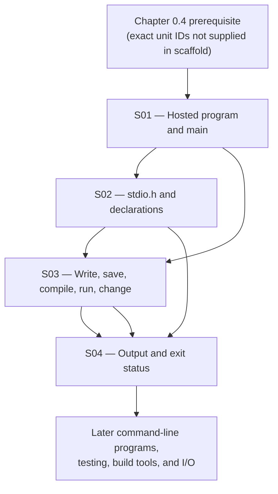

# 00.05 — First Program and the Program Workflow

**Part:** 00 — Orientation, History, and Working Environment  
**Chapter level:** L0 — Discover  
**Prerequisite:** Chapter 0.4 (preserved from source metadata; prerequisite knowledge-unit IDs are not present in this scaffold)  
**Chapter source ID:** `C23-P00-CH05`  
**Source outline:** `Kurikulum_C_Final.txt`  
**Language edition:** English (United States)  
**Status:** Publication-ready instructional draft; compiler checks recorded below; standards references are version-aware and explicitly scoped.

> **Chapter promise:** By the end of this chapter, you will be able to create a minimal hosted C program, explain why its entry point and header matter, compile and run it from a terminal, make a controlled change, and distinguish printed output from the program's termination status.

---

## How to use this chapter

This is a first-contact chapter. It introduces the smallest useful workflow without pretending that one compiler command explains every C implementation.

Work in this order:

1. Read one sub-chapter and study its example.
2. Close the explanation and answer its retrieval question from memory.
3. Type the code yourself. Do not begin by copying and pasting.
4. Compile it, run it, and compare the observed result with the expected result.
5. Change one thing at a time, predict the result, then test the prediction.
6. Record actual errors and scores in the registries near the end of this chapter.

The compiler commands below are for a hosted environment with GCC or Clang available. Android users may use a Linux-like terminal environment such as Termux if a compatible compiler package is installed. The C language rules discussed here are not specific to Android, Termux, Linux, Windows, GCC, or Clang.

## Learning outcomes

After completing the chapter, a learner should be able to:

- identify `main` as the standard startup function in a hosted C program;
- write and explain `int main(void)`;
- explain why `#include <stdio.h>` is used before calling `puts` or `printf`;
- distinguish a header declaration from a function implementation;
- describe the practical edit → save → compile → run → inspect → edit cycle;
- recognize a compiler diagnostic as different from a program's runtime output;
- explain the difference between standard output and an exit status;
- use `return 0;` for successful termination in a hosted program;
- avoid claiming that every compiler command, executable format, or exit-code representation is universal.

---

# 0.5.1 — A Minimal Hosted Program and the `main` Function

**Knowledge-unit ID:** `C23-P00-CH05-S01`  
**Importance:** **Critical** — this is the entry point for nearly every later program-writing exercise in a hosted environment.  
**Retrieval item ID:** `C23-P00-CH05-S01-RET-01`  
**Candidate misconception ID:** `MIS-P00-CH05-S01-01`

## 1. Core idea

In a **hosted C environment**, the implementation starts the program by calling a function named `main`, which a beginner should define with an `int` return type and either no parameters or the standard argument pair.

The smallest conventional example is:

```c
int main(void)
{
    return 0;
}
```

This is a complete minimal hosted C program at the language level. It does not print anything. Its purpose is to make the entry point and successful termination visible without adding unrelated concepts.

## 2. Mental model

Think of `main` as the front door through which a hosted C program begins executing.

- The host environment starts the program.
- The implementation arranges for the initial call to `main`.
- Statements in `main` execute in order, subject to C's rules.
- Returning from the initial call to `main` ends the program and communicates a status to the host environment.

**Limit of the model:** `main` is not a magical operating-system command, and the source file is not executed directly by the CPU as written. The implementation translates and prepares the program, and the hosted execution environment performs startup work before the C function body begins.

## 3. Technical mechanism

### The function definition

```c
int main(void)
{
    return 0;
}
```

Read it from the outside in:

| Source fragment | Meaning |
|---|---|
| `int` | The function's return type is `int`. |
| `main` | The function has the required hosted startup name. |
| `(void)` | The function takes no parameters. |
| `{` and `}` | They delimit the function body. |
| `return 0;` | It ends this call and supplies the integer value zero. |

A function definition provides both the function's interface and its body. In this example, `main` is defined, not merely declared.

The other standard hosted form introduces command-line arguments:

```c
int main(int argc, char *argv[])
{
    (void)argc;
    (void)argv;
    return 0;
}
```

- `argc` is the argument count.
- `argv` is an array of pointers to argument strings.
- `argv[argc]` is a null pointer.
- The values and exact contents of argument strings are supplied by the host environment.

This second form is useful later. For this chapter's first executable, prefer `int main(void)` because it keeps attention on the entry point.

### Hosted versus freestanding

C distinguishes two execution environments:

- A **hosted environment** provides the facilities described for a hosted C implementation, including the standard library facilities covered by the language standard.
- A **freestanding environment** may be used where a complete hosted environment is not available, such as some embedded or operating-system development contexts. Its startup function and available library facilities are implementation-defined, subject to the standard's minimum requirements.

Therefore, do not state that every C program on every device must begin at a function named `main`. That is the hosted-program rule, not a universal description of every freestanding implementation.

## 4. Formal boundary

**Standards basis:** ISO/IEC 9899:2024 (C23), §5.1.2.1 (freestanding environment), §5.1.2.2.1 (hosted program startup), and §5.1.2.2.3 (program termination). The publicly available WG14 document N3220 is a 2024 working draft of the C23 text and is useful for locating these provisions; it is not a substitute for the published ISO standard when a legally authoritative copy is required.

For a hosted implementation, the standard forms include:

```c
int main(void)
int main(int argc, char *argv[])
```

The standard also allows equivalent forms and other implementation-defined forms. That permission does **not** make arbitrary signatures portable. In particular, `void main(void)` is not one of the two standard forms shown above; do not teach it as portable hosted C.

When the return type of `main` is compatible with `int`, returning from the initial call to `main` is equivalent to calling `exit` with the returned value. Reaching the closing brace of `main` without an explicit return produces the effect of returning zero under the standard rule.

Do not confuse these categories:

- **Defined behavior:** the standard specifies the relevant behavior, as with the standard hosted forms of `main`.
- **Implementation-defined behavior:** the implementation chooses and documents a permitted behavior, as with certain implementation-specific startup forms.
- **Unspecified behavior:** the standard permits multiple possibilities without requiring the implementation to document which one occurs.
- **Undefined behavior:** the standard imposes no requirements for the situation.
- **Extension:** a compiler or platform accepts behavior outside the applicable standard language definition.

These labels are not interchangeable. Do not call every nonportable feature “undefined behavior.”

## 5. Practical consequence

For an ordinary beginner command-line program:

1. Write `int main(void)` unless the program needs command-line arguments.
2. Use braces to make the function body explicit.
3. Put executable statements inside the body.
4. Use `return 0;` when you want to state successful completion explicitly.
5. Do not copy nonstandard signatures merely because a tutorial or compiler accepts them.

A compiler accepting `void main(void)` on one platform does not make it a portable hosted C definition.

### Worked example: entry point only

```c
int main(void)
{
    return 0;
}
```

Expected behavior: the program produces no standard output and terminates with a success status.

### Try it

1. Remove `return 0;` and compile in C23 mode. What happens when execution reaches the closing brace?
2. Change `int main(void)` to `void main(void)`. Is that one of the standard hosted forms? Explain before compiling.
3. Add a local variable declaration inside the braces. Does that change which function is the entry point?

## 6. Retrieval question

Without looking back, explain why a beginner hosted C program uses `int main(void)`. Include the meaning of `int`, `main`, and `void`, and state one reason this rule must not be generalized to every freestanding implementation.

**Retrieval check:** A complete answer identifies the hosted environment, the startup role of `main`, the no-parameter meaning of `(void)`, the integer return type, and the freestanding boundary.

---

# 0.5.2 — `#include <stdio.h>` and the Declarations Provided by a Header

**Knowledge-unit ID:** `C23-P00-CH05-S02`  
**Importance:** **Critical** — standard-library use depends on correct declarations and interfaces.  
**Retrieval item ID:** `C23-P00-CH05-S02-RET-01`  
**Candidate misconception ID:** `MIS-P00-CH05-S02-01`

## 1. Core idea

`#include <stdio.h>` asks the preprocessor to make the standard input/output header's declarations available to the translation unit, allowing the program to use the standard I/O interfaces with the correct declared types.

A first visible-output program is:

```c
#include <stdio.h>

int main(void)
{
    puts("Hello, C!");
    return 0;
}
```

Expected standard output:

```text
Hello, C!
```

## 2. Mental model

A header is like an interface card: it tells the compiler what names and types are available and how calls are expected to be formed.

The implementation supplies the corresponding library functionality. The header and implementation work together, but they are not the same thing.

**Limit of the model:** `#include` is not a runtime operation that loads a library when the program reaches that line. It is a preprocessing directive processed before ordinary compilation. Nor does the header necessarily contain the machine-code implementation of every function it declares.

## 3. Technical mechanism

### What the directive means

```c
#include <stdio.h>
```

- `#include` is a preprocessing directive.
- The angle-bracket form requests a header using the implementation's standard-header search rules.
- `stdio.h` is the standard input/output header.
- The directive is handled during preprocessing, before the compiler analyzes the resulting translation unit as C source.

The header provides declarations and definitions required by the standard for its interface. Examples include declarations for standard I/O functions such as `puts` and `printf`, and the `FILE` type and standard stream macros such as `stdin`, `stdout`, and `stderr`.

### A function call needs a declaration

```c
puts("Hello, C!");
```

The compiler needs to know that `puts` is a function with the declared interface. Including `<stdio.h>` makes the appropriate declaration available.

`puts` writes the string to the standard output stream and appends a newline. Its return value indicates success or failure; this introductory example intentionally ignores that return value so the first lesson stays focused. Production code should decide whether output failure matters and handle it when required.

### Header declaration versus implementation

| Item | Role |
|---|---|
| `#include <stdio.h>` | Makes the standard I/O header's interface available during translation. |
| Declaration of `puts` | Tells the compiler the function's interface. |
| Library implementation of `puts` | Supplies executable behavior used when the program runs. |
| Linker | Combines object files and required library components into an executable or another linkable output, according to the toolchain. |

The implementation may use static libraries, shared libraries, built-in compiler knowledge, or another conforming mechanism. The standard specifies the C interface and behavior, not one universal file layout or linker command.

### `puts` versus `printf`

Use `puts` when a plain string followed by a newline is sufficient:

```c
puts("Hello, C!");
```

Use `printf` when formatted output is needed:

```c
printf("The answer is %d.\n", 42);
```

The `\n` in the `printf` example is a newline escape sequence inside the string literal. It is not the same as pressing Enter in the source editor.

For formatted output, every conversion specification must match the type of its corresponding argument. A mismatched format and argument can produce undefined behavior. This chapter uses only the simple, matching `%d` with an `int` example.

## 4. Formal boundary

**Standards basis:** ISO/IEC 9899:2024 (C23), §6.10.2 (source file inclusion), §7.1 (introduction to the library), and §7.23 (input/output, including `<stdio.h>`). The publicly available WG14 N3220 draft provides a navigable C23 text; consult the published ISO/IEC 9899:2024 document for authoritative publication-grade clause verification.

Important boundaries:

- A standard header is included with its standard name, such as `<stdio.h>`.
- A standard header may provide macros, types, objects, and function declarations; it is not accurate to describe every header entry as a function.
- `puts` and `printf` are standard-library functions, not C keywords or operators.
- A hosted implementation provides the standard library facilities required by the hosted standard.
- A freestanding implementation is not required to provide the entire hosted standard library.
- The exact physical location of headers and library binaries is implementation-specific.
- A compiler-specific built-in or extension does not replace the need to understand the standard interface.

Do not include a standard header by inventing a path such as `#include "stdio.h"` merely because it happens to work on one machine. The angle-bracket form expresses the standard-header request.

## 5. Practical consequence

When a program calls a standard-library function:

1. Identify the function's documented header.
2. Include that header before using the interface.
3. Pass arguments that match the declared parameter and format requirements.
4. Read the function's return-value contract when failure is possible or relevant.
5. Avoid assuming that the header contains the function's executable implementation.

### Worked example: one plain line and one formatted line

```c
#include <stdio.h>

int main(void)
{
    puts("First line");
    printf("Second line: %d\n", 2);
    return 0;
}
```

Expected standard output:

```text
First line
Second line: 2
```

### Controlled experiment

Compile the following deliberately incomplete program:

```c
int main(void)
{
    puts("Hello, C!");
    return 0;
}
```

It uses `puts` without including its declaration. A modern compiler in a strict C mode should diagnose this constraint violation. The exact wording and severity of diagnostics are implementation-specific; the important point is that the source has not provided the required declaration.

Now add:

```c
#include <stdio.h>
```

Compile again. The declaration is now available.

Do not “fix” this by manually writing a guessed declaration for `puts`. Include the standard header that owns the interface.

## 6. Retrieval question

What does `#include <stdio.h>` do, when does it happen, and how is that different from the library implementation that performs the actual output? Give one example of a declaration or interface supplied by this header.

**Retrieval check:** A complete answer distinguishes preprocessing from runtime, a header interface from executable implementation, and standard-library functions from language keywords.

---

# 0.5.3 — Writing, Saving, Compiling, Running, and Changing a Program

**Knowledge-unit ID:** `C23-P00-CH05-S03`  
**Importance:** **Critical** — this is the repeatable workflow used to turn source edits into tested program behavior.  
**Retrieval item ID:** `C23-P00-CH05-S03-RET-01`  
**Candidate misconception ID:** `MIS-P00-CH05-S03-01`

## 1. Core idea

A C program is developed through a controlled cycle: write source code, save it, translate it with a suitable implementation, run the resulting program in its environment, inspect the result, and repeat after deliberate changes.

The source file and the executable are different artifacts:

- **Source file:** the human-readable C text, for example `hello.c`.
- **Executable:** the output produced by the toolchain, for example `hello` on a typical Unix-like system.

Editing the source does not automatically update an already-built executable. You must rebuild it.

## 2. Mental model

Think of the workflow as a kitchen recipe:

- The source file is the recipe.
- The compiler and related tools are the preparation process.
- The executable is the prepared dish.
- Running the executable is tasting the result.
- Editing the source and rebuilding is changing the recipe and preparing it again.

**Limit of the model:** a compiler is not merely a text-to-text converter, and a real toolchain may include preprocessing, compilation, assembly, and linking stages. The recipe analogy explains the cycle, not the implementation details.

## 3. Technical mechanism

### Step A — Create a source file

Create a file named `hello.c` with this exact content:

```c
#include <stdio.h>

int main(void)
{
    puts("Hello, C!");
    return 0;
}
```

File extension conventions are not the language itself, but `.c` is the conventional suffix for a C source file and helps tools identify the intended language.

### Step B — Save the file

Save the editor buffer as `hello.c` in a directory you can find from your terminal.

A frequent beginner mistake is editing a file in one directory and compiling a different file with the same name elsewhere. Confirm the current directory and filename before compiling.

Useful shell commands on a Unix-like terminal:

```sh
pwd
ls
```

- `pwd` prints the current working directory.
- `ls` lists entries in that directory.

These are shell commands, not C language statements.

### Step C — Compile with GCC

For GCC 14 or a version that supports the `-std=c23` spelling:

```sh
gcc -std=c23 -Wall -Wextra -Wpedantic -Werror -pedantic-errors hello.c -o hello
```

Meaning:

| Option | Purpose |
|---|---|
| `gcc` | Invokes the GNU Compiler Collection's C compiler driver. |
| `-std=c23` | Requests the C23 language dialect. |
| `-Wall` | Enables a broad set of useful warnings; it does not literally enable every warning. |
| `-Wextra` | Enables additional warnings. |
| `-Wpedantic` | Requests diagnostics for relevant extensions beyond the selected ISO dialect. |
| `-Werror` | Treats warnings as errors. |
| `-pedantic-errors` | Requests errors for required diagnostics concerning nonconforming extensions and related cases. |
| `hello.c` | Names the input source file. |
| `-o hello` | Names the output file `hello`. |

Compiler options and their exact diagnostic coverage are tool-specific. The command is a deliberately strict GCC configuration, not a requirement imposed by ISO C.

For Clang, use:

```sh
clang -std=c23 -Wall -Wextra -Wpedantic -Werror -pedantic-errors hello.c -o hello
```

Clang versions and targets may differ in their level of C23 support. If a compiler does not recognize `-std=c23`, consult that compiler's documentation. Do not silently switch to an older dialect and continue claiming that the build was a C23 build.

### Step D — Run the executable

On a typical Unix-like environment:

```sh
./hello
```

Expected output:

```text
Hello, C!
```

The `./` prefix tells the shell to run the executable named `hello` from the current directory. This is shell behavior, not C syntax.

### Step E — Change one thing

Edit the source:

```c
#include <stdio.h>

int main(void)
{
    puts("Hello from my second build!");
    return 0;
}
```

Save the file, then compile again with the same command:

```sh
gcc -std=c23 -Wall -Wextra -Wpedantic -Werror -pedantic-errors hello.c -o hello
```

Run it again:

```sh
./hello
```

Expected output:

```text
Hello from my second build!
```

The important observation: the new output appears because you rebuilt the executable after saving the changed source.

### What happens during translation?

A hosted implementation commonly performs several conceptual stages:

1. **Preprocessing:** handles directives such as `#include`.
2. **Compilation:** analyzes C language constructs and translates them into a lower-level representation.
3. **Assembly:** may translate assembly output into object code.
4. **Linking:** combines object code and required library components into a program image.

These are useful conceptual stages, not a promise that every compiler exposes four separate commands or intermediate files. A compiler driver may orchestrate them in one command.

## 4. Formal boundary

The C standard specifies the language and translation requirements, but it does not prescribe one universal command-line interface, executable suffix, shell, directory layout, object-file format, or build system.

Distinguish:

- **C language rule:** syntax and semantics defined by ISO C.
- **Implementation/toolchain behavior:** compiler options, diagnostics, object formats, and linking procedures.
- **Shell behavior:** command parsing, paths, redirection, and executable launching.
- **Operating-system behavior:** process creation, executable loading, and the environment's handling of termination status.

The sample GCC/Clang commands are toolchain instructions. They are not portable C source code and will not work unchanged in every environment.

On Windows, executable naming and invocation commonly differ. A GCC/Clang installation may produce `hello.exe`, and the shell may use a different invocation form. Follow the conventions of the installed toolchain and shell.

On Android, a terminal environment may require installation of a compiler package and may have different storage permissions. The C source remains the same; the environment setup and commands may differ.

## 5. Practical consequence

Use this loop every time you make a change:

```text
EDIT → SAVE → COMPILE → RUN → INSPECT → EDIT
```

When something goes wrong, identify the stage:

| Symptom | Likely stage | First action |
|---|---|---|
| The compiler says a file cannot be found | File/path or invocation | Check `pwd`, `ls`, and the filename. |
| The compiler reports a syntax error | Translation | Read the first relevant diagnostic and inspect nearby source. |
| The linker reports an unresolved symbol | Linking | Check declarations, definitions, libraries, and link options. |
| The program starts but prints unexpected text | Runtime behavior | Trace the executed statements and input. |
| You see old output after editing | Build workflow | Save the file and rebuild the executable. |
| The shell says permission denied or command not found | Execution environment | Check executable permissions, path, and platform conventions. |

### Mini-lab: prove that rebuilding matters

1. Compile and run the original `hello.c`.
2. Change the string to `Build number two`.
3. Save the file.
4. Run the old executable **before** recompiling.
5. Observe that it still contains the previous build's behavior.
6. Recompile.
7. Run again and observe the changed output.

The experiment separates the source file from the already-built executable.

## 6. Retrieval question

Reconstruct the complete edit-to-run cycle in the correct order. Explain why saving a changed `.c` file does not, by itself, change the executable that you previously built. Identify which parts of the workflow belong to the C language and which belong to the compiler, shell, or operating system.

**Retrieval check:** A complete answer includes save-before-build, successful translation/linking, running the produced executable, inspecting output, and rebuilding after a source change.

---

# 0.5.4 — Program Exit Status and Program Output

**Knowledge-unit ID:** `C23-P00-CH05-S04`  
**Importance:** **Core** — every hosted program terminates, and scripts or other programs may use its status.  
**Retrieval item ID:** `C23-P00-CH05-S04-RET-01`  
**Candidate misconception ID:** `MIS-P00-CH05-S04-01`

## 1. Core idea

A hosted program communicates through more than printed text: its output streams carry characters, while its termination status reports whether the program completed successfully or unsuccessfully according to the program's contract.

These are separate channels:

- `puts("Done");` writes text to standard output.
- `return 0;` from the initial call to `main` indicates successful termination.

A program can print a success-looking sentence and still return a failure status. It can also return success without printing anything.

## 2. Mental model

Think of a program's output as a message and its exit status as a compact result code.

- The message is intended for a person or another process reading a stream.
- The status is intended for the host environment or a process that launched the program.

**Limit of the model:** the status is an integer value in the C interface, but the way a host environment represents it to a shell or parent process is not universally identical across platforms. Do not infer a universal numeric range or encoding from one operating system.

## 3. Technical mechanism

### Returning from `main`

```c
int main(void)
{
    puts("Work completed.");
    return 0;
}
```

For a hosted program with an `int`-compatible `main`, returning from the initial call to `main` has the effect specified by the standard in relation to `exit`.

The standard also specifies that reaching the closing brace of `main` is equivalent to returning zero. Even so, writing `return 0;` explicitly is useful in beginner code because it makes the success result visible.

### Standard success and failure macros

The `<stdlib.h>` header provides:

- `EXIT_SUCCESS` — a value used to report successful termination.
- `EXIT_FAILURE` — a value used to report unsuccessful termination.

Example:

```c
#include <stdlib.h>

int main(void)
{
    return EXIT_FAILURE;
}
```

This example deliberately returns failure and prints nothing. It is a demonstration of status, not a useful application.

### Output streams

A hosted C program starts with three predefined text streams:

| Stream | Typical purpose | Common function |
|---|---|---|
| `stdin` | Standard input | `getchar`, `scanf` |
| `stdout` | Ordinary program output | `puts`, `printf` |
| `stderr` | Diagnostic/error output | `fprintf(stderr, ...)` |

They are declared or made available through `<stdio.h>`. Their initial association with devices is established by the host environment. A terminal is common, but redirection can associate a stream with a file or another process.

Example:

```c
#include <stdio.h>
#include <stdlib.h>

int main(void)
{
    puts("This is ordinary output.");
    fputs("This is a diagnostic message.\n", stderr);
    return EXIT_SUCCESS;
}
```

`stdout` and `stderr` may appear in different places when redirected. Their separation lets a program's ordinary result remain distinct from diagnostics.

### Check the status in a Unix-like shell

After running a program:

```sh
./hello
echo $?
```

`$?` is a shell parameter that expands to the status of the most recently completed foreground command in common POSIX-style shells. It is not a C variable and is not part of the C language.

For a program that returns success, a typical shell displays:

```text
0
```

The exact host-to-shell mapping is platform-specific. The portable C-level lesson is to use `0` or `EXIT_SUCCESS` for success and `EXIT_FAILURE` for failure, not to assume all hosts expose every integer identically.

## 4. Formal boundary

**Standards basis:** ISO/IEC 9899:2024 (C23), §5.1.2.2.3 (program termination), §7.23 (input/output), and §7.24.4.4 (the `exit` function); `EXIT_SUCCESS` and `EXIT_FAILURE` are provided by `<stdlib.h>` under the standard library specification. The 2024 WG14 N3220 draft can be used to locate the relevant text; consult the published ISO standard for authoritative publication-grade verification.

Important distinctions:

- Returning zero from the initial call to a hosted `main` reports successful termination.
- `EXIT_SUCCESS` is the standard macro for successful termination.
- `EXIT_FAILURE` is the standard macro for unsuccessful termination.
- The host environment receives an implementation-defined form of successful or unsuccessful termination status as specified for `exit`.
- Other status values are not guaranteed to map portably to a particular shell-visible number.
- Output text and exit status are independent.
- Normal termination flushes open output streams as specified by the library rules. Do not generalize that behavior to every abnormal termination path.

Avoid teaching “zero always means success on every computer” without context. In the standard hosted C termination contract, zero and `EXIT_SUCCESS` identify success; the host's external representation is a separate matter.

## 5. Practical consequence

A useful program should make its outcome clear through the right channel:

- Put ordinary results on standard output.
- Put diagnostics on standard error.
- Return a success status only when the program's stated task succeeded.
- Return a failure status when the program could not complete its task as promised.
- Do not rely on a human-readable message as a substitute for a correct status.

For example, a command-line tool may print `Saved report.` and return success if the save operation succeeded. If the save failed, it should report the problem to standard error and return a failure status.

### Worked contrast

Program A:

```c
#include <stdio.h>

int main(void)
{
    puts("Everything worked.");
    return 0;
}
```

Program B:

```c
#include <stdio.h>
#include <stdlib.h>

int main(void)
{
    puts("Everything worked.");
    return EXIT_FAILURE;
}
```

Both print the same text. Their termination statuses differ. Program B demonstrates why output alone cannot prove success.

### Try it

1. Run Program A and inspect the shell status.
2. Run Program B and inspect the shell status.
3. Redirect standard output to a file and observe that the exit status remains a separate result.
4. Change the message but leave the return value unchanged. Did the status change?

## 6. Retrieval question

Explain the difference between standard output, standard error, and exit status. What does returning zero from the initial call to a hosted `main` mean? Why should a program not rely on a sentence printed to the terminal to communicate success to another program?

**Retrieval check:** A complete answer distinguishes character streams from termination status, names the standard success/failure macros, and notes the host-environment boundary.

---

# Integrated First-Program Lab

This lab combines all four knowledge units. Type the program into a file named `hello.c`.

```c
#include <stdio.h>

int main(void)
{
    puts("Hello, C!");
    puts("I wrote, compiled, and ran my first C program.");
    return 0;
}
```

## Expected result

Standard output:

```text
Hello, C!
I wrote, compiled, and ran my first C program.
```

Termination: successful.

## Build with GCC

```sh
gcc -std=c23 -Wall -Wextra -Wpedantic -Werror -pedantic-errors hello.c -o hello
```

## Run

```sh
./hello
```

## Inspect the status in a POSIX-style shell

```sh
echo $?
```

A typical POSIX-style shell reports `0` for this successful run. This shell observation is not a claim that every operating system exposes process status in precisely the same way.

## Change the program

Replace the second message with:

```c
puts("I can change source code and rebuild it.");
```

Save, compile again, and run again. Do not skip the rebuild.

---

# Pitfall Box — Read Before You Copy Code

> **Pitfall 1 — Treating `void main(void)` as portable hosted C.** Use `int main(void)` for the standard beginner form. A compiler extension is not a universal language rule.
>
> **Pitfall 2 — Calling `puts` without its header.** Include `<stdio.h>`; do not rely on an undeclared function or a permissive compiler mode.
>
> **Pitfall 3 — Thinking the header is the function's machine code.** A header provides the interface; the implementation supplies the behavior.
>
> **Pitfall 4 — Running an old executable after editing the source.** Save and rebuild. The executable does not update itself.
>
> **Pitfall 5 — Treating compiler success as proof of correct runtime behavior.** Compilation checks translation constraints and diagnostics; running and testing check behavior.
>
> **Pitfall 6 — Treating printed text as the exit status.** Output streams and termination status are separate.
>
> **Pitfall 7 — Assuming a shell command is part of C.** `gcc`, `./hello`, `pwd`, and `echo $?` are environment/tool commands, not C statements.
>
> **Pitfall 8 — Generalizing hosted rules to freestanding systems.** Embedded and other freestanding implementations can have different startup and library arrangements.

---

# Misconception Defense Registry

These are concrete, technically realistic misconception cases designed for diagnosis and repair. They are **case-based risks**, not claims that this learner has already expressed these beliefs. Mark a learner-specific record as observed only after an actual answer or action demonstrates the belief.

## Registry record `MIS-P00-CH05-01` — The compiler accepts it, so `void main` must be standard

| Field | Record |
|---|---|
| Misconception ID | `MIS-P00-CH05-01` |
| Incorrect belief | “My compiler accepted `void main(void)`, so `void main(void)` is the standard portable form for a hosted C program.” |
| Correct explanation | The standard hosted forms include `int main(void)` and `int main(int argc, char *argv[])`, plus equivalent or implementation-defined forms. A compiler accepting another form may be applying an extension or implementation-specific rule. |
| Why it seems plausible | Beginners often treat the compiler as the authority on the language, and many examples online omit the distinction between standard C and extensions. |
| Relevant chapter | `0.5.1` — minimal hosted program and `main` |
| Code example | `void main(void) { }` versus `int main(void) { return 0; }` |
| Diagnostic question | “Does acceptance by one compiler prove that a form is required by ISO C? What exact hosted forms should you use for portable beginner code?” |
| Correction exercise | Compile both forms in a strict C23 mode with warnings treated as errors. Then explain why a diagnostic result is evidence about that implementation, while the standard text determines portability. |
| Related misconceptions | `MIS-P00-CH05-S01-01`; confusion family: Portability and Behavior |

## Registry record `MIS-P00-CH05-S01-01` — Every C program must start at `main`

| Field | Record |
|---|---|
| Misconception ID | `MIS-P00-CH05-S01-01` |
| Incorrect belief | “Every C program on every device must use `main` as its startup function.” |
| Correct explanation | `main` is the standard startup function for a hosted C program. In a freestanding environment, the startup function's name and type are implementation-defined. |
| Why it seems plausible | Most beginner exercises run on desktop or phone operating systems and therefore use hosted implementations. |
| Relevant chapter | `0.5.1` |
| Code example | Compare a normal hosted command-line program with a freestanding embedded implementation's documented startup contract. |
| Diagnostic question | “Would the hosted `main` rule alone define the startup function of a microcontroller firmware implementation?” |
| Correction exercise | Write two sentences: one scoped to hosted C, one scoped to freestanding C. Do not use “all C programs” in either sentence unless the claim is genuinely universal. |
| Related misconceptions | `MIS-P00-CH05-01`; confusion family: Portability |

## Registry record `MIS-P00-CH05-S02-01` — `#include` loads the library at runtime

| Field | Record |
|---|---|
| Misconception ID | `MIS-P00-CH05-S02-01` |
| Incorrect belief | “When execution reaches `#include <stdio.h>`, the program loads the I/O library.” |
| Correct explanation | `#include` is a preprocessing directive handled before ordinary C execution. It makes the header's interface available during translation; it is not a runtime statement. |
| Why it seems plausible | The word “include” sounds like loading, and beginners first encounter the directive beside calls to library functions. |
| Relevant chapter | `0.5.2` |
| Code example | `#include <stdio.h>` appears before `main`; `puts("Hello");` is executed at runtime. |
| Diagnostic question | “Does the CPU execute the `#include` line when the program starts? At what stage is the directive handled?” |
| Correction exercise | Label each of these as preprocessing-time, translation/link-time, or runtime: `#include <stdio.h>`, a compiler invocation, `puts("Hello");`. |
| Related misconceptions | `MIS-P00-CH05-S02-02`; confusion family: Preprocessor |

## Registry record `MIS-P00-CH05-S02-02` — A header contains the complete function implementation

| Field | Record |
|---|---|
| Misconception ID | `MIS-P00-CH05-S02-02` |
| Incorrect belief | “`stdio.h` contains the machine code for `puts`, so including it performs the output.” |
| Correct explanation | The header provides the declarations and other interface material required for use. The library implementation supplies the function behavior used by the program. |
| Why it seems plausible | The function becomes known to the compiler after the include, so the learner may confuse interface visibility with executable implementation. |
| Relevant chapter | `0.5.2` |
| Code example | `#include <stdio.h>` makes the declaration available; `puts("Hello");` performs output when executed. |
| Diagnostic question | “If the header itself printed the message, why would the program need to call `puts`?” |
| Correction exercise | Draw a three-part chain: header/interface → translation and linking → runtime function call. Explain the role of each part. |
| Related misconceptions | `MIS-P00-CH05-S02-01`; confusion family: Preprocessor and Declarations |

## Registry record `MIS-P00-CH05-S03-01` — Editing source changes the existing executable

| Field | Record |
|---|---|
| Misconception ID | `MIS-P00-CH05-S03-01` |
| Incorrect belief | “I saved a change to `hello.c`, so running `./hello` must use the new code.” |
| Correct explanation | The executable is a built artifact. A source edit changes the source file; the executable changes only after a successful rebuild that incorporates the edit. |
| Why it seems plausible | Editors update the visible text immediately, and some development environments rebuild automatically behind the scenes. |
| Relevant chapter | `0.5.3` |
| Code example | Build version 1, change the string in `hello.c`, run the old executable, then rebuild and run again. |
| Diagnostic question | “What exact operation converts the saved source change into a new executable?” |
| Correction exercise | Perform the mini-lab in 0.5.3 and record the output before and after recompilation. |
| Related misconceptions | `MIS-P00-CH05-S03-02`; confusion family: Preprocessor and Portability |

## Registry record `MIS-P00-CH05-S03-02` — A successful compile proves the program is correct

| Field | Record |
|---|---|
| Misconception ID | `MIS-P00-CH05-S03-02` |
| Incorrect belief | “There were no compiler errors, so the program must do what I intended.” |
| Correct explanation | Successful translation does not prove that runtime behavior meets the program's requirements. The program still needs to be run, observed, and tested. |
| Why it seems plausible | Compiler diagnostics are visible and authoritative for many translation problems, while logic mistakes may produce valid C. |
| Relevant chapter | `0.5.3` |
| Code example | A program that compiles but prints `Goodbye` when the intended output is `Hello`. |
| Diagnostic question | “Can a syntactically valid program still implement the wrong behavior? Give a concrete example.” |
| Correction exercise | Change the expected string in a test without changing the program. Run the test and explain why compilation alone cannot detect the mismatch. |
| Related misconceptions | `MIS-P00-CH05-S03-01`; confusion family: Behavior |

## Registry record `MIS-P00-CH05-S04-01` — Printed success text guarantees success status

| Field | Record |
|---|---|
| Misconception ID | `MIS-P00-CH05-S04-01` |
| Incorrect belief | “If the program prints `Everything worked.`, the operating system must regard it as successful.” |
| Correct explanation | Output text and termination status are independent. The program can print that sentence and return `EXIT_FAILURE`. |
| Why it seems plausible | A human reading the terminal often interprets the message as the final result and ignores the process status. |
| Relevant chapter | `0.5.4` |
| Code example | Compare the two “Worked contrast” programs in 0.5.4; both print the same text but return different statuses. |
| Diagnostic question | “What does a calling script inspect if it needs to know whether the program succeeded?” |
| Correction exercise | Run both contrast programs and inspect the shell status separately from the printed text. |
| Related misconceptions | `MIS-P00-CH05-S04-02`; confusion family: I/O and Behavior |

## Registry record `MIS-P00-CH05-S04-02` — Every host exposes exit codes identically

| Field | Record |
|---|---|
| Misconception ID | `MIS-P00-CH05-S04-02` |
| Incorrect belief | “The integer returned by C `main` is always displayed unchanged as the same numeric value on every operating system and shell.” |
| Correct explanation | C specifies the termination-status contract, including success and failure macros. The host environment's representation and delivery of that status are implementation-defined or platform-specific in relevant respects. |
| Why it seems plausible | A learner repeatedly sees `echo $?` display `0` and assumes the observation is a universal C rule. |
| Relevant chapter | `0.5.4` |
| Code example | `return EXIT_FAILURE;` followed by inspection using the host's documented process-status mechanism. |
| Diagnostic question | “Which part is guaranteed by the C interface, and which part belongs to the host/shell?” |
| Correction exercise | Compare the C source-level meaning of `EXIT_FAILURE` with the process-status documentation for two different host environments. |
| Related misconceptions | `MIS-P00-CH05-S04-01`; confusion family: Portability and Behavior |

### Six-step misconception repair loop

For any misconception that a learner actually demonstrates:

1. Present its diagnostic question before showing the correction.
2. Ask the learner to explain their reasoning in their own words.
3. Identify the exact assumption that caused the error.
4. Present the correct mental model and the applicable rule.
5. Give a contrasting example that changes only the relevant condition.
6. Re-test later with a different example.

A correction is not resolved merely because the learner has read it. Record the learner's answer and later re-test evidence before changing an observed case to resolved.

---

# Error and Weakness Registry

The following entries are **initial diagnostic watch-items**, not invented records of learner failures. Set status to `Open` only when the learner demonstrates the corresponding issue. Until then, retain `Not observed`.

| Error ID | Chapter | Concept | Error type | Incorrect reasoning to watch for | Correct reasoning / repair | Severity | Re-test evidence | Status |
|---|---|---|---|---|---|---|---|---|
| `ERR-P00-CH05-01` | 0.5.1 | Hosted entry point | Standards error | Treats `void main` as a standard hosted form because one compiler accepts it. | Reconstruct the standard hosted forms and explain the implementation-defined boundary. | Critical | Correctly evaluates a new `main` signature example. | Not observed |
| `ERR-P00-CH05-02` | 0.5.2 | Header interface | Conceptual error | Believes `#include` runs at runtime or contains the function's executable code. | Explain preprocessing, declaration visibility, and library implementation as separate roles. | Critical | Correctly classifies a new header/function example. | Not observed |
| `ERR-P00-CH05-03` | 0.5.3 | Rebuild cycle | Application error | Runs a stale executable after editing source and assumes it contains the change. | Save, rebuild, and verify the produced executable. | Critical | Performs a changed-output rebuild without prompting. | Not observed |
| `ERR-P00-CH05-04` | 0.5.3 | Compiler diagnostics | Reasoning error | Treats no compiler error as proof of correct requirements or runtime behavior. | Add runtime observation and an expected-result check. | Core | Finds a validly compiled program with incorrect output. | Not observed |
| `ERR-P00-CH05-05` | 0.5.4 | Output versus status | Conceptual error | Uses a printed message as evidence of successful termination. | Inspect output streams and process status independently. | Core | Correctly explains two programs with identical output and different statuses. | Not observed |
| `ERR-P00-CH05-06` | 0.5.4 | Host status mapping | Portability error | Assumes a shell-visible numeric status is a universal ISO C representation. | Separate the C termination contract from host and shell behavior. | Supporting | Explains a host-specific status observation without universalizing it. | Not observed |

### Error classification guide

- **Knowledge gap:** the learner cannot recall a necessary fact or term.
- **Conceptual error:** the learner has formed an incorrect mental model.
- **Reasoning error:** the learner applies a known rule incorrectly.
- **Application error:** the learner cannot carry out the required workflow.
- **Standards error:** the learner confuses ISO C requirements with extensions or platform behavior.
- **Engineering error:** the learner makes an unreliable workflow or testing decision.

Do not prescribe the same repair for every error. A path typo needs a path check, not a full re-teaching of hosted startup semantics.

---

# Knowledge Connection Map

## Chapter-level dependency map



**Dependency integrity note:** The scaffold specifies Chapter 0.4 as a prerequisite but does not provide its exact knowledge-unit IDs. No prerequisite IDs have been invented. Add exact edges when the authored 0.4 knowledge units are available.

## Knowledge-unit relationship table

| Knowledge unit | Depends on | Supports | Similar concept to distinguish | Practical application | Related confusion |
|---|---|---|---|---|---|
| `C23-P00-CH05-S01` | Chapter 0.4 (unit IDs pending) | Every hosted program example in later chapters | Hosted startup vs freestanding startup | Define a valid hosted entry point | `MIS-P00-CH05-01` |
| `C23-P00-CH05-S02` | S01 for the first complete output program | Standard I/O, library use, formatted output, file streams | Header declaration vs function implementation | Use `puts` and `printf` through declared interfaces | `MIS-P00-CH05-S02-01`, `-02` |
| `C23-P00-CH05-S03` | S01 and S02 | Build systems, debugging, testing, project work | Source file vs object file vs executable | Rebuild after source changes | `MIS-P00-CH05-S03-01`, `-02` |
| `C23-P00-CH05-S04` | S02 and S03 | Error handling, automation, shell pipelines, robust CLI design | Output stream vs termination status | Communicate results to users and calling processes | `MIS-P00-CH05-S04-01`, `-02` |

## Relationship prompts

Answer these periodically:

1. Which prerequisite ideas from Chapter 0.4 are needed to understand a C source file and its environment?
2. Why does `main` belong to the hosted startup model, while `puts` belongs to the standard library?
3. How does the preprocessor's handling of `<stdio.h>` relate to the later link and runtime stages?
4. Why can a correct compile still be followed by an incorrect runtime result?
5. How do output streams and exit status cooperate without being the same thing?

---

# Retrieval Bank

Attempt each question before reopening the teaching section. Use free recall first; then check the answer criteria.

## Atomic recall

1. What is the conventional minimal hosted C entry-point definition?
2. What does `(void)` mean in `int main(void)`?
3. Which standard header provides the `puts` interface?
4. Is `puts` a C keyword, a compiler command, or a standard-library function?
5. What does `puts` append after the supplied string?
6. What does `return 0;` communicate when executed by the initial call to a hosted `main`?

## Precision and contrast

7. Explain the difference between a hosted and a freestanding environment.
8. Explain the difference between a header declaration and a library implementation.
9. Explain why `#include` is not executed at runtime.
10. Explain the difference between a `.c` source file and a compiled executable.
11. Explain why editing a source file does not automatically update an existing executable.
12. Explain the difference between standard output, standard error, and exit status.

## Code prediction

13. What text does this program write, and what status does it return?

```c
#include <stdio.h>

int main(void)
{
    puts("Ready");
    return 0;
}
```

14. Does this program print a line?

```c
int main(void)
{
    return 0;
}
```

15. Do these two programs have the same output? Do they have the same termination status?

```c
#include <stdio.h>

int main(void)
{
    puts("Done");
    return 0;
}
```

```c
#include <stdio.h>
#include <stdlib.h>

int main(void)
{
    puts("Done");
    return EXIT_FAILURE;
}
```

## Error diagnosis

16. A compiler accepts `void main(void)`. What can and cannot be concluded from that observation?
17. A program compiles without errors but prints the wrong message. Which workflow stage should be investigated?
18. A learner edits `hello.c`, runs `./hello`, and sees the old message. Name the missing workflow action.
19. A script must know whether a program succeeded. Why is checking the printed sentence insufficient?
20. A tutorial says that every C implementation must provide the same hosted standard I/O facilities. What execution-environment distinction must be checked?

## Transfer and engineering judgment

21. A program is intended to run on both a hosted desktop and a freestanding microcontroller. Which assumptions in this chapter must be re-evaluated?
22. A compiler's default mode accepts a feature, but strict C23 mode diagnoses it. What evidence would you gather before calling the feature portable?
23. A build command succeeds on Linux but not on Windows. Is that automatically a C language defect? Explain the possible toolchain and shell causes.
24. Design a minimal test that checks both a program's printed output and its termination status.

### Retrieval answer criteria

Do not grade a response as correct merely because it contains the right keyword. A good response reconstructs the relationship:

- **S01:** hosted startup → `main` → integer return → freestanding boundary.
- **S02:** preprocessing → header interface → declared library call → runtime behavior.
- **S03:** source → save → toolchain → executable → run → inspect → rebuild after change.
- **S04:** output streams → termination status → host mapping → separate checks.

---

# Cumulative Review

The roadmap requires four review scopes: Chapter, Part, Cross-part, and Curriculum. Review intervals are suggestions and must be adjusted to performance rather than followed as an inflexible punishment queue.

## Chapter review — this chapter only

Complete all seven activities:

1. **Core concept recall:** Explain the purpose of `main`, `<stdio.h>`, the build workflow, and exit status without opening the chapter.
2. **Definitions and distinctions:** Contrast hosted/freestanding, declaration/implementation, source/executable, stdout/stderr/status.
3. **Code reading:** Predict the output and status of the three examples in the Retrieval Bank.
4. **Code writing:** Type the integrated first-program lab from memory.
5. **Error diagnosis:** Diagnose one missing-header example and one stale-executable example.
6. **Prerequisite connection:** Explain which ideas from Chapter 0.4 are needed; add exact unit links when that chapter's authored IDs are available.
7. **Short mastery assessment:** Score Recall, Explanation, Application, Diagnosis, and Integration from 0–4.

## Part review — Part 00

This chapter contributes to the seven mandatory Part 00 review items:

1. **Core concept recall:** Reconstruct the path from source file to hosted program execution.
2. **Definitions and distinctions:** Distinguish source code, preprocessing, compilation, linking, executable, runtime output, and exit status.
3. **Code reading:** Read a small program and identify its entry point, header dependencies, output, and return value.
4. **Code writing:** Create, compile, and modify a minimal hosted program.
5. **Error diagnosis:** Diagnose an invalid entry-point assumption, a missing declaration, a stale executable, and a misleading success message.
6. **Prerequisite connections:** Connect this chapter to Chapter 0.4 and to later language/toolchain chapters using the curriculum's actual prerequisite graph.
7. **Short mastery assessment:** Demonstrate independent completion of the workflow and explain its portability boundaries.

This is not a claim that the other Part 00 chapters have been reviewed here. It is the contribution of Chapter 0.5 to the required Part 00 review design.

## Cross-part review

Use only the relationship groupings that actually apply:

- **Parts 1–5:** translation concepts, declarations, types, expressions, control flow, and functions build on the ability to read and compile a C program.
- **Parts 9–11:** I/O, translation, and standard-library chapters deepen the distinction between headers, library interfaces, streams, and runtime behavior.
- **Parts 17–20:** algorithms, toolchains, testing, and engineering practice reuse the edit/build/run/inspect cycle.

These are roadmap-level suggested connections, not replacements for exact chapter prerequisites.

## Curriculum review

Do not ask the learner to recall all 175 chapters in one sitting. Sample:

- critical knowledge such as the hosted entry point and rebuild workflow;
- previously weak knowledge from the Error and Weakness Registry;
- high-dependency knowledge such as header declarations and standard I/O;
- knowledge not reviewed recently;
- concepts from different levels and parts.

A short mixed review is preferable to an exhausting attempt to recite the entire curriculum.

## Suggested retrieval schedule

| Review point | Suggested task |
|---|---|
| Day 0 | Complete the chapter, type the integrated program, and answer all four retrieval questions. |
| Day 1 | Reconstruct `main`, header purpose, and the edit/build/run cycle from memory. |
| Day 3 | Predict output and status for unseen short examples. |
| Day 7 | Complete the integrated lab without copying the source. |
| Day 14 | Diagnose a stale executable and a status/output mismatch. |
| Day 30 | Complete the seven-item Part 00 review contribution. |
| Day 60 | Rebuild the program in a different supported environment and explain which commands changed. |
| Day 90 | Complete a mixed cross-part review and a standards lookup task. |

Intervals are defaults, not guarantees of retention. Move a review earlier after an error; lengthen the interval after repeated independent success.

---

# Assessment Record and Mastery Gate

## Scoring rubric: 0–4

| Score | Meaning | Evidence |
|---:|---|---|
| **0** | Cannot answer or performs the task incorrectly | No usable recall or a critical misunderstanding remains. |
| **1** | Major gaps; substantial help required | Can repeat fragments but cannot reconstruct or apply the rule. |
| **2** | Partially correct; inconsistent or incomplete | Understands part of the idea but misses a boundary or needs prompts. |
| **3** | Correct and independent | Explains and applies the knowledge accurately without assistance. |
| **4** | Correct, clear, and transferable | Explains, applies, diagnoses, and transfers the concept to a new context. |

## Assessment dimensions

| Dimension | What is assessed | Suggested evidence |
|---|---|---|
| Recall | Retrieves the central facts | Reconstructs the hosted entry point and workflow from memory. |
| Explanation | Explains mechanisms and boundaries | Distinguishes header processing from runtime library behavior. |
| Application | Performs the task | Writes, compiles, runs, and changes the program independently. |
| Diagnosis | Finds and explains errors | Diagnoses a missing declaration, stale executable, or status mismatch. |
| Integration | Connects concepts | Explains how source, header, toolchain, output, and status fit together. |

## Current assessment record

| Dimension | Score (0–4) | Evidence / notes |
|---|---:|---|
| RecalRecall | — | Not assessed; no learner response supplied. |
| Explanation | — | Not assessed; no learner explanation supplied. |
| Application | — | Not assessed; learner execution not observed. |
| Diagnosis | — | Not assessed; no diagnostic response supplied. |
| Integration | — | Not assessed; no transfer task observed. |

**Status:** `Not assessed`.

Do not convert a publication-ready chapter or a passing sample-program test into a claim that a learner has mastered the chapter. Content quality, code validation, learner completion, delayed retention, and mastery are separate records.

### Mastery gate

A learner may be considered mastered only when there is evidence that they can:

1. retrieve the critical concepts accurately;
2. explain the principal mechanisms in their own words;
3. handle important distinctions, especially hosted/freestanding and output/status;
4. complete the relevant application task independently;
5. avoid or correctly repair the critical misconceptions;
6. retain the knowledge in a later cumulative review.

A critical concept scoring 0 or 1 blocks mastery even if the overall average is high.

---

# C23 Standards and Source-Verification Record

This chapter is standards-sensitive because introductory tutorials often mix hosted C, compiler conventions, shell behavior, and historical language versions.

| Topic | C23 source location to consult | Claim used in this chapter | Verification status |
|---|---|---|---|
| Execution environments | §5.1.2.1 and §5.1.2.2 | Hosted and freestanding environments have different startup/library guarantees. | Checked against public WG14 N3220 (2024 C23 working draft); confirm against licensed ISO publication for formal audit. |
| Hosted program startup | §5.1.2.2.1 | Standard hosted forms include `int main(void)` and `int main(int argc, char *argv[])`, with equivalent and implementation-defined alternatives. | Checked against public WG14 N3096/N3220 draft text. |
| Program termination | §5.1.2.2.3 | Returning from the initial call to an `int`-compatible `main` is equivalent to calling `exit`; reaching its closing brace returns zero. | Checked against public WG14 draft text. |
| Source inclusion | §6.10.2 | `#include` is a preprocessing directive for source-file inclusion. | Clause identified; final ISO pagination not asserted. |
| Standard I/O header | §7.23 | `<stdio.h>` supplies the standard I/O interface. | Clause identified in public C23 draft; individual declaration synopsis should be checked in the published standard when doing a formal standards audit. |
| `exit` and status | §7.24.4.4 | `EXIT_SUCCESS` and `EXIT_FAILURE` identify successful and unsuccessful termination; host representation is not a universal shell-number promise. | Checked against public WG14 N3220 draft text. |
| GCC/Clang command options | Compiler documentation | The command examples request C23 and strict diagnostics. | Tool-specific; tested in the environment recorded below. Not an ISO C guarantee. |
| Shell commands/status | Shell/platform documentation | `./hello`, `pwd`, `ls`, and `$?` are environment-specific command conventions. | POSIX-style shell convention for examples; not an ISO C rule. |

## Source references

1. **WG14 N3220 — ISO/IEC 9899:2024 (E), C23 working draft.** Public WG14 document: <https://www.open-std.org/jtc1/sc22/wg14/www/docs/n3220.pdf>
2. **WG14 N3096 — ISO/IEC 9899:2023 (E), C23 working draft, April 1, 2023.** Useful for cross-checking hosted startup and termination text: <https://www.open-std.org/jtc1/sc22/wg14/www/docs/n3096.pdf>
3. **GCC documentation:** <https://gcc.gnu.org/onlinedocs/>
4. **Clang documentation:** <https://clang.llvm.org/docs/>

**Normative versus explanatory:** ISO/IEC 9899 is the normative language standard. WG14 working drafts are committee documents useful for public inspection and clause navigation, but this chapter does not claim that a working draft is itself the published ISO document. Compiler manuals and shell manuals document their respective tools/environments; they do not define ISO C.

**Historical caution:** A tutorial written for C89/C90, C99, C11, or C17 may contain statements that need version checks. In particular, the rule that reaching the closing brace of `main` returns zero is not safe to project backward onto every historical C edition. This chapter teaches the C23 rule and does not silently rewrite historical behavior.

**Unverified claims policy:** No exact ISO page numbers are asserted. If the published standard's exact clause wording or pagination is required for an external compliance audit, verify directly against the licensed ISO/IEC 9899:2024 publication and update this table with the verified page and paragraph references.

---

# Code Validation Record

## Program under test

The integrated lab program is the canonical example:

```c
#include <stdio.h>

int main(void)
{
    puts("Hello, C!");
    puts("I wrote, compiled, and ran my first C program.");
    return 0;
}
```

## Validation profile

Strict diagnostics are used to catch common beginner mistakes early:

```sh
-std=c23 -Wall -Wextra -Wpedantic -Werror -pedantic-errors
```

This is a deliberately strict teaching profile, not a claim that these flags are required by C23 or ideal for every production build. `-Werror` can make builds sensitive to compiler-version warning changes; teams should select and document their own warning policy.

## Four acceptance checks

| Check | Acceptance criterion | Result |
|---|---|---|
| **1 — GCC C23 compile** | GCC compiles the canonical program with the stated strict flags and no diagnostics that fail the build. | **PASS** |
| **2 — Clang C23 compile** | Clang compiles the canonical program with the stated strict flags and no diagnostics that fail the build. | **PASS** |
| **3 — Exact output** | Running the GCC-built executable produces exactly the two expected lines on standard output. | **PASS** |
| **4 — Successful termination** | The canonical program returns a successful termination status; the test process observes status zero in this validation environment. | **PASS** |

<details>
<summary>Validation environment and reproducibility notes</summary>

- GCC: `gcc (Debian 14.2.0-19) 14.2.0`
- Clang: `clang version 17.0.0`
- Host used for this recorded validation: Linux x86-64 container environment.
- The program was compiled with `-std=c23 -Wall -Wextra -Wpedantic -Werror -pedantic-errors`.
- The exact-output check compared the captured output, including the final newline, with the expected two-line string.
- The status check observed a zero exit status from the executable.
- These results validate the exact sample program and the listed toolchain versions in this environment. They do not prove compatibility with every C implementation, target, shell, or Android installation.

</details>

**Validation result: 4/4 PASS** for the canonical sample program in the environment described above. The result is not a claim that every code fragment in the chapter is a standalone program; several fragments are deliberately partial examples or diagnostic exercises.

---

# CTM Operational Notes

## Importance and review priority

| Knowledge unit | Importance | Reason | Default review priority |
|---|---|---|---|
| `C23-P00-CH05-S01` | Critical | Hosted entry-point knowledge is foundational to executable examples. | Highest |
| `C23-P00-CH05-S02` | Critical | Correct standard-header use supports standard-library programming. | Highest |
| `C23-P00-CH05-S03` | Critical | The source/build/run workflow is required for every practical C exercise. | Highest |
| `C23-P00-CH05-S04` | Core | Status/output separation is essential for robust tools and automation. | High |

## Review workload

Use the roadmap's suggested allocation as a flexible planning aid:

- New knowledge: approximately 30%.
- Scheduled retrieval: approximately 40%.
- Cumulative/mixed review: approximately 20%.
- Weakness repair: approximately 10%.

These percentages are illustrative, not mandatory fixed allocations. If reviews are missed, prioritize critical prerequisites, material needed by the current chapter, overdue core concepts, and then supporting material. Do not force the learner to clear an unmanageable backlog in one sitting.

## Standard review session

A 20–30 minute session can use this sequence:

| Step | Activity | Suggested time | Required action |
|---:|---|---:|---|
| 1 | Free recall | 3–5 min | Write what is remembered without opening the chapter. |
| 2 | Precision check | 3–5 min | Answer definitions and contrast questions. |
| 3 | Code reasoning | 5–8 min | Predict, trace, modify, or diagnose a C program. |
| 4 | Connection review | 3–5 min | Explain links to prerequisite and later knowledge. |
| 5 | Error repair | 3–5 min | Repair one demonstrated misconception or weakness. |
| 6 | Scheduling | 1–2 min | Record scores and set the next review interval. |

Adapt the time to the learner's actual performance. The session length is a default, not a rigid rule.

## Dashboard fields for this chapter

| Metric | Current value |
|---|---|
| Chapters completed | Not recorded |
| Chapters retained | Not assessed |
| Chapters mastered | Not assessed |
| Critical knowledge at risk | Not assessed |
| Reviews due | Day 0 after first study |
| Overdue reviews | None recorded |
| Open misconceptions | None observed; seven concrete diagnostic cases documented |
| Weak prerequisite concepts | Chapter 0.4 exact unit-level evidence pending |
| Cumulative assessment results | Not assessed |
| Standards verification status | Draft checked against public WG14 C23 working-draft text; final ISO publication audit still recommended |

---

## Chapter completion checklist

- [ ] I can write `int main(void)` and explain each part.
- [ ] I can explain the hosted/freestanding distinction without overgeneralizing.
- [ ] I know why `<stdio.h>` is included before using `puts`.
- [ ] I can distinguish a header interface from a library implementation.
- [ ] I can create and save a `.c` source file.
- [ ] I can compile the source with the compiler installed in my environment.
- [ ] I can run the executable and recognize the output.
- [ ] I can change the source, rebuild, and verify the new behavior.
- [ ] I can distinguish standard output, standard error, and exit status.
- [ ] I can explain why compiler acceptance alone does not establish portability.
- [ ] I have answered all four sub-chapter retrieval questions without looking.
- [ ] I have completed a delayed cumulative review before claiming retention or mastery.

---

*File path: `part-00-orientation-history-toolchain/00.05-first-program-workflow.md`*  
*Chapter source ID and all original knowledge-unit, retrieval-item, and candidate-misconception identifiers are preserved.*
