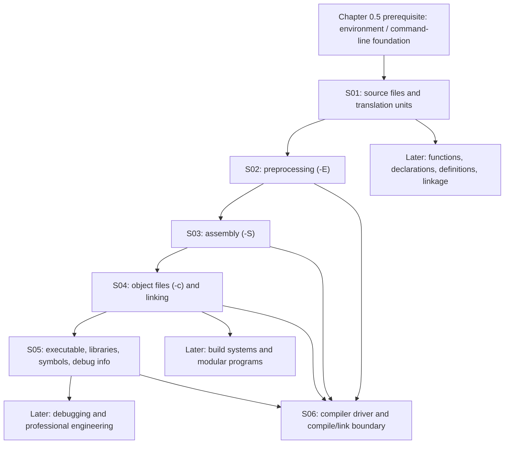

# 00.06 — Translation Stages and the C Toolchain

**Part:** 00 — Orientation, History, and Working Environment  
**Chapter level and prerequisites:** `L0; prerequisite: 0.5`  
**Chapter source ID:** `C23-P00-CH06`  
**Source outline:** `Kurikulum_C_Final.txt`  
**Knowledge-unit namespace:** `C23-P00-CH06-Sxx-*`  
**Status:** Publication-ready instructional chapter; standards-sensitive claims are scoped and source-labeled below.

> **Chapter promise:** By the end of this chapter, you can follow a C program from source text to a runnable program, stop a compiler driver at useful intermediate stages, diagnose whether a failure belongs to preprocessing, compilation, assembly, or linking, and inspect the artifacts without confusing implementation details with ISO C guarantees.

---

## Chapter scope

- **0.6.1** — Source file, preprocessing, translation unit, compiler, assembler, linker
- **0.6.2** — Preprocessing with `-E`
- **0.6.3** — Assembly generation with `-S`
- **0.6.4** — Object files with `-c` and linking
- **0.6.5** — Executables, libraries, symbols, and debug information
- **0.6.6** — Compiler driver; compile-time versus link-time

## How to use this chapter

1. Read a subchapter once for understanding.
2. Hide it and answer its retrieval question before rereading.
3. Run the commands in the lab using a compiler available on your system.
4. When a command fails, classify the failure by stage before changing code.
5. Record any incorrect prediction in the Error and Weakness Registry. A correction is not resolved until a later, different example is answered independently.

The command examples use GCC-compatible driver syntax on a Unix-like shell. Clang supports many of the same options. These are **toolchain conventions**, not C language syntax. Windows toolchains and other compilers may use different commands, file extensions, object formats, linkers, and executable formats.

---

## Learning and retention map

### Knowledge units

| Knowledge unit | Importance | Main memory layers | Prerequisite |
|---|---|---|---|
| `C23-P00-CH06-S01` | **Critical** | Atomic, conceptual, relationship | Chapter 0.5: prerequisite `0.5` |
| `C23-P00-CH06-S02` | **Core** | Atomic, procedural, engineering judgment | `S01` |
| `C23-P00-CH06-S03` | **Core** | Atomic, procedural, relationship | `S01`, `S02` |
| `C23-P00-CH06-S04` | **Critical** | Atomic, procedural, relationship, engineering judgment | `S01`, `S03` |
| `C23-P00-CH06-S05` | **Core** | Conceptual, relationship, engineering judgment | `S04` |
| `C23-P00-CH06-S06` | **Critical** | Atomic, procedural, relationship, engineering judgment | `S02`–`S05` |

**Why these importance levels:** `S01`, `S04`, and `S06` are critical because confusing translation units, object files, or the link stage causes recurring build and modular-programming errors. `S02`, `S03`, and `S05` are core because they support diagnosis and inspection, but learners can initially write small programs without routinely inspecting those artifacts.

### Memory layers

- **Atomic:** Know what `-E`, `-S`, and `-c` request.
- **Conceptual:** Explain the difference between source text, a translation unit, an object file, and an executable.
- **Procedural:** Run staged builds and identify the output artifact.
- **Relationship:** Explain why separate source files can be compiled independently but still need linking.
- **Engineering judgment:** Choose the stage that provides the evidence needed to debug a failure.

### Review scopes

`Chapter → Part 00 → Cross-part (especially functions, declarations/linkage, headers, and build systems) → Curriculum`

Do not invent a prerequisite link to a chapter that has not yet been authored. Keep the source prerequisite metadata `0.5` intact.

---

# 0.6.1 — Source Files, Preprocessing, Translation Units, Compiler, Assembler, and Linker

**Knowledge-unit ID:** `C23-P00-CH06-S01`  
**Retrieval item ID:** `C23-P00-CH06-S01-RET-01`  
**Candidate misconception ID:** `MIS-P00-CH06-S01-01`

## 1. Core idea

A C program is translated through a sequence of conceptual stages; the compiler driver coordinates tools that transform source files into object files and then combine the required object files and libraries into a program image.

## 2. Mental model

Think of a toolchain as a production line:

- **Source file:** the authored input.
- **Preprocessor:** expands directives and macros and handles included files.
- **Compiler proper:** analyzes C and generates lower-level code.
- **Assembler:** turns assembly text into machine-code object data.
- **Linker:** combines object files and libraries and resolves references.
- **Compiler driver:** the coordinator that invokes these tools with suitable options.

This model is useful for locating failures, but it is not a promise that every compiler literally runs one separate executable per stage. Implementations may combine stages, use intermediate representations, invoke integrated assemblers, or perform link-time optimization. ISO C specifies translation behavior conceptually; it does not mandate GCC, ELF, `.o`, `ld`, or a particular pipeline executable.

## 3. Technical mechanism

### The key vocabulary

| Term | Meaning | Do not confuse it with |
|---|---|---|
| **Source file** | A file containing source text supplied to translation; common suffix: `.c` | A translation unit |
| **Header** | A file commonly included by preprocessing; often `.h` | A separately compiled module by default |
| **Preprocessing translation unit** | The source after preprocessing-related transformations, in the standard’s terminology | The original `.c` file on disk |
| **Translation unit** | The C language unit resulting from preprocessing and used for syntactic/semantic translation | A whole multi-file program |
| **Compiler** | The implementation component that translates C into a lower-level representation or code | Necessarily the complete build command |
| **Assembler** | Converts assembly-language input into object code | The linker |
| **Object file** | A toolchain artifact containing code/data and metadata, often with unresolved external references | A finished executable |
| **Linker** | Combines object files and libraries and resolves references under the platform’s linking model | A C language feature |
| **Compiler driver** | A command such as `gcc` or `clang` that orchestrates stages | A single stage |

A common modular program has multiple source files:

```text
project/
├── main.c
├── math_ops.c
└── math_ops.h
```

`main.c` and `math_ops.c` normally become separate translation units. The header is included into the translation unit(s) that include it; it is not normally compiled as an independent source module.

### Translation and build flow

```text
main.c ── preprocessing ── compiler ── assembler ── main.o ─┐
                                                             ├─ linker ── program
math_ops.c ─ preprocessing ─ compiler ─ assembler ─ math_ops.o┘
                              ↑
                    math_ops.h is included
                    into relevant source files
```

The diagram is conceptual. A driver may combine stages or use different internal artifacts.

### A small modular example

`math_ops.h`:

```c
#ifndef MATH_OPS_H
#define MATH_OPS_H

int add(int left, int right);

#endif
```

`math_ops.c`:

```c
#include "math_ops.h"

int add(int left, int right)
{
    return left + right;
}
```

`main.c`:

```c
#include <stdio.h>
#include "math_ops.h"

int main(void)
{
    printf("%d\n", add(20, 22));
    return 0;
}
```

Build the complete program:

```sh
cc -std=c23 -Wall -Wextra -Wpedantic main.c math_ops.c -o app
./app
```

Expected output:

```text
42
```

The compiler processes the two `.c` inputs as separate translation units. The linker combines their outputs and resolves the external reference to `add`.

## 4. Formal boundary

- **ISO C:** Translation phases, source files, translation units, declarations, definitions, and linkage are language concepts. See the standards notes below.
- **Not prescribed by ISO C:** The compiler executable name, command-line flags, object-file suffix, assembly syntax, executable format, linker implementation, and exact build pipeline.
- **Translation units are not necessarily physical files:** The standard’s translation model is conceptual. A toolchain may represent or combine stages differently.
- **Headers:** `#include` is a preprocessing operation. A header’s contents become part of the preprocessing input of the including source file; headers do not inherently create independently linked modules.
- **Linking:** The ISO C model describes translation and program formation, but practical linking behavior and artifact conventions also depend on the implementation and platform.
- **C23 claim boundary:** C23 is ISO/IEC 9899:2024. The WG14 site confirms C23’s adoption in 2024. Exact clause/page references for translation phases should be checked against the licensed final standard before adding clause numbers. Do not substitute draft wording silently.

## 5. Practical consequence

When a program fails, classify the stage before debugging:

- `#include` cannot find a header or a macro is wrong → inspect preprocessing.
- Invalid C syntax or incompatible declarations → inspect compiler diagnostics.
- Assembly syntax or target instruction issue → inspect assembly/assembler stage.
- `undefined reference` / unresolved external symbol → inspect object inputs, definitions, linkage, and link command.
- Program builds but behaves incorrectly → translation succeeded; investigate runtime logic, environment, and behavior.

This classification prevents the common mistake of trying to “fix the linker” by changing C syntax that was already accepted—or trying to fix a missing definition with a preprocessor macro unrelated to the unresolved symbol.

## 6. Retrieval question

Without looking: define a source file, translation unit, object file, and linker in your own words. Why can `main.c` compile successfully while the complete program still fails to link?

---

# 0.6.2 — Preprocessing with `-E`

**Knowledge-unit ID:** `C23-P00-CH06-S02`  
**Retrieval item ID:** `C23-P00-CH06-S02-RET-01`  
**Candidate misconception ID:** `MIS-P00-CH06-S02-01`

## 1. Core idea

With GCC-compatible drivers, `-E` requests preprocessing and stops before the compiler proper; it is an inspection tool for the preprocessed source, not a request to build an executable.

## 2. Mental model

Treat preprocessing as a **text-and-token transformation checkpoint**: inspect what the compiler will receive after include processing and macro expansion.

The analogy is limited: preprocessing is not a general-purpose text substitution engine. Macro expansion follows C preprocessing-token rules, and the standard defines translation phases. The output may contain line markers and implementation-specific formatting; it is not necessarily clean source intended for humans.

## 3. Technical mechanism

### Minimal example

`inspect.c`:

```c
#include <stdio.h>

#define SCALE 3

int main(void)
{
    printf("%d\n", 7 * SCALE);
    return 0;
}
```

Run:

```sh
cc -std=c23 -E inspect.c -o inspect.i
```

Inspect the relevant part:

```sh
grep -n '7 \* 3' inspect.i
```

The preprocessed output should contain the expanded expression `7 * 3` (formatting and line markers vary). The included header’s contents may also appear, often with line markers.

You can send the preprocessed output to a later stage:

```sh
cc -std=c23 -E inspect.c -o inspect.i
cc -std=c23 -S inspect.i -o inspect.s
```

### What `-E` is useful for

- Confirm whether the intended header was included.
- Check macro definitions and expansions.
- Diagnose conditional compilation (`#if`, `#ifdef`, `#elif`).
- Investigate include-path problems.
- See whether a macro accidentally changes an identifier or expression.
- Capture the preprocessed input when a compiler issue depends on macros or headers.

### What it does not do

- It does not prove that the C program is syntactically or semantically valid.
- It does not assemble machine code.
- It does not link an executable.
- It does not evaluate ordinary C expressions such as `7 * 3` at runtime; macro expansion merely substitutes the macro’s replacement tokens.

## 4. Formal boundary

- `-E` is a GCC/Clang-style driver option, **not an ISO C language feature**.
- GCC documents `-E` as stopping after preprocessing and writing preprocessed source to standard output unless output is redirected with `-o`.
- C preprocessing behavior itself is specified by ISO C; exact command-line handling, line-marker format, diagnostics, and output conventions are implementation-specific.
- Macro replacement is token-based. Do not reason about macros as unrestricted textual find-and-replace.
- The resulting `.i` suffix is a convention used by common toolchains, not a standard-mandated file extension.

## 5. Practical consequence

When the source looks correct but a macro or include behaves unexpectedly, inspect the `.i` output first. It often exposes the actual input that the compiler proper sees.

Do not use `-E` as the only correctness check: a preprocessed file can still contain invalid C.

## 6. Retrieval question

What does `-E` stop before? If a macro expands incorrectly, what can `.i` reveal—and what kinds of errors can it not rule out?

---

# 0.6.3 — Assembly Generation with `-S`

**Knowledge-unit ID:** `C23-P00-CH06-S03`  
**Retrieval item ID:** `C23-P00-CH06-S03-RET-01`  
**Candidate misconception ID:** `MIS-P00-CH06-S03-01`

## 1. Core idea

With GCC-compatible drivers, `-S` asks the compiler to translate the input through the compiler proper and stop before assembling, producing assembly-language output.

## 2. Mental model

Assembly is a **human-inspectable bridge** between C-level intent and machine-level instructions.

It is useful for seeing how a compiler expresses operations for a target CPU, but assembly is not a direct, stable transcription of C. Optimizations may remove, combine, reorder, or transform source-level operations when allowed by the language and compilation settings.

## 3. Technical mechanism

Using the `inspect.c` example:

```sh
cc -std=c23 -Wall -Wextra -S inspect.c -o inspect.s
```

Inspect the file:

```sh
less inspect.s
```

The contents depend on compiler, target architecture, optimization level, ABI, and compiler version. You may see directives, labels, instructions, and references to runtime/library symbols.

A common inspection variant:

```sh
cc -std=c23 -O0 -S inspect.c -o inspect-O0.s
cc -std=c23 -O2 -S inspect.c -o inspect-O2.s
```

Compare the files. They may differ substantially. That difference is expected: optimization changes generated code while preserving required observable behavior for programs whose behavior is defined.

### Why inspect assembly?

- Learn the target’s calling convention and instruction patterns.
- Investigate performance hypotheses.
- Confirm whether a particular operation survives optimization.
- Explore compiler output for educational purposes.
- Debug compiler/target-specific problems.

Do not assume the assembly is the final machine code. The assembler has not yet converted it into an object file.

## 4. Formal boundary

- `-S` is a GCC/Clang-style toolchain option, not an ISO C feature.
- GCC documents `-S` as stopping after compilation proper and producing assembler output for applicable inputs.
- Assembly syntax, instruction selection, register names, ABI, directives, and output naming are target/implementation-specific.
- Source-to-assembly correspondence is not one-to-one, especially under optimization.
- Do not infer C undefined behavior merely from an unfamiliar assembly sequence. First establish the C semantics and compiler options.

## 5. Practical consequence

Use `-S` when the question is “what code did this compiler generate?” Use `-E` when the question is “what source tokens did the compiler receive?” Those are different debugging questions.

For portable C reasoning, start with the language rule. Assembly is evidence about one build on one target—not a universal specification of C.

## 6. Retrieval question

What artifact does `-S` produce, and what stage does it skip? Why can assembly generated from the same C source change between `-O0` and `-O2`?

---

# 0.6.4 — Object Files with `-c` and Linking

**Knowledge-unit ID:** `C23-P00-CH06-S04`  
**Retrieval item ID:** `C23-P00-CH06-S04-RET-01`  
**Candidate misconception ID:** `MIS-P00-CH06-S04-01`

## 1. Core idea

With GCC-compatible drivers, `-c` compiles and assembles source inputs into object files but stops before linking, allowing translation units to be built independently.

## 2. Mental model

An object file is a **partially assembled package**: it contains code/data and metadata that the linker can combine with other packages, but it may still refer to symbols defined elsewhere.

This is only a model. Object formats differ, and some object files can be complete in some contexts. “Object file” does not mean “always contains unresolved symbols.”

## 3. Technical mechanism

Using the modular example from 0.6.1:

```sh
cc -std=c23 -Wall -Wextra -Wpedantic -c main.c -o main.o
cc -std=c23 -Wall -Wextra -Wpedantic -c math_ops.c -o math_ops.o
```

At this point, no final link has occurred. The object files can be inspected:

```sh
file main.o math_ops.o
nm main.o
nm math_ops.o
```

The exact output format is platform-dependent. On common Unix-like systems, `nm` may show an undefined reference to `add` in `main.o` and a definition of `add` in `math_ops.o`.

Link them:

```sh
cc main.o math_ops.o -o app
./app
```

Expected output:

```text
42
```

### Build one stage at a time

```sh
# Preprocess
cc -std=c23 -E main.c -o main.i

# Compile to assembly
cc -std=c23 -S main.i -o main.s

# Assemble to object
cc -c main.s -o main.o

# Link
cc main.o math_ops.o -o app
```

This staged sequence is useful for learning and diagnosis. In normal work, the driver can perform several or all stages in one command.

### Separate compilation

Separate compilation means each source file can be translated independently. It does **not** mean the resulting object files are automatically a complete program. The link step must still receive the required definitions and libraries.

## 4. Formal boundary

- `-c` is a toolchain option, not an ISO C feature.
- GCC documents `-c` as compiling or assembling but not linking; commonly it produces one object file per source input.
- `.o` is common on ELF/Unix-like systems. `.obj` is common in some Windows toolchains. Neither suffix is mandated by ISO C.
- Object format (for example, ELF, COFF, or Mach-O), relocation records, symbol tables, and linker behavior are platform/toolchain matters.
- Linker command-line order can matter for static libraries on many Unix-like linkers. This is a linker/platform convention; do not generalize it to every toolchain without verification.
- A missing definition at link time is not necessarily a C syntax error. The compiler may have accepted a declaration and generated an external reference.

## 5. Practical consequence

Compile each source file separately to:

- speed up incremental builds;
- isolate diagnostics;
- cache or reuse object files;
- build libraries;
- identify which translation unit fails.

When a link error appears, inspect whether the defining source was compiled and whether its object or library was included in the link command. Also verify symbol spelling, linkage, calling convention/ABI, and library ordering where applicable.

## 6. Retrieval question

What does `-c` do and not do? Why can `main.o` be created successfully even though linking `main.o` alone fails with an unresolved `add` symbol?

---

# 0.6.5 — Executables, Libraries, Symbols, and Debug Information

**Knowledge-unit ID:** `C23-P00-CH06-S05`  
**Retrieval item ID:** `C23-P00-CH06-S05-RET-01`  
**Candidate misconception ID:** `MIS-P00-CH06-S05-01`

## 1. Core idea

An executable, a library, a symbol, and debug information are distinct build artifacts or metadata: the linker uses object and library inputs to form a program image, while symbols and debug data help tools identify code and its source-level structure.

## 2. Mental model

Think of the final build as a package:

- **Executable/program image:** the package prepared for a particular execution environment.
- **Library:** reusable code/data supplied to another build or loaded by a runtime mechanism.
- **Symbol:** a named entity represented in toolchain metadata or used for reference resolution.
- **Debug information:** extra metadata mapping machine-level locations and entities back to source-level information.

The analogy does not imply every executable is a single self-contained file or every library is loaded dynamically. Platform formats and deployment models vary.

## 3. Technical mechanism

### Executable

A common driver command:

```sh
cc main.c math_ops.c -o app
```

creates an output named `app` on many Unix-like systems. Without `-o`, GCC-compatible drivers commonly default to `a.out` on Unix-like systems.

The output is not universally a “native executable” in every environment: a cross-compiler may produce a target executable that cannot run on the host, and embedded toolchains may produce firmware or another target image.

### Libraries

Two broad library forms are common:

- **Static library:** a collection of object code selected and incorporated by the linker into a linked output (common archive suffix: `.a` on Unix-like systems).
- **Shared/dynamic library:** code intended to be shared or loaded by a platform’s dynamic loader (common suffixes include `.so`, `.dylib`, and `.dll`, depending on platform).

These are platform conventions, not ISO C categories. The exact linking/loading model varies.

### Symbols

A symbol is a name represented in the object/executable ecosystem. Examples include function names and global object names.

Inspect symbols on supported systems:

```sh
nm main.o
nm math_ops.o
```

Common symbol classifications include:

- **Defined symbol:** supplied by this object or image.
- **Undefined reference:** referenced here but expected to be supplied elsewhere.
- **Local symbol:** generally not available for external resolution.
- **External/global symbol:** potentially visible to other object files under the toolchain’s symbol model.

The exact letters and semantics printed by `nm` depend on the tool and object format.

### Debug information

Build with debug information:

```sh
cc -std=c23 -g -O0 main.c math_ops.c -o app-debug
```

`-g` requests debug information from common GCC/Clang drivers. It does not guarantee that the executable will contain every source-level detail, nor does it disable optimization by itself.

For easier source-level debugging, `-g -O0` is a common learning configuration. In optimized builds, variables may be optimized away, instructions reordered, and source-level stepping less intuitive.

### Useful inspection commands

```sh
file app
size app
nm app
```

These commands are common on Unix-like systems; availability and output vary. Do not assume they exist on every host.

## 4. Formal boundary

- Executable formats, libraries, symbol tables, dynamic loaders, debug formats, and commands such as `nm`, `file`, and `size` are implementation/platform/toolchain matters—not ISO C requirements.
- Common formats include ELF (many Unix-like systems), Mach-O (Apple platforms), and PE/COFF (Windows). This is a high-level platform overview; verify the actual target.
- “Static” and “dynamic” describe common linking/loading approaches, not a guarantee that every platform uses the same model.
- Debug information is not required for a C program to execute.
- The presence or absence of debug symbols does not determine whether the program is correct.

## 5. Practical consequence

Choose artifacts based on the task:

- Run or deploy the target output → executable/program image.
- Reuse compiled functionality → library.
- Diagnose unresolved references or visibility → symbol inspection.
- Step through source and inspect variables → debug information plus a debugger.

Keep debug builds and release builds conceptually separate. A debug build is a diagnostic configuration, not proof of correctness; a release build is not proof that debugging metadata is unnecessary during development.

## 6. Retrieval question

How are an object file, executable, static library, shared library, symbol, and debug information different? Which of these are ISO C concepts, and which belong to the toolchain/platform?

---

# 0.6.6 — Compiler Driver and Compile-Time versus Link-Time

**Knowledge-unit ID:** `C23-P00-CH06-S06`  
**Retrieval item ID:** `C23-P00-CH06-S06-RET-01`  
**Candidate misconception ID:** `MIS-P00-CH06-S06-01`

## 1. Core idea

A compiler driver such as `cc`, `gcc`, or `clang` coordinates translation and linking, while compile-time diagnostics concern an individual translation process and link-time diagnostics concern combining its outputs and resolving references.

## 2. Mental model

A driver is a **dispatcher**: it chooses which tools or internal stages run and passes options to them.

“Compile-time” and “link-time” are useful engineering labels, not universal diagnostic categories with identical boundaries across all implementations. A compiler can perform extra checks, and link-time optimization can move analysis across the conventional boundary.

## 3. Technical mechanism

### Driver versus compiler stage

These commands invoke the driver:

```sh
cc -std=c23 -E source.c
cc -std=c23 -S source.c
cc -std=c23 -c source.c
cc -std=c23 source.c -o program
```

The driver interprets the command-line options and selects the requested stopping point. Depending on the toolchain, it may invoke a preprocessor, compiler, assembler, and linker—or use integrated components.

### Compile-time error example

`syntax_error.c`:

```c
int main(void)
{
    int value = ; /* Invalid C syntax */
    return value;
}
```

Try:

```sh
cc -std=c23 -Wall -Wextra -Wpedantic -c syntax_error.c
```

A diagnostic should be produced during translation/compilation. The precise wording and whether a diagnostic is labeled “error” are compiler-specific, but the source is not a valid C expression.

### Link-time error example

`missing.c`:

```c
int missing_function(void);

int main(void)
{
    return missing_function();
}
```

Compile to object:

```sh
cc -std=c23 -Wall -Wextra -Wpedantic -c missing.c -o missing.o
```

Then attempt to link:

```sh
cc missing.o -o missing
```

On a conventional hosted toolchain, the link will fail because no definition of `missing_function` was supplied. Exact diagnostics vary.

This demonstrates a key distinction: a declaration can allow the compiler to translate a call, but the final link still needs a matching definition under the platform’s linking model.

### A practical build command

```sh
cc -std=c23 -Wall -Wextra -Wpedantic -g \
   main.c math_ops.c -o app
```

Meaning:

- `cc`: compiler-driver command (often a system-selected compiler).
- `-std=c23`: request C23 mode on a compiler that supports this spelling.
- `-Wall -Wextra -Wpedantic`: common GCC/Clang warning options; not a complete correctness proof.
- `-g`: request debug information.
- `main.c math_ops.c`: source inputs.
- `-o app`: name the final output.

If the compiler does not recognize `-std=c23`, check its version and documented supported dialect flags. Some older releases used `-std=c2x` as a provisional spelling. Do not silently claim that `c2x` and `c23` are identical in every compiler release.

## 4. Formal boundary

- `cc`, `gcc`, `clang`, `-std=c23`, warning flags, `-g`, and `-o` are implementation/toolchain interfaces, not ISO C syntax.
- ISO C defines language translation and diagnostics requirements; it does not standardize GCC/Clang driver stages or their command-line vocabulary.
- **Compile-time** commonly refers to preprocessing/compilation/assembly before final linking, but actual implementations can combine work.
- **Link-time** commonly refers to combining object files and libraries, resolving external references, and producing the final output. Link-time optimization (LTO) can perform compiler optimization during a link invocation, blurring the simple mental boundary.
- A warning is not automatically an error. Compiler options can change warning behavior; warnings do not certify or disprove program correctness.
- A successful link does not prove the program has defined behavior, is portable, or is free of runtime defects.

## 5. Practical consequence

Use the stage distinction to debug efficiently:

| Symptom | First place to investigate |
|---|---|
| Macro expansion/header issue | `-E`, include paths, macro definitions |
| Syntax/type diagnostic | Compiler diagnostics and C declarations/expressions |
| Assembly/target failure | `-S`, target/assembler settings |
| Undefined reference | Link inputs, definitions, linkage, library dependencies |
| Runtime crash/wrong output | Runtime behavior, data, environment, debugging tools |
| Works on one compiler only | C standard version, extension use, implementation choices, target/ABI |

Always preserve the exact command, compiler version, target, and relevant environment when reporting a build failure. A diagnostic is reproducible only when the context is sufficiently specified.

## 6. Retrieval question

Why is a compiler driver not the same thing as the compiler proper? Give one compile-time failure and one link-time failure, and explain why a successful compile does not guarantee a successful link.

---

# Integrated Lab — Follow the Artifacts

This lab is designed to verify that you can use the stages, not merely recite the flags.

## Lab files

Create a directory and these files:

`calc.h`:

```c
#ifndef CALC_H
#define CALC_H

int multiply(int a, int b);

#endif
```

`calc.c`:

```c
#include "calc.h"

int multiply(int a, int b)
{
    return a * b;
}
```

`main.c`:

```c
#include <stdio.h>
#include "calc.h"

#define FACTOR 6

int main(void)
{
    printf("%d\n", multiply(7, FACTOR));
    return 0;
}
```

## Stage commands

Run these from the directory containing the three files:

```sh
# 1. Preprocess one translation unit
cc -std=c23 -E main.c -o main.i

# 2. Generate assembly
cc -std=c23 -S main.c -o main.s

# 3. Compile/assemble separately
cc -std=c23 -Wall -Wextra -Wpedantic -c main.c -o main.o
cc -std=c23 -Wall -Wextra -Wpedantic -c calc.c -o calc.o

# 4. Link
cc main.o calc.o -o calc-app

# 5. Execute
./calc-app
```

Expected output:

```text
42
```

### Artifact checklist

| Check | Expected evidence |
|---|---|
| `main.i` exists | Preprocessed text; macro `FACTOR` expanded in relevant code |
| `main.s` exists | Target-specific assembly text |
| `main.o` exists | Object file; not yet the final executable |
| `calc.o` exists | Object file containing the implementation of `multiply` |
| `calc-app` exists | Link step completed |
| Program prints `42` | This run produced the expected output |

The artifact checks are environment-specific. If a command is unavailable, identify the platform/toolchain and use its equivalent rather than treating a Unix command as universal.

## Four-pass validation gate

This is a reproducible **local toolchain check**, not a claim that every compiler/platform produces byte-identical artifacts. Execute the commands below after creating the lab files. Each pass is a separate test:

```sh
# PASS 1 — preprocessing
cc -std=c23 -E main.c -o main.i &&
test -s main.i

# PASS 2 — assembly generation
cc -std=c23 -S main.c -o main.s &&
test -s main.s

# PASS 3 — object generation for both translation units
cc -std=c23 -Wall -Wextra -Wpedantic -c main.c -o main.o &&
cc -std=c23 -Wall -Wextra -Wpedantic -c calc.c -o calc.o &&
test -s main.o &&
test -s calc.o

# PASS 4 — link and execute
cc main.o calc.o -o calc-app &&
test -x calc-app &&
test "$(./calc-app)" = "42"
```

**Acceptance criterion:** all four shell blocks exit successfully. If your shell/compiler uses different conventions, adapt the command and record the toolchain; do not mark a test PASS without actually running it.

**Execution record:** `Not run in this authoring environment. Learner/toolchain must execute and record actual results.`

---

## Pitfall box

> **Pitfall — A compiler’s output is not the C standard.** Do not infer a language guarantee from one compiler’s assembly, object file, diagnostic, or executable. Identify the C version, the target implementation, the toolchain options, and the relevant rule before making a portability claim.

### Additional high-frequency pitfalls

- `-E` does not mean “compile and run”; it stops after preprocessing.
- `-S` does not mean “assemble”; it emits assembly and stops before assembly.
- `-c` does not mean “create a complete program”; it skips linking.
- A `.h` file is usually included into a translation unit, not linked as a module.
- A successful object build does not prove all external definitions exist.
- A successful link does not prove runtime correctness or defined behavior.
- `.o`, `.a`, `.so`, `a.out`, `nm`, and `ld` are conventions/tools, not ISO C vocabulary.
- Debug symbols do not make a program correct, and their absence does not make a program unexecutable.
- `-O0` output is not a semantic specification; optimized output is not inherently less correct.
- C23 support varies by compiler release. Check the compiler’s documentation rather than assuming the flag is accepted.

---

# Misconception Defense Registry

These are **concrete candidate misconceptions** tied to this chapter’s concepts. They are diagnostic hypotheses for learner assessment, not claims that a particular learner has demonstrated them. Record actual learner evidence before marking any misconception observed or resolved.

| Field | Record |
|---|---|
| Registry ID | `MIS-P00-CH06-01` |
| Incorrect belief | “If the compiler accepted my `.c` file and produced an object file, the program is complete and should run.” |
| Correct explanation | Object generation does not perform the final link when `-c` is used. Required external definitions and libraries may still be missing. |
| Why it seems plausible | The command succeeded and produced a tangible artifact; beginners often treat “compile” as the whole build process. |
| Relevant chapter | `0.6.1`, `0.6.4`, `0.6.6` |
| Code example | `missing.c` declares and calls `missing_function`, then compiles with `-c`; linking without a definition fails on a conventional hosted toolchain. |
| Diagnostic question | Why can `missing.o` exist even though `cc missing.o -o missing` fails? |
| Correction exercise | Add a definition in another source file, compile both files separately, then link them. Explain which step changed the result. |
| Related misconceptions | `MIS-P00-CH06-S01-01`, `MIS-P00-CH06-S04-01`, `MIS-P00-CH06-S06-01` |
| Evidence/status | Candidate; not learner-observed. |

| Field | Record |
|---|---|
| Misconception ID | `MIS-P00-CH06-S01-01` |
| Incorrect belief | “One `.c` file always equals one complete C program, and a header is another separately linked module.” |
| Correct explanation | A `.c` input commonly forms a translation unit after preprocessing; headers are commonly included into translation units. A complete program can involve multiple translation units. |
| Why it seems plausible | Files are visible on disk, and headers have their own filenames, so learners may assume every file has the same compilation/link role. |
| Relevant chapter | `0.6.1`, `0.6.4` |
| Code example | `main.c` includes `calc.h`; `calc.c` defines `multiply`; both `.c` files are compiled and linked. |
| Diagnostic question | Is `calc.h` normally passed to the linker? Where does its declaration become visible? |
| Correction exercise | Draw the translation-unit boundary for `main.c` and `calc.c`; identify where the header’s declarations appear. |
| Related misconceptions | `MIS-P00-CH06-01`, declaration/definition confusion in the function chapter |
| Evidence/status | Candidate; not learner-observed. |

| Field | Record |
|---|---|
| Misconception ID | `MIS-P00-CH06-S02-01` |
| Incorrect belief | “`-E` evaluates C expressions and proves the program compiles.” |
| Correct explanation | `-E` performs preprocessing and stops before compiler proper. Macro replacement can expose tokens such as `7 * 3`, but ordinary C expression evaluation is not performed by preprocessing. |
| Why it seems plausible | Macro expansion can visibly change source text, and the preprocessed output may look like complete C code. |
| Relevant chapter | `0.6.2` |
| Code example | `#define SCALE 3`; `7 * SCALE` becomes `7 * 3` in preprocessed output, not the value `21`. |
| Diagnostic question | Why does the preprocessed output still contain `7 * 3` rather than `21`? |
| Correction exercise | Preprocess a file with a macro, then compile and run it; identify which stage handles the expression. |
| Related misconceptions | Preprocessor-versus-expression confusion |
| Evidence/status | Candidate; not learner-observed. |

| Field | Record |
|---|---|
| Misconception ID | `MIS-P00-CH06-S03-01` |
| Incorrect belief | “The `.s` file is the final machine-code object, and it must look the same for every compiler.” |
| Correct explanation | `-S` emits target-specific assembly and stops before assembling. Assembly varies with compiler, target, ABI, optimization, and version. |
| Why it seems plausible | Assembly contains low-level instructions and is closer to machine code than C. |
| Relevant chapter | `0.6.3` |
| Code example | Compare `cc -O0 -S` and `cc -O2 -S` outputs for the same source. |
| Diagnostic question | What stage remains after `-S`, and why can two assembly outputs differ while both implement the source’s required behavior? |
| Correction exercise | Generate assembly at two optimization levels and explain at least one difference without claiming it is a C rule. |
| Related misconceptions | `MIS-P00-CH06-S04-01` |
| Evidence/status | Candidate; not learner-observed. |

| Field | Record |
|---|---|
| Misconception ID | `MIS-P00-CH06-S04-01` |
| Incorrect belief | “`-c` creates an executable; linking is optional cleanup.” |
| Correct explanation | `-c` stops before linking and commonly emits object files. A hosted program typically needs a link step to produce its executable output. |
| Why it seems plausible | The object file contains machine code and can be mistaken for a runnable program. |
| Relevant chapter | `0.6.4` |
| Code example | Compile `main.c` and `calc.c` with `-c`, then link `main.o calc.o`. |
| Diagnostic question | Which command combines the object files and resolves the external call? |
| Correction exercise | Try linking only `main.o`; then link `main.o` and `calc.o`. Explain the diagnostic and result. |
| Related misconceptions | `MIS-P00-CH06-01`, `MIS-P00-CH06-S01-01` |
| Evidence/status | Candidate; not learner-observed. |

| Field | Record |
|---|---|
| Misconception ID | `MIS-P00-CH06-S05-01` |
| Incorrect belief | “Every library is dynamically loaded at runtime, and every executable contains all of its code.” |
| Correct explanation | Static and dynamic/shared library mechanisms differ; static linking commonly incorporates selected object code, while dynamic loading depends on platform/runtime mechanisms. Executable composition is platform-specific. |
| Why it seems plausible | “Library” is used generically, and file extensions differ across platforms. |
| Relevant chapter | `0.6.5` |
| Code example | Compare the platform’s documented static archive and shared-library link commands; inspect output with its native tools. |
| Diagnostic question | What is the difference between static and dynamic/shared linking on your target platform? |
| Correction exercise | Find the platform’s official linker documentation and classify one library artifact; cite the source in your notes. |
| Related misconceptions | Portability and ABI confusion |
| Evidence/status | Candidate; not learner-observed. |

| Field | Record |
|---|---|
| Misconception ID | `MIS-P00-CH06-S06-01` |
| Incorrect belief | “A compile-time success means there can be no link-time failure.” |
| Correct explanation | Compilation can translate a call based on a declaration, while the linker still needs the referenced definition or library. |
| Why it seems plausible | The declaration checks argument/return types at compile time, creating a false sense that the function is fully supplied. |
| Relevant chapter | `0.6.6` |
| Code example | `missing.c` declares `int missing_function(void);`, calls it, and compiles; linking fails without a definition. |
| Diagnostic question | What information does the declaration provide to the compiler, and what does it not provide to the linker? |
| Correction exercise | Provide a definition in a separate translation unit and rebuild. Explain the declaration/definition distinction. |
| Related misconceptions | `MIS-P00-CH06-01`, `MIS-P00-CH06-S04-01` |
| Evidence/status | Candidate; not learner-observed. |

## Six-step misconception repair loop

1. Present the diagnostic question without showing the answer.
2. Ask the learner to explain the reasoning.
3. Identify the exact incorrect assumption—not merely the wrong final answer.
4. Explain the correct model and relevant boundary.
5. Give a contrasting example.
6. Re-test later using a different program or command.

**Resolution rule:** Reading the correction is not evidence of resolution. A misconception is resolved only after a later independent re-test demonstrates the distinction.

---

# Error and Weakness Registry

Use this registry for actual learner errors. The examples below are **seeded diagnostic scenarios**, not assertions that the learner has made these mistakes.

| Error ID | Chapter / concept | Error type | Incorrect reasoning / observable symptom | Correct reasoning | Severity | Repair exercise | Re-test | Status |
|---|---|---|---|---|---|---|---|---|
| `ERR-P00-CH06-001` | `0.6.4`; object versus executable | Conceptual / application | Attempts to execute `main.o` after `-c` | `-c` stops before linking; object files are inputs to the linker | Core | Link all required objects, then run the output | Next review (Day 3 default) | Open until observed |
| `ERR-P00-CH06-002` | `0.6.6`; compile versus link | Reasoning / diagnosis | Treats unresolved external symbol as a syntax error | Check the definition and link inputs; compiler accepted a declaration/call | Critical | Build a two-file program and deliberately omit one object, then repair | Day 1, then Day 7 | Open until observed |
| `ERR-P00-CH06-003` | `0.6.2`; preprocessing | Application | Expects macro expansion to calculate arithmetic | Preprocessing replaces tokens; C expression evaluation occurs later | Core | Compare `.i` output with runtime output | Day 3 | Open until observed |
| `ERR-P00-CH06-004` | `0.6.3`; assembly output | Portability / engineering | Treats one assembly listing as a C guarantee | Assembly depends on implementation, target, ABI, and options | Supporting | Compare output for two optimization settings and label implementation-specific observations | Day 7 | Open until observed |
| `ERR-P00-CH06-005` | `0.6.5`; library types | Knowledge / engineering | Assumes `.a`/`.so` are ISO C-defined suffixes | They are common platform conventions; confirm the target toolchain | Supporting | Look up actual library format and linker behavior for target | Day 14 | Open until observed |

### Error classification

- **Knowledge gap:** cannot recall the stage or artifact.
- **Conceptual error:** conflates translation unit, object, executable, or library.
- **Reasoning error:** draws a wrong conclusion from a successful intermediate command.
- **Application error:** uses the wrong flag or omits an object/library.
- **Standards error:** presents a toolchain convention as an ISO C requirement.
- **Engineering error:** fails to record compiler version, target, or exact build command.

Repair the error category actually observed. A command typo should not automatically trigger a full re-teaching of the C translation model.

---

# Knowledge Connection Map

This chapter’s graph links only to known chapter metadata and clear conceptual relationships. The exact prerequisite list remains authoritative.



### Connection prompts

- Which concepts does this chapter rely on? The command-line and environment foundation identified as prerequisite `0.5`.
- Which later concepts use it? Declarations/definitions, external linkage, headers, modular functions, build systems, libraries, debugging, and ABI-aware engineering.
- Which concepts look similar but differ? Source file vs translation unit; object file vs executable; declaration vs definition; compile stage vs link stage.
- What changes in a different context? A cross-compiler, embedded toolchain, Windows linker, or LTO build may change artifacts and commands while retaining the need to understand the relevant language and platform contracts.
- What can go wrong? Missing definitions, wrong object inputs, wrong target, macro errors, incompatible ABI, and mistaken portability claims.

## Relationship retrieval

1. Why is a header included in a translation unit rather than normally linked as an independent object?
2. How does external linkage connect a function declaration in one translation unit to its definition in another?
3. Why can a build system reuse `calc.o` when only `main.c` changes?
4. Which of these are C language concepts, and which are platform/toolchain concepts: translation unit, `.o`, `-c`, external linkage, ELF, linker?

---

# Retrieval Questions and Cumulative Review

## Chapter retrieval bank

Answer before rereading. Keep answers concise but technically precise.

| Retrieval ID | Mode | Question |
|---|---|---|
| `C23-P00-CH06-S01-RET-01` | Free recall | Reconstruct the source → preprocessing → compilation → assembly → object → linking model. Explain why it is conceptual. |
| `C23-P00-CH06-S02-RET-01` | Precision recall | What does `-E` stop after? What does preprocessing do to a macro invocation? |
| `C23-P00-CH06-S03-RET-01` | Contrastive retrieval | Compare `-S` with `-E` and `-c`. What is the output artifact? |
| `C23-P00-CH06-S04-RET-01` | Code prediction | Predict which files exist after compiling two `.c` files separately with `-c`; what remains to be done? |
| `C23-P00-CH06-S05-RET-01` | Distinction | Separate executable, static library, shared library, symbol, and debug information. |
| `C23-P00-CH06-S06-RET-01` | Error diagnosis | Explain one compile-time failure and one link-time failure, and why successful compilation is not sufficient. |

## Chapter review

1. **Core concept recall:** Explain the purpose of preprocessing, compilation, assembly, and linking without naming a compiler brand.
2. **Definitions and distinctions:** Contrast source file, translation unit, object file, executable, library, and symbol.
3. **Code-reading problem:** Given `#define N 4` and `int x = N * 2;`, predict what preprocessing changes and what it does not evaluate.
4. **Code-writing exercise:** Write a two-source-file program with one function defined in one `.c` file and called from another.
5. **Error diagnosis:** Explain why a program may compile into object files and fail at link time.
6. **Prerequisite connection:** Explain how a declaration and a definition can be in different translation units.
7. **Short mastery assessment:** Run the integrated lab and explain each artifact without consulting the chapter.

## Part-end review (Part 00)

This chapter contributes to the required seven-item Part 00 review. The full part-end assessment must also cover other Part 00 chapters and should not merely repeat this chapter’s exercises.

Required seven item types:

1. Core concept recall
2. Important definitions and distinctions
3. Code-reading problems
4. Code-writing exercises
5. Error diagnosis
6. Connections to prerequisite chapters
7. Short mastery assessment

## Cross-part review

Use mixed questions from related parts only when those chapters are actually available:

- **Parts 5–7:** declarations, definitions, functions, linkage, arrays, and pointers.
- **Part 10:** preprocessing, headers, translation, and linking.
- **Part 18:** build-system reasoning, ABI awareness, and optimization analysis.
- **Part 20:** engineering decisions, testing, and maintainability.
- **Part 22:** standards lookup, conformance, and evidence interpretation.

## Curriculum review

Do not ask the learner to recall all 175 chapters in one sitting. Sample:

- critical knowledge (`S01`, `S04`, `S06`);
- previously weak or overdue knowledge;
- high-dependency concepts (translation units, declarations, linkage);
- concepts from different parts and levels.

### Review interval schedule

Default retrieval schedule from the CTM system:

`Day 0 → Day 1 → Day 3 → Day 7 → Day 14 → Day 30 → Day 60 → Day 90`

Adjust intervals based on performance. A missed review is handled by prioritization, not by forcing the learner to clear the entire backlog.

---

# Assessment Record and Mastery Gate

## Score scale (0–4)

| Score | Meaning | Evidence standard |
|---:|---|---|
| **0** | Cannot answer / incorrect | Cannot identify the stage or gives an incorrect artifact explanation |
| **1** | Major gaps; needs substantial help | Recognizes some vocabulary but confuses multiple stages |
| **2** | Partially correct; inconsistent | Explains the basic pipeline but misses a boundary or cannot diagnose a failure independently |
| **3** | Correct and independent | Accurately explains and applies the concepts without help |
| **4** | Correct, clear, and transferable | Diagnoses a new build problem, explains the evidence, and distinguishes standard rules from toolchain details |

## Assessment dimensions

| Dimension | Score (0–4) | Evidence / notes |
|---|---:|---|
| Recall | — | Not assessed |
| Explanation | — | Not assessed |
| Application | — | Not assessed |
| Diagnosis | — | Not assessed |
| Integration | — | Not assessed |

**Assessment status:** Not assessed. No learner performance has been observed during authoring.

### Mastery gate

A chapter is not mastered solely because it has been read or its reviews completed. Mastery requires evidence that the learner:

1. retrieves critical concepts accurately;
2. explains the principal mechanism in their own words;
3. handles important distinctions;
4. completes the application task independently;
5. avoids critical misconceptions;
6. retains the knowledge during a later cumulative review.

A critical knowledge unit must not be marked mastered if it scores `0` or `1`, even when the overall average is high. Scores are learning-management aids, not measures of intelligence or permanent knowledge.

### Status definitions

- **Completed:** studied.
- **Retained:** retrieved after a delay.
- **Mastered:** independently explained, applied, and transferred.
- **At risk:** weak, overdue, or inconsistent retrieval.
- **Needs repair:** important misconception or failed assessment.
- **Not assessed:** insufficient evidence.

---

# C23 Standards and Toolchain Verification Notes

## Version and evidence policy

- **Language version:** C23, published as ISO/IEC 9899:2024.
- **Primary standards source:** ISO/IEC 9899:2024 (C23). The WG14 official site confirms C23 adoption in 2024.
- **Translation model:** ISO C describes translation phases and translation units conceptually. Do not claim that ISO C requires GCC, a separate assembler process, `.o`, ELF, `ld`, or any command-line flag.
- **Command behavior:** GCC documentation is the authoritative source for the GCC options described here; it documents `-E`, `-S`, and `-c` as stage-stopping options. Clang behavior should be checked against the version-specific Clang documentation when needed.
- **Normative status:** The C standard is normative for the language rules. GCC/Clang manuals are normative for their respective command-line interfaces. This chapter’s analogies and diagnostic strategies are explanatory.
- **Behavior category:** These toolchain options are not defined/implementation-defined/unspecified/undefined C program behaviors; they are outside ISO C’s command-line interface.
- **Historical boundary:** Do not assume a compiler’s `-std=c23` flag exists in older versions. Older implementations may have used provisional `-std=c2x` naming. Verify the exact compiler release.
- **External API boundary:** This chapter covers toolchain commands and platform artifacts, not an external API contract.

## Verified sources

1. **WG14 — ISO/IEC JTC1/SC22/WG14, official C committee site.** Confirms C23 / ISO/IEC 9899 was adopted in 2024.  
   <https://www.open-std.org/jtc1/sc22/wg14/>
2. **GCC documentation — Overall Options.** Documents `-E`, `-S`, and `-c`, including their stopping points and output forms.  
   <https://gcc.gnu.org/onlinedocs/gcc/Overall-Options.html>
3. **GCC documentation — Link Options.** Describes options and inputs relevant to linking.  
   <https://gcc.gnu.org/onlinedocs/gcc/Link-Options.html>
4. **GCC documentation — C Dialect Options.** Documents C23 mode naming and supported dialect options for GCC.  
   <https://gcc.gnu.org/onlinedocs/gcc/C-Dialect-Options.html>

**Standards clause note:** Exact clause/page numbering for the final ISO/IEC 9899:2024 text should be verified against the licensed final standard before publication with clause-level citations. Do not cite a draft clause as though it were confirmed to be identical to the published standard.

---

# CTM Anti-Forget Compliance

This chapter instantiates the roadmap requirements without changing the system-level rules.

- [x] Six-step explanation format for every subchapter, in the required order.
- [x] Stable knowledge-unit IDs preserved.
- [x] Stable retrieval item IDs preserved.
- [x] Candidate misconception IDs preserved and expanded with concrete scenarios.
- [x] Misconception registry includes incorrect belief, correct explanation, plausibility, chapter, example, diagnostic question, repair, and related concepts.
- [x] Error and Weakness Registry includes required fields and repair/re-test status.
- [x] Knowledge Connection Map includes prerequisite and downstream relationships.
- [x] Pitfall box includes a concrete portability/toolchain warning.
- [x] Retrieval questions and chapter/part/cross-part/curriculum review scopes included.
- [x] Assessment record uses the 0–4 rubric and explicitly remains unassessed.
- [x] Runnable staged build commands and four separate PASS gates included.
- [x] Standards claims are version-aware; toolchain conventions are not mislabeled as ISO C guarantees.
- [x] No claim that tests passed without actual execution.

---

## Chapter completion checklist

Before marking this chapter complete:

- [ ] Explain all six knowledge units without reading.
- [ ] Run the integrated lab on the intended compiler and target.
- [ ] Record actual PASS/FAIL for each of the four gates.
- [ ] Diagnose a deliberately missing symbol and repair the link.
- [ ] Complete one delayed retrieval session.
- [ ] Update misconception/error status based on observed evidence—not mere reading.
- [ ] Confirm compiler version, target, and dialect flag in the learning record.

**Current instructional status:** Content authored; learner assessment and local toolchain execution remain pending.

---

*File path: `part-00-orientation-history-toolchain/00.06-translation-toolchain.md`*
