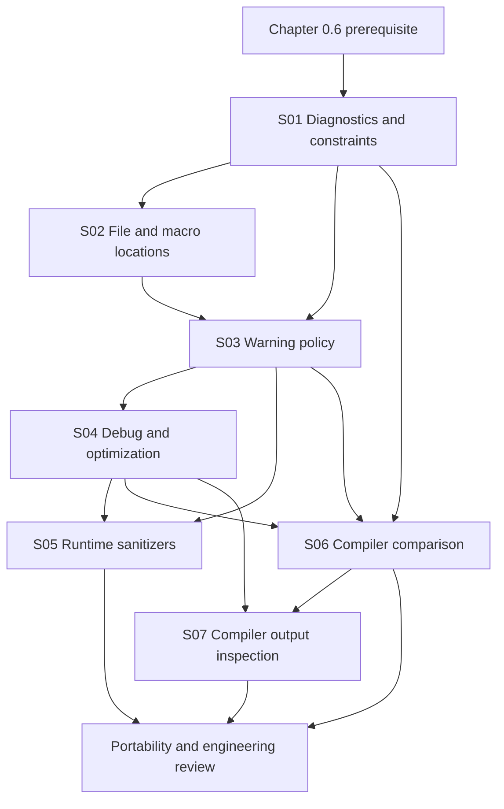

# 00.07 — Compiler Diagnostics and Compiler Options

**Part:** 00 — Orientation, History, and Working Environment  
**Chapter level and prerequisites (source):** `L0; prerequisite: 0.6`  
**Chapter source ID:** `C23-P00-CH07`  
**Source outline:** `Kurikulum_C_Final.txt`  
**Status:** Publication-ready teaching chapter; implementation-specific details are version-scoped and linked to vendor documentation.  
**Language:** English (United States)  
**Primary language version:** C23 (ISO/IEC 9899:2024); examples intentionally use constructs supported by both current GCC and Clang modes tested below.

> **Scope discipline.** This chapter teaches how to read compiler feedback, select common diagnostic and build options, use runtime instrumentation, compare implementations, and inspect generated output. Compiler command-line switches are implementation interfaces, not ISO C language features. Their exact behavior must be checked against the selected compiler version and target.

## Chapter scope

1. **0.7.1** — Syntax errors, constraint violations, warnings, and diagnostics
2. **0.7.2** — Reading file names, line numbers, columns, messages, and macro expansion locations
3. **0.7.3** — `-Wall`, `-Wextra`, `-Wpedantic`, `-Wconversion`, `-Wshadow`, and `-Werror`
4. **0.7.4** — `-g`, `-O0`, `-O1`, `-O2`, `-O3`, `-Os`, and `-Og`
5. **0.7.5** — AddressSanitizer, UndefinedBehaviorSanitizer, MemorySanitizer, and ThreadSanitizer
6. **0.7.6** — Comparing GCC, Clang, and other compilers
7. **0.7.7** — Compiler Explorer and compiler-output inspection

## Learning and retention map

- **Knowledge-unit namespace:** `C23-P00-CH07-Sxx-*` (all existing identifiers are preserved).
- **Prerequisite:** Chapter `0.6`; its exact knowledge-unit identifiers are not present in this scaffold, so no prerequisite unit IDs are fabricated.
- **Importance assignments:** S01–S03 and S06 are **Critical**; S04–S05 and S07 are **Core**. This assignment reflects how often the skills are needed to interpret, validate, and debug C programs; it is a curriculum priority, not a claim about the learner.
- **Memory layers:** Atomic (terms and flags), Conceptual (diagnostic and build models), Procedural (reading reports and running commands), Relationship (compiler/version/target differences), Engineering judgment (selecting evidence and deciding what a report proves).
- **Retrieval modes:** Free recall, precision recall, code prediction, error diagnosis, contrastive retrieval, and transfer retrieval.
- **Review scopes:** Chapter → Part → Cross-part → Curriculum.
- **Suggested review intervals:** Day 0, 1, 3, 7, 14, 30, 60, and 90; adjust based on demonstrated performance rather than treating these dates as a guarantee of memory.

---

# 0.7.1 — Syntax Errors, Constraint Violations, Warnings, and Diagnostics

**Knowledge-unit ID:** `C23-P00-CH07-S01`  
**Importance:** Critical  
**Retrieval item ID:** `C23-P00-CH07-S01-RET-01`  
**Misconception ID:** `MIS-P00-CH07-S01-01`

### 1. Core idea
A compiler diagnostic is feedback emitted by a translation implementation; a required diagnostic for a C syntax-rule or constraint violation is not the same thing as a compiler warning, and neither message category by itself proves that a program is correct or incorrect at runtime.

### 2. Mental model
Think of translation as a technical review with several possible findings: a **syntax error** means the source cannot be parsed according to the language grammar; a **constraint violation** means a construct violates a semantic rule for which the standard requires a diagnostic; a **warning** is an implementation's advisory report about a suspicious or risky construct; and the umbrella term **diagnostic** means a message from the implementation.

This model is a reading aid, not a complete compiler taxonomy. Compilers may label messages `error`, `warning`, `note`, or `remark`; those labels are implementation presentation choices and do not map one-to-one onto every ISO C category.

### 3. Technical mechanism
C translation includes preprocessing and translation of translation units. During translation, an implementation checks syntax and constraints and may perform additional static analysis. For a conforming implementation, ISO/IEC 9899:2024 (C23) §5.1.1.3 requires at least one diagnostic message, identified in an implementation-defined manner, when a preprocessing translation unit or translation unit contains a syntax-rule or constraint violation. The implementation is encouraged to identify the nature of each violation and localize it where possible.

A syntax violation example:

```c
int main(void)
{
    int value = ; /* Missing initializer expression: syntax violation. */
    return value;
}
```

A constraint violation example:

```c
int main(void)
{
    int number = 10;
    number(); /* An object is not a function designator. */
    return 0;
}
```

The second example attempts to call an `int` object as though it were a function. A conforming implementation must issue at least one diagnostic for the constraint violation. The exact wording, number of messages, severity label, and source location formatting are not standardized.

A warning can be emitted even when a program has no syntax or constraint violation. For example, a compiler may warn about an unused local variable or a suspicious conversion. Conversely, the absence of warnings does not establish that a program is free of undefined behavior, security defects, logic errors, or portability problems.

### 4. Formal boundary

- **Syntax rule:** A grammar requirement governing how tokens form valid language constructs.
- **Constraint:** A semantic restriction specified by the C standard. A violation requires a diagnostic under §5.1.1.3.
- **Diagnostic:** A message from the implementation. The standard does not prescribe a universal message format or require a particular English phrase.
- **Warning:** Common compiler terminology for a non-fatal advisory message. Its meaning and activation are implementation-specific.
- **Error:** Common compiler terminology for a condition that prevents the requested compilation step from succeeding. It is not a complete ISO C classification.
- **Undefined behavior:** Not a synonym for a constraint violation. Some constructs can involve both a constraint violation and wording that describes undefined behavior; C23 §5.1.1.3 still requires a diagnostic for the constraint violation.
- **No diagnostic required:** A program can have undefined behavior without violating a syntax rule or constraint that requires a diagnostic. A compiler is not a complete runtime proof system.

The normative C23 source verified for the diagnostic requirement is ISO/IEC 9899:2024 §5.1.1.3 in WG14 document N3220, which is the publicly available committee draft corresponding to the 2024 edition. The final published ISO text is authoritative; N3220 is used here as an accessible source copy, not represented as a different standard edition.

### 5. Practical consequence
Classify what the compiler reports before responding:

1. Read the first relevant error, not just the final cascade of follow-up messages.
2. Identify whether the report points to malformed syntax, a violated constraint, an enabled warning, or an implementation/toolchain issue.
3. Fix the underlying source problem rather than suppressing the message blindly.
4. Rebuild after each meaningful fix; one syntax error can cause several misleading downstream diagnostics.
5. Do not treat a clean build as proof of runtime correctness. Add tests, review contracts, and use suitable runtime analysis.

**Pitfall box**

> **Pitfall:** “The compiler accepted it” does not mean “the program is correct.” Acceptance only establishes that this compiler, with these options and this target, completed the requested translation step. It does not prove the absence of undefined behavior or logic defects.

### 6. Retrieval question
Without looking back, distinguish a syntax violation, a constraint violation, a compiler warning, and a diagnostic. Which two language-rule categories trigger the C23 minimum-diagnostic requirement, and what does that requirement leave implementation-defined?

**Contrastive retrieval:** Why can a warning appear for a program that violates no C constraint, and why can a program with undefined behavior compile without a warning?

---

# 0.7.2 — Reading File Names, Lines, Columns, Messages, and Macro Locations

**Knowledge-unit ID:** `C23-P00-CH07-S02`  
**Importance:** Critical  
**Retrieval item ID:** `C23-P00-CH07-S02-RET-01`  
**Misconception ID:** `MIS-P00-CH07-S02-01`

### 1. Core idea
A diagnostic location is a navigation clue supplied by the compiler, and understanding it requires separating the reported spelling location, macro expansion location, included-file location, and the underlying source construct.

### 2. Mental model
Treat a diagnostic as a map pin with a short explanation. The primary location tells you where to begin looking; notes and macro-expansion traces explain how the compiler arrived there. A map pin is not always the origin of the defect: the triggering token may be inside a macro invocation while the problematic replacement token is defined in a header.

The analogy has a limit: compilers can report several related locations, and the exact presentation is vendor-specific. Never assume that every compiler prints columns, caret ranges, macro backtraces, or include stacks in the same format.

### 3. Technical mechanism
A typical diagnostic may contain:

```text
src/example.c:18:9: warning: conversion may change value [-Wconversion]
        count = input;
        ^
```

Read the parts as follows:

- `src/example.c` — source file associated with the reported location.
- `18` — line number, conventionally one-based in human-readable diagnostics.
- `9` — column number, conventionally one-based in human-readable diagnostics.
- `warning` — compiler-selected severity label.
- Message text — the compiler's description of the issue it detected.
- `[-Wconversion]` — often the warning option that controls the diagnostic; this suffix is a vendor convention, not required by ISO C.
- Caret/range — a visual indication of the token or source span selected by the diagnostic engine.

For a macro, consider:

```c
#define TO_SMALL(x) ((unsigned char)(x))

int main(void)
{
    int input = 300;
    unsigned char result = TO_SMALL(input);
    (void)result;
    return 0;
}
```

A compiler can show the invocation in `main`, the macro definition, or both through an expansion note. The cast is explicit here, so this example demonstrates navigation rather than a guaranteed warning. If a diagnostic points into an expanded macro, inspect both the invocation and the definition before changing either.

`#line` directives can alter the logical source file name and line number used for subsequent diagnostics and predefined source-location macros. This is useful for generated code, but it means the displayed path may be a logical name rather than the physical path of the file on disk.

### 4. Formal boundary

- ISO C specifies preprocessing behavior, including `#line` processing, but it does not standardize the visual layout of compiler diagnostics.
- File names, columns, caret rendering, warning-option suffixes, color, include-stack formatting, and macro backtrace wording are compiler-interface behavior.
- Column counting can be affected by tabs, multibyte source encodings, and compiler conventions. Treat the column as an approximate navigation aid; confirm the token in the source editor.
- A macro expansion can produce tokens whose effective diagnostic location is not intuitively the line where the macro was written. Read the full expansion trace.
- Generated source, symlinks, relative paths, build directories, and `#line` directives can make two different path strings refer to the same logical source or one physical file appear under different names.

### 5. Practical consequence
Use a repeatable diagnostic-reading sequence:

1. Capture the complete diagnostic, including notes and the command that produced it.
2. Open the reported file at the reported line; inspect several surrounding lines.
3. Locate the exact token or range indicated by the caret.
4. If a macro is involved, trace the expansion from invocation to definition and inspect relevant included headers.
5. Check whether generated code or `#line` changed the logical location.
6. Recompile with the same compiler and options to confirm that the intended message disappears and no new issue was introduced.

When reporting a defect to another developer, include the compiler name/version, target, exact command, complete diagnostic, and a minimal source reproducer. A screenshot of one highlighted line is often insufficient.

**Pitfall box**

> **Pitfall:** Do not edit the macro definition merely because the caret appears in the macro expansion, and do not edit the invocation merely because the primary location points there. Establish whether the defect is in the argument, the macro replacement list, or their interaction.

### 6. Retrieval question
Given `file.c:24:7: warning: ... [-Wconversion]`, identify each field and state which parts are compiler conventions. If a note says “expanded from macro,” what two source locations should you inspect?

**Code-reading task:** In the `TO_SMALL` example, identify the macro definition line and invocation line. Explain why the diagnostic location format cannot be assumed identical across GCC and Clang.

---

# 0.7.3 — Warning and Diagnostic-Control Options

**Knowledge-unit ID:** `C23-P00-CH07-S03`  
**Importance:** Critical  
**Retrieval item ID:** `C23-P00-CH07-S03-RET-01`  
**Misconception ID:** `MIS-P00-CH07-S03-01`

### 1. Core idea
Warning flags select implementation-specific diagnostic checks, while `-Werror` changes the build consequence of warnings; none of these options changes the meaning of a valid C program or replaces standards-based reasoning.

### 2. Mental model
Think of warning options as switches on a workshop inspection panel. `-Wall` and `-Wextra` enable groups of checks, more focused flags request particular checks, and `-Werror` changes how the build treats selected warnings. The panel is not a universal checklist: the exact switches and the checks grouped under them depend on the compiler and version.

### 3. Technical mechanism
The requested options are commonly used with GCC and Clang:

| Option | Practical meaning | Important qualification |
|---|---|---|
| `-Wall` | Enables a broad, curated set of commonly useful warnings. | It does **not** literally enable every warning. The set changes by compiler/version. |
| `-Wextra` | Enables additional warnings beyond the compiler's `-Wall` set. | It is not a synonym for “all warnings.” |
| `-Wpedantic` | Requests diagnostics for certain extensions or departures relative to the selected ISO language dialect. | It does not prove full conformance, and exact diagnostics depend on compiler and `-std=` mode. |
| `-Wconversion` | Warns about certain implicit conversions that may change values or representation. | It can produce noise in code that intentionally narrows or changes signedness; fix intent explicitly rather than adding arbitrary casts. |
| `-Wshadow` | Warns when a declaration hides another declaration in an overlapping scope. | The precise shadowing cases and defaults differ among implementations. |
| `-Werror` | Promotes warnings to errors. | It can make a previously successful build fail when compiler versions add or change warnings. |

A useful strict baseline for a small learning program is:

```sh
gcc -std=c2x -Wall -Wextra -Wpedantic -Wconversion -Wshadow -Werror \
    -pedantic-errors source.c -o program
```

For Clang, the same command shape is commonly accepted:

```sh
clang -std=c2x -Wall -Wextra -Wpedantic -Wconversion -Wshadow -Werror \
      -pedantic-errors source.c -o program
```

`-std=c2x` selects the C2x development dialect supported by these tested compiler versions; it is not a claim that every compiler version uses this spelling. Some newer compilers provide `-std=c23`; check `compiler --help` and the compiler manual before selecting a standard-mode option. The commands in the validation record below were tested with GCC 14.2.0 and Clang 17.0.0 using `-std=c2x`.

`-Werror` can be scoped in GCC and Clang with forms such as `-Werror=conversion` and `-Wno-error=conversion`; verify exact behavior in the selected compiler's documentation. Prefer a targeted exception over disabling an entire warning family. For CI, pin or document compiler versions so that a newly introduced warning does not unexpectedly become a release blocker.

### 4. Formal boundary

- These are **compiler options**, not C keywords, operators, declarations, or standard-library facilities.
- ISO C does not define `-Wall`, `-Wextra`, `-Wpedantic`, `-Wconversion`, `-Wshadow`, or `-Werror`.
- The standard's required diagnostic for a syntax or constraint violation is separate from optional warning policies.
- `-Wpedantic` is not a substitute for selecting the correct `-std=` dialect. A compiler may accept extensions even when a standard mode is selected; the warning policy determines which uses it diagnoses.
- A warning-free build is conditional on compiler, version, target, options, included headers, and source files. It is not a proof of portability or correctness.
- `-Werror` can turn a warning into a build failure without changing the source construct's status under ISO C.

### 5. Practical consequence
Adopt warnings incrementally and consistently:

1. Choose and document the language dialect (`-std=c23` where supported, or the documented compatibility spelling such as `-std=c2x`).
2. Enable a broad baseline (`-Wall -Wextra -Wpedantic`).
3. Add focused checks such as `-Wconversion` and `-Wshadow` when the team can act on their findings.
4. Fix warnings at their source; use explicit conversions only when the conversion is intentional and range-safe.
5. Enable `-Werror` in controlled CI after the warning baseline is stable; consider targeted `-Werror=...` policies.
6. Recheck the command when changing compiler versions, target architectures, or build configurations.

**Pitfall box**

> **Pitfall:** `-Wall` does not mean every warning, and `-Werror` does not mean every possible defect is now an error. The first is a curated warning group; the second promotes diagnostics that the compiler actually emits.

### 6. Retrieval question
Explain the difference between `-Wall`, `-Wextra`, `-Wpedantic`, `-Wconversion`, `-Wshadow`, and `-Werror`. Which of them changes warning severity rather than selecting a warning family?

**Transfer task:** A project builds cleanly with GCC but fails under Clang because `-Werror` promotes a warning. List the evidence you need before deciding whether to change code, adjust a warning policy, or pin a compiler version.

---

# 0.7.4 — Debug Information and Optimization Levels

**Knowledge-unit ID:** `C23-P00-CH07-S04`  
**Importance:** Core  
**Retrieval item ID:** `C23-P00-CH07-S04-RET-01`  
**Misconception ID:** `MIS-P00-CH07-S04-01`

### 1. Core idea
`-g` requests debugger-oriented information, while `-O` options select compiler optimization policies; debug information and optimization are separate controls that can be combined, but optimization can make source-level debugging less direct.

### 2. Mental model
Imagine two independent questions: “What information should the compiler preserve for a debugger?” and “How aggressively should the compiler transform the program?” `-g` addresses the first; `-O0`, `-O1`, `-O2`, `-O3`, `-Os`, and `-Og` address the second. A build can request both.

The model is intentionally simplified. Debug information does not preserve every source variable as a physical runtime object, and optimization levels are bundles of passes whose exact contents vary by compiler, target, and release.

### 3. Technical mechanism

| Option | Typical intent | What not to assume |
|---|---|---|
| `-g` | Emit debug information for a debugger. | It does not itself disable optimization. |
| `-O0` | Minimize optimization; favor straightforward compilation and source-level debugging. | It does not guarantee that every source statement maps one-to-one to machine instructions. |
| `-O1` | Enable a basic optimization set. | It is not a fixed cross-compiler optimization recipe. |
| `-O2` | Enable a broader set of optimizations, commonly used for production builds. | It does not guarantee a faster executable for every workload. |
| `-O3` | Enable further optimizations, often including more aggressive loop and inlining transformations. | It may increase code size and is not automatically faster than `-O2`. |
| `-Os` | Optimize with code size as an important objective. | It does not guarantee the smallest possible binary on every target. |
| `-Og` | Optimize while attempting to preserve a useful debugging experience (notably documented by GCC). | It is not identical across compilers and may not exist or behave the same everywhere. |

Typical GCC development builds:

```sh
# Straightforward debug build
gcc -std=c2x -g -O0 -Wall -Wextra -Wpedantic source.c -o program-debug

# Debug-friendly optimized build
gcc -std=c2x -g -Og -Wall -Wextra -Wpedantic source.c -o program-og
```

A release-oriented comparison might use `-O2` first, measure the real workload, and then compare `-O3` or `-Os` if performance or binary size justifies it. Do not infer performance from the number in the flag alone; benchmark representative inputs and record the compiler, target, and flags.

### 4. Formal boundary

- Optimization levels and debug-information switches are implementation-specific command-line interfaces, not ISO C language semantics.
- The compiler must preserve the behavior required by the language for programs whose behavior is defined, subject to the selected language mode and implementation contract. Undefined behavior does not impose the same constraints on optimization.
- Optimized code can inline functions, remove dead stores, fold constants, reorder operations where permitted, and keep values in registers or eliminate them. Consequently, a debugger may report a variable as optimized out or show execution positions that do not correspond intuitively to source order.
- `-g` can be combined with optimization. The quality and precision of source-level debugging depend on compiler, debug format, optimization, and target.
- The exact pass set for `-O1`, `-O2`, `-O3`, `-Os`, and `-Og` is compiler- and version-dependent. GCC documents its enabled passes and provides `-Q --help=optimizers` to inspect them.
- Do not confuse `-O0` with a guarantee that undefined behavior will behave predictably. A program with undefined behavior remains invalid to reason about as though a stable output were promised.

### 5. Practical consequence
Use the build configuration that matches the question you are asking:

- **Learning and first debugging:** `-g -O0` is easy to reason about.
- **Everyday edit/compile/debug:** `-g -Og` is a useful GCC starting point; verify the corresponding behavior for other compilers.
- **Performance testing:** use the intended optimization level, release-like settings, representative data, repeated measurements, and a recorded toolchain.
- **Production size investigation:** compare `-Os` against the normal release build and measure the final linked artifact.
- **Hard-to-reproduce optimized-only issue:** keep debug information and reproduce with the same optimization level instead of assuming the issue cannot occur in optimized builds.

**Pitfall box**

> **Pitfall:** `-g` does not mean “no optimization,” and `-O0` does not mean “the source executes literally line by line.” Debug metadata and code generation are related but distinct concerns.

### 6. Retrieval question
What does `-g` control, and what does `-O2` control? Why can a variable be unavailable in a debugger even when the program was compiled with `-g`?

**Contrastive retrieval:** When would you choose `-g -O0`, `-g -Og`, `-g -O2`, and `-Os`? Name one measurement or debugging limitation for each choice.

---

# 0.7.5 — Runtime Sanitizers

**Knowledge-unit ID:** `C23-P00-CH07-S05`  
**Importance:** Core  
**Retrieval item ID:** `C23-P00-CH07-S05-RET-01`  
**Misconception ID:** `MIS-P00-CH07-S05-01`

### 1. Core idea
A sanitizer adds compiler instrumentation and runtime support to detect selected classes of defects during executions that actually occur, but no sanitizer can prove that an entire program is defect-free.

### 2. Mental model
A sanitizer is like a specialized test observer. AddressSanitizer watches memory-access validity; UndefinedBehaviorSanitizer checks selected operations associated with undefined behavior; MemorySanitizer tracks uninitialized data use; and ThreadSanitizer observes memory accesses and synchronization to detect data races.

Each observer has a field of view and a cost. It can miss defects outside its checks, unexecuted paths, or code that is not suitably instrumented. A clean sanitizer run is evidence about the executions and instrumentation performed—not a universal proof.

### 3. Technical mechanism
Sanitizers are generally compiler instrumentation features paired with runtime libraries. The exact flag spelling and supported checks depend on the compiler and platform.

| Sanitizer | Main target | Typical Clang option | Key limitation |
|---|---|---|---|
| AddressSanitizer (ASan) | Out-of-bounds accesses, use-after-free, and other supported memory errors. | `-fsanitize=address` | Requires compatible runtime/platform support; changes memory use and execution cost. |
| UndefinedBehaviorSanitizer (UBSan) | Selected operations that can invoke undefined behavior, such as certain invalid shifts or signed overflow checks. | `-fsanitize=undefined` | It checks a defined set of cases, not every possible undefined behavior. |
| MemorySanitizer (MSan) | Uses of uninitialized values. | `-fsanitize=memory` | Best results require instrumenting the program and relevant dependencies; platform support is narrower. |
| ThreadSanitizer (TSan) | Data races in multithreaded programs. | `-fsanitize=thread` | Requires supported runtime/platform and broad instrumentation; it has significant overhead. |

A practical ASan + UBSan build for supported Clang/GCC environments is:

```sh
clang -std=c2x -g -O1 -fno-omit-frame-pointer \
      -fsanitize=address,undefined -fno-sanitize-recover=all \
      source.c -o program-sanitized
./program-sanitized
```

Use separate builds for incompatible sanitizer combinations. In particular, ThreadSanitizer is not combined with AddressSanitizer in the same GCC instrumentation configuration. A dedicated TSan build commonly uses `-fsanitize=thread -g -O1`; compile and link all relevant program translation units with compatible instrumentation. For MemorySanitizer, use a Clang toolchain with its MSan runtime and instrumented dependencies where feasible.

### 4. Formal boundary

- Sanitizers are implementation tooling, not requirements imposed by ISO C23.
- A sanitizer report is evidence that a particular instrumented execution triggered a check. Interpret the report, stack trace, and source locations; do not equate every report mechanically with a complete diagnosis.
- A clean run does not prove safety: unexecuted paths, unsupported checks, uninstrumented libraries, platform limitations, and tool blind spots remain.
- ASan, UBSan, MSan, and TSan detect different classes of issues; they are not interchangeable.
- TSan targets data races, not every concurrency defect. A race-free program can still deadlock or violate a higher-level protocol.
- UBSan does not cover every behavior that the C standard classifies as undefined. Check the compiler's sanitizer documentation for the exact check set.
- Sanitizer runtime availability, address-space requirements, supported architectures, and combination restrictions vary by toolchain and release. Confirm support before designing a CI matrix.
- Sanitized binaries are testing artifacts. Do not assume that their runtime, performance, or security characteristics are suitable for production deployment.

### 5. Practical consequence
Build a layered testing strategy:

1. Compile with strict warnings.
2. Run ordinary unit and integration tests.
3. Run ASan + UBSan where supported to exercise memory and selected undefined-behavior checks.
4. Run MSan separately when uninitialized-value analysis is important and the dependency stack can be instrumented.
5. Run TSan separately for multithreaded code on a supported platform.
6. Preserve the full report and exact build command; fix the root cause, then rerun the test that exposed it.
7. Record untested platforms and uninstrumented dependencies as limitations, not as successful coverage.

**Pitfall box**

> **Pitfall:** “The sanitizer passed” means only that no enabled check reported a problem in that instrumented run. It does not certify the whole program, every path, or every platform.

### 6. Retrieval question
Match ASan, UBSan, MSan, and TSan to their principal defect classes. Why should MSan and TSan generally be treated as separate build configurations, and what does a clean sanitizer run actually establish?

**Transfer task:** A program passes ASan but has a race in a worker thread. Explain why this is not contradictory and choose the next tool and build strategy.

---

# 0.7.6 — Comparing GCC, Clang, and Other Compilers

**Knowledge-unit ID:** `C23-P00-CH07-S06`  
**Importance:** Critical  
**Retrieval item ID:** `C23-P00-CH07-S06-RET-01`  
**Misconception ID:** `MIS-P00-CH07-S06-01`

### 1. Core idea
Comparing compilers is a portability and evidence exercise: hold the source, language mode, target, and relevant options as constant as possible, then investigate differences against the C standard and each implementation's documented behavior.

### 2. Mental model
Treat GCC, Clang, and another compiler as independent reviewers reading the same specification. Agreement can increase confidence, but agreement is not proof; disagreement is a useful clue that may reveal an extension, implementation-defined choice, unsupported feature, diagnostic-policy difference, target difference, or a defect in the program.

The model has limits: compilers may share front-end ideas, libraries, runtimes, or target backends, and their results are not statistically independent votes on what the standard means.

### 3. Technical mechanism
For a meaningful comparison, record a test matrix:

| Variable | Record |
|---|---|
| Compiler | Exact vendor and executable (`gcc`, `clang`, or other) |
| Version | Full version output, not just the major family name |
| Target | Architecture, operating system, ABI, and relevant target triple |
| Language mode | Exact `-std=` option and any extensions enabled |
| Options | Warnings, optimization, sanitizer, include paths, and macros |
| Libraries | C library and relevant runtime versions |
| Result | Compile status, complete diagnostics, runtime output, and exit status |

A reproducible baseline comparison:

```sh
gcc --version
clang --version

gcc -std=c2x -Wall -Wextra -Wpedantic -Wconversion -Wshadow \
    -Werror -pedantic-errors source.c -o app-gcc
clang -std=c2x -Wall -Wextra -Wpedantic -Wconversion -Wshadow \
      -Werror -pedantic-errors source.c -o app-clang

./app-gcc
./app-clang
```

If one compiler rejects the program and another accepts it, reduce the source to a minimal reproducer. Check whether the construct is valid in the selected C version, whether the compilers actually used the same dialect and target, whether an extension was involved, and whether the diagnostic is a required diagnostic or an optional warning.

### 4. Formal boundary

- ISO C defines language requirements; GCC and Clang manuals define their respective command-line interfaces and document implementation behavior.
- A compiler's acceptance does not override a standard constraint. A compiler's warning does not automatically mean the standard forbids the construct.
- Implementation-defined behavior must be documented by the implementation; compare the documented choices, not just observed output.
- Unspecified behavior permits multiple outcomes without requiring the implementation to document which one it chooses. Do not label it implementation-defined merely because two compilers differ.
- Undefined behavior cannot be used as a valid cross-compiler test oracle. Different results do not establish which compiler is “wrong” when the source has undefined behavior.
- Different warning sets are expected. Compare the selected options and diagnostic documentation before treating a warning mismatch as a language-conformance disagreement.
- C23 feature support can be partial or version-dependent. Check the compiler's current C23 support status and test the exact feature in question.

### 5. Practical consequence
Use a disciplined portability workflow:

1. Compile the same minimal source in the same intended language mode.
2. Capture compiler versions, targets, flags, and complete diagnostics.
3. Compare the language rule with the relevant C23 wording before comparing compiler behavior.
4. Separate compile-time diagnostics from runtime differences.
5. If runtime results differ, first eliminate undefined behavior and uninitialized data; then investigate implementation-defined or unspecified behavior and target assumptions.
6. Test at least two independent implementations when portability is a project requirement, but retain standards-based reasoning as the authority.
7. File a compiler bug report only with a reduced, standards-valid reproducer and the exact environment.

**Pitfall box**

> **Pitfall:** “GCC and Clang agree” is not a standards citation. “GCC and Clang disagree” is not automatically a compiler bug. The standard and documented implementation contracts determine how the evidence should be interpreted.

### 6. Retrieval question
What variables must be held constant when comparing compilers? Give four plausible reasons why GCC and Clang might report different results without either result proving that the C standard is contradictory.

**Diagnosis task:** A program prints different values under `-O0` and `-O2`. What must you investigate before claiming an optimizer defect?

---

# 0.7.7 — Compiler Explorer and Inspecting Compiler Output

**Knowledge-unit ID:** `C23-P00-CH07-S07`  
**Importance:** Core  
**Retrieval item ID:** `C23-P00-CH07-S07-RET-01`  
**Misconception ID:** `MIS-P00-CH07-S07-01`

### 1. Core idea
Compiler Explorer is an interactive environment for comparing source code with compiler output, especially assembly, and its output is evidence about one selected compiler configuration rather than a definition of C language behavior.

### 2. Mental model
Think of the source as the program you express and the assembly view as one implementation's translation into a target instruction set. Compiler Explorer lets you change the compiler, version, target, and options and observe how the output changes.

The analogy is not a literal one-to-one translation. Optimizers can remove, combine, inline, reorder, or transform source operations; one source statement may produce many instructions, several statements may collapse into a few instructions, and a function may disappear if its result is unused.

### 3. Technical mechanism
A useful inspection sequence is:

1. Open Compiler Explorer (`https://godbolt.org/`).
2. Select a C compiler (for example, GCC or Clang) and a specific version.
3. Select the intended language mode and target where available.
4. Paste a small, self-contained C example.
5. Add options such as `-O0`, `-O2`, `-g`, or warning flags in the compiler-options field.
6. Inspect the compiler output and any diagnostics.
7. Change one variable at a time—compiler, version, target, or option—and compare the result.

For a local command-line inspection, ask the compiler to emit assembly:

```sh
gcc -std=c2x -O2 -S -masm=intel example.c -o example-gcc.s
clang -std=c2x -O2 -S -masm=intel example.c -o example-clang.s
```

`-S` requests assembly output rather than a linked executable. `-masm=intel` is a GCC/Clang target-dependent assembly-syntax option; omit it if unsupported or use the target's default syntax. To inspect preprocessed source, use `-E`; to inspect object-file symbols or disassembly, use suitable platform tools such as `nm` and `objdump` where available.

Compiler Explorer can also execute selected programs in supported configurations when execution is enabled. Treat remote execution as a convenience for small, non-sensitive examples, not as a substitute for testing on the actual deployment platform. Do not paste secrets, private source, credentials, or proprietary code into a public web service unless its privacy and organizational terms permit it.

### 4. Formal boundary

- Compiler Explorer is an external educational and inspection service, not part of ISO C and not an authoritative standards interpreter.
- Assembly is target-specific. The same C source can produce different instructions for x86-64, AArch64, and other targets.
- Compiler version, optimization level, target ABI, feature flags, and surrounding program context can all change generated output.
- An observed instruction sequence is not a portable guarantee and must not be used as a substitute for a C semantic rule.
- An empty or tiny assembly output may result from optimization, inlining, constant folding, or dead-code elimination; ensure the result is observably used before drawing conclusions.
- The exact Compiler Explorer interface and available compiler versions can change. Record a shareable configuration or the exact settings when documenting an experiment.

### 5. Practical consequence
Use output inspection to answer focused questions, such as:

- Did this compiler inline the function at this optimization level?
- Did a loop become vector instructions for this target?
- Did a constant expression eliminate runtime work?
- Does a bounds check remain in the generated code?
- How does changing `-O0` to `-O2` affect this small example?

For each experiment, write down the question, compiler/version, target, language mode, options, source, and observation. Then distinguish the **observation** (“this compiler emitted these instructions”) from the **inference** (“this optimization appears to have occurred”) and the **language claim** (“C requires this behavior”). Only the last requires a standards-based argument.

**Pitfall box**

> **Pitfall:** Do not conclude that C requires a particular assembly instruction because one Compiler Explorer configuration emitted it. The assembly describes one compiler's output for one target and option set.

### 6. Retrieval question
What does Compiler Explorer show, and which configuration details must be recorded for a reproducible comparison? Why is assembly output not a portable C guarantee?

**Transfer task:** A function disappears from optimized assembly. Give three possible explanations and describe how you would modify the experiment to determine whether the function's result is observable.

---

# Misconception Defense Registry

These are **concrete, commonly encountered incorrect beliefs** used as diagnostic cases. They are not claims that this learner has expressed them. Resolution requires an actual learner explanation, a correction exercise, and a later re-test; reading this table alone does not mark a misconception resolved.

| Misconception ID | Incorrect belief | Correct explanation | Why it seems plausible | Relevant chapter | Concrete diagnostic case | Diagnostic question | Correction exercise | Related misconceptions |
|---|---|---|---|---|---|---|---|---|
| `MIS-P00-CH07-S01-01` | “If a program has undefined behavior, the compiler must always print an error.” | C23 §5.1.1.3 requires a diagnostic for syntax-rule and constraint violations; it does not require a diagnostic for every possible undefined behavior. | Some undefined operations are easy for a compiler to detect, and sanitizers often report selected cases. | 0.7.1 | `int main(void) { int x = 1; return x / 0; }` may trigger a warning, but the standard does not require a diagnostic solely because every undefined behavior is detectable. | Does integer division by zero necessarily violate a syntax rule or constraint that requires a diagnostic? | Contrast a function-call constraint violation with a runtime path that can perform division by zero; classify what is guaranteed and what is tool-dependent. | Behavior; Portability |
| `MIS-P00-CH07-S02-01` | “The first file and line in a macro diagnostic must be where the bug was written.” | A report can identify the invocation, macro definition, or both; inspect the complete expansion trace and relevant headers. | The primary caret looks authoritative and appears to point at one exact token. | 0.7.2 | A macro defined in `config.h` expands at a call in `main.c`; the compiler emits an expansion note connecting both locations. | Which source locations can participate in one macro-related diagnostic? | Trace a macro invocation into its replacement list and annotate definition and expansion locations separately. | Preprocessor; Portability |
| `MIS-P00-CH07-S03-01` | “`-Wall` enables every warning, so a clean `-Wall` build means no suspicious code remains.” | `-Wall` enables a compiler-defined subset; other warnings require separate options, and no warning set proves correctness. | The word “all” in the option name sounds exhaustive. | 0.7.3 | GCC documents warning options not enabled by `-Wall`; some are enabled by `-Wextra` or individual flags. | Name two reasons a clean `-Wall` build is not a proof of correctness. | Compare the compiler's warning-option documentation and compile a small example with one additional targeted warning enabled. | Behavior; Portability |
| `MIS-P00-CH07-S04-01` | “Adding `-g` disables optimization, and `-O0` guarantees source statements execute literally in order.” | `-g` requests debug information and can coexist with optimization; `-O0` is an optimization policy, not a guarantee of a one-to-one source-to-machine mapping. | Debugging is easier in unoptimized builds, so the two ideas are often taught together. | 0.7.4 | Build the same program with `-g -O0` and `-g -O2`; both can contain debug information, but optimized variables or control flow may be harder to inspect. | Can `-g` and `-O2` be used together? What does the optimizer change? | Compile a small function both ways, inspect debugger variable availability and assembly, and write observations without claiming that the output is required by C. | Behavior; Portability |
| `MIS-P00-CH07-S05-01` | “If ASan passes, the program has no memory or concurrency bugs.” | ASan detects selected memory errors on executed, instrumented paths; TSan detects data races; each has different coverage and limitations. | ASan reports dramatic memory failures and is commonly treated as a general safety check. | 0.7.5 | A multithreaded program can be free of ASan findings and still contain an unsynchronized conflicting access. | Which sanitizer is designed to detect data races, and why is ASan not a substitute? | Build separate ASan/UBSan and TSan configurations for a suitable test suite; record what each does and does not check. | Memory; Concurrency; Behavior |
| `MIS-P00-CH07-S06-01` | “If GCC and Clang produce different output, one compiler must be wrong.” | Differences may arise from options, targets, implementation-defined choices, unspecified behavior, extensions, or undefined behavior; compare against the standard and implementation contracts. | Both compilers are widely used and often produce similar results for ordinary programs. | 0.7.6 | A program with undefined behavior prints different results after optimization or between compiler families. | What must be established before filing a compiler bug? | Reduce the example, remove undefined behavior, align language modes/targets/options, and cite the relevant C23 rule. | Behavior; Portability |
| `MIS-P00-CH07-S07-01` | “The assembly shown by Compiler Explorer is the assembly every conforming C compiler must emit.” | Assembly is specific to a compiler, version, target, and option set; ISO C specifies observable language behavior, not a universal instruction sequence. | Assembly is concrete and appears to reveal what the program “really does.” | 0.7.7 | The same C expression produces different instruction sequences on x86-64 and AArch64 while preserving the required observable behavior. | Which parts of a Compiler Explorer experiment are observations, and which would require a standards argument? | Change only the target or compiler and compare outputs; write a standards-level statement that does not name an instruction. | Portability; Behavior |

**Repair protocol:** Exposing question → learner reasoning → exact incorrect assumption → corrected model and rule → contrasting example → later re-test with a different example. Record `Open`, `Recovering`, or `Resolved` only after evidence; do not infer a learner's belief from the existence of a registry entry.

# Error and Weakness Registry

The following initial records define concrete failure modes and repair actions for this chapter. They are **curriculum risk records**, not learner-performance claims. A learner-specific status and re-test date must be entered only after an assessment.

| Error ID | Chapter | Concept | Error type | Incorrect reasoning / observable failure | Correct reasoning | Severity | Repair exercise | Re-test trigger | Status |
|---|---|---|---|---|---|---|---|---|---|
| `ERR-P00-CH07-01` | 0.7.1 | Diagnostic requirement | Standards error | Claims that every runtime undefined behavior must be diagnosed at translation. | C23 §5.1.1.3 requires at least one diagnostic for syntax-rule and constraint violations; other diagnostics are not universally required. | Critical | Classify four examples as syntax violation, constraint violation, optional warning, or runtime issue. | Next chapter review; record date when scheduled | Open — curriculum repair |
| `ERR-P00-CH07-02` | 0.7.2 | Source locations | Reasoning error | Edits only the macro call site without reading the expansion note. | Inspect invocation, definition, included file, and generated-source mapping. | Core | Trace one macro diagnostic from use site to definition and explain both locations. | After the macro trace exercise | Open — curriculum repair |
| `ERR-P00-CH07-03` | 0.7.3 | Warning groups | Recall / application error | Treats `-Wall` as exhaustive or assumes warning sets are identical across compiler families. | Warning groups are vendor/version-specific; add focused options and consult manuals. | Critical | Build with GCC and Clang, capture versions, and compare one deliberately selected warning. | After compiler comparison | Open — curriculum repair |
| `ERR-P00-CH07-04` | 0.7.4 | Debug versus optimization | Conceptual error | Assumes `-g` and `-O0` are the same control. | Debug information and optimization level are independent controls. | Core | Produce `-g -O0` and `-g -O2` builds; compare debugger observations. | Next delayed retrieval | Open — curriculum repair |
| `ERR-P00-CH07-05` | 0.7.5 | Sanitizer coverage | Application error | Treats one clean sanitizer run as a whole-program proof. | Each sanitizer checks a subset of issues on instrumented, executed paths. | Critical | Map four defect scenarios to ASan, UBSan, MSan, or TSan and list coverage limits. | After sanitizer matrix exercise | Open — curriculum repair |
| `ERR-P00-CH07-06` | 0.7.6 | Compiler comparison | Standards error | Calls a compiler defective before eliminating undefined behavior and aligning flags. | Reproduce with matched conditions and check the normative rule first. | Critical | Minimize a differing example and create a version/target/flags matrix. | After comparison exercise | Open — curriculum repair |
| `ERR-P00-CH07-07` | 0.7.7 | Assembly interpretation | Reasoning error | Treats one assembly listing as a portable language requirement. | Assembly is one implementation's target-specific output. | Core | Compare two targets and rewrite the conclusion as an observation, not a language guarantee. | Next cumulative review | Open — curriculum repair |

**Learner assessment fields to update when evidence exists:** incorrect reasoning; corrected reasoning; severity confirmation; repair result; re-test date; status (`Open`, `Recovering`, `Resolved`). Do not assign a learner score or claim a learner weakness from these template records.

# Knowledge Connection Map

The map below connects this chapter to its stated prerequisite and to curriculum topics that naturally consume compiler diagnostics and toolchain knowledge. The chapter scaffold identifies only prerequisite chapter `0.6`; its exact knowledge-unit IDs are not available here and are therefore intentionally not invented.

| This chapter knowledge | Prerequisite / related knowledge | Relationship | Later use |
|---|---|---|---|
| `C23-P00-CH07-S01` diagnostics and constraints | Chapter 0.6 (exact unit ID pending source authoring); language syntax and constraints | Diagnostics report translation findings about language constructs. | Syntax, types, expressions, declarations, portability, standards audit |
| `C23-P00-CH07-S02` diagnostic locations | Preprocessing and header inclusion; `C23-P00-CH07-S01` | Macro expansion and source mapping explain where a report points. | Preprocessor, headers, generated source, build systems |
| `C23-P00-CH07-S03` warning controls | `S01`, `S02` | Warning policy selects which implementation findings become visible and actionable. | Code review, CI, portability, professional engineering |
| `C23-P00-CH07-S04` debug and optimization | `S01`, `S03`; program execution and observable behavior | Build configuration changes debug visibility and generated code. | Debugging, algorithms, performance, ABI and toolchain analysis |
| `C23-P00-CH07-S05` sanitizers | Memory/object lifetime, expressions, concurrency, `S03` and `S04` | Instrumented runs test selected runtime properties. | Memory safety, concurrency, testing, security analysis |
| `C23-P00-CH07-S06` compiler comparison | `S01`–`S05`; C23 standards navigation | Cross-implementation differences must be classified against the standard and implementation contracts. | Portability, C23 conformance, standards audit |
| `C23-P00-CH07-S07` output inspection | `S04`, `S06`; target architecture and machine representation | Assembly inspection helps explain a particular compiler's transformations. | Optimization, ABI, algorithms, architecture-aware engineering |



**Connection retrieval prompts**

- Which language rules must you understand before deciding whether a diagnostic indicates a constraint violation?
- Why does macro expansion knowledge help interpret compiler locations?
- How can optimization influence both warning effectiveness and debugger visibility?
- Why do sanitizers complement rather than replace static diagnostics?
- How does standards lookup resolve disagreements between compilers?
- Which details make an assembly observation reproducible but not portable?

# Pitfall Box — Chapter-Wide Rules

> **Do not infer a language guarantee from one compiler's output.** Record the language version, implementation, version, target, and options; then verify the relevant C23 rule and any documented implementation-defined choice or extension.

> **Do not equate “no diagnostic” with “no defect.”** Some runtime defects are not required to be diagnosed, and optional warning/sanitizer checks have limited coverage.

> **Do not suppress a warning before understanding it.** A cast, pragma, or `-Wno-*` option can hide evidence without correcting the underlying problem.

> **Do not compare unlike builds.** Compiler version, target, `-std=`, optimization, preprocessor definitions, and libraries can change results.

> **Do not ship sanitizer assumptions.** Sanitized test binaries are investigative builds, not automatically production-ready artifacts.

# Runnable Lab — One Source, Four Verified Build Paths

This lab is deliberately small and deterministic. It uses standard C library facilities and avoids undefined behavior. The expected output is `total=12` and the expected process exit status is `0`.

Save as `diagnostics_lab.c`:

```c
#include <stddef.h>
#include <stdio.h>

static int sum_values(const int *values, size_t count)
{
    int total = 0;

    for (size_t i = 0; i < count; ++i) {
        total += values[i];
    }

    return total;
}

int main(void)
{
    const int values[] = { 3, 4, 5 };
    const size_t count = sizeof values / sizeof values[0];
    const int total = sum_values(values, count);

    (void)printf("total=%d\n", total);
    return total == 12 ? 0 : 1;
}
```

Run from the directory containing the file:

```sh
# 1. GCC: strict diagnostics and C2x mode
gcc -std=c2x -Wall -Wextra -Wpedantic -Wconversion -Wshadow \
    -Werror -pedantic-errors diagnostics_lab.c -o diagnostics-gcc
./diagnostics-gcc

# 2. Clang: same source and requested diagnostic policy
clang -std=c2x -Wall -Wextra -Wpedantic -Wconversion -Wshadow \
      -Werror -pedantic-errors diagnostics_lab.c -o diagnostics-clang
./diagnostics-clang

# 3. GCC: debug information plus debug-friendly optimization
gcc -std=c2x -g -Og -Wall -Wextra -Wpedantic -Wconversion -Wshadow \
    -Werror diagnostics_lab.c -o diagnostics-debug
./diagnostics-debug

# 4. Clang: AddressSanitizer and UndefinedBehaviorSanitizer
clang -std=c2x -g -O1 -fno-omit-frame-pointer \
      -fsanitize=address,undefined -fno-sanitize-recover=all \
      diagnostics_lab.c -o diagnostics-sanitized
./diagnostics-sanitized
```

Expected output for each run:

```text
total=12
```

Expected exit status for each run: `0`.

### Validation record

**Validation result: 4/4 PASS — executed.**

| Test | Compiler and flags | Observed result | Status |
|---|---|---|---|
| 1 | GCC 14.2.0; `-std=c2x -Wall -Wextra -Wpedantic -Wconversion -Wshadow -Werror -pedantic-errors` | Compiled without diagnostics; printed `total=12`; exit status 0. | PASS |
| 2 | Clang 17.0.0; same strict diagnostic policy | Compiled without diagnostics; printed `total=12`; exit status 0. | PASS |
| 3 | GCC 14.2.0; `-g -Og` plus strict warnings | Compiled; printed `total=12`; exit status 0. | PASS |
| 4 | Clang 17.0.0; `-g -O1 -fsanitize=address,undefined -fno-sanitize-recover=all` | Compiled and ran without sanitizer report; printed `total=12`; exit status 0. | PASS |

**Validation scope:** These four results were executed in a Linux x86-64 environment with GCC 14.2.0 and Clang 17.0.0. They verify this exact sample and command set in that environment only. They do not verify MSan, TSan, other operating systems, other architectures, every C23 feature, or every compiler release. Do not extend the 4/4 claim beyond this recorded matrix.

### Deliberate diagnostic exercise (do not include in the passing lab)

Save separately as `constraint_violation.c`:

```c
int main(void)
{
    int object = 7;
    object(); /* Constraint violation: object is not a function. */
    return 0;
}
```

Compile it without `-Werror` if you want to observe the implementation's diagnostic category and wording:

```sh
gcc -std=c2x -Wall -Wextra -pedantic-errors -fsyntax-only constraint_violation.c
clang -std=c2x -Wall -Wextra -pedantic-errors -fsyntax-only constraint_violation.c
```

A nonzero compiler exit is expected for this deliberately invalid translation unit. Do not expect identical wording or exactly one diagnostic. The exercise is about recognizing a constraint violation and comparing implementation presentation, not about obtaining a successful executable.

# Retrieval Question Bank

Use free recall before rereading. Give a short answer, then justify it with a rule, a compiler-manual statement, or a reproducible observation.

| Retrieval ID | Mode | Question | Evidence expected |
|---|---|---|---|
| `C23-P00-CH07-S01-RET-01` | Precision / contrastive | Which C23 translation violations require a diagnostic, and why is a warning not the same category as a constraint violation? | Correct use of §5.1.1.3 and distinction between language requirement and implementation warning. |
| `C23-P00-CH07-S02-RET-01` | Code reading | What do file, line, column, severity, message, and option suffix communicate? What should be inspected for a macro expansion note? | Correct location interpretation and both macro definition/invocation. |
| `C23-P00-CH07-S03-RET-01` | Recall / application | What does each requested warning flag do, and why is `-Wall` not exhaustive? | Correct vendor-specific caveat and warning-versus-error distinction. |
| `C23-P00-CH07-S04-RET-01` | Contrastive | How do `-g`, `-O0`, `-O1`, `-O2`, `-O3`, `-Os`, and `-Og` differ in intent? | Separation of debug metadata from optimization; no universal pass-set claim. |
| `C23-P00-CH07-S05-RET-01` | Matching / transfer | Which sanitizer is appropriate for memory bounds/lifetime, selected UB checks, uninitialized reads, and data races? | Correct mapping plus explicit coverage limits. |
| `C23-P00-CH07-S06-RET-01` | Diagnosis | What must be controlled and recorded before comparing compiler behavior? | Version, target, language mode, flags, libraries, and standard-based classification. |
| `C23-P00-CH07-S07-RET-01` | Transfer | What does Compiler Explorer establish, and why is generated assembly not a portable C guarantee? | Observation/inference/language-rule distinction and reproducible settings. |

# Cumulative Review

## Chapter review

1. **Core concept recall:** Explain how a diagnostic differs from a warning and a constraint violation.
2. **Definitions and distinctions:** Distinguish syntax rule, constraint, implementation-defined behavior, unspecified behavior, undefined behavior, warning, and error.
3. **Code reading:** Read a sample diagnostic and identify its file, line, column, severity, option suffix, and macro expansion notes.
4. **Code writing:** Compile `diagnostics_lab.c` with the strict GCC and Clang commands; explain every option used.
5. **Error diagnosis:** Explain why a clean `-Wall` build cannot establish the absence of undefined behavior.
6. **Prerequisite connection:** Explain how preprocessing and language constraints influence the diagnostics seen in this chapter. Exact prerequisite unit identifiers remain pending authoring of chapter 0.6.
7. **Short mastery assessment:** Complete the five-dimension assessment record below and justify each score with evidence.

## Part-end review contribution

When Part 00 is assembled, this chapter contributes to all seven required part-end review categories: core concept recall; definitions and distinctions; code reading; code writing; error diagnosis; prerequisite connections; and a short mastery assessment. This chapter does not invent the remaining Part 00 chapter questions.

## Cross-part review links

- **Parts 1–3:** tokenization, types, conversions, and expressions are common sources of diagnostics and warning analysis.
- **Parts 5–8:** declarations, pointers, object lifetime, and memory errors connect to warnings, sanitizers, and debugging.
- **Parts 10–11:** preprocessing, headers, and library interfaces explain macro locations and build diagnostics.
- **Parts 12–15:** concurrency, numerical behavior, C23 feature support, and behavior classification require sanitizer and portability judgment.
- **Parts 16–20:** standards navigation, algorithms, toolchains, security, and engineering review use compiler evidence without confusing it with normative requirements.

These are conceptual review links, not replacements for the curriculum's exact prerequisite graph.

## Curriculum review contribution

Sample this chapter when reviewing critical toolchain knowledge, previously weak diagnostic interpretation, compiler portability, sanitizer coverage, and standards-sensitive claims. Do not schedule all 175 chapters in one sitting.

# Assessment Record

Use the roadmap's 0–4 scale for each dimension. A score is an evidence record, not an intelligence measure. The current file documents the assessment criteria and runnable checks; it does not claim that a learner has completed the assessment.

| Dimension | Score (0–4) | Evidence required | Current learner record |
|---|---:|---|---|
| Recall | 0–4 | Reconstruct key definitions and option purposes without notes. | Not assessed |
| Explanation | 0–4 | Explain the mechanism and formal boundary in the learner's own words. | Not assessed |
| Application | 0–4 | Run the lab and select appropriate build options for a stated task. | Not assessed |
| Diagnosis | 0–4 | Interpret a diagnostic, identify a macro location, and classify a compiler difference. | Not assessed |
| Integration | 0–4 | Connect standards rules, warning policy, sanitizers, optimization, and output inspection. | Not assessed |

**Scoring rubric**

| Score | Meaning | Observable evidence |
|---:|---|---|
| 0 | Cannot answer or performs the task incorrectly. | No usable explanation or incorrect result. |
| 1 | Major gaps; substantial help required. | Recognizes a term but confuses its role or cannot complete the task. |
| 2 | Partially correct; inconsistent or incomplete. | Correct in a familiar example but misses a boundary or needs prompts. |
| 3 | Correct and independent. | Explains and performs the task accurately without help. |
| 4 | Correct, clear, and transferable. | Applies the concept to a new compiler, target, diagnostic, or code example and states limitations. |

**Assessment decision:** `Not assessed`. Do not assign `Retained` or `Mastered` based solely on reading this chapter or passing the compiler lab. The lab validates the sample and toolchain commands; mastery also requires delayed retrieval, explanation, diagnosis, and transfer. Any critical dimension scoring 0 or 1 blocks a mastery decision regardless of the average.

# Review Scheduling and Status Record

Suggested default retrieval schedule: Day 0, 1, 3, 7, 14, 30, 60, and 90. Adjust based on actual performance; do not create duplicate questions that test the same fact in nearly identical ways.

| Review point | Retrieval focus | Result / date |
|---|---|---|
| Day 0 | All seven retrieval IDs; complete the runnable lab. | Not recorded |
| Day 1 | S01 diagnostics vs. constraints; S03 warning groups. | Not recorded |
| Day 3 | S02 macro locations; S04 debug vs. optimization. | Not recorded |
| Day 7 | S05 sanitizer selection; explain coverage limits. | Not recorded |
| Day 14 | S06 compiler comparison with a recorded matrix. | Not recorded |
| Day 30 | S07 assembly observation vs. language guarantee. | Not recorded |
| Day 60 | Mixed diagnosis across S01–S07. | Not recorded |
| Day 90 | Transfer task using a new compiler/version or target. | Not recorded |

**Chapter status:** `Completed` only after study; `Retained` only after successful delayed retrieval; `Mastered` only after independent explanation, application, diagnosis, misconception control, and later cumulative review. **Current learner status: Not assessed.**

# C23 and Source-Verification Notes

| Claim area | Source / status | Boundary |
|---|---|---|
| Required diagnostics | **Verified against WG14 N3220, §5.1.1.3**, the public draft corresponding to ISO/IEC 9899:2024. | At least one diagnostic is required for syntax-rule or constraint violations in the specified translation units; message identification is implementation-defined. The exact final ISO publication should be consulted for formal conformance work. |
| Warning option groups | **Verified against current GCC Warning Options documentation** and Clang user/command-line documentation. | These are vendor interfaces; sets and behavior change across releases. |
| Optimization/debug flags | **Verified against GCC Optimize Options and Debugging Options documentation.** | Exact optimization pass sets vary by compiler, version, and target. Clang behavior must be checked in its own manual. |
| Sanitizer purposes and constraints | **Verified against Clang ASan, UBSan, MSan, and TSan documentation and GCC instrumentation documentation.** | Support and runtime limitations vary by platform/version. The chapter does not claim that all four sanitizer configurations were executed. |
| Compiler Explorer | **Verified against Compiler Explorer's “What Is Compiler Explorer?” documentation and FAQ.** | Service interface and available compiler versions can change. |
| Local code validation | **Executed:** GCC 14.2.0 and Clang 17.0.0 on Linux x86-64; four lab configurations passed. | This is a reproducibility record for the exact sample and commands only, not a full C23 conformance test suite. |

### Standards terminology guardrail

Use the categories precisely:

- **Defined behavior:** the applicable language rules specify the behavior.
- **Implementation-defined behavior:** the implementation chooses among permitted alternatives and documents its choice.
- **Unspecified behavior:** the standard permits multiple possibilities and does not require the implementation to document which occurs.
- **Undefined behavior:** the standard imposes no requirements for the situation.
- **Extension:** behavior or a feature outside the selected ISO C language definition, as provided by an implementation or environment.
- **Optional/conditionally supported feature:** a feature whose availability is not universally required; consult the relevant standard provision and implementation documentation.

Do not collapse these into “compiler-dependent.” A difference between compiler outputs must be classified before drawing a portability conclusion.

# References and Further Verification

1. **WG14, N3220 — ISO/IEC 9899:2024 public draft**, especially §5.1.1.3, “Diagnostics”: <https://www.open-std.org/jtc1/sc22/wg14/www/docs/n3220.pdf>
2. **GCC — Warning Options:** <https://gcc.gnu.org/onlinedocs/gcc/Warning-Options.html>
3. **GCC — Optimize Options:** <https://gcc.gnu.org/onlinedocs/gcc/Optimize-Options.html>
4. **GCC — Debugging Options:** <https://gcc.gnu.org/onlinedocs/gcc/Debugging-Options.html>
5. **GCC — Instrumentation Options:** <https://gcc.gnu.org/onlinedocs/gcc/Instrumentation-Options.html>
6. **Clang — Users Manual:** <https://clang.llvm.org/docs/UsersManual.html>
7. **Clang — Command Line Argument Reference:** <https://clang.llvm.org/docs/ClangCommandLineReference.html>
8. **Clang — AddressSanitizer:** <https://clang.llvm.org/docs/AddressSanitizer.html>
9. **Clang — UndefinedBehaviorSanitizer:** <https://clang.llvm.org/docs/UndefinedBehaviorSanitizer.html>
10. **Clang — MemorySanitizer:** <https://clang.llvm.org/docs/MemorySanitizer.html>
11. **Clang — ThreadSanitizer:** <https://clang.llvm.org/docs/ThreadSanitizer.html>
12. **Compiler Explorer — What Is Compiler Explorer?:** <https://github.com/compiler-explorer/compiler-explorer/blob/main/docs/WhatIsCompilerExplorer.md>
13. **Compiler Explorer — FAQ:** <https://github.com/compiler-explorer/compiler-explorer/wiki/FAQ>

**Version policy:** Revisit vendor documentation when the compiler version, target, or build system changes. Do not copy a flag's current behavior into a permanent language rule.

---

*File path: `part-00-orientation-history-toolchain/00.07-compiler-diagnostics-options.md`*
