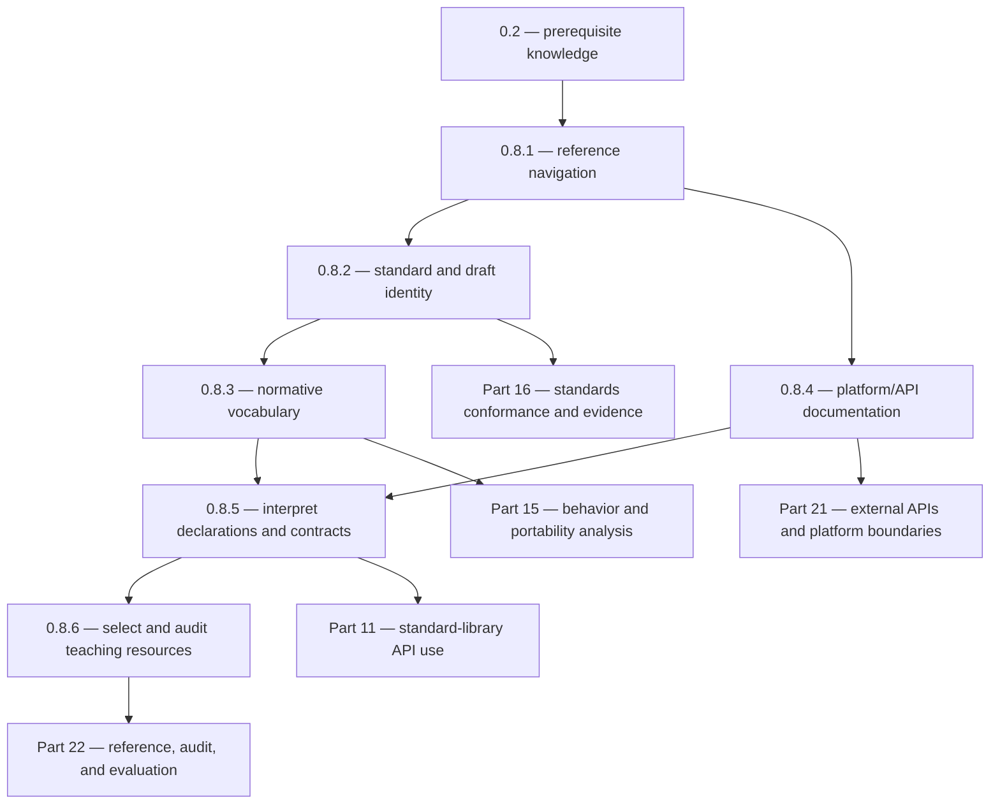

# 00.08 — Standards Documentation and How to Read It

**Part:** 00 — ORIENTATION, HISTORY, AND WORKING ENVIRONMENT  
**Chapter level and prerequisites (source):** `L0; prerequisite: 0.2`  
**Chapter source ID:** `C23-P00-CH08`  
**Source outline:** `Kurikulum_C_Final.txt`  
**Status:** Publication-ready instructional content; standards-sensitive statements are version-labelled and linked to their evidence.  
**Primary language baseline:** ISO/IEC 9899:2024 (C23).  
**Last editorial verification:** 2026-11-06

> **The governing habit:** Treat every technical statement as a claim with a scope. Identify *which C version*, *which implementation or platform*, *which document*, and *which kind of authority* supports it. A compiler result is evidence about that compiler configuration—not a replacement for the language specification.

## Chapter scope

- **0.8.1** — cppreference C: language, headers, versions, and symbol index
- **0.8.2** — WG14 drafts, ISO documents, clause numbers, and corrigenda
- **0.8.3** — Normative terms: *shall*, *shall not*, *constraint*, *undefined*, *unspecified*, and *implementation-defined*
- **0.8.4** — Man pages and implementation-library documentation
- **0.8.5** — Reading examples, declarations, signatures, return values, and version notes
- **0.8.6** — Reference books: K&R, K. N. King, Beej's Guide to C, Modern C, and CS50

## Learning and retention map

- **Knowledge-unit namespace:** `C23-P00-CH08-Sxx-*`
- **Importance:** `Core` for S01–S05; `Supporting` for S06. The ability to locate and interpret reliable evidence is a prerequisite for every later standards-sensitive chapter.
- **Prerequisite:** Preserve `L0; prerequisite: 0.2`. The exact prerequisite knowledge-unit ID is intentionally not guessed; connect it when the source chapter's unit is available.
- **Review scopes:** Chapter → Part → Cross-part → Curriculum.
- **Retention layers:** Atomic (terms and identifiers), Conceptual (authority and scope), Procedural (lookup workflow), Relationship (connections between documents and implementations), Engineering judgment (deciding what evidence is sufficient).

## How to use this chapter

When a claim matters, do not start by searching for a compiler error message. Start by naming the claim precisely. For example:

> “In ISO C23, what does the standard require of this declaration, and does the Linux implementation add a platform-specific condition?”

Then follow the evidence chain:

1. Identify the language or API and its version.
2. Find the relevant declaration or topic in an index/reference.
3. Locate the authoritative specification or implementation contract.
4. Read the surrounding constraints, notes, and version history—not just the first matching sentence.
5. Build the smallest example that tests the claim without confusing unrelated behavior.
6. Record the conclusion, source, version, and remaining uncertainty.

A useful reference accelerates navigation. It does not automatically become the authority for every claim it explains.

---

## 0.8.1 — cppreference C: language, headers, versions, and symbol index

**Knowledge-unit ID:** `C23-P00-CH08-S01`  
**Importance:** Core  
**Retrieval item ID:** `C23-P00-CH08-S01-RET-01`  
**Misconception ID:** `MIS-P00-CH08-S01-01`

### 1. Core idea

cppreference is a high-value secondary reference for navigating C language and library topics, but the applicable ISO C standard and the relevant platform/API specification remain the authorities for conformance claims.

### 2. Mental model

Think of cppreference as a well-organized map with links to landmarks. It helps you find the subject, see related terms, and notice version boundaries. It is not the territory: a map entry may be incomplete, simplified, or still being updated, and the standard's exact wording controls a standards claim.

The analogy has a limit: unlike a physical map, reference pages may contain interpretation, examples, editorial notes, and links to several standards. Always distinguish those layers.

### 3. Technical mechanism

Use the C reference in a deliberate sequence:

- **Language page:** Start here for a language concept such as declarations, expressions, object lifetime, or translation phases.
- **Header page:** Start here when you know the header, such as `<stdio.h>` or `<stdlib.h>`, and need its declarations and macro inventory.
- **Function/macro page:** Start here when you know a symbol such as `fopen`, `strtol`, or `EXIT_FAILURE`. Inspect its synopsis, parameter types, return value, notes, and version annotations.
- **Version page:** Check whether the feature exists in C90, C99, C11, C17, or C23. Do not infer availability from a page's current wording alone.
- **Symbol/index search:** Search the exact spelling, then verify that the result is the C entity you mean—not a C++ entry, POSIX function, compiler extension, or similarly named macro.

A practical lookup record should contain:

| Field | Example of what to record |
|---|---|
| Spelling | `strtol` |
| Entity kind | Standard-library function |
| Header | `<stdlib.h>` |
| Version scope | Check the page's standard/version notes; do not guess |
| Contract | Parameters, base handling, return value, `errno` conditions |
| Authority to verify | ISO C library clause and any applicable implementation documentation |
| Confidence | Secondary-reference lookup complete; normative wording still to be checked |

**Important C23 orientation:** ISO/IEC 9899:2024 is the published C23 edition. cppreference's C23 overview identifies C23 and summarizes additions/removals, but the page itself flags areas as incomplete. Use it as a navigation aid, not as proof that every listed detail is exhaustive. The predefined macro `__STDC_VERSION__` is `202311L` for an implementation claiming the C23 language version in the relevant standard mode; test the implementation rather than assuming that every compiler's newest mode exposes the final value.

### 4. Formal boundary

- A cppreference page is explanatory secondary material, not the ISO document.
- A header's presence on a system does not prove that every declaration in it is ISO C; the header can expose POSIX, operating-system, vendor, or extension interfaces under particular conditions.
- A compiler accepting an identifier does not prove that the identifier is part of the selected C edition.
- C and C++ references are separate. Similar syntax or a shared header name does not make their rules interchangeable.
- Version labels matter. A C23 feature must not be silently taught as C17, and an old example must not be silently upgraded to C23 semantics.

### 5. Practical consequence

Use cppreference to reduce search time, then confirm important claims in the standard or platform specification. When reviewing a pull request, replace “cppreference says it works” with a traceable statement: “This is an ISO C23 library facility declared by `<...>`; the applicable contract is in ISO/IEC 9899:2024, and the target implementation documents support for the selected mode.” If the exact clause or implementation support has not been checked, say so.

### 6. Retrieval question

You find a page for a function that appears in `<string.h>`. Reconstruct the lookup path that establishes (a) whether it is ISO C23, (b) its required header and contract, and (c) whether the target platform adds restrictions. Which source is a navigation aid, and which source settles the conformance claim?

**Worked lookup:** Search for the exact symbol → confirm the C page and header → inspect version notes → follow the standard reference → inspect the target platform's manual page if platform behavior matters → record unresolved details rather than filling them from memory.

---

## 0.8.2 — WG14 drafts, ISO documents, clause numbers, and corrigenda

**Knowledge-unit ID:** `C23-P00-CH08-S02`  
**Importance:** Core  
**Retrieval item ID:** `C23-P00-CH08-S02-RET-01`  
**Misconception ID:** `MIS-P00-CH08-S02-01`

### 1. Core idea

WG14 develops and maintains the C language standard, while ISO/IEC publishes the International Standard; committee drafts are essential public evidence, but a draft number, publication number, and clause citation are not interchangeable.

### 2. Mental model

Think of standardization as a document's controlled journey: proposals and working drafts record development, a final committee text approaches publication, and the published ISO/IEC edition is the formal International Standard. Later corrections and change/clarification records help explain the standard's maintenance history.

The analogy is not a claim that every draft is automatically superseded in a simple linear sequence. A draft may be useful for history or public access, but its status must be read from WG14/ISO records.

### 3. Technical mechanism

Use these document types accurately:

- **WG14 paper/document number (for example, Nxxxx):** An identifier assigned within the committee's document process. A paper may be a proposal, discussion paper, draft, response, or other committee material. The number alone does not tell you its status.
- **Working Draft (WD):** A draft text circulated during standards development. It can change before publication.
- **Final International Standard:** The published ISO/IEC document. For C23, the designation is **ISO/IEC 9899:2024**, Edition 5, published in 2024.
- **Clause/subclause number:** A locator within a particular edition. Cite it together with the edition; clause numbers can move or be revised between editions.
- **Corrigendum / correction / change or clarification record:** A maintenance artifact addressing errors or interpretation questions. Check the official record and its applicability; do not assume every committee proposal became part of the published text.

**C23 document identity, verified against WG14/ISO records:** WG14's project-status page identifies ISO/IEC 9899:2024 as C23 and lists N3220 (2024-02-22) as a similar draft. The publicly accessible N3220 PDF carries the ISO/IEC 9899:2024 title page. It is therefore a valuable publicly readable text, but cite the published edition as ISO/IEC 9899:2024 when making a claim about the International Standard. The official WG14 site notes that the international standard is obtained through the relevant national member body.

**A reliable citation format:**

> ISO/IEC 9899:2024, *Programming languages — C*, Edition 5, clause/subclause [number], [paragraph if needed].

If you used a public draft instead, disclose it:

> WG14 N3220, public text corresponding to the C23 publication; verify against the licensed ISO/IEC 9899:2024 text before treating a disputed wording detail as final.

Do not invent a clause number. If you have not checked the exact clause in the applicable edition, write **“to be verified with the authoritative ISO/IEC 9899:2024 text”** and retain the topic name as a search lead.

### 4. Formal boundary

- A proposal is not itself a language rule merely because WG14 discussed it.
- A draft may differ from the final published text. Confirm accepted changes and editorial corrections.
- A clause number without an edition is incomplete evidence.
- A corrigendum or change/clarification response must be read in context: identify the base edition, the issue addressed, and whether the record is adopted, published, or merely proposed.
- ISO's public preview and WG14 pages establish publication metadata and document status; a preview is not necessarily the complete normative text.
- Do not call N3220 “the ISO publication number.” It is a WG14 document number; ISO/IEC 9899:2024 is the standard designation.

### 5. Practical consequence

When documenting a standards-sensitive bug, preserve enough information for another engineer to reproduce the lookup: language edition, document designation, clause, compiler and version, command-line mode, platform, and exact source code. If the issue concerns a defect report or correction, link the official WG14 record and explain whether it changes the rule being discussed. Never cite “C23 §x.y” from memory.

### 6. Retrieval question

A blog post cites “WG14 N3220 §6.7” and calls it “the ISO standard.” What is imprecise about that citation? Reconstruct a corrected citation, explain why the edition must accompany the clause, and state what you would do if you could not verify the final published wording.

---

## 0.8.3 — Normative terms: shall, shall not, constraint, undefined, unspecified, and implementation-defined

**Knowledge-unit ID:** `C23-P00-CH08-S03`  
**Importance:** Critical  
**Retrieval item ID:** `C23-P00-CH08-S03-RET-01`  
**Misconception ID:** `MIS-P00-CH08-S03-01`

### 1. Core idea

Normative vocabulary defines the force and consequences of a standard's statements, so a C programmer must distinguish a requirement, a prohibition, a constraint violation, and the different categories of behavior instead of calling all of them “compiler-dependent.”

### 2. Mental model

Read a standard like a contract with different kinds of clauses:

- **shall** states a requirement;
- **shall not** states a prohibition;
- a **constraint** sets a condition a translation must satisfy;
- **implementation-defined** behavior leaves a choice to the implementation and requires documentation of that choice;
- **unspecified** behavior permits one of multiple possibilities without requiring the implementation to document which one it chooses;
- **undefined behavior** means the standard imposes no requirements for that situation.

This is a reading aid, not a replacement for the formal definitions and the exact clause governing a particular construct.

### 3. Technical mechanism

**Requirement and prohibition.** In normative text, *shall* and *shall not* are strong requirement words. Do not downgrade “shall” to a suggestion. Also do not assume every sentence in a standard is normative: notes, examples, rationale, and informative annexes have different roles.

**Constraint.** A constraint is a restriction on a program construct. A translation unit containing a syntax-rule or constraint violation requires a diagnostic under the standard's translation requirements. A diagnostic is not necessarily a promise that the implementation will refuse to produce an executable; the implementation may continue after issuing it. Distinguish “a diagnostic is required” from “the program must fail to compile.” Exact application depends on the applicable rule and translation context.

**Implementation-defined behavior.** The standard permits a choice and requires the implementation to document how the choice is made. Example: certain properties of the implementation's integer types are documented characteristics; consult the implementation's documentation rather than assuming a universal value.

**Unspecified behavior.** The standard permits two or more possibilities and does not require the implementation to document which possibility is selected. Do not rely on one observed selection. A familiar example category is the order in which function-call arguments are evaluated when the standard does not specify an order; the program must not assume a particular order. Check the exact expression's sequencing rules before classifying it.

**Undefined behavior (UB).** The standard imposes no requirements when a program reaches a situation classified as undefined. It is not a predictable “random result,” and it is not a portable way to request a particular outcome. A compiler may optimize on the assumption that a conforming program does not execute undefined behavior.

**Extension.** An implementation may accept additional syntax or provide extra APIs. That acceptance does not make the feature part of ISO C. Use the implementation's extension documentation and select a strict language mode when the goal is to test ISO-language boundaries.

### 4. Formal boundary

| Category | What the standard says | Documentation obligation | Safe engineering interpretation |
|---|---|---|---|
| Required behavior | A requirement applies | No special “choice” documentation implied | Meet the requirement |
| Prohibited behavior | A prohibition applies | No special “choice” documentation implied | Do not do it |
| Constraint violation | A constraint is not met | A diagnostic is required in the relevant translation context | Treat the source as non-conforming; do not rely on recovery behavior |
| Implementation-defined | One permitted choice is made | The implementation documents the choice | Read the target's documentation; portability may require handling variation |
| Unspecified | One of multiple permitted possibilities occurs | No requirement to document the choice | Do not depend on which possibility occurs |
| Undefined | The standard imposes no requirements | No defined outcome to document | Remove the triggering condition; do not predict output |
| Extension | Outside the ISO language/library contract | Vendor/platform documentation should describe it | Mark it as non-portable unless another specification guarantees it |

Three important safeguards:

1. **A diagnostic is not the same as a runtime guarantee.** Compiler warnings, errors, and runtime behavior are separate evidence.
2. **Unspecified is not undefined.** Unspecified behavior remains within a set permitted by the standard; undefined behavior has no standard-imposed requirements.
3. **Implementation-defined is not unspecified.** The implementation must document the choice for implementation-defined behavior.

For exact normative definitions and clause locations, consult ISO/IEC 9899:2024, especially its terms-and-definitions material and the translation/constraint requirements. The public N3220 text is a useful route to the C23 wording; for disputed details, verify against the published ISO text. Clause numbers are deliberately not supplied here unless individually checked against the final edition.

### 5. Practical consequence

When reviewing code, classify the issue before proposing a fix. Ask: “Is this prohibited by a constraint? Is the implementation required to document a choice? Is the choice unspecified? Is the behavior undefined? Or is this an extension?” Then remove dependencies on unspecified/implementation-defined choices when portability matters, and eliminate undefined behavior rather than testing for a preferred output.

### 6. Retrieval question

Explain the difference between implementation-defined, unspecified, and undefined behavior without using the phrase “compiler-dependent.” For each category, state whether documentation is required and whether a program may safely rely on one observed result.

---

## 0.8.4 — Man pages and implementation-library documentation

**Knowledge-unit ID:** `C23-P00-CH08-S04`  
**Importance:** Core  
**Retrieval item ID:** `C23-P00-CH08-S04-RET-01`  
**Misconception ID:** `MIS-P00-CH08-S04-01`

### 1. Core idea

Man pages and vendor/library manuals describe the contract of a particular operating system, C library, compiler, or tool, and must be separated from the ISO C contract unless they explicitly identify a standard requirement.

### 2. Mental model

Use two overlapping shelves:

- **ISO C shelf:** language and standard-library guarantees that apply to a conforming implementation of the selected C edition;
- **platform shelf:** operating-system interfaces, POSIX facilities, vendor extensions, implementation details, and platform-specific behavior.

A function can appear on both shelves, but the platform manual may add details that ISO C does not specify. Never assume that “documented on Linux” means “required by ISO C.”

### 3. Technical mechanism

On Unix-like systems, `man` opens manual pages. Sections commonly separate user commands, system calls, library functions, file formats, and administrative interfaces; exact section organization varies by system. For example, section 3 commonly contains library calls and section 2 system calls on Linux, but always check the local manual's conventions.

Useful commands include:

```sh
man 3 printf
man 3 strtol
man 7 feature_test_macros
man -k string
apropos string
```

The section number matters: `printf(3)` is a library function entry, while a command with the same spelling could have a different page. On Linux, the man-pages project documents Linux interfaces and library behavior; its pages often identify standards history and portability notes. Those notes are valuable, but a Linux man page is not the ISO C standard.

When reading a page, inspect:

- **NAME / SYNOPSIS:** exact symbol and required headers;
- **DESCRIPTION:** operational contract and parameter meaning;
- **RETURN VALUE:** success and failure indicators;
- **ERRORS:** documented error conditions, including whether `errno` is relevant;
- **ATTRIBUTES / CONFORMING TO / STANDARDS:** thread-safety and standards labels, where supplied;
- **NOTES / BUGS / CAVEATS / HISTORY:** platform behavior, limitations, and version history;
- **SEE ALSO:** related interfaces and specifications.

For non-Linux platforms, consult that platform's official documentation. Examples include the Microsoft C runtime documentation, Apple platform documentation, and the relevant POSIX specification. Do not transfer Linux-specific guarantees to Windows, macOS, embedded targets, or another C library without evidence.

### 4. Formal boundary

- ISO C specifies the C language and standard library; it does not standardize every operating-system service or process-launch mechanism.
- POSIX is a separate specification. A POSIX function may be widely available on Unix-like systems without being an ISO C function.
- Feature-test macros can control which declarations a system header exposes. Their names, required values, and effects are platform-specific; read the target system's documentation.
- A man page's “conforming to” list identifies standards associated with that interface; it does not mean every detail on the page is part of ISO C.
- `errno` is meaningful only when the relevant function's contract says it is meaningful. Do not treat a stale `errno` value as a universal error signal.

### 5. Practical consequence

For every external API, record the platform and contract explicitly. For a portable C program, prefer ISO C facilities when they meet the requirement. If a POSIX or vendor API is necessary, isolate it behind a platform-specific boundary, document the dependency, and test it on the intended target. A build that succeeds on one machine does not establish availability elsewhere.

### 6. Retrieval question

A Linux `man 3` page documents a function and says it conforms to POSIX. Does that make the function part of ISO C23? Reconstruct the evidence you would need to answer separately for ISO C, POSIX, and the target Linux implementation.

---

## 0.8.5 — Reading examples, declarations, signatures, return values, and version notes

**Knowledge-unit ID:** `C23-P00-CH08-S05`  
**Importance:** Core  
**Retrieval item ID:** `C23-P00-CH08-S05-RET-01`  
**Misconception ID:** `MIS-P00-CH08-S05-01`

### 1. Core idea

A documentation example is a compressed demonstration of a contract, so read its declaration, preconditions, return-value rules, error path, and version assumptions before copying it into a program.

### 2. Mental model

Treat an API entry as a small interface agreement. The declaration tells you how to call it; the prose tells you what the call means; the return-value section tells you what evidence the caller receives; the version notes tell you when the agreement applies. An example is one witness to that contract—not the entire contract.

### 3. Technical mechanism

Read a function synopsis from left to right:

```c
long strtol(const char *restrict nptr,
            char **restrict endptr,
            int base);
```

- `long` is the return type.
- `strtol` is the function name.
- `const char *` describes the input character sequence through a pointer-to-const view.
- `char **` is an output channel through which the function can store a pointer, when `endptr` is not a null pointer.
- `int base` controls the conversion base subject to the function's contract.
- `restrict` is a type qualifier with aliasing-related semantics; do not erase it from a normative synopsis merely because a simplified example omits it.

A synopsis is not a complete explanation. For `strtol`, the caller must understand where conversion stops, how to detect that no digits were converted, how range errors are reported, and when `errno` should be inspected. The return value alone is not sufficient to distinguish every situation; consult the full contract.

**A disciplined API-reading checklist:**

1. Copy the exact declaration and required header.
2. Identify each parameter's direction, permitted values, and lifetime requirements.
3. Identify preconditions and constraints.
4. Identify the success return value and every documented failure result.
5. Check whether the function sets `errno`, and under which conditions.
6. Check ownership: whether memory is borrowed, returned, allocated, modified, or freed.
7. Read version, feature-test, and platform notes.
8. Read the example line by line; identify omitted error paths and assumptions.
9. Compile a minimal program under the intended language mode and target platform.

**Illustrative standard-library example:**

```c
#include <errno.h>
#include <stdio.h>
#include <stdlib.h>

int main(void)
{
    const char text[] = "123tail";
    char *end = NULL;

    errno = 0;
    long value = strtol(text, &end, 10);

    if (end == text) {
        puts("No digits were converted.");
        return EXIT_FAILURE;
    }

    if (errno == ERANGE) {
        puts("The converted value was out of range.");
        return EXIT_FAILURE;
    }

    printf("value=%ld, unconverted suffix=%s\n", value, end);
    return EXIT_SUCCESS;
}
```

This example intentionally accepts a numeric prefix and reports the suffix. It does **not** claim that the entire input string is a valid integer. A whole-string parser must additionally check that the remaining characters satisfy the application's whitespace/trailing-input policy. The example also demonstrates why reading only the return type or copying a one-line call is inadequate.

### 4. Formal boundary

- A declaration's spelling and qualifiers matter. Do not replace a prototype with a remembered approximation.
- A return value can have multiple meanings; follow the function-specific contract.
- `errno` is not automatically reset by every library function, and its value is not a universal success/failure flag.
- An example may omit checks for brevity. Production code must satisfy the complete contract.
- Version notes can refer to the language standard, a library version, an operating-system release, or a feature-test macro. These are different version axes.
- A function may be standardized in POSIX or a vendor library but absent from the ISO C edition being targeted.

### 5. Practical consequence

Before adopting an example, write down its preconditions and failure paths. Compile it with warnings enabled, then add tests for normal input, boundary input, and documented failure cases. If a documentation page does not specify a required behavior, do not invent one from the example's output; find the authoritative contract or mark the issue unresolved.

### 6. Retrieval question

Given a function prototype and a five-line example, how would you determine whether the example is safe to reuse? Explain the difference between a declaration, a complete contract, a return-value convention, and a version note. For `strtol`, why is checking only whether the return value is zero insufficient?

---

## 0.8.6 — Reference books: K&R, K. N. King, Beej's Guide to C, Modern C, and CS50

**Knowledge-unit ID:** `C23-P00-CH08-S06`  
**Importance:** Supporting  
**Retrieval item ID:** `C23-P00-CH08-S06-RET-01`  
**Misconception ID:** `MIS-P00-CH08-S06-01`

### 1. Core idea

Books and courses are teaching paths with different audiences and publication dates; choose them for explanation and practice, then verify version-sensitive details against the current standard and implementation documentation.

### 2. Mental model

Think of references as different instructors in a workshop. One gives historical perspective, another builds fundamentals carefully, another offers a modern tutorial, and a course supplies a structured learning sequence. None of them replaces the specification when the question is “what exactly does C23 require?”

### 3. Technical mechanism

Use each resource for the job it is suited to:

| Resource | Strong use | Version / scope caution |
|---|---|---|
| **Kernighan and Ritchie, *The C Programming Language*, 2nd ed. (1988)** | Compact explanations, classic idioms, historical context, and the design style of ANSI C | It describes ANSI C, not C23. Treat old-style declarations, library details, and examples as historical unless checked against the current standard. |
| **K. N. King, *C Programming: A Modern Approach*, 2nd ed. (2008)** | Structured teaching, detailed explanations, exercises, and substantial practice | The publisher describes coverage of C89 and C99. It is not a C23 specification; check later-standard features elsewhere. |
| **Beej's Guide to C** | Accessible tutorial plus a separate library-reference volume; useful for practical examples and command-line orientation | The current guide identifies C23 as its focus, but the author labels the tutorial beta-quality and explicitly notes that some material may contain errors. Verify critical claims. |
| **Jens Gustedt, *Modern C*, 3rd ed. (2025)** | Modern C programming concepts, organization, memory, performance, threads, and C23-oriented practice | The publisher identifies the third edition as covering C23. A textbook remains explanatory material, not the normative standard. |
| **CS50** | Course structure, lectures, problem sets, tool-assisted practice, and beginner-friendly programming workflow | Course content is pedagogical and may use a particular environment or toolchain. Its examples do not define ISO C conformance. |

**A practical reading strategy:**

- Learn a concept from one teaching source that matches your current level.
- Solve its exercises without looking at the solution.
- Use a current reference to locate the relevant declaration or topic.
- Use the standard or platform specification to settle a disputed rule.
- Record the book/course edition and the C version assumed by the material.

Do not turn the reading list into a completion contest. One well-understood explanation plus a verified contract and independent practice is more valuable than passively finishing several books.

### 4. Formal boundary

- Publication date is evidence about likely version coverage, not proof of every technical detail in a book.
- A book may teach portable C, POSIX, a compiler extension, or a particular environment. Identify which one each example uses.
- A modern title is not automatically error-free or normative.
- Historical books remain valuable; their age changes how their claims should be verified, not whether their explanations can teach useful fundamentals.
- Do not reproduce copyrighted passages or large blocks of source text. Summarize concepts in your own words and cite the resource.

### 5. Practical consequence

Choose a primary teaching resource and keep a separate standards-verification workflow. When an example conflicts with C23 documentation, do not silently “average” the sources: identify the edition, find the normative rule, and annotate the older example as historical or version-specific. Prefer the newest relevant edition for C23-oriented learning, while still using older texts for the ideas they explain well.

### 6. Retrieval question

A K&R example and a C23 reference page appear to disagree. How would you determine whether the difference is historical, a platform extension, an editorial simplification, or a genuine conflict? Which resource would you use to learn the concept, and which would settle the C23 conformance question?

---

## Integrated practical lab — Build a standards-awareness probe

This lab is deliberately small. It tests whether a selected compiler mode exposes a language-version macro and whether a simple ISO C program compiles and runs. It does **not** certify full compiler conformance.

Create `standards_probe.c`:

```c
#include <stdio.h>

int main(void)
{
#ifdef __STDC_VERSION__
    printf("__STDC_VERSION__=%ld\n", (long)__STDC_VERSION__);
#else
    puts("__STDC_VERSION__ is not defined");
#endif

    puts("The program compiled and ran.");
    return 0;
}
```

### Reproducible checks

Run from the directory containing the file. The following four checks use distinct purposes and must be recorded independently.

```sh
# Check 1 — GCC in the published C23 language mode
 gcc -std=c23 -Wall -Wextra -Wpedantic -pedantic-errors \
     -Werror -O2 standards_probe.c -o probe-gcc-c23

# Check 2 — GCC in C17 mode, to demonstrate that the probe is not C23-only
 gcc -std=c17 -Wall -Wextra -Wpedantic -pedantic-errors \
     -Werror -O2 standards_probe.c -o probe-gcc-c17

# Check 3 — Clang 17 uses the pre-finalization spelling -std=c2x
 clang -std=c2x -Wall -Wextra -Wpedantic -pedantic-errors \
       -Werror -O2 standards_probe.c -o probe-clang-c2x

# Check 4 — Run the C23-mode executable
 ./probe-gcc-c23
```

Expected invariant for Check 4: the process exits successfully and prints two lines, the first reporting the implementation's `__STDC_VERSION__` value (or that the macro is not defined), and the second exactly:

```text
The program compiled and ran.
```

The final C23 value of `__STDC_VERSION__` is `202311L`, but do not assume every compiler that accepts a C23/C2x mode reports that final value. In this authoring environment, GCC 14.2.0 with `-std=c23` reported `202000`; Clang 17 uses the transitional `-std=c2x` spelling, whose macro value is likewise implementation/version-specific. Record the observed value and compiler version. If a compiler rejects a mode flag, record the unsupported mode; do not change the flag silently and still call the test C23.

### Acceptance record

| Check | Command intent | Result |
|---|---|---|
| 1/4 | GCC C23 strict-warning build | PASS — verified in this authoring environment (GCC 14.2.0; reports `__STDC_VERSION__=202000`) |
| 2/4 | GCC C17 compatibility build | PASS — verified in this authoring environment (GCC 14.2.0) |
| 3/4 | Clang C2x transition-mode build | PASS — verified in this authoring environment (Clang 17.0.0) |
| 4/4 | Execute GCC C23 build and inspect required output | PASS — verified in this authoring environment |

**What this test proves:** these exact compiler versions accepted this exact source under these exact options, and the GCC C23 executable ran successfully. **What it does not prove:** complete C23 conformance, correctness of unrelated library functions, identical behavior on another platform, or the absence of compiler defects. Compiler support tables are feature-by-feature, not a blanket guarantee.

---

## Misconception Defense Registry

The cases below are concrete diagnostic traps derived from real documentation and toolchain workflows. They are **candidate misconceptions**, not claims that a particular learner has expressed them. Use a learner's answer to determine whether the misconception is actually present.

### `MIS-P00-CH08-01` — “If cppreference lists it, it is automatically guaranteed by ISO C23.”

- **Incorrect belief:** A reference page is itself the normative standard, so every statement on it is a C23 guarantee.
- **Correct explanation:** cppreference is secondary explanatory material. Verify the applicable rule in ISO/IEC 9899:2024; verify platform-specific claims in the relevant platform/API specification.
- **Why it seems plausible:** The pages are detailed, well indexed, and often link directly to standards clauses. Their presentation can look specification-like.
- **Relevant chapter:** `0.8.1`.
- **Concrete case:** A developer finds `strdup` on a reference page and assumes it is universally available in every ISO C implementation. The C23 library status and the target implementation's support must be checked; historical POSIX availability is not the same as universal support in an older C edition.
- **Diagnostic question:** What evidence distinguishes “documented on cppreference” from “required by ISO C23”?
- **Correction exercise:** Pick one library symbol. Record its header, C edition, normative source, and target-platform availability. Mark each statement as secondary-reference, ISO, POSIX, or vendor evidence.
- **Related misconceptions:** `MIS-P00-CH08-S04-01`, `MIS-P00-CH08-S06-01`.

### `MIS-P00-CH08-S01-01` — “A compiler accepting a symbol proves that the selected C standard provides it.”

- **Incorrect belief:** Successful compilation proves that a feature belongs to the selected ISO C edition.
- **Correct explanation:** A compiler may accept extensions, built-ins, compatibility features, or declarations exposed by system headers. Use a strict mode, inspect diagnostics and feature macros, and verify the standard source.
- **Why it seems plausible:** The program builds and may even work on the developer's machine.
- **Relevant chapter:** `0.8.1`.
- **Concrete case:** A file compiles under `-std=gnu17` because the GNU dialect exposes an extension. The author then labels the program “strict C17.” The `gnu` mode explicitly permits GNU extensions; it is not the same claim as strict `-std=c17`.
- **Code example:** Compare `-std=c17` with `-std=gnu17` for a known GNU extension; record diagnostics and do not infer ISO status from acceptance.
- **Diagnostic question:** What does the `gnu` part of `-std=gnu17` tell you that `-std=c17` does not?
- **Correction exercise:** Rebuild a program in strict and extension-enabled modes. Identify which declarations or constructs depend on the extension and document a portable alternative where possible.
- **Related misconceptions:** `MIS-P00-CH08-S04-01`, `MIS-P00-CH08-S05-01`.

### `MIS-P00-CH08-S02-01` — “A WG14 N-number is the published ISO standard number.”

- **Incorrect belief:** Any document numbered Nxxxx is the final standard.
- **Correct explanation:** N-numbers identify WG14 documents of different types and statuses. C23's published designation is ISO/IEC 9899:2024; N3220 is a WG14 document associated with the C23 text.
- **Why it seems plausible:** WG14 drafts often contain near-complete standard text and are easier to access than the licensed publication.
- **Relevant chapter:** `0.8.2`.
- **Concrete case:** A code review cites “ISO C23 = N3220” without identifying the published standard. The citation conflates the committee document identifier with the ISO designation.
- **Diagnostic question:** Which part of `ISO/IEC 9899:2024` is the publication designation, and what does `N3220` identify?
- **Correction exercise:** Rewrite a citation with the publication designation, edition, clause, and paragraph. If relying on a draft, label it as a draft/public text and record the need to verify against the published edition.
- **Related misconceptions:** `MIS-P00-CH08-01`, `MIS-P00-CH08-S03-01`.

### `MIS-P00-CH08-S03-01` — “Unspecified, implementation-defined, and undefined all mean the compiler can do anything.”

- **Incorrect belief:** These categories are synonyms for unpredictable behavior.
- **Correct explanation:** Implementation-defined behavior requires documentation of the implementation's choice; unspecified behavior permits alternatives without a documentation requirement; undefined behavior carries no requirements from the standard for that situation.
- **Why it seems plausible:** All three can produce different observations across implementations or builds.
- **Relevant chapter:** `0.8.3`.
- **Concrete case:** A reviewer sees two calls such as `f(i++, i++)` and labels the issue merely “implementation-defined.” That classification is not justified: argument evaluation order is not generally specified, and modifying the same scalar object multiple times without the required sequencing can instead make the expression undefined. The exact expression must be analyzed under the applicable sequencing rule; it is not enough to call every order difference implementation-defined.
- **Diagnostic question:** Which of the three categories requires the implementation to document its choice?
- **Correction exercise:** Classify three independently sourced examples, quote the rule that supports each classification, and explain why the other two labels do not apply.
- **Related misconceptions:** `MIS-P00-CH08-S02-01`, `MIS-P00-CH08-S05-01`.

### `MIS-P00-CH08-S04-01` — “A Linux man page describes an ISO C function, so every detail is portable ISO C.”

- **Incorrect belief:** A function documented on a Linux system belongs to ISO C and behaves identically everywhere.
- **Correct explanation:** Linux man pages document Linux interfaces and may describe ISO C, POSIX, Linux-specific, or library-specific behavior. Check the “standards” and portability sections and compare with the actual ISO C contract.
- **Why it seems plausible:** The manual is authoritative for the local system and often includes a “STANDARDS” section.
- **Relevant chapter:** `0.8.4`.
- **Concrete case:** A program uses a function described in `man 3` and is then built on a non-Linux target where the function or its feature-test declaration is absent. Local documentation was mistaken for a cross-platform guarantee.
- **Diagnostic question:** What evidence would establish that the function is ISO C rather than POSIX or Linux-specific?
- **Correction exercise:** Select one man-page entry and annotate each claim as ISO C, POSIX, Linux, or implementation-specific. Verify the ISO claim in the C standard and the POSIX claim in the POSIX specification.
- **Related misconceptions:** `MIS-P00-CH08-01`, `MIS-P00-CH08-S01-01`.

### `MIS-P00-CH08-S05-01` — “The example compiles, so its error handling and preconditions are complete.”

- **Incorrect belief:** A short documentation example is production-ready and covers all failure paths.
- **Correct explanation:** Examples illustrate selected behavior. The full declaration and contract define preconditions, return values, error indicators, ownership, and edge cases.
- **Why it seems plausible:** The code is short, readable, and produces the advertised output.
- **Relevant chapter:** `0.8.5`.
- **Concrete case:** A `strtol` example prints the returned number but never checks whether any digits were converted, whether the value was out of range, or whether trailing characters remain. The displayed number is not proof that the complete input was a valid integer.
- **Diagnostic question:** What does `endptr` tell you that the numeric return value alone does not?
- **Correction exercise:** Extend the example to distinguish no conversion, range error, valid full-string input, and valid numeric prefix with trailing text. State the application's whitespace policy.
- **Related misconceptions:** `MIS-P00-CH08-S03-01`, `MIS-P00-CH08-S04-01`.

### `MIS-P00-CH08-S06-01` — “A respected C book is current for C23 unless it says otherwise.”

- **Incorrect belief:** A classic or popular textbook can be used as a current normative source without checking its publication era.
- **Correct explanation:** Books teach concepts within their edition's scope. K&R 2nd edition describes ANSI C; King's 2nd edition covers C89/C99; a C23-oriented resource still remains explanatory rather than normative.
- **Why it seems plausible:** The fundamentals remain useful and many old examples still compile.
- **Relevant chapter:** `0.8.6`.
- **Concrete case:** A learner copies an old-style function declaration from a pre-C23 source and assumes it is valid C23 because a modern compiler accepts it in a permissive or compatibility mode. The selected language version and diagnostic behavior must be checked.
- **Diagnostic question:** Which of the listed resources is explicitly identified by its publisher as covering C23, and does that make it the normative standard?
- **Correction exercise:** Take one older example and one C23-oriented example. Identify their assumed language versions, compile in the intended modes, and verify any disputed semantic rule against ISO/IEC 9899:2024.
- **Related misconceptions:** `MIS-P00-CH08-01`, `MIS-P00-CH08-S01-01`.

### Misconception repair loop

For each case: present the diagnostic question → ask for the learner's reasoning → isolate the exact incorrect assumption → teach the corrected distinction with the relevant evidence → use a contrasting example → re-test later with a different example. A read correction is not evidence of resolution.

---

## Error and Weakness Registry

The registry below seeds **content-level risk checks** for the chapter. It does not pretend that a learner has made these errors. Add learner-specific entries only after observing an answer, code submission, or explanation.

| Error ID | Chapter / concept | Error type | Incorrect reasoning or risk | Correct reasoning | Severity | Repair exercise | Re-test | Status |
|---|---|---|---|---|---|---|---|---|
| `ERR-P00-CH08-01` | 0.8.1 / source authority | Standards error | Treats a secondary reference as normative | Verify the claim in the applicable standard or API specification | Core | Trace one symbol from index to authoritative contract | Day 3, then Day 14 | Open — content risk |
| `ERR-P00-CH08-02` | 0.8.2 / document identity | Recall / standards error | Uses N-number as the ISO publication designation | Separate WG14 document ID from ISO/IEC edition | Core | Repair a flawed citation | Day 3, then Day 14 | Open — content risk |
| `ERR-P00-CH08-03` | 0.8.3 / behavior categories | Reasoning error | Collapses unspecified, implementation-defined, and undefined | State documentation obligation and standard consequence for each | Critical | Classify examples with evidence | Day 1, 3, 7 | Open — content risk |
| `ERR-P00-CH08-04` | 0.8.4 / platform scope | Portability error | Treats Linux/POSIX documentation as ISO C | Label each contract by governing specification | Core | Audit one man-page entry | Day 3, then Day 14 | Open — content risk |
| `ERR-P00-CH08-05` | 0.8.5 / return-value contract | Application error | Copies example without checking failure indicators | Implement all documented checks | Core | Extend the `strtol` lab | Day 1, 3, 7 | Open — content risk |
| `ERR-P00-CH08-06` | 0.8.6 / book version | Historical/version error | Applies old book examples as C23 rules | Identify publication scope and verify modern claims | Supporting | Version-audit an older example | Day 7, then Day 30 | Open — content risk |

**Learner evidence fields to add when an error is observed:** date; exact question or code; learner's original answer; selected error ID; severity; help required; correction completed; delayed re-test result; status (`Open`, `Recovering`, `Resolved`). Do not mark an error resolved merely because the learner has reread the correction.

## Knowledge Connection Map



**Map interpretation:** the arrow from `0.2` preserves the scaffold's prerequisite relationship without inventing an unknown unit ID. Links to Parts 11, 15, 16, 21, and 22 are conceptual support relationships from the roadmap, not replacements for the curriculum's exact prerequisite list.

At review time, ask:

- Which earlier knowledge is required to understand the document or declaration?
- Which later chapters rely on the ability to distinguish ISO C from platform APIs?
- Which similar-looking concepts have different authority or semantic force?
- What changes when the same function is used under another C version or operating system?
- What engineering failure follows if this relationship is misunderstood?

## Pitfall box

> **Pitfall — observed output is not a specification.** One compiler's acceptance, warning, output, or optimization result does not establish a portable C guarantee. Record the compiler/version, selected `-std` mode, flags, platform, and exact program; then verify the language rule and any implementation-defined choice. Never infer “the standard says this” from “my machine did this.”

## Retrieval questions

Answer from memory first. Consult the chapter only after committing to an answer.

1. What is the difference between a secondary reference and a normative specification?
2. What is the difference between `N3220` and `ISO/IEC 9899:2024`?
3. Why must a clause number be paired with a standard edition?
4. Which behavior category requires the implementation to document its choice?
5. Why is unspecified behavior not the same as undefined behavior?
6. What does a required diagnostic for a constraint violation fail to guarantee?
7. Why is a Linux man page not automatically an ISO C guarantee?
8. What information should be read beyond a function's synopsis?
9. Why is the `strtol` return value insufficient to validate an entire input string?
10. Which listed books explicitly cover earlier C editions, and which listed Modern C edition is publisher-described as covering C23?
11. What does a successful `-std=c23` build prove—and what does it not prove?
12. How would you document an unresolved standards question without inventing a clause or guarantee?

## Cumulative review

### Chapter review

Use a 20–30 minute session, adapting the time to the learner's level:

1. **Free recall (3–5 min):** Draw the authority chain from cppreference to ISO/WG14 to platform documentation.
2. **Precision recall (3–5 min):** Define implementation-defined, unspecified, and undefined behavior; state the documentation difference.
3. **Code reasoning (5–8 min):** Read the `strtol` example and identify every branch and remaining input condition.
4. **Connection review (3–5 min):** Explain how standards vocabulary informs portability and API selection in later parts.
5. **Error repair (3–5 min):** Repair one open misconception or weakness record.
6. **Scheduling (1–2 min):** Record scores and the next review date.

### Part-end review contribution

This chapter contributes evidence to all seven mandatory Part 00 review items; it does not replace the seven-item review itself.

| Required part-end item | Chapter 0.8 contribution |
|---|---|
| 1. Core concept recall | Reconstruct the authority and version-aware lookup workflow |
| 2. Definitions and distinctions | Normative terms; draft vs published standard; ISO vs POSIX/vendor scope |
| 3. Code reading | Interpret the `strtol` example and compiler-mode probe |
| 4. Code writing | Build and run `standards_probe.c`; extend the parsing example |
| 5. Error diagnosis | Diagnose the six concrete misconception cases |
| 6. Prerequisite connections | Preserve the 0.2 prerequisite and link to later standards/API work |
| 7. Short mastery assessment | Score recall, explanation, application, diagnosis, and integration |

### Cross-part review

- **Parts 6–8:** Use the authority workflow when pointer, object, and memory claims depend on exact C semantics.
- **Parts 9–11:** Distinguish ISO library contracts from operating-system and library extensions.
- **Parts 12–15:** Use normative behavior categories when analyzing concurrency, numerical behavior, C23 features, and portability.
- **Parts 16 and 22:** Reconstruct a standards citation and audit the evidence behind a technical claim.
- **Part 21:** Keep the boundary between ISO C and external APIs explicit.

These are review connections, not new prerequisite declarations.

### Curriculum review

Sample this chapter when reviewing critical standards knowledge, previously weak concepts, high-dependency concepts, and knowledge not reviewed recently. Do not attempt all 175 chapters in one sitting. A short evidence-based lookup task is more useful than a marathon of definition cards.

## Assessment record

**Scoring scale:** 0 = cannot answer / incorrect; 1 = major gaps or substantial help; 2 = partly correct or inconsistent; 3 = correct and independent; 4 = clear, correct, and transferable to a new context.

| Dimension | Score (0–4) | Evidence / notes |
|---|---:|---|
| Recall | Not assessed | No learner response has been collected |
| Explanation | Not assessed | No learner explanation has been collected |
| Application | Not assessed | Lab is provided; no learner submission is recorded |
| Diagnosis | Not assessed | Misconception cases are authored; no learner diagnosis is recorded |
| Integration | Not assessed | Cumulative review is specified; no learner evidence is recorded |

**Assessment status:** Not assessed. Do not substitute the author's code verification for learner assessment. A critical knowledge unit cannot be marked mastered if it scores 0 or 1 in a critical dimension. Completion, delayed retention, and mastery remain separate statuses.

## Review schedule and workload controls

Use the roadmap's default retrieval intervals as a starting point: **Day 0, 1, 3, 7, 14, 30, 60, and 90**, adjusting to actual performance. These are review opportunities, not a punishment for missed sessions.

Prioritize in this order when the queue is overloaded:

1. Critical prerequisite knowledge—especially the distinctions in S03.
2. Material needed by the current chapter or coding task.
3. Overdue core knowledge units.
4. Supporting resource-selection knowledge in S06.

Avoid near-duplicate cards. Definitions can be reviewed briefly; code diagnosis, standards lookup, and integration need longer practice. If reviews are missed, resume with the highest-value item rather than attempting the entire backlog at once.

## Operational CTM implementation

This chapter is one node in the curriculum-wide system: **23 parts, 175 chapters, and levels L0–L4**. Its local records should remain small and useful; they feed the shared knowledge graph, retrieval bank, misconception registry, assessment process, and dashboard.

### Level-appropriate evidence

The chapter metadata remains L0. Use evidence appropriate to the learner's current level rather than demanding advanced standards-audit work too early:

| Level | Suitable task using this chapter | Evidence |
|---|---|---|
| L0 — Discover | Recognize a reference page, a standard, and a platform manual as different source types | Correctly identifies what each source is for |
| L1 — Understand | Explain the difference between a draft, published standard, and implementation manual | Gives a clear explanation and a simple example |
| L2 — Apply | Look up a symbol and compile a minimal program in a named language mode | Produces a traceable lookup record and a working build |
| L3 — Analyze | Diagnose a claim that confuses POSIX, ISO C, and vendor behavior | Cites the correct contract and explains the category error |
| L4 — Engineer | Review a portability claim and justify the evidence required for release | Produces a defensible standards/platform audit with explicit uncertainty |

### Mastery gate

Keep three statuses separate:

- **Completed:** the learner has studied the chapter.
- **Retained:** the learner can retrieve essential distinctions after a delay.
- **Mastered:** the learner can explain, apply, and transfer the lookup method independently.

Mastery requires evidence that the learner can (1) retrieve the critical distinctions, (2) explain the authority chain, (3) handle important version and behavior categories, (4) complete an appropriate standards/API lookup task, (5) avoid critical misconceptions, and (6) retain the knowledge in a later cumulative review. A critical concept scoring 0 or 1 is not mastered, even if the overall average is high.

### Project reinforcement

Use small practical artifacts to reactivate this chapter in later work:

- **Parts 0–4:** annotate a tiny command-line program with its compiler mode and the sources used to explain its constructs.
- **Parts 5–7:** document the contract and version scope of one declaration or library function used by a modular program.
- **Parts 8–10:** distinguish ISO C behavior from the operating-system services used by a memory/file/translation-unit exercise.
- **Part 11:** build a one-page API record containing header, purpose, parameters, return value, errors, version, and source.
- **Parts 12–15:** write a short standards note classifying a behavior claim and its portability boundary.
- **Parts 16–19:** produce a small standards-and-toolchain audit alongside a reference, algorithm, or security investigation.
- **Parts 20–22:** include an evidence ledger in an integrated project review, identifying normative claims, implementation claims, tests, and unresolved items.

Projects must deliberately revisit old knowledge. A project that only introduces new APIs does not reinforce this chapter unless it requires the learner to retrieve and apply its source-verification method.

### Dashboard fields contributed by this chapter

Track these values in the shared dashboard; do not invent learner status before assessment:

| Metric | Chapter 0.8 interpretation |
|---|---|
| Chapters completed / retained / mastered | Three separate states, each backed by its own evidence |
| Critical knowledge at risk | Especially S03 behavior-category distinctions and S02 source identity |
| Reviews due / overdue | Retrieval items scheduled from the Day 0–90 sequence and adjusted to performance |
| Open misconceptions | The six diagnostic cases, marked open until tested and resolved with evidence |
| Weak prerequisites | The exact prerequisite from 0.2 once its knowledge-unit ID is available |
| Cumulative assessment | Chapter, Part 00, cross-part, and curriculum review results |
| Standards verification status | Verified metadata, exact-clause checks pending, compiler support recorded by version |

Allowed dashboard states are `Mastered`, `Retained`, `At risk`, `Needs repair`, and `Not assessed`. This file's learner assessment remains `Not assessed` until a learner supplies evidence.

### Reusable implementation components

| Component | Chapter 0.8 data it consumes or produces |
|---|---|
| Knowledge Extractor | Six knowledge units, importance, retrieval questions, and version-sensitive claims |
| Knowledge Graph | Prerequisite and conceptual links in the connection map |
| Question Bank | Retrieval questions, code-reading tasks, and standards-lookup exercises |
| Misconception Registry | Six candidate cases with diagnostics, corrections, and re-tests |
| Review Scheduler | Day 0, 1, 3, 7, 14, 30, 60, and 90 review opportunities, adjusted to performance |
| Assessment Engine | 0–4 scores for recall, explanation, application, diagnosis, and integration |
| Retention Dashboard | Completion/retention/mastery states, weaknesses, overdue reviews, and verification status |

The system can initially be operated manually in a spreadsheet or database. Software is optional; stable identifiers, accurate records, and sustainable review behavior are not.

### Non-negotiable operating rules for this chapter

1. Retrieve the authority chain before rereading the lesson.
2. Understand why a source has authority before memorizing its title or document number.
3. Apply the lookup method to a real symbol or standards claim.
4. Test similar categories contrastively: draft vs publication, ISO vs POSIX, implementation-defined vs unspecified vs undefined.
5. Track a misconception until a later re-test demonstrates correction.
6. Reactivate the 0.2 prerequisite and the chapter's later dependencies when reviewing advanced material.
7. Include this chapter in Part 00 and cumulative reviews.
8. Keep all C claims version-aware, with C23 as the primary ISO C baseline.
9. Treat standards lookup as an engineering skill; memory alone is not sufficient for disputed details.
10. Award mastery only when independent evidence satisfies the gate.
11. Keep the review queue sustainable; do not punish missed sessions with an unmanageable backlog.
12. Adapt review frequency to demonstrated weakness and reliability.

### Chapter blueprint

| Element | Chapter 0.8 implementation |
|---|---|
| Scope | Six sub-chapters under `C23-P00-CH08` |
| Memory layers | Atomic terminology; conceptual source hierarchy; procedural lookup; relationship map; engineering judgment in evidence evaluation |
| Retrieval modes | Free recall, precision distinctions, code reading, error diagnosis, contrastive retrieval, transfer to a new platform/version |
| Review intervals | Day 0, 1, 3, 7, 14, 30, 60, 90, adjusted to performance |
| Cumulative scopes | Chapter, Part 00, cross-part, curriculum |
| Learning statuses | Completed, Retained, Mastered |
| Operational components | Knowledge graph, question bank, misconception registry, scheduler, assessment record, dashboard |

## Standards verification ledger

| Claim / topic | Evidence used | Status | Publication note |
|---|---|---|---|
| C23 publication identity | WG14 project-status page; ISO catalogue; WG14 home page | Verified against WG14/ISO publication metadata | Cite ISO/IEC 9899:2024 as the published edition; N3220 is a WG14 document/public text |
| N3220 document identity | Public WG14 N3220 PDF | Verified as a WG14 document carrying ISO/IEC 9899:2024 title page | Do not call the N-number the ISO publication designation |
| cppreference role and C23 overview | cppreference C23 overview | Verified as a secondary reference; page itself flags incompleteness | Use for navigation; verify normative details in the standard |
| Normative vocabulary | Public C standard text and established C terminology | Concepts checked; exact final-edition clause numbers intentionally omitted | **To be verified with authoritative ISO/IEC 9899:2024 text** before adding exact clause citations |
| Constraint diagnostic requirement | C translation/constraint rules | General rule stated with scope qualification | Verify exact clause/paragraph in the licensed final text for formal audit |
| Linux man-page scope | Linux man-pages project conventions and page structure | Scope distinction established | Check the specific target page and target platform before relying on an API |
| Compiler flags/support | GCC C status; Clang C status; local compile matrix | Flags and local builds verified; support is feature-by-feature | Do not generalize one build into full conformance |
| K&R / King / Modern C / Beej / CS50 metadata | Publisher, author-maintained, and official course pages | Bibliographic and stated coverage claims checked | A book/course remains explanatory, not normative |

## Source and further-reading register

The following sources support the chapter's navigation, publication, toolchain, and resource-selection claims. The standard itself controls normative C claims.

1. **ISO/IEC JTC 1/SC 22/WG 14 — official C committee site:** <https://www.open-std.org/jtc1/sc22/wg14/>. Identifies WG14 as the C standardization working group and states that C23 was adopted by ISO/IEC in 2024.
2. **WG14 — project status and milestones:** <https://www.open-std.org/jtc1/sc22/wg14/www/projects>. Lists C23 as ISO/IEC 9899:2024 and N3220 as a similar draft; also links change/clarification records.
3. **WG14 N3220 PDF:** <https://www.open-std.org/jtc1/sc22/wg14/www/docs/n3220.pdf>. Publicly readable C23 text carrying the ISO/IEC 9899:2024 title page. Verify disputed wording against the published ISO edition.
4. **ISO catalogue — ISO/IEC 9899:2024:** <https://committee.iso.org/standard/82075.html>. Publication metadata, edition, date, and abstract.
5. **cppreference — C23:** <https://en.cppreference.com/w/c/23>. Secondary overview of C23 language/library changes and version information; the page notes that parts are incomplete.
6. **GCC — C standards support:** <https://gcc.gnu.org/projects/c-status.html>. Compiler-mode and feature-support information; support is version- and feature-specific.
7. **Clang — C language status:** <https://clang.llvm.org/c_status.html>. C23/C2x mode and feature-status information; support is partial and evolves by release.
8. **Beej's Guide to C:** <https://beej.us/guide/bgc/>. Author-maintained tutorial and library-reference links; the guide discloses its beta-quality status.
9. **Kernighan and Ritchie, *The C Programming Language*, 2nd ed. — publisher record:** <https://www.informit.com/store/c-programming-language-9780131103627>. Publication and ANSI C scope.
10. **K. N. King, *C Programming: A Modern Approach*, 2nd ed. — publisher record:** <https://wwnorton.co.uk/books/9780393979503-c-programming>. Publisher describes C89/C99 coverage.
11. **Jens Gustedt, *Modern C*, 3rd ed. — publisher record:** <https://www.simonandschuster.com/books/Modern-C-Third-Edition/Jens-Gustedt/9781633437777>. Publisher describes the edition as covering C23.
12. **CS50 — C course material:** <https://cs50.harvard.edu/x/weeks/1/>. Official course notes and practice context; not a language specification.
13. **Linux man-pages project:** <https://www.kernel.org/doc/man-pages/>. Linux manual-page project; consult the individual page and its standards/portability notes for any particular interface.

**Source hierarchy for future edits:** (1) published ISO/IEC C standard and applicable corrigenda; (2) applicable POSIX or other external specification for non-ISO APIs; (3) official implementation/platform documentation for implementation behavior; (4) compiler support/status documentation for feature availability; (5) secondary references, books, courses, and examples for explanation and navigation.

## Quality assurance record

- [x] All six source sub-chapters are retained.
- [x] All six original knowledge-unit IDs are unchanged.
- [x] Each sub-chapter contains the six mandatory steps in the required order.
- [x] Concrete misconception cases include all required registry fields and are explicitly not misrepresented as observed learner beliefs.
- [x] Error and Weakness Registry includes IDs, chapter, concept, error type, reasoning, severity, repair, re-test, and status.
- [x] Knowledge Connection Map preserves the stated prerequisite without inventing its unit ID.
- [x] Pitfall box is present.
- [x] Assessment record uses the 0–4 rubric and does not fabricate learner scores.
- [x] Retrieval questions and chapter/part/cross-part/curriculum cumulative review are present.
- [x] Standards-sensitive claims are version-labelled; exact final-edition clause numbers are not fabricated.
- [x] Runnable C source and four separately recorded build/run checks are included.
- [x] Compiler verification is explicitly limited to the tested compiler versions and exact commands.

**Publication boundary:** The chapter is ready as a teaching document. Before a formal standards audit or release that requires clause-level citations, verify each exact clause/paragraph against the licensed published ISO/IEC 9899:2024 text and update the verification ledger. No unverified clause number is presented as fact.

---

*File path: `part-00-orientation-history-toolchain/00.08-standards-documentation.md`*
