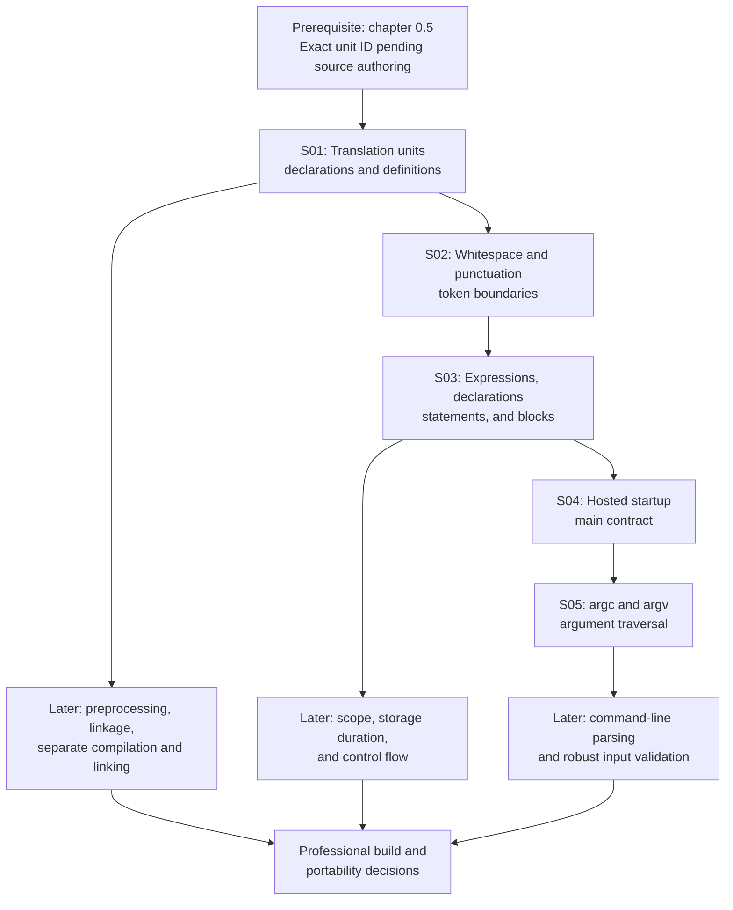

# 01.01 — C Program Structure

**Part:** 01 — Language Fundamentals, Tokens, and the Language Model  
**Chapter level and prerequisites (source):** `L1; prerequisite: 0.5`  
**Chapter source ID:** `C23-P01-CH01`  
**Source outline:** `Kurikulum_C_Final.txt`  
**Publication status:** Full instructional chapter; standards-sensitive statements are cross-checked against the publicly available WG14 N3220 document, titled *ISO/IEC 9899:2024*. The published ISO standard remains the normative authority.  
**Language:** English (United States)

> **Chapter promise:** By the end of this chapter, you should be able to look at a small C source file and explain how its text becomes a translation unit, how declarations and statements organize the program, why punctuation matters, and how a hosted implementation starts `main` and supplies command-line arguments.

---

## How to use this chapter

Do not begin by memorizing punctuation. Read a code example, predict what each part means, and then check the explanation. The central skill is structural reading: identify what is declared, what is defined, what is evaluated, where a block begins and ends, and which environment-specific contract starts the program.

This chapter is written for **L1 — Understand**. You should be able to identify and explain the structures and trace short examples. It does not assume that you can yet explain every rule of declarations, linkage, expressions, or the preprocessor in full; those subjects receive deeper treatment in their own chapters.

### Learning outcomes

After completing the chapter, you should be able to:

1. Distinguish a source file, preprocessing translation unit, translation unit, and executable program.
2. Explain why C translation is described in phases and why physical line layout is not the same thing as program structure.
3. Recognize the roles of whitespace, newlines, comments, semicolons, parentheses, braces, and commas.
4. Distinguish an expression, expression statement, declaration, definition, function definition, and compound statement.
5. Explain the hosted-environment contract for `main` and distinguish it from a freestanding startup contract.
6. Read `argc` and `argv` safely, including the `argv[argc]` null-pointer sentinel.
7. Compile and run a small program that demonstrates the chapter's central structures.

### Importance map

| Knowledge unit | Importance | Why it matters |
|---|---|---|
| `C23-P01-CH01-S01` | Critical | Translation-unit boundaries and declarations/definitions are foundational to later compilation and linking topics. |
| `C23-P01-CH01-S02` | Core | Token boundaries and punctuation determine how source text is read. |
| `C23-P01-CH01-S03` | Critical | Structural categories prevent fundamental code-reading and syntax errors. |
| `C23-P01-CH01-S04` | Critical | The hosted startup contract determines the portable entry-point form. |
| `C23-P01-CH01-S05` | Core | Command-line parameters are a common hosted-program interface. |

The source prerequisite `0.5` is preserved exactly. Its full knowledge-unit identifier is not present in this scaffold, so this chapter does not invent one. Add the precise graph edge when the prerequisite unit is authored and its identifier is available.

---

# 1.1.1 — Translation units, declarations, definitions, functions, blocks, and statements

**Knowledge-unit ID:** `C23-P01-CH01-S01`  
**Retrieval item ID:** `C23-P01-CH01-S01-RET-01`  
**Candidate misconception ID:** `MIS-P01-CH01-S01-01`

## 1. Core idea

A C program is translated through source-file and translation-unit boundaries, while declarations introduce names and definitions provide the entities' defining content or storage as required by the language.

## 2. Mental model

Think of a multi-file C program as a set of independently prepared sections that are later assembled into one deliverable. A translation unit is one unit of translation; a linker can later connect separately translated units through externally linked names.

The analogy is limited: translation units are language-defined conceptual units, not necessarily physical files in a one-to-one way, and linking is not simply concatenating text. Headers are processed through inclusion during preprocessing, and the implementation may use internal representations that do not resemble source files.

## 3. Technical mechanism

### From source file to translation unit

The C standard distinguishes the translation environment from the execution environment. At the program-structure level, the important sequence is:

1. A **source file** supplies source text.
2. A source file together with headers and source files included through `#include` forms a **preprocessing translation unit**.
3. After preprocessing, that preprocessing translation unit is called a **translation unit**.
4. A program may contain multiple translation units. They can be translated separately and later linked to form an executable program.

This is why a project can be divided into files such as `main.c`, `math_utils.c`, and `math_utils.h`. The `.c` files are commonly compiled separately; the header is commonly included by source files so that they share declarations. A header is not normally compiled as an independent executable component merely because it has a `.h` suffix.

### A small multi-file illustration

`math_utils.h`:

```c
#ifndef MATH_UTILS_H
#define MATH_UTILS_H

int add(int left, int right); /* declaration */

#endif
```

`math_utils.c`:

```c
#include "math_utils.h"

int add(int left, int right) /* definition */
{
    return left + right;
}
```

`main.c`:

```c
#include <stdio.h>
#include "math_utils.h"

int main(void)
{
    printf("%d\n", add(2, 3));
    return 0;
}
```

The header makes the function declaration visible to `main.c`. The function definition in `math_utils.c` supplies the implementation. The linker connects the call to the externally linked function definition. The include guard prevents repeated inclusion of the same header contents within one preprocessing translation unit; it does not itself create a linker symbol or compile a function.

### Declaration versus definition

A **declaration** introduces or redeclares an identifier and specifies properties such as its type. A **definition** is a declaration that also defines the entity. The exact rules depend on the entity and declaration form; do not reduce the distinction to “declaration means no memory, definition means memory” because that slogan is not universally accurate.

Examples:

```c
int calculate(int value); /* function declaration (prototype) */

extern int shared_count;  /* declaration, not a definition here */

int local_count = 0;      /* object definition */

int calculate(int value) /* function definition */
{
    return value * 2;
}
```

The function prototype allows the compiler to check calls against the declared parameter and return types. The function definition provides the function body. `extern int shared_count;` declares an object whose definition may appear elsewhere; by itself, this declaration does not define that object in this example.

### Functions, blocks, and statements

A **function definition** consists of declaration specifiers, a declarator, and a function body. The function body is a compound statement. A **block** is associated with that compound statement and has its own scope rules. A compound statement is delimited by braces and contains block items: declarations, statements, and labels.

```c
int double_value(int input) /* function definition begins */
{                           /* function body's block begins */
    int result = input * 2; /* declaration */
    return result;          /* statement */
}                           /* block and function body end */
```

A function call is not a function definition. A function declaration is not a function body. A brace pair can delimit a compound statement without defining a function, as in a nested block or an `if` body.

## 4. Formal boundary

The following C23 references have been checked against WG14 N3220, whose document title is *ISO/IEC 9899:2024*:

- **5.1.1.1, Program structure:** source files, preprocessing translation units, translation units, and separate translation/linking.
- **5.1.1.2, Translation phases:** the conceptual sequence of translation operations.
- **6.7, Declarations:** declaration syntax and semantics.
- **6.8, Statements and blocks:** statement and block structure.
- **6.9.1, General; 6.9.2, Function definitions:** external declarations and function-definition structure.

These clause references identify the relevant topics; this chapter is an explanation, not a substitute for the normative text. In particular:

- A translation unit is defined after preprocessing, not simply as “one `.c` file.”
- Separate translation is permitted; it is not a requirement that every implementation store each conceptual unit as a separate physical file.
- A declaration is not automatically a definition. Conversely, some declarations are definitions.
- The meaning of linkage, scope, storage duration, and external definitions is more detailed than this introductory chapter. Do not infer those rules from file names alone.
- A program may have multiple translation units. The exact requirements for external definitions and compatible declarations must be followed; the linker cannot make incompatible declarations correct.

## 5. Practical consequence

When organizing a project, place shared declarations in headers, provide exactly the required definitions in source files, and compile/link the translation units as a coherent program. When debugging an “undefined reference” or duplicate-definition problem, inspect declarations, definitions, linkage, and the build command rather than assuming that adding another `#include` will solve it.

When reading a function, mark its declarator, parameter list, body, nested blocks, declarations, and statements separately. This habit makes later topics—scope, linkage, storage duration, and control flow—much easier to reason about.

## 6. Retrieval question

Without looking back: explain the journey from source file to translation unit, then distinguish a function declaration from a function definition. Why is a header declaration useful when the definition is in another source file?

**Quick check**

```c
int transform(int);       /* A */
int stored_value = 10;    /* B */
int transform(int x)     /* C */
{
    return x + stored_value;
}
```

- A is a function declaration.
- B is an object definition.
- C is a function definition.

If you labelled A as a definition, revisit the difference between naming an interface and supplying its implementation.

---

# 1.1.2 — Whitespace, newlines, semicolons, parentheses, and token separators

**Knowledge-unit ID:** `C23-P01-CH01-S02`  
**Retrieval item ID:** `C23-P01-CH01-S02-RET-01`  
**Candidate misconception ID:** `MIS-P01-CH01-S02-01`

## 1. Core idea

Whitespace and punctuation help the translator identify preprocessing tokens and grammatical structure; they are not interchangeable decoration, and a newline is not generally a substitute for a semicolon.

## 2. Mental model

Think of a C source file as a stream of characters that is segmented into meaningful units. Whitespace often separates those units, while punctuation marks relationships and boundaries. The analogy resembles spaces and punctuation in written language, but C has formal tokenization and grammar rules: a character that looks like punctuation may be part of a string literal, a comment, or a multi-character punctuator.

## 3. Technical mechanism

### Whitespace and token boundaries

During translation phase 3, the source file is decomposed into preprocessing tokens and sequences of whitespace characters, including comments. Comments are replaced by one space character. Newline characters are retained. Whether a nonempty sequence of whitespace characters other than newline is retained or replaced by one space is implementation-defined.

Whitespace is therefore important as a separator. Compare:

```c
int total = 12;
inttotal = 12; /* one identifier, not the keyword int + total */
```

In the first line, whitespace separates the keyword `int` from the identifier `total`. In the second, `inttotal` is one identifier; the declaration does not mean the same thing.

### Newline is not a statement terminator

These are both valid ways to lay out the same declaration and expression statement:

```c
int count = 3;
count = count + 1;
```

```c
int
count
=
3
;
count
=
count
+
1
;
```

The second version is difficult to read, but the line breaks do not replace the semicolons. Conversely, a statement can be formatted across several physical lines.

A special translation rule joins physical source lines when a backslash is immediately followed by a newline in phase 2. That operation is called line splicing. It is not the same as inserting a semicolon, and it occurs before phase-3 tokenization.

### Semicolons

A semicolon appears in several distinct grammatical roles:

- It terminates many declarations, such as `int count;`.
- It terminates an expression statement, such as `count++;`.
- By itself, `;` is a **null statement** that performs no operation.
- It separates the three expressions in a `for` header: `for (i = 0; i < limit; ++i)`.

It does not terminate every C construct. A function definition ends with its closing brace, not a semicolon after the body:

```c
int get_value(void)
{
    return 7;
}
```

A semicolon after the closing brace is not part of the function-definition syntax. It may be parsed as a separate null statement in a context where a statement is permitted, but it should not be added as if it were required punctuation for a function definition.

### Parentheses

Parentheses serve multiple roles:

- Function declarators: `int get_value(void)`.
- Function calls: `get_value()`.
- Grouping expressions: `(a + b) * c`.
- Controlling expressions: `if (ready)` and `while (condition)`.
- Casts and type-related syntax, among other constructs.

Do not assume every pair of parentheses means a function call. In `if (ready)`, the parentheses delimit the controlling expression. In `(a + b)`, they group an expression.

### Braces, commas, and other punctuators

Braces delimit compound statements and initializer lists, among other constructs. A comma can separate declarators, arguments, parameters, or initializer elements; it can also be the comma operator in an expression. Its meaning depends on grammatical context.

C also has multi-character punctuators such as `++`, `->`, `<=`, `==`, `&&`, and `...`. Tokenization is not performed by casually splitting each visible symbol. The translator follows the preprocessing-token rules, including the general longest-possible-preprocessing-token principle. Thus:

```c
int x = 1;
int y = 2;
int z = x+++y;   /* tokenized as x ++ + y */
```

This expression is valid and means `(x++) + y`; it is not read as `x + (++y)`. Although it is useful to understand the rule, prefer whitespace that makes intended operators obvious:

```c
int z = x++ + y;
```

### Comments are separators, not magic deletion

```c
int/**/value = 4;
```

The comment is replaced by one space, so the tokens remain separate. By contrast:

```c
int/* comment */value = 4;
```

also behaves as if a space separated `int` and `value`. A comment does not simply vanish with no replacement; that distinction can affect token boundaries.

## 4. Formal boundary

WG14 N3220 references checked for this section:

- **5.1.1.2, Translation phases 1–4:** source-character mapping, line splicing, preprocessing-token formation, comment replacement, and preprocessing.
- **6.4, Lexical elements:** token categories and lexical rules.
- **6.4.6, Punctuators:** punctuator spellings.
- **6.4.9, Comments:** comment recognition and replacement.
- **6.8.4, Expression and null statements:** expression-statement syntax and the semantics of a null statement.

Important boundaries:

- A newline is retained in phase 3 and can matter to preprocessing directives; it is not a general statement terminator.
- Comments are recognized only in the applicable lexical context. Comment-like characters inside a string literal do not start a comment.
- `/* ... */` comments do not nest as nested block comments. Use a different commenting strategy rather than attempting to nest them.
- Backslash-newline splicing is an exact adjacent-character rule in C23 phase 2; do not assume arbitrary spaces after a backslash are equivalent.
- Whitespace within string literals is part of the literal's contents, not a token separator.
- Punctuator tokenization follows the language rules. Visual spacing improves readability but does not redefine the tokens.

## 5. Practical consequence

Use consistent formatting, put spaces around binary operators, and keep one statement per line unless a compact expression is genuinely clearer. Never use formatting as a substitute for understanding the grammar. When a line compiles unexpectedly, inspect the actual token sequence—especially around comments, adjacent operators, string literals, and macro lines.

## 6. Retrieval question

Why does `int value;` declare an `int` object while `intvalue;` does not? Explain the different roles of a newline, semicolon, comment, and parenthesis, then describe how `x+++y` is tokenized.

**Micro-exercise** — Identify the issue in each line:

```c
int score = 10
score++;
if (score > 10) ;
```

- The declaration is missing its semicolon.
- `score++;` is an expression statement.
- The final semicolon is a null statement used as the `if` body; the `if` does not control a following block.

---

# 1.1.3 — Statements, expressions, declarations, definitions, and compound statements

**Knowledge-unit ID:** `C23-P01-CH01-S03`  
**Retrieval item ID:** `C23-P01-CH01-S03-RET-01`  
**Candidate misconception ID:** `MIS-P01-CH01-S03-01`

## 1. Core idea

Expressions compute values or designate entities, declarations introduce names and properties, definitions provide defining entities, and statements form executable control-flow units; a compound statement groups block items inside braces.

## 2. Mental model

Use five questions when reading code:

1. **Expression:** What is evaluated, and what value or effect does it produce?
2. **Declaration:** What name is being introduced, and what are its properties?
3. **Definition:** Which entity is being defined here?
4. **Statement:** What action or control-flow unit is being executed?
5. **Compound statement:** Which declarations and statements are grouped into this block?

This checklist is a reading aid, not a formal grammar. Some constructs have more than one role in context; for example, a function definition is also an external declaration and contains a compound statement as its body.

## 3. Technical mechanism

### Expressions

An expression is a syntactic construct built from operands and operators. Depending on its form, it may produce a value, designate an object or function, or cause side effects.

```c
int a = 4;
int b = 5;
int sum = a + b;  /* a + b is an expression */
```

The expression `a + b` computes a value. In `a = a + 1`, the assignment expression both stores a value and has a value as specified by the expression rules. Expression semantics—including value category, conversions, sequencing, and side effects—are treated in depth in the expressions chapter.

### Expression statements and null statements

An expression followed by a semicolon is an expression statement:

```c
count = count + 1;
print_result();
```

The expression is evaluated for its side effects; its value is discarded. A lone semicolon is a null statement:

```c
while (get_next_item())
    ; /* intentionally empty loop body */
```

The null statement performs no operation. It is syntactically meaningful, so an accidental semicolon after an `if` can change the program:

```c
if (ready);
{
    start_work();
}
```

Here the `if` controls the null statement. The braced block is a separate compound statement and executes unconditionally when control reaches it. The indentation does not change that structure.

### Declarations and definitions

A declaration introduces identifiers or specifies their properties. A definition is a declaration that defines an object or function according to the applicable rules.

```c
extern int total;       /* declaration of an object */
int total = 12;         /* definition of that object */

int compute(int);       /* function declaration */
int compute(int x)     /* function definition */
{
    return x * 3;
}
```

A declaration can appear without defining the object in that translation unit. Some declarations are definitions. A function prototype is a declaration; a function definition includes the body.

A `typedef` declaration introduces a typedef name, not an object definition:

```c
typedef unsigned int count_t;
count_t item_count = 0;
```

Here `count_t` is a type alias name; `item_count` is an object definition.

### Compound statements and blocks

A compound statement has the form `{ block-item-list }`, where the list can contain declarations, unlabeled statements, and labels. The list may be empty.

```c
int main(void)
{
    int outer = 10;

    {
        int inner = 20;
        outer += inner;
    }

    return outer;
}
```

The inner braces form a nested compound statement and a distinct block. The declaration of `inner` belongs to that block; its identifier is not available after the closing brace. The `outer` object remains in scope within the nested block and can be used there.

### A structural annotation

```c
int multiply(int left, int right) /* function definition */
{                                  /* compound statement begins */
    int product = left * right;    /* declaration + initializer expression */
    return product;                /* return statement + expression */
}                                  /* compound statement ends */
```

Do not call `left * right` a statement: it is an expression within an initializer. Do not call `int product = ...;` merely an expression: it is a declaration. Do not call the braces a function: they delimit the function body's compound statement.

## 4. Formal boundary

WG14 N3220 references checked:

- **6.5, Expressions:** expression syntax and semantics.
- **6.7, Declarations:** declaration syntax and semantics.
- **6.8.1–6.8.4, Statements and blocks:** general statement rules, labels, compound statements, expression and null statements.
- **6.9.1–6.9.2, External definitions and function definitions:** external declaration and function-definition structure.

The following distinctions are essential:

- A statement is not synonymous with an expression. An expression can appear inside a statement; a declaration is not an expression statement.
- A compound statement is a statement formed by braces; it may contain declarations as well as statements and labels.
- A null statement consists of a semicolon and performs no operation.
- A function body is a compound statement, but not every compound statement is a function body.
- The declaration/definition distinction depends on the declared entity and exact form. Avoid universal memory slogans.
- The scope and lifetime of declared identifiers/objects are separate concepts. This chapter introduces blocks; it does not attempt to replace the dedicated scope and storage-duration treatment.

## 5. Practical consequence

When reviewing code, annotate each construct by its grammatical role before reasoning about runtime behavior. This quickly exposes common errors: an accidental null statement, a missing declaration terminator, a function prototype mistaken for an implementation, or a variable used outside its block.

When teaching or documenting code, name the construct precisely. “This expression is evaluated in an expression statement” is more accurate than “this line is an expression” when the line includes the terminating semicolon.

## 6. Retrieval question

Given `int answer = first + second;`, identify the declaration, the defined object, and the initializer expression. Then explain why `{ int temporary = 1; }` is a compound statement but not a function definition.

---

# 1.1.4 — The `main` function in a hosted environment

**Knowledge-unit ID:** `C23-P01-CH01-S04`  
**Retrieval item ID:** `C23-P01-CH01-S04-RET-01`  
**Candidate misconception ID:** `MIS-P01-CH01-S04-01`

## 1. Core idea

In a hosted C environment, the startup function is named `main`, and the standard specifies its required return type and the standard parameter forms while allowing a separately defined implementation-specific alternative.

## 2. Mental model

Think of the hosted execution environment as the program's caller. Before ordinary program logic begins, the environment transfers control to the designated startup function, `main`, and later receives the program's termination status.

The analogy does not mean that a C programmer writes the call to `main` or that every C implementation must provide a hosted environment. The standard describes the startup contract; the implementation and host environment perform the startup process.

## 3. Technical mechanism

### What “hosted” means here

C distinguishes **hosted** and **freestanding** execution environments. A hosted environment is not required to exist, but if an implementation provides one, it must conform to the hosted-environment specifications. In a hosted environment, the function called at program startup is named `main`.

The two standard forms are:

```c
int main(void)
{
    return 0;
}
```

and

```c
int main(int argc, char *argv[])
{
    (void)argc;
    (void)argv;
    return 0;
}
```

The parameter names `argc` and `argv` are conventional names. The standard allows other names because they are local parameter identifiers. The return type is `int` in the standard forms.

### Why `int` matters

The hosted environment receives a termination status from the program. When `main` has a return type compatible with `int`, returning from the initial call to `main` is equivalent to calling `exit` with the returned value. In C23, reaching the closing brace that terminates `main` returns a value of zero.

For clarity and portability, beginners should normally write an explicit `return 0;` on successful completion and return an appropriate nonzero status when reporting a failure. The exact interpretation of status values by the host environment is not a universal cross-platform numeric convention; consult the platform contract when a specific status meaning matters.

### `main` is not an ordinary function declaration chosen by the programmer

The standard states that the implementation declares no prototype for `main`. The implementation calls it at startup. This is why `main` should not be treated as an ordinary function that the program calls as part of its own control flow.

## 4. Formal boundary

WG14 N3220 references checked:

- **5.1.2.1, General:** hosted and freestanding execution environments.
- **5.1.2.2, Freestanding environment:** startup function name and type are implementation-defined.
- **5.1.2.3.1–5.1.2.3.4, Hosted environment:** hosted requirements, startup, execution, and termination.
- **6.9.2, Function definitions:** general function-definition constraints.

Precisely:

- A hosted environment is **not required** to be provided. Do not claim that every C implementation must be hosted.
- If a hosted environment is provided, the standard forms are `int main(void)` and `int main(int argc, char *argv[])`, or equivalent forms, or another implementation-defined manner.
- The phrase “or equivalent” is not a license to invent arbitrary signatures. The standard's footnote gives examples such as a typedef name defined as `int` and `char **argv` for the second parameter's type.
- In a freestanding environment, the startup function's name and type are implementation-defined; `main` is not a universal freestanding entry-point requirement.
- In a hosted environment, the return from the initial call to `main` has the specified termination behavior for an `int`-compatible return type. The C standard does not define every operating system's user-facing interpretation of every status code.

## 5. Practical consequence

For ordinary hosted command-line programs, start with `int main(void)` when no arguments are needed, or `int main(int argc, char *argv[])` when arguments are needed. Avoid `void main(void)` in portable hosted C. If you are writing firmware, a kernel component, or another freestanding program, follow the target implementation's startup contract rather than copying a hosted `main` template blindly.

## 6. Retrieval question

What does the C23 hosted-environment rule require about the name and return type of the startup function? Why is `void main(void)` not a portable standard hosted form, and why might a freestanding program use a different startup function?

---

# 1.1.5 — `main` without parameters and `main` with `argc`/`argv`

**Knowledge-unit ID:** `C23-P01-CH01-S05`  
**Retrieval item ID:** `C23-P01-CH01-S05-RET-01`  
**Candidate misconception ID:** `MIS-P01-CH01-S05-01`

## 1. Core idea

The no-parameter hosted form is `int main(void)`, while the two-parameter form receives a nonnegative argument count and an array of pointers to argument strings terminated by a null pointer.

## 2. Mental model

Treat `argc` as the number of argument strings and `argv` as the indexed list of those strings. The final pointer, `argv[argc]`, is a sentinel marking the end of the list.

This model is useful for iteration, but remember that `argv` is a parameter adjusted to a pointer type in the function declaration; it is not a magical, self-describing array object whose length can be recovered with `sizeof argv` inside `main`.

## 3. Technical mechanism

### No command-line arguments are needed

```c
int main(void)
{
    puts("No command-line arguments are needed.");
    return 0;
}
```

`void` inside the parameter list explicitly says that the function takes no parameters. In a function prototype, `int main()` is not the clearest way to say “no parameters”; in C, an empty parameter list in a declaration without a prototype does not provide the same information as `(void)`. Use `int main(void)` for the standard no-parameter hosted form.

### Command-line arguments are needed

```c
#include <stdio.h>

int main(int argc, char *argv[])
{
    printf("Argument count: %d\n", argc);

    for (int index = 0; index < argc; ++index) {
        printf("argv[%d] = %s\n", index, argv[index]);
    }

    return 0;
}
```

The key relationships are:

- `argc` is nonnegative.
- If `argc` is greater than zero, `argv[0]` through `argv[argc - 1]` point to strings supplied by the host environment.
- `argv[argc]` is a null pointer.
- When `argc` is greater than zero, `argv[0]` represents the program name. If the host environment cannot provide that name, `argv[0][0]` is the null character.
- When `argc` is greater than one, `argv[1]` through `argv[argc - 1]` represent the program parameters.

A typical invocation might be:

```text
./greet Ada verbose
```

A common host supplies strings conceptually corresponding to:

```text
argv[0] -> "./greet"
argv[1] -> "Ada"
argv[2] -> "verbose"
argv[3] -> null pointer
argc    -> 3
```

The exact spelling of `argv[0]` and the values of the strings are supplied by the host environment; do not promise that the program name is always an absolute path or even always available in a particular textual form.

### Safe iteration

The conventional index loop is:

```c
for (int i = 0; i < argc; ++i) {
    /* use argv[i] */
}
```

The loop stops before `argv[argc]`, which is the null sentinel rather than an argument string. An alternative sentinel-based loop is:

```c
for (char **arg = argv; *arg != NULL; ++arg) {
    /* use *arg */
}
```

Both forms rely on the hosted contract. The index form makes the count relationship explicit; the sentinel form demonstrates the null terminator. For an introductory program, prefer the index form because it makes the valid index range visible.

### Parameter spelling and type

The standard form is:

```c
int main(int argc, char *argv[])
```

The parameter `argv` is declared as an array of pointers to `char` in the parameter list, and function-parameter array adjustment means the parameter type is adjusted to a pointer type. The standard explicitly recognizes `char **argv` as an equivalent spelling for this parameter type:

```c
int main(int argc, char **argv)
```

The two forms are equivalent for this parameter declaration. Neither means that each argument is a single character; each `argv[i]` points to a null-terminated string.

## 4. Formal boundary

WG14 N3220 **5.1.2.3.2, Program startup** was checked for these details:

- `argc` shall be nonnegative.
- `argv[argc]` shall be a null pointer.
- For `argc > 0`, the entries from `argv[0]` through `argv[argc - 1]` point to strings whose values are determined by the host environment before startup.
- `argv[0]` represents the program name when `argc > 0`; its first character is the null character if the program name is unavailable from the host environment.
- For `argc > 1`, the entries from `argv[1]` through `argv[argc - 1]` represent program parameters.
- The host-supplied argument-string values are implementation-defined; do not assume one universal path format or shell parsing convention.

The standard also states that the parameters and the strings pointed to by the `argv` array may be modified by the program and retain their last-stored values between startup and termination. This is a language guarantee, not a recommendation to modify arguments casually. In most application code, treating input arguments as read-only is simpler and avoids surprising later code.

The standard's hosted signature rules do not define every command-line convention. Quoting, wildcard expansion, environment-variable expansion, and the exact way a command line is converted into the argument strings can be host- or platform-specific. ISO C specifies the interface received by `main`, not a universal shell language.

## 5. Practical consequence

Choose `int main(void)` if the program does not need command-line input. Choose the two-parameter form if it does. Validate the number and meaning of arguments before accessing a particular `argv` element, and iterate only over indices smaller than `argc`. Treat `argv[argc]` as the null sentinel, not as another string.

For a program that expects a name argument, first check `argc` before reading `argv[1]`:

```c
if (argc < 2) {
    fprintf(stderr, "Usage: %s NAME\n", argv[0]);
    return 1;
}
```

This example assumes the ordinary hosted case where `argv[0]` is available as a pointer when `argc > 0`; code that must tolerate an unavailable program name should also handle the empty-string case described by the standard.

## 6. Retrieval question

If `argc` is 3, which `argv` indices represent arguments, what is stored in `argv[3]`, and why is `argv[3]` not a fourth argument? Explain when to choose `int main(void)` and when to choose the two-parameter form.

---

# Integrated practical lab — Read the structure, then run the program

This lab deliberately combines the chapter's five knowledge units. Save the following as `program_structure_lab.c`.

```c
#include <stdio.h>

/* Function declaration: the definition appears below. */
static int count_characters(const char *text);

/* Function definition. Its body is a compound statement. */
static int count_characters(const char *text)
{
    int count = 0; /* object definition inside this block */

    while (text[count] != '\0') {
        ++count;   /* expression statement */
    }

    return count;  /* return statement */
}

int main(int argc, char *argv[])
{
    int total_characters = 0;

    printf("argc = %d\n", argc);

    for (int i = 0; i < argc; ++i) {
        int current_length = count_characters(argv[i]);

        printf("argv[%d] = %s (length %d)\n",
               i, argv[i], current_length);
        total_characters += current_length;
    }

    {
        /* A nested block creates a separate scope. */
        int report_value = total_characters;
        printf("total argument characters = %d\n", report_value);
    }

    return 0;
}
```

### Build and run

Use a compiler that supports the selected language mode. These commands are intentionally strict: warnings are enabled and promoted to errors.

```sh
# GCC in C23 mode
 gcc -std=c23 -Wall -Wextra -Wpedantic -pedantic-errors -Werror -O2 \
     program_structure_lab.c -o program_structure_lab

# Run with two user-supplied arguments
./program_structure_lab Ada verbose
```

Expected output on a typical hosted command-line environment (the exact spelling of `argv[0]` is host-dependent):

```text
argc = 3
argv[0] = ./program_structure_lab (length 23)
argv[1] = Ada (length 3)
argv[2] = verbose (length 7)
total argument characters = 33
```

The displayed `argv[0]` and its length can differ when the program is invoked through a different path or host. The values for the two user-supplied arguments and their lengths are stable for this exact invocation. The program counts bytes represented by `char` elements up to the terminating null character; for non-ASCII multibyte text, that is not necessarily the number of user-perceived characters.

### Lab questions

1. Which line is a function declaration, and where is its definition?
2. Which braces delimit the function body, and which braces delimit a nested block?
3. Identify one declaration, one expression, one expression statement, and one return statement.
4. Why does the loop use `i < argc` rather than `i <= argc`?
5. Which output component may vary between environments, and why?

### Lab acceptance criteria

- The source compiles in the tested language modes without diagnostics under the flags listed below.
- The program exits successfully for the no-extra-argument and two-extra-argument invocations.
- The loop never treats `argv[argc]` as a string.
- The learner can label the declaration, definition, expression, statement, and block boundaries without relying on indentation.

---

# Misconception Defense Registry

The records below are **candidate misconception cases** grounded in common, reproducible C code-reading traps. They are not claims that a particular learner has demonstrated these beliefs. Use the diagnostic questions to determine whether a learner actually holds the incorrect model; only then record it as an observed learner misconception.

| ID | Incorrect belief | Correct explanation | Why it seems plausible | Relevant unit | Diagnostic question | Correction exercise | Related misconceptions |
|---|---|---|---|---|---|---|---|
| `MIS-P01-CH01-S01-01` | “A translation unit is always exactly one physical `.c` file.” | A translation unit is the result after preprocessing a preprocessing translation unit; included headers and source text contribute to it. | Projects commonly use one `.c` file per compiled source unit, so the file convention is mistaken for the language definition. | S01 | If `main.c` includes `config.h`, what source material contributes to its preprocessing translation unit? | Trace an include guard and list the text that participates before and after preprocessing. | Preprocessor boundaries; declaration/definition confusion. |
| `MIS-P01-CH01-S02-01` | “A newline ends a C statement.” | Newlines are retained during translation, but statement termination is determined by C grammar and punctuation; many declarations and expression statements require semicolons. | Many languages use line endings as statement boundaries, and C code is usually formatted one statement per line. | S02 | Does `int value = 3` become a complete declaration merely because the line ends? | Move a declaration across several lines without changing its tokens; then remove its semicolon and compile. | Tokenization; statement/declaration distinction. |
| `MIS-P01-CH01-S03-01` | “An expression, a statement, and a declaration are three names for an executable line.” | They are different grammatical categories. An expression can occur within an expression statement; a declaration introduces a name and properties; a compound statement groups block items. | In formatted code, each often occupies one line and may contain overlapping punctuation. | S03 | In `int total = left + right;`, which part is the expression and which part is the declaration? | Annotate each token range in a mixed code sample and explain each category. | Declaration versus definition; expression versus statement. |
| `MIS-P01-CH01-S04-01` | “Every C implementation must start a program by calling `void main(void)`.” | Hosted C specifies `main` with an `int` return type and the standard parameter forms (or equivalent/implementation-defined alternative); freestanding startup is implementation-defined. | Some nonstandard teaching examples and compiler environments accept `void main`, and embedded environments may use other startup functions. | S04 | Is the claim about hosted C, freestanding C, or a compiler extension? | Rewrite a hosted entry point using `int main(void)` and explain the distinction from a target-specific startup routine. | Portability; implementation-defined behavior. |
| `MIS-P01-CH01-S05-01` | “If `argc` is 3, `argv[3]` is the third user argument.” | The valid argument strings are indexed `0` through `argc - 1`; `argv[argc]` is a null pointer. `argv[0]` represents the program name when present. | Human counting starts at one, while C array indexing starts at zero; the sentinel can be mistaken for another item. | S05 | For `argc == 3`, which indices are argument strings and what is `argv[3]`? | Trace a three-entry argument list plus the null sentinel; write a loop using `i < argc`. | Array bounds; null pointer; host argument conventions. |

## Six-step misconception repair loop

1. Present the diagnostic question without the correction.
2. Ask the learner to explain the reasoning, not just choose an answer.
3. Identify the exact assumption that produced the error.
4. Reconstruct the correct model and point to the relevant C23 rule.
5. Use a contrasting example that differs in one important feature.
6. Re-test later with a new code sample; do not mark the misconception resolved merely because the explanation was read.

---

# Error and Weakness Registry

This is a chapter-level tracking template with concrete failure modes and repair actions. A row becomes an observed learner record only when evidence is collected. “Open” below means the instructional risk is available to test, not that the learner has failed it.

| Error ID | Unit | Concept / error type | Incorrect reasoning to watch for | Correct reasoning | Severity | Repair exercise | Re-test trigger | Initial status |
|---|---|---|---|---|---|---|---|---|
| `ERR-P01-CH01-01` | S01 | Translation-unit boundary; conceptual | Treats a source file and translation unit as interchangeable in every context. | The translation unit is the post-preprocessing unit; included material contributes. | Critical | Draw the source → preprocessing translation unit → translation unit sequence for a file with two includes. | After the next preprocessor lesson and at Day 7. | Not assessed |
| `ERR-P01-CH01-02` | S01 | Declaration/definition; semantic | Assumes every prototype defines a function. | A prototype declares the function; a function definition supplies its body. | Critical | Label prototypes, object declarations, object definitions, and function definitions in a mixed file. | Before first multi-file build. | Not assessed |
| `ERR-P01-CH01-03` | S02 | Tokenization; lexical | Assumes comments disappear without affecting adjacent tokens. | Each comment is replaced by one space in translation phase 3. | Core | Compare `int/**/value` with `intvalue`, and explain the resulting token boundaries. | After token and preprocessor review. | Not assessed |
| `ERR-P01-CH01-04` | S02/S03 | Punctuation; syntax | Treats newline as a semicolon or overlooks a null statement after `if`. | Grammar and punctuators determine the construct; indentation is not semantic. | Critical | Repair a deliberately misleadingly indented `if` block and explain the parse. | In the next control-flow code-reading exercise. | Not assessed |
| `ERR-P01-CH01-05` | S04 | Hosted/freestanding distinction; standards | Applies hosted `main` rules to every freestanding target or accepts `void main` as portable hosted C. | Hosted and freestanding startup contracts differ; hosted standard forms return `int`. | Critical | Classify three startup descriptions and rewrite the hosted example. | Before embedded/freestanding material. | Not assessed |
| `ERR-P01-CH01-06` | S05 | Argument indexing; application | Reads `argv[argc]` as the final argument or loops with `i <= argc`. | `argv[argc]` is the null pointer sentinel; valid string indices stop at `argc - 1`. | Core | Trace `argc == 3`; correct a loop with an off-by-one error. | In the first command-line utility exercise. | Not assessed |

### Evidence fields to complete during learning

For each observed error, add: learner response (quoted briefly), date, context, confidence in diagnosis, exact rule consulted, repair result, retest date, retest result, and final status (`Open`, `Recovering`, or `Resolved`). Do not infer a learner's reasoning from an incorrect output alone; ask what they thought the code meant.

---

# Knowledge Connection Map

The graph below is a conceptual learning map, not a replacement for the curriculum's exact prerequisite metadata. The only explicit prerequisite available in this scaffold is `0.5`; it remains unchanged until its exact knowledge-unit ID is authored.



### Connection prompts

- Which earlier knowledge from chapter `0.5` does this chapter rely on? Retrieve the actual prerequisite material rather than guessing its content.
- How does tokenization in S02 affect the grammar categories in S03?
- Why does understanding declarations and definitions in S01 help explain separate compilation and linking later?
- How do block boundaries in S03 prepare you for scope and storage-duration rules?
- How does the `argc`/`argv` contract in S05 support later command-line parsing and validation?
- Which statements in this chapter describe ISO C guarantees, and which describe host- or implementation-supplied details?

---

# Pitfall box — Five structural traps worth remembering

> **1. A file extension is not the definition of a translation unit.** Preprocessing and included content matter.
>
> **2. A newline is not a semicolon.** C syntax is determined by tokens and grammar, not by the editor's line layout.
>
> **3. An expression is not automatically a statement.** The semicolon and grammatical context matter; a declaration is a different category.
>
> **4. Indentation cannot repair a parse.** An accidental semicolon after `if (condition)` creates a null statement as its body.
>
> **5. `argv[argc]` is not another argument.** It is the required null-pointer sentinel in the hosted argument-vector contract.

A sixth standards trap applies across the chapter: do not generalize the hosted `main` contract to freestanding implementations, and do not generalize one compiler's acceptance of an extension into an ISO C guarantee.

---

# Retrieval system

## Chapter retrieval questions

Answer from memory first. Then check the chapter and record the exact correction, if any.

1. **S01 — Structure:** What is the difference between a source file, preprocessing translation unit, and translation unit?
2. **S01 — Declaration/definition:** Why is `int process(int);` not the same as a function definition?
3. **S02 — Whitespace:** Why does `int total;` contain two tokens before the semicolon, while `inttotal;` does not declare an `int` named `total`?
4. **S02 — Punctuation:** Which role does a semicolon play in an expression statement, a declaration, a `for` header, and a null statement?
5. **S03 — Categories:** In `int result = a + b;`, distinguish the declaration from its initializer expression.
6. **S03 — Blocks:** What does a pair of braces create, and what kinds of block items may it contain?
7. **S04 — Hosted startup:** What are the two standard hosted forms of `main`?
8. **S04 — Environment boundary:** Why can a freestanding implementation use an implementation-defined startup function?
9. **S05 — Indexing:** For `argc == 4`, list the indices of the argument strings and identify the sentinel index.
10. **S05 — Validation:** Why must a program check `argc` before reading `argv[1]`?

## Contrastive retrieval

For each pair, explain the difference without merely saying “one is valid and one is invalid.”

| Pair | Contrast to reconstruct |
|---|---|
| `int f(int);` / `int f(int x) { return x; }` | Function declaration versus definition |
| `int value;` / `intvalue;` | Token separation versus one identifier |
| `x++;` / `;` | Expression statement versus null statement |
| `int main(void)` / `void main(void)` | Standard hosted form versus nonportable/nonstandard form |
| `argv[argc - 1]` / `argv[argc]` | Last argument string versus null sentinel |

## Code-reading retrieval

Without compiling, annotate this fragment:

```c
int scale(int value);

int main(int argc, char **argv)
{
    int value = argc;
    if (value > 1) {
        value = scale(value);
    }
    return value == 0;
}

int scale(int value)
{
    return value * 2;
}
```

Identify the declarations, definitions, expressions, statements, blocks, and entry-point parameters. Then explain why this fragment's use of `argv` is legal even though it does not inspect the argument strings.

---

# Cumulative review plan

Follow the Anti-Forget roadmap's review scopes and sustainable workload rules. Retrieval comes before rereading. These intervals are a default schedule, not a promise that every item needs the same number of repetitions.

| Time | Review task | Evidence to record |
|---|---|---|
| Day 0 | Complete the chapter retrieval questions and run the lab. | Initial recall, explanation, and application scores. |
| Day 1 | Reconstruct the source-to-translation-unit sequence and the `main` signatures from memory. | Correct sequence and exact signatures without notes. |
| Day 3 | Complete the contrastive retrieval table and diagnose the accidental-null-statement example. | Accurate distinctions and diagnosis. |
| Day 7 | Rebuild the lab from a blank file and explain `argc`, `argv`, and the sentinel. | Independent build and safe argument traversal. |
| Day 14 | Mixed review with prerequisite `0.5` and the current Part 01 material. | Correct prerequisite connections; do not invent missing prerequisite details. |
| Day 30 | Review translation-unit structure, token boundaries, and hosted/freestanding distinctions in a new code sample. | Transfer to a changed example. |
| Day 60 | Perform a short multi-file explanation and command-line code review. | Integration and standards-aware reasoning. |
| Day 90 | Cumulative review across relevant Parts, sampling critical, weak, high-dependency, and overdue knowledge. | Delayed retrieval and updated mastery evidence. |

### Part-end review contribution

This chapter contributes material to all seven required Part-end review items:

1. **Core concept recall:** Reconstruct the translation and program-structure model.
2. **Definitions and distinctions:** Distinguish source file, translation unit, declaration, definition, expression, statement, and block.
3. **Code reading:** Annotate a small hosted C program.
4. **Code writing:** Write a minimal `main` and a helper function with a prototype and definition.
5. **Error diagnosis:** Find a missing semicolon, accidental null statement, or `argv` off-by-one error.
6. **Prerequisite connections:** Revisit the exact prerequisite material from `0.5` when available.
7. **Mastery assessment:** Complete the scoring record below without using the lesson as a prompt.

### Cross-part and curriculum review

- **Cross-part:** Connect this chapter to later work on expressions, control flow, functions, preprocessing, linkage, and program startup. Use the actual prerequisite graph when those chapters are available.
- **Curriculum:** Sample this chapter when it is critical, previously weak, highly depended upon, or overdue. Do not turn the 175-chapter curriculum review into a single exhaustive sitting.

---

# Assessment record

## Scoring scale (0–4)

| Score | Meaning | Evidence standard |
|---:|---|---|
| 0 | Cannot answer or performs the task incorrectly. | No reliable reconstruction or incorrect result. |
| 1 | Major gaps; requires substantial help. | Recognizes fragments but cannot explain or apply the rule independently. |
| 2 | Partially correct; inconsistent or incomplete. | Some correct distinctions, with material omissions or prompting required. |
| 3 | Correct and independent. | Accurate explanation and application without substantial help. |
| 4 | Correct, clear, and transferable. | Accurate, independent reasoning applied to a new example, including relevant boundaries. |

## Chapter dimensions

| Dimension | Score (0–4) | Evidence / notes |
|---|---:|---|
| Recall | Not assessed | No learner attempt supplied. |
| Explanation | Not assessed | No learner explanation supplied. |
| Application | Not assessed | Lab has been authored; learner execution is not evidenced here. |
| Diagnosis | Not assessed | No learner diagnosis supplied. |
| Integration | Not assessed | No cumulative learner result supplied. |

**Current status:** `Not assessed`  
**Mastery decision:** Not awarded. A completed chapter is not automatically retained or mastered. A critical concept scoring 0 or 1 blocks mastery regardless of the average. Mastery requires delayed retrieval and independent application, not merely reading this file or compiling the sample program once.

### Mastery gate for this chapter

A learner may be considered to have mastered this chapter only after demonstrating all of the following:

- Correctly reconstructs the source/preprocessing/translation-unit relationship.
- Distinguishes declaration and definition with new examples.
- Correctly identifies expressions, statements, declarations, and compound statements.
- Explains why newline formatting does not replace grammatical punctuation.
- States the hosted `main` contract and distinguishes freestanding startup.
- Traverses `argv` safely and identifies `argv[argc]` as the null pointer.
- Passes a delayed mixed review without relying on the original examples.

---

# Standards verification ledger

The ledger separates the language rule from implementation and teaching choices.

| Topic | C23 source checked | Verified statement used here | Boundary / status |
|---|---|---|---|
| Program structure | N3220 §5.1.1.1 | Source files and included content form a preprocessing translation unit; after preprocessing it is a translation unit; separate units may be translated and linked. | Verified against WG14 N3220. |
| Translation phases | N3220 §5.1.1.2 | Phase 2 line splicing; phase 3 token/whitespace decomposition, comment replacement, newline retention; phase 4 preprocessing. | Verified against WG14 N3220. |
| Token and punctuator terminology | N3220 §6.4, §6.4.6, §6.4.9 | Lexical elements, punctuators, and comment treatment. | Verified against WG14 N3220. |
| Declarations | N3220 §6.7 | Declaration forms and the declaration/definition distinction are governed by the language rules. | Verified at clause level; individual advanced declaration forms are outside this chapter's scope. |
| Statements and blocks | N3220 §6.8.1–§6.8.4 | Compound statements contain block items; expression statements and null statements have distinct semantics. | Verified against WG14 N3220. |
| Function definitions | N3220 §6.9.1–§6.9.2 | Function definitions have a declarator and compound-statement body; function-definition constraints apply. | Verified against WG14 N3220. |
| Hosted and freestanding environments | N3220 §5.1.2.1–§5.1.2.3 | Hosted startup uses `main` with specified forms; freestanding startup function name/type are implementation-defined. | Verified against WG14 N3220. |
| `argc`/`argv` and termination | N3220 §5.1.2.3.2, §5.1.2.3.4 | `argc` nonnegative; `argv[argc]` null; hosted argument strings and `main` termination behavior as described. | Verified against WG14 N3220. Host command-line construction remains environment-specific. |

**Source limitation:** N3220 is the publicly available WG14 document bearing the ISO/IEC 9899:2024 title. It is a strong public verification source for this chapter's cited text, but it is not a replacement for the licensed, published ISO edition. Exact wording should be checked against the official published copy during a formal standards audit. No unsupported clause number has been invented.

---

# Quality assurance and publication record

## Content audit

- [x] All five source-scope sub-chapters are covered.
- [x] All five original knowledge-unit IDs are preserved exactly.
- [x] Each sub-chapter contains the six mandatory steps in the required order.
- [x] Explanations include mechanisms, examples, boundaries, and practical consequences.
- [x] Hosted and freestanding startup contracts are distinguished.
- [x] The `argc`/`argv` sentinel relationship is stated and demonstrated.
- [x] Misconception Defense Registry contains concrete code-related cases and all required fields.
- [x] Error and Weakness Registry contains concrete failure modes, severity, repair, retest, and status fields.
- [x] Knowledge Connection Map preserves the known prerequisite metadata without inventing an identifier.
- [x] Pitfall box, retrieval questions, cumulative reviews, and 0–4 assessment record are present.
- [x] Compiler results below are limited to the configurations actually executed.

## Compiler and runtime verification

**Verification target:** `program_structure_lab.c` from the integrated practical lab.  
**Compiler versions in this environment:** GCC 14.2.0; Clang 17.0.0.

Commands executed:

```sh
gcc -std=c23 -Wall -Wextra -Wpedantic -pedantic-errors -Werror -O2 \
    program_structure_lab.c -o lab-gcc-c23

clang -std=c2x -Wall -Wextra -Wpedantic -pedantic-errors -Werror -O2 \
      program_structure_lab.c -o lab-clang-c2x

gcc -std=c17 -Wall -Wextra -Wpedantic -pedantic-errors -Werror -O2 \
    program_structure_lab.c -o lab-gcc-c17

./lab-gcc-c23
./lab-gcc-c23 Ada verbose
```

**Results:**

| Check | Result | What it establishes |
|---|---|---|
| GCC 14.2.0, `-std=c23`, strict warnings | PASS | The lab compiles in GCC's C23 mode with the selected diagnostics enabled. |
| Clang 17.0.0, `-std=c2x`, strict warnings | PASS | The lab compiles in Clang's transitional C2x mode with the selected diagnostics enabled. |
| GCC 14.2.0, `-std=c17`, strict warnings | PASS | The lab also compiles in the earlier C17 language mode. |
| Runtime: no extra arguments and two extra arguments | PASS | The program completes both invocations and traverses the argument strings without reading the null sentinel as a string. |

**Test result: 4/4 PASS.**

**Interpretation limit:** These checks establish that this example compiles and runs under the named compiler versions and modes. They do not establish full C23 compiler conformance, prove portability to every implementation, or replace a standards audit. Clang uses `-std=c2x` for this tested release; it is not labelled as a final `-std=c23` mode here.

## Final editorial status

**Status:** Publication-ready instructional chapter, subject to the repository's normal editorial review and any project-specific style checks. The technical scope follows the supplied scaffold. The exact prerequisite unit ID remains intentionally unresolved because it was not present in the supplied source. The learner assessment remains `Not assessed` because no learner performance evidence was supplied.

---

# References

1. **WG14, N3220 — *ISO/IEC 9899:2024 (en), Programming Languages — C*.** Public document used to verify the clause references and technical statements in this chapter. <https://www.open-std.org/jtc1/sc22/wg14/www/docs/n3220.pdf>
2. **ISO/IEC JTC 1/SC 22/WG 14 — C language working group.** Official working-group information identifying C23 as ISO/IEC 9899 adopted in 2024. <https://www9.open-std.org/JTC1/SC22/WG14/>
3. **cppreference — C translation phases.** Secondary explanatory reference for tokenization and translation-phase examples; use the standard for normative decisions. <https://en.cppreference.com/w/c/language/translation_phases>

---

*File path: `part-01-language-fundamentals/01.01-program-structure.md`*
