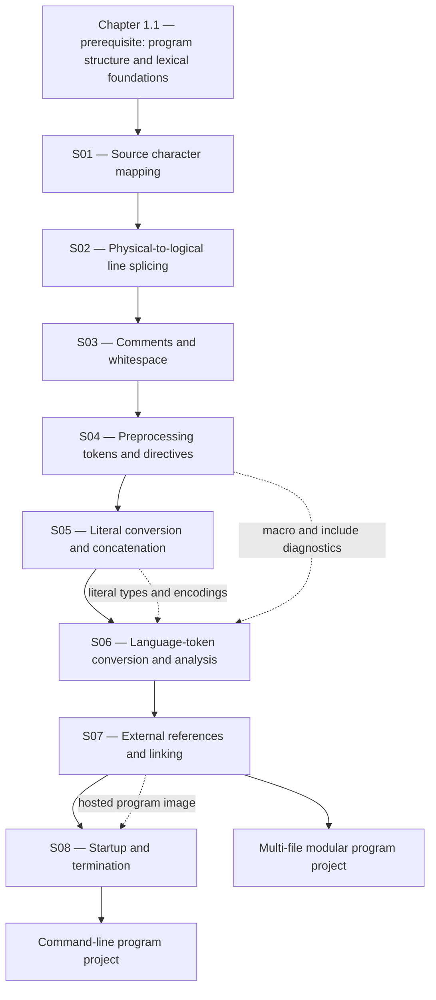

# 01.02 — Translation Phases in C23

**Part:** 01 — Language Fundamentals, Tokens, and the Language Model  
**Chapter level and prerequisites (source):** `L1; prerequisite: 1.1`  
**Chapter ID:** `C23-P01-CH02`  
**Source outline:** `Kurikulum_C_Final.txt`  
**Publication status:** Full instructional chapter; standards-sensitive claims checked against WG14 N3220 (the public C23 working draft titled *ISO/IEC 9899:2024*).  
**Knowledge-unit namespace:** `C23-P01-CH02-Sxx-*`

> **The central idea:** C source code does not move directly from characters on a screen to a running program. The C abstract translation model describes an ordered sequence of transformations, from source characters and physical lines through preprocessing tokens, expanded tokens, translated translation units, external-reference resolution, and finally execution-environment startup.

This chapter teaches the eight translation phases as a reasoning model, not as a claim that every compiler literally runs eight isolated programs in eight separate passes. Implementations must behave *as if* the specified phases occur in the prescribed order; real toolchains commonly combine work, cache intermediate results, or use internal representations that do not resemble the standard's conceptual stages.

## How to use this chapter

1. Read each subchapter's six steps in order. Do not skip the formal boundary: it is where a useful mental model is separated from a language guarantee.
2. Before looking at an example's explanation, predict what transformation occurs and at which phase.
3. Use the integrated lab and the two-file linking exercise to move from recognition to application.
4. During review, retrieve the phase order from memory before rereading the phase table.
5. Treat the assessment record as evidence to be earned. The chapter being complete does not mean a learner has retained or mastered it.

### Learning outcomes

By the end of this chapter, a learner should be able to:

- explain why the translation phases are a conceptual ordering rather than a required compiler architecture;
- distinguish the source character set from the execution character set;
- predict the effect of backslash-newline splicing on logical source lines;
- explain why comments are replaced by spaces and why this matters to token boundaries;
- distinguish preprocessing tokens, preprocessing directives, macro expansion, and ordinary language tokens;
- explain character-literal and string-literal encoding at the level needed for portable reasoning;
- predict adjacent string-literal concatenation and identify invalid prefix combinations;
- distinguish translation-unit compilation from program-wide external-reference resolution;
- explain hosted startup, the standard `main` forms, argument-vector boundaries, and normal termination.

## The eight translation phases at a glance

| Phase | Standard-described operation | Main question to ask |
|---:|---|---|
| 1 | Map physical source-file multibyte characters to the source character set; recognize line endings as new-line characters | What source characters does the implementation see? |
| 2 | Delete each eligible backslash immediately followed by new-line, joining physical lines into logical lines | Which physical lines become one logical line? |
| 3 | Decompose source into preprocessing tokens and whitespace; replace each comment with one space; retain new-lines | Where are the preprocessing-token boundaries? |
| 4 | Execute preprocessing directives, expand macro invocations, execute `_Pragma`; recursively process included files through phases 1–4; remove directives | What source remains after preprocessing? |
| 5 | Convert characters and escape sequences in character constants and string literals to the corresponding execution-character-set members | What character values do literals denote? |
| 6 | Concatenate adjacent string-literal tokens | Which neighboring string tokens become one literal sequence? |
| 7 | Convert each preprocessing token into a language token; syntactically and semantically analyze and translate the translation unit | Is this translation unit a valid C translation unit, and what translated output results? |
| 8 | Resolve external object and function references and collect translator output into a program image | Can the program's external references be satisfied? |

**Memory hook — characters, lines, tokens, directives, literals, strings, language, links.** This mnemonic is a recall aid, not a substitute for the numbered rules. Phase 5 concerns literal character conversion; phase 6 concatenates adjacent string-literal tokens; phase 7 converts preprocessing tokens into language tokens; phase 8 resolves external references. Keeping these four easily confused stages separate is especially important.

---

# 1.2.1 — Mapping Source Characters to the Source Character Set

**Knowledge-unit ID:** `C23-P01-CH02-S01`  
**Importance:** Core  
**Primary standard references:** ISO/IEC 9899:2024 (WG14 N3220), 5.1.1.2 phase 1; 5.2.1; 5.2.2; 6.4.2; 6.4.3; 6.4.4.5; 6.4.5.

## 1. Core idea

Translation phase 1 maps the physical source file's multibyte characters, when necessary, into the implementation's source-character representation and treats each physical line ending as a new-line character for the translation model.

The phrase *source character set* names the character repertoire used to write and interpret source text; it is not a promise that every editor, terminal, file encoding, or execution environment uses the same byte encoding.

## 2. Mental model

Imagine a document arriving at a reading desk in a particular file encoding. Before the compiler can reason about C tokens, it must interpret the incoming representation as source characters. Phase 1 is the conceptual hand-off from the file's physical representation to the implementation's source-character view.

The analogy has a limit: the standard does not prescribe one universal byte encoding, one editor format, or one physical internal representation. The mapping from physical source-file multibyte characters to the source character set is implementation-defined. A compiler may perform it while reading the file, through an internal decoding layer, or as part of a larger combined operation.

Keep three layers distinct:

1. **Physical file representation:** bytes and line-ending conventions stored in a file.
2. **Source character set:** the characters recognized as source text by the implementation.
3. **Execution character set:** the character representation used for ordinary character constants and string literals during translation and execution.

These layers are related, but they are not interchangeable. A source file saved as UTF-8 does not, by itself, prove that every implementation interprets every extended character identically or that ordinary string literals use UTF-8 at runtime.

## 3. Technical mechanism

N3220 describes two character sets: the source character set, in which source files are written, and the execution character set, interpreted in the execution environment. Each has a basic character set and may have additional extended characters. The values of execution-character-set members are implementation-defined.

The basic source and basic execution character sets include the Latin alphabet's uppercase and lowercase letters, decimal digits, specified graphic characters, space, and certain control characters. The basic character sets are designed to provide the characters needed for ordinary C source syntax and common literal content. The source file also has a physical end-of-line indication; the translation model treats that indication as if it were a single new-line character.

A simplified source fragment:

```c
#include <stdio.h>

int main(void)
{
    puts("Hello, C");
    return 0;
}
```

The compiler must recognize the characters that form `#include`, identifiers, punctuators, string-literal delimiters, and the other source elements. The spelling shown in the editor is a human-readable view; phase 1 establishes the implementation's source-character interpretation before later lexical work is considered.

The standard also provides universal character names for naming certain characters that may not be directly present in the basic source character set. Their detailed syntax and constraints belong to 6.4.3. A universal character name is not a magic escape from every identifier or literal restriction: its use is governed by the relevant lexical and character rules.

For ordinary character and string literals, phase 5 later maps source characters and escape sequences to the execution character set. Therefore, phase 1 and phase 5 answer different questions:

- Phase 1: how is the physical source represented as source characters?
- Phase 5: how are characters in character constants and string literals represented for execution?

## 4. Formal boundary

- **Implementation-defined mapping:** The physical-source-to-source-character mapping in phase 1 is implementation-defined. The implementation is required to document implementation-defined choices under the standard's conformance provisions.
- **Basic versus extended characters:** The standard specifies a basic character set. Additional characters are not a universal guarantee across all implementations and locales.
- **Source versus execution encoding:** The source and execution character sets need not use the same encoding. Do not infer runtime literal bytes solely from the source file's encoding.
- **Line endings:** Different physical end-of-line indicators are represented in the translation model as a new-line character. Do not build portability assumptions around a particular editor's byte sequence for line endings.
- **Universal character names:** Their legality depends on the token context and the rules of 6.4.3 and the relevant literal/identifier provisions. Do not assume every Unicode code point is valid in every C lexical position.
- **No general Unicode guarantee:** C's character-set provisions should not be paraphrased as “all C source is UTF-8” or “all ordinary string literals are UTF-8.” Those are stronger claims than the general rule.

## 5. Practical consequence

For portable source code:

- Keep identifiers and syntax within the basic source character set unless the project deliberately specifies and tests a broader implementation environment.
- Agree on a source-file encoding and enforce it in the editor, repository, build system, and compiler configuration.
- Treat source encoding and execution-literal encoding as separate build concerns.
- Use universal character names or encoded literals only when the language-version rules and target environment have been checked.
- When a compiler reports an invalid or unrepresentable character, investigate the file encoding and the compiler's documented source-character mapping before changing the program's semantics.

A practical review question is: “Am I relying on a property of the C language, or on a property of this compiler's input encoding and target execution encoding?” If the answer is the latter, record the implementation requirement explicitly.

## 6. Retrieval question

Without looking back, distinguish the physical source-file representation, the source character set, and the execution character set. Which mapping is implementation-defined in phase 1, and why does that prevent you from claiming that an ordinary string literal is necessarily UTF-8?

**Retrieval item ID:** `C23-P01-CH02-S01-RET-01`  
**Candidate misconception ID:** `MIS-P01-CH02-S01-01`

---

# 1.2.2 — Splicing Physical Source Lines

**Knowledge-unit ID:** `C23-P01-CH02-S02`  
**Importance:** Core  
**Primary standard references:** ISO/IEC 9899:2024 (WG14 N3220), 5.1.1.2 phase 2; 5.1.1.3.

## 1. Core idea

Translation phase 2 deletes each backslash character that is immediately followed by a new-line character, joining the two physical source lines into one logical source line before phase 3 decomposes the source into preprocessing tokens and whitespace.

## 2. Mental model

Think of a physical line as a line on the page and a logical line as the line the preprocessor receives after continuation processing. A backslash immediately before the line ending is a join marker: the backslash and line ending disappear, so the next physical line continues the current logical line.

The analogy is deliberately narrow. This is not ordinary text wrapping, and indentation on the next physical line is not automatically removed. The phase deletes only the eligible backslash and new-line pair. Any spaces or tabs physically present after the join remain characters in the resulting logical line and can affect later token separation.

## 3. Technical mechanism

Consider this source:

```c
#define MESSAGE "translation " \
               "continues"
```

After phase 2, the logical line is equivalent to:

```c
#define MESSAGE "translation "                "continues"
```

The exact whitespace that remains between the two physical lines depends on the characters that were already present. Phase 2 removes the backslash and the line ending; it does not delete the indentation before `"continues"`.

The same mechanism applies outside macro definitions:

```c
int total = 10 + \
            20;
```

The compiler's translation model sees one logical source line containing the declaration and expression. The line break was not a C statement separator. The semicolon still ends the declaration.

A useful diagnostic technique is to inspect the characters at the physical line boundary. A backslash followed immediately by the line-ending indicator is eligible. A backslash followed by a space and then a line ending is not the specified phase-2 splice, because the backslash is not immediately followed by new-line.

## 4. Formal boundary

- **Immediate adjacency:** The required pair is backslash followed immediately by new-line. A trailing space after the backslash changes the character sequence and prevents the specified splice.
- **Last backslash rule:** Only the last backslash on a physical source line is eligible to participate in a splice.
- **Final newline:** A nonempty source file shall end in a new-line character, and before splicing that final new-line shall not be immediately preceded by a backslash. This requirement is explicit in phase 2.
- **Eligibility is constrained:** Only the last backslash on a physical source line can participate in the splice. Apply that rule to the physical source representation rather than treating every nearby backslash as a continuation marker.
- **Order matters:** Splicing occurs before phase-3 comment recognition and preprocessing-token decomposition. This is why a line splice can change whether later characters are part of a comment or a directive.
- **No special string rule:** Backslash-newline splicing is a source transformation, not a string escape sequence. It can occur before the compiler has classified the surrounding characters as a string literal.

## 5. Practical consequence

Use explicit continuation only when it improves readability and is reliably preserved by the editing and formatting tools. In macro definitions, place the backslash as the final character before the physical newline; do not leave trailing spaces after it. Configure editors to display trailing whitespace and consider repository checks that reject accidental trailing spaces on continued lines.

When debugging a surprising macro or comment, reconstruct the logical line first. Reading the file as visually wrapped lines can lead to the wrong conclusion because phase 2 changes the character sequence before phase 3 decides what counts as a comment or preprocessing token.

## 6. Retrieval question

A physical line ends with a backslash, then a space, then a newline. Does phase 2 splice that line? Explain the exact adjacency rule, state what phase 2 removes in a valid splice, and identify why the answer matters before comment and token recognition.

**Retrieval item ID:** `C23-P01-CH02-S02-RET-01`  
**Candidate misconception ID:** `MIS-P01-CH02-S02-01`

---

# 1.2.3 — Processing Comments and Replacing Them with Spaces

**Knowledge-unit ID:** `C23-P01-CH02-S03`  
**Importance:** Core  
**Primary standard references:** ISO/IEC 9899:2024 (WG14 N3220), 5.1.1.2 phase 3; 6.4; 6.4.9.

## 1. Core idea

In translation phase 3, the source is decomposed into preprocessing tokens and whitespace, comments are recognized as part of the whitespace sequence, and each comment is replaced by one space character while new-line characters are retained.

## 2. Mental model

A comment is like a removable annotation placed between pieces of source text. The compiler does not treat the annotation as executable C code; phase 3 replaces it with a space so that removing the annotation does not accidentally glue the tokens on either side together.

The model's important limit is that a comment is not always equivalent to deleting every character it occupies. The replacement space is semantically significant for token separation. A comment is also recognized only after earlier translation phases have transformed the source. In particular, phase-2 line splicing can join characters that appear on separate physical lines before phase 3 recognizes comments.

## 3. Technical mechanism

C has two comment forms:

```c
// A line comment ends before the next new-line character.

/* A block comment can span
   more than one physical line. */
```

A comment is not nested. The first subsequent `*/` ends a block comment; writing another `/*` inside a block comment does not open a nested comment.

Why replace a comment with a space? Compare:

```c
int/**/value = 7;
```

The comment is replaced by one space, so the resulting token sequence behaves as if the source had been:

```c
int value = 7;
```

If comments were simply deleted with no separator, the characters could become `intvalue`, a different identifier. The replacement preserves the token boundary.

Phase order creates a less obvious example:

```c
// comment continues \
int value = 7;
```

Phase 2 first removes the backslash and new-line pair. The `int value = 7;` characters therefore remain on the same logical line as the `//` comment introducer and are part of that line comment during phase 3. The declaration is not active code. This example is useful for understanding phase order, but it is not a recommended way to write comments.

Comments are also not recognized inside character constants or string literals as comment delimiters. For example:

```c
const char *text = "not a /* comment */";
```

The comment-like characters are part of the string-literal spelling, not a comment.

## 4. Formal boundary

- **Replacement:** Each comment is replaced by one space character in phase 3.
- **New-lines:** New-line characters are retained. Whether each nonempty sequence of whitespace other than new-line is retained or replaced by one space is implementation-defined.
- **No nesting:** Block comments do not nest. A `/*` sequence inside an existing block comment has no nested-comment effect.
- **Phase order:** Phase 2 line splicing precedes phase 3 comment recognition. A backslash-newline pair can therefore alter the extent of a `//` comment.
- **Lexical context:** The same character sequence has different status inside a string literal, a character constant, a comment, or ordinary source text. Do not classify punctuation without first identifying its lexical context.
- **End of file:** A source file shall not end in a partial comment. An unterminated block comment is not a harmless unfinished note.

## 5. Practical consequence

Use comments to explain intent, invariants, non-obvious constraints, and design decisions—not to carry code or to rely on subtle phase-order tricks. Avoid backslash continuations on `//` comments. Keep block comments properly terminated and use editor highlighting or compiler diagnostics to detect accidental comment boundaries.

When a token unexpectedly changes after editing a comment, inspect the characters on both sides of the comment. Ask what one space in place of the comment does to the token sequence. This is especially useful when a comment appears between an identifier and punctuation, or between two identifier-like spellings.

## 6. Retrieval question

Why does C replace a comment with one space rather than simply erase it? Then explain how a backslash-newline pair can extend a `//` comment even though the physical source shows the comment on one line.

**Retrieval item ID:** `C23-P01-CH02-S03-RET-01`  
**Candidate misconception ID:** `MIS-P01-CH02-S03-01`

---

# 1.2.4 — Preprocessing Tokens and Preprocessing Directives

**Knowledge-unit ID:** `C23-P01-CH02-S04`  
**Importance:** Critical  
**Primary standard references:** ISO/IEC 9899:2024 (WG14 N3220), 5.1.1.1; 5.1.1.2 phase 3–4; 6.4; 6.10; 6.10.5.

## 1. Core idea

A preprocessing translation unit is processed as preprocessing tokens and directives before the resulting preprocessing-token sequence is converted into ordinary C language tokens in phase 7.

## 2. Mental model

Think of preprocessing as a source-rewriting stage that operates on a structured stream of preprocessing tokens rather than as a blind text editor performing arbitrary find-and-replace operations. Directives control this stage; macros can substitute token sequences; included files are recursively processed through the early phases.

The analogy has limits. Macro expansion has detailed rules for arguments, rescanning, stringization, token pasting, and conditional inclusion. It is not equivalent to replacing every matching character sequence. Preprocessing tokens also have categories and boundaries that matter to the result.

## 3. Technical mechanism

### Preprocessing tokens

Phase 3 decomposes source into preprocessing tokens and whitespace. The preprocessing-token categories include header names, identifiers, preprocessing numbers, character constants, string literals, punctuators, and individual non-whitespace characters that do not fit the other categories. Tokenization is context-dependent; for example, text following `#include` is interpreted under header-name rules.

A preprocessing number is intentionally broader than a valid integer or floating constant. It is a preprocessing token category; it is not proof that the same spelling will be accepted as a valid C constant after phase 7. This distinction helps explain why some malformed numeric-looking sequences are diagnosed later.

### Preprocessing directives

A preprocessing directive begins in the source form recognized by the preprocessing rules, ordinarily with `#` at the start of a preprocessing line (allowing preceding whitespace). Common directives include:

```c
#include <stdio.h>
#define BUFFER_SIZE 64
#if BUFFER_SIZE >= 32
#define BUFFER_CLASS "large"
#else
#define BUFFER_CLASS "small"
#endif
```

Phase 4 executes preprocessing directives, expands macro invocations, and executes `_Pragma` unary operator expressions. An `#include` directive causes the named header or source file to undergo phases 1 through 4 recursively. After preprocessing, the directives are removed from the resulting translation unit.

### Macro replacement is token-based

```c
#define SCALE(x) ((x) * 10)
int result = SCALE(3);
```

The invocation is recognized as a function-like macro invocation because the macro name is followed by a left-parenthesis preprocessing token. Its argument is substituted according to the macro-replacement rules, and the replacement result is rescanned for further macro names. The expanded token sequence is conceptually:

```c
int result = ((3) * 10);
```

Parenthesizing macro parameters and the replacement expression is a defensive convention that prevents many precedence surprises. It does not make every macro safe: arguments with side effects may be evaluated more than once if the replacement uses a parameter more than once.

The `#` and `##` operators are preprocessing operators. `#` stringizes a macro argument under specified rules; `##` pastes preprocessing tokens. Their behavior belongs to phase 4, not to ordinary runtime expression evaluation.

### A useful inspection workflow

Many compilers offer an option to emit preprocessed source. That output is a practical diagnostic artifact for seeing the result of includes and macro expansion. It is not itself a new C language phase, and compiler command-line options are implementation-specific. Use the compiler manual for the exact option and do not treat a preprocessor dump as a universal file format.

## 4. Formal boundary

- **Preprocessing translation unit versus translation unit:** A source file together with headers and source files included through `#include` is a preprocessing translation unit. After preprocessing, it is called a translation unit.
- **Token categories:** A preprocessing token is not automatically a valid ordinary C token. Phase 7 applies the conversion and language constraints.
- **Directive execution:** Directives and macro invocations are processed in phase 4; all preprocessing directives are then deleted from the translation unit.
- **Recursive inclusion:** A file introduced by `#include` is processed from phase 1 through phase 4 recursively. Do not imagine that an included header is merely pasted as unexamined raw bytes at the final linking stage.
- **Macro replacement:** Macro replacement works on preprocessing tokens. `#` and `##` have dedicated semantics; argument substitution and rescanning have formal rules.
- **Undefined behavior boundary:** N3220 states that if token concatenation produces a character sequence matching the syntax of a universal character name, behavior is undefined. Do not invent a portable result for this case.
- **Diagnostics:** A conforming implementation must issue at least one diagnostic for a syntax-rule or constraint violation in a preprocessing translation unit or translation unit. Diagnostics are not required for every possible questionable construct, and a compiler's willingness to continue does not make invalid source conforming.

## 5. Practical consequence

When debugging macros or conditional compilation:

1. Confirm the active compiler language mode and relevant predefined macros.
2. Inspect the preprocessed output when macro expansion or inclusion is unclear.
3. Check whether a surprising sequence is one preprocessing token or several.
4. Check macro argument boundaries, parentheses, `#`, and `##` behavior.
5. Only then analyze the result as ordinary C syntax and semantics.

Prefer small, clearly named macros, or `static inline` functions when an operation needs function-like type checking or should evaluate an argument exactly once. Keep header guards or an equivalent inclusion strategy consistent. Do not assume that `#if` evaluates ordinary C expressions with all the same rules as the runtime language; it is a preprocessing conditional with its own permitted expression domain.

## 6. Retrieval question

Explain the difference between a preprocessing token and a C language token. In which phase are `#include` and macro invocations processed, and why does a successful macro expansion not prove that the resulting translation unit is syntactically valid C?

**Retrieval item ID:** `C23-P01-CH02-S04-RET-01`  
**Candidate misconception ID:** `MIS-P01-CH02-S04-01`

---

# 1.2.5 — Character Literals, String Literals, and Adjacent String Concatenation

**Knowledge-unit ID:** `C23-P01-CH02-S05`  
**Importance:** Critical  
**Primary standard references:** ISO/IEC 9899:2024 (WG14 N3220), 5.1.1.2 phases 5–6; 5.2.1–5.2.2; 6.4.4.5; 6.4.5; 6.2.9.

## 1. Core idea

In phase 5, characters and escape sequences in character constants and string literals are converted to the corresponding execution-character-set or literal-encoding values; in phase 6, adjacent compatible string-literal tokens are concatenated into one sequence.

## 2. Mental model

A literal has two distinct stories. First, its source spelling is interpreted and its characters are mapped to the representation required by the literal's encoding category. Second, neighboring string-literal tokens may be joined into one string-literal sequence. Think “interpret the contents, then join adjacent string pieces.”

This model is intentionally simplified. The detailed rules depend on literal prefixes (`u8`, `u`, `U`, `L`, or no prefix), escape-sequence forms, execution and literal encodings, and the constraints on adjacent prefixed tokens. A character constant and a string literal are not the same type of object and should not be treated as interchangeable.

## 3. Technical mechanism

### Character constants and string literals are different constructs

A character constant uses single quotes:

```c
int letter = 'A';
```

An ordinary string literal uses double quotes:

```c
const char *word = "A";
```

An ordinary integer character constant has type `int` under the C23 rules. A character string literal initializes an array of `char` elements (with a terminating zero byte appended under the literal rules); in most expression contexts, the array expression is converted to a pointer to its first element. The two spellings may look similar, but one is a character constant and the other denotes a string-literal array.

C23 also specifies encoding-prefixed character and string literals. For string literals, the prefixes include:

| Prefix | Literal category | Element type for the resulting array |
|---|---|---|
| none | Ordinary character string literal | `char` |
| `u8` | UTF-8 string literal | `char8_t` |
| `u` | UTF-16 string literal | `char16_t` |
| `U` | UTF-32 string literal | `char32_t` |
| `L` | Wide string literal | `wchar_t` |

The associated types are defined by the C standard and its library provisions. The prefixes are not decorative labels; they affect the literal's type and encoding rules.

### Escape sequences

Escape sequences are part of the literal's source spelling. Common examples include:

```c
const char *line = "first\nsecond";
const char *quote = "She said: \"hello\"";
const char *path  = "C:\\temp";
```

A hexadecimal escape sequence consumes the longest sequence of following hexadecimal digits that can form the escape. Thus:

```c
"\x12" "3"
```

is a useful way to express a string whose first character is the value specified by `\x12` and whose next character is `'3'`. In contrast, `"\x123"` contains one longer hexadecimal escape sequence, not an escape followed automatically by the character `3`.

### Adjacent string-literal concatenation

Phase 6 concatenates adjacent string-literal tokens. Whitespace and comments may appear between tokens without preventing adjacency in the token sequence:

```c
const char *message = "translation "
                      "phases";
```

This yields the same string contents as:

```c
const char *message = "translation phases";
```

A comment between the tokens does not create a runtime character:

```c
const char *message = "C23" /* explanatory note */ " translation";
```

The resulting string contains `C23 translation`, not the comment text.

For adjacent string-literal tokens that include prefixed literals, the prefixed tokens must all have the same prefix. Ordinary unprefixed string literals may be adjacent to a prefixed string literal under the standard's rule, with the resulting sequence treated as having that prefix. Do not mix incompatible nonempty prefixes and assume the implementation will choose a meaningful common encoding.

### What concatenation does not do

Concatenation joins string-literal tokens in the source translation model. It does not concatenate variables at runtime, and it does not make a character constant into a string literal:

```c
const char *a = "one" "two"; /* valid adjacent-literal concatenation */
/* const char *b = "one" + "two"; */ /* not string concatenation */
```

The second expression uses the `+` operator, which is not a string-joining operator in C.

## 4. Formal boundary

- **Phase distinction:** Phase 5 performs the character/escape conversion for literals; phase 6 concatenates adjacent string-literal tokens; phase 7 performs token conversion and semantic analysis.
- **Ordinary character constants:** An ordinary integer character constant has type `int`. If it contains more than one character, or a character/escape that does not map to a single value in the literal encoding, its value is implementation-defined. Do not use multi-character constants as portable text encodings.
- **String-literal array:** A zero value is appended to the multibyte character sequence that results from a string literal or concatenated string literals. Embedded `\0` can mean the resulting array contains a zero before its final terminator; a C string, as defined by the library, ends at the first null character.
- **Prefix constraints:** If adjacent string-literal tokens include prefixed tokens, all prefixed tokens in that adjacent sequence must have the same prefix. An incompatible prefix combination violates a constraint; do not rely on a compiler extension to accept it.
- **Encoding is not display:** A literal's execution or UTF encoding determines code units/bytes, not how a terminal renders them. Display behavior belongs to the execution environment and output device.
- **Modifiability:** The standard does not guarantee that distinct evaluations of identical string literals refer to distinct arrays. Attempting to modify a string literal's array has undefined behavior. Use an array initialized from a literal when mutable storage is required.
- **Hex escape extent:** Hexadecimal escapes consume the longest sequence of hexadecimal digits. Add adjacent literal boundaries or another unambiguous separator when necessary.

## 5. Practical consequence

Use adjacent string literals to format long messages and keep source lines readable without runtime concatenation code. Choose a literal prefix deliberately when a program needs UTF-8, UTF-16, UTF-32, or wide-character data. Do not infer a portable byte sequence from a source editor's encoding setting.

For character processing, distinguish a numeric character constant from a string object. Use a string literal for text and a character constant for a single character value. Avoid multi-character integer constants as data interchange formats. If mutable text is needed, initialize a modifiable array:

```c
char greeting[] = "hello";
greeting[0] = 'H';
```

Do not attempt to write through a pointer to a string literal:

```c
const char *read_only_view = "hello";
/* read_only_view[0] = 'H'; */ /* undefined behavior if attempted */
```

## 6. Retrieval question

State the difference between phase 5 and phase 6. Then explain why `'A'` and `"A"` are different C constructs, what a `u8` string literal changes, and why `"one" "two"` is valid while `"one" + "two"` is not string concatenation.

**Retrieval item ID:** `C23-P01-CH02-S05-RET-01`  
**Candidate misconception ID:** `MIS-P01-CH02-S05-01`

---

# 1.2.6 — Converting Preprocessing Tokens into Language Tokens

**Knowledge-unit ID:** `C23-P01-CH02-S06`  
**Importance:** Critical  
**Primary standard references:** ISO/IEC 9899:2024 (WG14 N3220), 5.1.1.2 phases 3, 4, 7; 6.4; 6.4.1–6.4.9.

## 1. Core idea

In translation phase 7, each preprocessing token is converted into a C language token, and the resulting tokens are syntactically and semantically analyzed and translated as a translation unit.

## 2. Mental model

Think of preprocessing tokens as the items produced for the preprocessor's workbench and language tokens as the items accepted by the C language grammar. Phase 7 is the hand-off from preprocessing representation to the language proper.

The analogy does not mean every preprocessing token has a one-to-one valid language-token equivalent. Some preprocessing-token spellings do not satisfy the lexical form or constraints of a C token. A preprocessing number, for example, can be broader than the syntax of a valid integer or floating constant. The language-token conversion and subsequent analysis are where the distinction becomes decisive.

## 3. Technical mechanism

C language tokens include keywords, identifiers, constants, string literals, and punctuators. The lexical rules in 6.4 define their spellings and constraints. Phase 7 also treats whitespace separating tokens as no longer significant for the later syntactic and semantic analysis.

Consider:

```c
#define COUNT 3
int values[COUNT];
```

After phase 4, the macro name has been replaced by the preprocessing-token sequence containing `3`. Phase 7 then converts the resulting preprocessing tokens into language tokens and analyzes the declaration.

Now consider a preprocessing number such as:

```c
/* Illustrative token spelling; not a valid C declaration. */
1e+
```

The preprocessor can classify numeric-looking sequences under the broader preprocessing-number category. That does not make `1e+` a valid floating constant in a C expression. The later language-token conversion and syntax/constraint checks determine whether the result is valid C.

A useful phase map for a macro-containing statement is:

```c
#define LIMIT 8
int data[LIMIT];
```

- Phase 3: recognizes preprocessing tokens such as `#`, `define`, `LIMIT`, `8`, `int`, `data`, `[`, `LIMIT`, `]`, and `;`.
- Phase 4: processes the directive and replaces the later `LIMIT` occurrence with `8`.
- Phase 7: converts the remaining preprocessing tokens into language tokens and analyzes the declaration.

The standard's phase description is an abstract model. A compiler may parse and optimize through a pipeline that combines operations, but its observable behavior must respect the language rules represented by the ordered phases.

## 4. Formal boundary

- **Token classes:** Preprocessing tokens and language tokens are distinct standard concepts. Do not use the words interchangeably when explaining translation.
- **Phase 7:** Each preprocessing token is converted to a token; the resulting tokens are syntactically and semantically analyzed and translated as a translation unit.
- **Whitespace:** Whitespace separating tokens is no longer significant after phase 7's token conversion, but earlier whitespace can determine token boundaries and directive structure.
- **Context-sensitive preprocessing:** Phase-3 decomposition is context-dependent. For example, header-name recognition after `#include` differs from ordinary punctuation and identifier interpretation.
- **Diagnostics:** A conforming implementation must diagnose at least one syntax-rule or constraint violation in a preprocessing translation unit or translation unit. The implementation may emit more diagnostics and may continue translating after a diagnostic; successful output does not prove the source was valid.
- **Undefined behavior versus constraint violation:** Do not collapse these categories. A constraint violation requires a diagnostic under 5.1.1.3; undefined behavior is a separate semantic classification. Some cases can involve both descriptions, as the standard's diagnostics clause notes.

## 5. Practical consequence

When a source fragment looks numeric or token-like but fails to compile, ask which phase produced the spelling and which language-token category it is supposed to become. This prevents the common mistake of assuming that “the preprocessor accepted it” means “the C compiler must accept it.”

Use compiler diagnostics as evidence, but read the standard's lexical and constraint rules for the applicable language version. For difficult cases, inspect preprocessed output, reduce the source to a minimal translation unit, and compile with strict warnings. Remember that diagnostics are implementation output; they are not a substitute for classifying the source under the language rules.

## 6. Retrieval question

Why can a preprocessing number be accepted as a preprocessing token yet fail to become a valid C constant? Describe phase 4's role, phase 7's role, and the distinction between a required diagnostic and undefined behavior.

**Retrieval item ID:** `C23-P01-CH02-S06-RET-01`  
**Candidate misconception ID:** `MIS-P01-CH02-S06-01`

---

# 1.2.7 — Resolving External References and Linking

**Knowledge-unit ID:** `C23-P01-CH02-S07`  
**Importance:** Critical  
**Primary standard references:** ISO/IEC 9899:2024 (WG14 N3220), 5.1.1.1; 5.1.1.2 phase 8; 6.2.2; 6.9; implementation/toolchain documentation for object formats and linker behavior.

## 1. Core idea

Translation phase 8 resolves external references to objects and functions across translated translation units and links the required library components to form a program image for the execution environment.

## 2. Mental model

Imagine each translation unit as a separately prepared module. During translation, one module can declare that a function or object exists elsewhere without containing its definition. Linking is the integration step that connects those external names to the definitions that satisfy them.

This is not a complete description of every platform's linker. Object-file formats, symbol decoration, static and dynamic libraries, startup objects, ABI conventions, and executable formats are platform/toolchain concerns. ISO C specifies the language-level relationships and the requirement to resolve external references; it does not prescribe one universal linker executable or binary format.

## 3. Technical mechanism

### Translation units can be translated separately

C does not require a complete program to be translated all at once. A source file together with the files included through `#include` forms a preprocessing translation unit; after preprocessing it is a translation unit. Separate translation units may be translated individually and later linked.

A minimal two-file example:

`main.c`

```c
#include <stdio.h>

int add_one(int value); /* declaration: definition is elsewhere */

int main(void)
{
    printf("%d\n", add_one(41));
    return 0;
}
```

`math_unit.c`

```c
int add_one(int value)
{
    return value + 1;
}
```

Each file can be compiled to an object file. A later link step combines the translated outputs and resolves the external reference to `add_one` using the definition in `math_unit.c`.

A common GCC/Clang-style command is:

```sh
cc -std=c23 -Wall -Wextra -Wpedantic -pedantic-errors -c main.c -o main.o
cc -std=c23 -Wall -Wextra -Wpedantic -pedantic-errors -c math_unit.c -o math_unit.o
cc main.o math_unit.o -o example
```

The exact command, object format, and linker invocation are toolchain-specific. The standard's phase 8 is a conceptual account of the language-level result, not a command-line recipe.

### Linkage is a language concept

C distinguishes external linkage, internal linkage, and no linkage. External linkage allows declarations of the same identifier in different translation units to denote the same object or function in the program. A file-scope function or object identifier ordinarily has external linkage unless rules such as `static` (and, in C23, relevant storage-class cases) give it internal linkage.

For example:

```c
/* file_a.c */
static int local_count; /* internal linkage */
int shared_count;       /* external linkage */
```

A `static` function or file-scope object is not intended to satisfy an external reference from another translation unit. A declaration such as `extern int shared_count;` can refer to an object defined elsewhere, provided the declarations and definitions satisfy the language rules.

### A linker error is not the same as a C syntax error

If `main.c` compiles but the final link reports that `add_one` is undefined, the problem is not necessarily a syntax error in `main.c`. It may mean that the object containing the definition was omitted, the name does not match, the definition has incompatible linkage, or the build configuration failed to provide the required library.

Conversely, compiling both files successfully does not prove that their declarations and definitions are compatible at the whole-program level. C imposes requirements on external definitions and compatible declarations; the build process must supply a program that satisfies them.

## 4. Formal boundary

- **Translation unit boundary:** A translation unit is the result after preprocessing. Multiple translation units may be translated separately and later linked.
- **External linkage:** Declarations of an identifier with external linkage in the program denote the same object or function, subject to the language's declaration and definition requirements.
- **Internal linkage:** File-scope `static` gives the relevant identifier internal linkage; it does not create a cross-translation-unit external definition.
- **Definition requirement:** If an identifier with external linkage is used in an expression, the entire program must contain exactly one external definition for it, subject to the detailed exceptions and wording in 6.9. If it is not so used, there must be no more than one external definition.
- **C versus ABI:** ISO C does not standardize ELF, COFF, Mach-O, symbol mangling conventions, a particular linker program, or a universal executable file format. These belong to implementation and platform contracts.
- **Libraries:** The phase description says library components are linked to satisfy external references to functions and objects not defined in the current translation. Whether a library is static, shared, or selected through a platform-specific build mechanism is not a universal ISO C command-line rule.
- **Diagnostic expectations:** A missing external definition is not necessarily diagnosed during compilation of an individual translation unit. The implementation's translation and link environment determines how the problem is reported.

## 5. Practical consequence

For multi-file programs:

- put shared declarations in headers where appropriate;
- include the declaration where a function or object is used;
- provide exactly one appropriate external definition when required;
- avoid putting ordinary non-`static` object definitions in headers included by multiple translation units;
- use `static` for file-local implementation details when internal linkage is intended;
- ensure every required object file and library is included in the final link command;
- investigate undefined references as integration/build problems before rewriting valid C syntax.

A robust project review checks both compilation and linking. A source file that compiles independently is only one part of a program; the program-wide external-reference contract must also be satisfied.

## 6. Retrieval question

A function is declared in `main.c`, defined in `math_unit.c`, and called from `main.c`. Why can each file compile successfully while the final link still fail? Explain external versus internal linkage and state what phase 8 is responsible for.

**Retrieval item ID:** `C23-P01-CH02-S07-RET-01`  
**Candidate misconception ID:** `MIS-P01-CH02-S07-01`

---

# 1.2.8 — Program Startup and Termination

**Knowledge-unit ID:** `C23-P01-CH02-S08`  
**Importance:** Critical  
**Primary standard references:** ISO/IEC 9899:2024 (WG14 N3220), 5.1.2.1–5.1.2.3.4; 7.24.4.4 (`exit`).

## 1. Core idea

Program startup is the point at which the execution environment calls the designated C function, and program termination returns control to that environment; the standard distinguishes hosted and freestanding execution environments.

## 2. Mental model

Think of translation and execution as two connected but different journeys. Phases 1–8 describe how source is transformed and assembled into a program image. Startup begins later, when the execution environment transfers control to the designated function. Termination is the program's return of control to that environment.

This is not a promise that the operating system always loads a file named `a.out`, nor that every C program begins at a machine-level symbol literally called `main`. A hosted C implementation calls `main` as specified; a freestanding implementation defines its startup function in an implementation-defined manner. The C standard's abstract execution model is not a complete operating-system boot specification.

## 3. Technical mechanism

### Hosted and freestanding environments

C defines two execution environments:

- **Hosted:** The environment provides the hosted-program contract, including the standard `main` startup forms and the hosted library facilities.
- **Freestanding:** C execution may take place without the benefit of an operating system. The name and type of the function called at startup are implementation-defined, as are library facilities beyond the minimum required by the standard and the effect of program termination.

A hosted environment is not required to exist on every C implementation. If it is provided, it must conform to the hosted requirements.

### Standard hosted `main` forms

The two standard forms are:

```c
int main(void)
{
    return 0;
}
```

and:

```c
int main(int argc, char *argv[])
{
    (void)argc;
    (void)argv;
    return 0;
}
```

Equivalent parameter types are permitted by the standard. The implementation declares no prototype for `main` on the programmer's behalf; the program defines it with a return type compatible with `int` and one of the permitted parameter forms, or an implementation-defined alternative form.

In C23, a function declarator with no parameter type list has the effect of a parameter type list consisting of `void`; therefore `int main()` also specifies no parameters under C23. `int main(void)` remains the clearest explicit spelling and is preferable when the source should also communicate the no-parameter prototype clearly to readers familiar with earlier C editions.

### Command-line arguments

In the two-parameter hosted form:

- `argc` is nonnegative;
- `argv[argc]` is a null pointer;
- if `argc > 0`, `argv[0]` through `argv[argc - 1]` point to strings supplied by the host environment;
- `argv[0]` represents the program name when available, and if the name is unavailable its first character is the null character;
- if `argc > 1`, `argv[1]` through `argv[argc - 1]` represent program parameters.

The values of the argument strings are implementation-defined by the host environment. The strings are not guaranteed to be byte-for-byte identical across operating systems, shells, launchers, or environments.

A safe iteration pattern is:

```c
#include <stdio.h>

int main(int argc, char *argv[])
{
    for (int i = 0; i < argc; ++i) {
        printf("argv[%d] = %s\n", i, argv[i]);
    }

    return 0;
}
```

The loop uses indices strictly less than `argc`, so it does not attempt to print the null sentinel at `argv[argc]` as a string. If the program needs to test the sentinel explicitly, it may compare `argv[argc]` with a null pointer.

### Normal termination

In a hosted environment, returning from the initial call to `main` with an `int`-compatible return type is equivalent to calling `exit` with the returned value. Reaching the closing brace that terminates `main` returns zero. Therefore, these two forms have the same normal termination status:

```c
int main(void)
{
    return 0;
}
```

```c
int main(void)
{
    /* Work completed. */
}
```

The explicit `return 0;` is often preferred in teaching examples because it makes the intended status visible. In either case, the hosted rule applies to reaching the end of the initial call to `main`.

Returning from `main` is not identical in every respect to every possible way of leaving a function: the standard explicitly relates the initial return from `main` to `exit`. The `exit` function performs normal termination processing described by the library, including registered termination handlers and stream flushing/closing behavior. The details are specified in the library clause; this chapter's core focus is the language-level startup and termination boundary.

## 4. Formal boundary

- **Environment distinction:** Hosted and freestanding are separate standard execution environments. Do not assume every C implementation is hosted.
- **Hosted `main`:** The standard hosted startup function is named `main`; it returns `int` and has no parameters, or the two permitted parameters, or an implementation-defined alternative form.
- **`argc`:** Its value is nonnegative.
- **`argv` sentinel:** `argv[argc]` is a null pointer. It is not an additional argument string.
- **Argument contents:** The host environment supplies implementation-defined values for the argument strings. The program should not assume a universal spelling or encoding of the program name.
- **Return from `main`:** Returning from the initial call with an `int`-compatible return type is equivalent to calling `exit` with that value. Reaching the closing brace of that initial call returns zero.
- **Freestanding startup:** The startup function's name and type are implementation-defined; the effect of termination is also implementation-defined.
- **Implementation-defined alternatives:** The standard permits an implementation-defined alternative form of `main` in hosted environments. That permission is not a reason to teach arbitrary nonstandard signatures as universally portable.
- **Static initialization:** Objects with static storage duration are initialized before program startup; the manner and timing of that initialization are otherwise unspecified.

## 5. Practical consequence

For ordinary hosted command-line programs, use one of the standard `main` forms and return a meaningful status. Treat `argc` as a count, iterate only over indices below it, and remember that `argv[argc]` is the null sentinel. Avoid assuming `argv[0]` is always a nonempty path or that argument strings have a universal encoding.

For embedded, kernel, bootloader, or other freestanding work, read the implementation's startup and runtime documentation. Do not copy a hosted `main` example into a freestanding environment and assume it is the required entry point. Conversely, do not infer from an embedded project's custom startup function that hosted C has no standard `main` contract.

## 6. Retrieval question

Compare hosted and freestanding startup. Give the two standard hosted `main` forms, state the invariant involving `argc` and `argv[argc]`, and explain what happens when the initial call to an `int`-returning `main` reaches its closing brace.

**Retrieval item ID:** `C23-P01-CH02-S08-RET-01`  
**Candidate misconception ID:** `MIS-P01-CH02-S08-01`

---

# Integrated Laboratory — Observe the Translation Model

This lab combines the chapter's core ideas in one hosted program. It deliberately uses portable basic-character-set source text, a macro, a comment, adjacent string literals, an ordinary character constant, and command-line arguments. It does not attempt to emulate a compiler's internal phases; it gives you concrete artifacts whose behavior can be reasoned about using the standard's model.

Save as `translation_phases_lab.c`:

```c
#include <stdio.h>
#include <string.h>

#define LABEL "translation " \
              "phases"
#define VALUE 42

static const char *const description =
    "C23 " /* this comment contributes no string characters */
    "translation model";

int main(int argc, char *argv[])
{
    const char marker = '!';

    printf("label: %s\n", LABEL);
    printf("description: %s\n", description);
    printf("value: %d%c\n", VALUE, marker);
    printf("argc: %d\n", argc);

    for (int i = 0; i < argc; ++i) {
        printf("argv[%d]: %s (length %zu)\n",
               i, argv[i], strlen(argv[i]));
    }

    return 0;
}
```

Compile in a compiler mode that supports C23:

```sh
cc -std=c23 -Wall -Wextra -Wpedantic -pedantic-errors -Werror -O2 \
   translation_phases_lab.c -o translation_phases_lab
```

Some compiler releases use `-std=c2x` for their pre-final C23 mode rather than accepting `-std=c23`. That is a compiler-version distinction, not a different C23 language rule. Check the compiler's own option documentation and record the exact mode used.

Run:

```sh
./translation_phases_lab
./translation_phases_lab Ada verbose
```

The second run should report three arguments: the program name, `Ada`, and `verbose`. The precise spelling of `argv[0]` is host/environment dependent; the other supplied arguments are shown as an example invocation.

### Lab analysis — reconstruct the phases

| Source feature | Translation-model explanation |
|---|---|
| `#include <stdio.h>` and `#include <string.h>` | Phase 4 processes each included header through phases 1–4 recursively. |
| `#define LABEL ...` | Phase 4 defines and later expands an object-like macro. The backslash-newline pair is removed in phase 2. |
| Adjacent `"translation "` and `"phases"` | Phase 6 concatenates adjacent string-literal tokens. |
| Comment between adjacent literals | Phase 3 replaces the comment with a space; phase 6 still sees adjacent literal tokens. |
| `VALUE` | Phase 4 replaces the macro name with its replacement preprocessing tokens. |
| `const char marker = '!';` | The character constant is interpreted under the character-constant and literal-encoding rules. |
| `main`, `argc`, and `argv` | Hosted startup calls `main`; the argument vector obeys the hosted contract. |
| Final executable | Translation units and required library components are collected and external references are resolved in the phase-8 model. |

### Two-translation-unit linking exercise

Save these as `link_main.c` and `link_helper.c`:

`link_main.c`

```c
#include <stdio.h>
int describe_value(int value);
int main(void)
{
    printf("result: %d\n", describe_value(41));
    return 0;
}
```

`link_helper.c`

```c
int describe_value(int value)
{
    return value + 1;
}
```

Compile and link both files:

```sh
cc -std=c23 -Wall -Wextra -Wpedantic -pedantic-errors -Werror -c link_main.c -o link_main.o
cc -std=c23 -Wall -Wextra -Wpedantic -pedantic-errors -Werror -c link_helper.c -o link_helper.o
cc link_main.o link_helper.o -o link_demo
./link_demo
```

Expected output:

```text
result: 42
```

Now omit `link_helper.o` from the final link command. The first source file may compile successfully, but the final link cannot satisfy the external reference to `describe_value`. This isolates translation-unit compilation from program-wide external-reference resolution.

---

# Misconception Defense Registry

These are **candidate misconception patterns for diagnosis**, not claims that a particular learner has expressed these beliefs. A learner's actual misconception status must be established by an answer, explanation, or observed code.

| Field | `MIS-P01-CH02-01` — Source encoding equals runtime encoding |
|---|---|
| Incorrect belief | “If my source file is UTF-8, every ordinary string literal is guaranteed to contain UTF-8 bytes on every C implementation.” |
| Correct explanation | Phase 1 maps physical source-file characters to the source character set in an implementation-defined manner. Phase 5 maps literal characters and escapes to execution/literal encodings. These are distinct concepts. |
| Why it seems plausible | Editors display decoded Unicode text, and many common toolchains use UTF-8-oriented defaults. |
| Relevant chapter | 1.2.1 and 1.2.5 |
| Code example | `const char text[] = "café";` — do not assume a universal byte sequence without checking the implementation contract. |
| Diagnostic question | Does C guarantee that an ordinary string literal is UTF-8 solely because the source file is UTF-8? |
| Correction exercise | Explain the physical-file, source-character, and execution/literal-encoding layers; state what a UTF-8-byte requirement demands from the build. |
| Related misconceptions | `MIS-P01-CH02-S05-01`; Portability. |

| Field | `MIS-P01-CH02-02` — Backslash continuation permits trailing spaces |
|---|---|
| Incorrect belief | “A backslash anywhere near the end of a line joins it to the next line, even if spaces follow it.” |
| Correct explanation | Phase 2 deletes a backslash immediately followed by a new-line character. A space between them means the required adjacent pair is absent. |
| Why it seems plausible | Editors may hide trailing whitespace; continuation is often remembered as a visual convention. |
| Relevant chapter | 1.2.2 |
| Code example | A physical line ending in backslash-space-newline is not the specified splice form. |
| Diagnostic question | Which two adjacent characters must phase 2 find to splice a line? |
| Correction exercise | Inspect visible whitespace, identify valid/invalid splice boundaries, and rewrite a continued macro. |
| Related misconceptions | `MIS-P01-CH02-03`; Preprocessor and Portability. |

| Field | `MIS-P01-CH02-03` — Comments are deleted without replacement |
|---|---|
| Incorrect belief | “A comment is removed completely, so the characters on both sides always become adjacent.” |
| Correct explanation | Phase 3 replaces each comment with one space, preserving token separation. `int/**/value` behaves as `int value`, not `intvalue`. |
| Why it seems plausible | Comments look like annotations with no program meaning, and text-processing tools often delete spans. |
| Relevant chapter | 1.2.3 |
| Code example | `int/**/value = 7;` |
| Diagnostic question | What token would form if the comment were erased without a space? |
| Correction exercise | Replace comments mentally with one space, retokenize examples, and analyze a line comment affected by phase-2 splicing. |
| Related misconceptions | `MIS-P01-CH02-02`; Preprocessor and Declarations. |

| Field | `MIS-P01-CH02-04` — Preprocessing acceptance means valid C |
|---|---|
| Incorrect belief | “If the preprocessor accepts a token sequence or macro expansion, the result must be valid C syntax.” |
| Correct explanation | Preprocessing tokens differ from language tokens. Phase 7 converts them to C tokens and performs syntax and semantic analysis. A preprocessing number can be broader than a valid C constant. |
| Why it seems plausible | Compiler commands often present preprocessing and parsing as one pipeline. |
| Relevant chapter | 1.2.4 and 1.2.6 |
| Code example | `1e+` may be a preprocessing-number spelling but is not a valid floating constant in an expression. |
| Diagnostic question | Which phase checks the resulting token sequence against C syntax and constraints? |
| Correction exercise | Trace a macro expansion, classify its tokens, and identify a preprocessing number that is not a valid C constant. |
| Related misconceptions | `MIS-P01-CH02-03`; Preprocessor and Behavior. |

| Field | `MIS-P01-CH02-05` — Separate compilation guarantees successful linking |
|---|---|
| Incorrect belief | “If every `.c` file compiles, all external calls must work.” |
| Correct explanation | Translation units may be compiled separately, but phase 8 resolves program-wide external references and links required library components. |
| Why it seems plausible | A successful compile command is casually called a successful build even when it only creates an object file. |
| Relevant chapter | 1.2.7 |
| Code example | `main.c` declares and calls `int calculate(void);`, but the object containing its definition is omitted from the final link. |
| Diagnostic question | What distinguishes successful object compilation from a complete successful link? |
| Correction exercise | Compile two files separately, link them, then omit the defining object and explain the unresolved reference. |
| Related misconceptions | `MIS-P01-CH02-06`; Declarations and Portability. |

| Field | `MIS-P01-CH02-06` — Every C program starts at `main` |
|---|---|
| Incorrect belief | “Every C implementation, including freestanding systems, must start by calling a function named `main`.” |
| Correct explanation | Hosted environments use the specified `main` contract. In freestanding environments, the startup function's name and type are implementation-defined. |
| Why it seems plausible | Most introductory examples run in hosted desktop environments. |
| Relevant chapter | 1.2.8 |
| Code example | Hosted: `int main(void) { return 0; }`. Freestanding: consult the implementation's startup contract. |
| Diagnostic question | Which execution environment requires the standard `main` startup contract? |
| Correction exercise | Classify a desktop command-line app and a microcontroller program; identify the relevant startup specification for each. |
| Related misconceptions | `MIS-P01-CH02-05`; Portability. |

### Six-step misconception repair loop

1. **Expose:** Ask the diagnostic question without showing the correction.
2. **Elicit:** Require the learner to explain the reasoning.
3. **Locate:** Identify the exact incorrect assumption.
4. **Rebuild:** Present the correct model and C23 rule.
5. **Contrast:** Use a new example that differs in one important property.
6. **Retest later:** Ask a different question in a later review. Reading a correction alone does not resolve a misconception.

---

# Error and Weakness Registry

These are diagnostic templates with status `Open — evidence pending`, not claims about a learner's performance. When an error is observed, record the learner's exact reasoning and update the status, severity, repair, and retest date.

| Error ID | Concept | Error type | Incorrect reasoning to capture | Repair | Severity | Retest evidence | Status |
|---|---|---|---|---|---|---|---|
| `ERR-P01-CH02-01` | Source/execution character sets | Standards / portability | Treats source encoding as runtime encoding | Draw the three-layer encoding model; verify phase 1 and phase 5 separately | Core | Explains a new implementation scenario after delay | Open — evidence pending |
| `ERR-P01-CH02-02` | Physical-line splicing | Syntax / preprocessing | Assumes trailing whitespace after `\\` is ignored | Inspect exact character adjacency and reconstruct logical lines | Core | Predicts valid and invalid splice examples | Open — evidence pending |
| `ERR-P01-CH02-03` | Comment replacement | Conceptual / lexical | Deletes comments without inserting a separator | Replace each comment with one space and retokenize | Core | Correctly analyzes token boundaries and line-comment continuation | Open — evidence pending |
| `ERR-P01-CH02-04` | Preprocessing vs language tokens | Reasoning / standards | Assumes macro expansion proves valid C syntax | Trace phase 4, then classify phase-7 tokens and constraints | Critical | Diagnoses a macro expansion that yields invalid C | Open — evidence pending |
| `ERR-P01-CH02-05` | Literal conversion/concatenation | Conceptual / application | Confuses character constants, string arrays, and runtime concatenation | Contrast `'x'`, `"x"`, adjacent literals, and `+` | Critical | Predicts literal category and contents | Open — evidence pending |
| `ERR-P01-CH02-06` | External references | Build / linkage | Stops after compiling object files | Verify declarations, definitions, linkage, and final link inputs | Critical | Completes and diagnoses a two-file link | Open — evidence pending |
| `ERR-P01-CH02-07` | Startup and arguments | Application / standards | Reads `argv[argc]` as an argument or assumes universal startup | Apply hosted constraints; iterate `i < argc`; distinguish environments | Critical | Correctly traces valid indices and sentinel | Open — evidence pending |

**Classification guide:** Use *knowledge gap* when a rule is not recalled; *conceptual error* when the mental model is wrong; *reasoning error* when a known rule is applied incorrectly; *application error* when code fails to implement it; *standards error* when a claim misstates the language version; and *engineering error* when the build or integration process is inadequate.

---

# Knowledge Connection Map

The prerequisite metadata `1.1` is preserved. The exact knowledge-unit ID for chapter 1.1 is not present in this scaffold, so no fabricated prerequisite ID is introduced. Connect the actual chapter 1.1 token and program-structure units when those identifiers are authored.



### Connection prompts

- Which chapter 1.1 token distinctions are required before phase 3 can be understood?
- How does phase 2 alter the input that phase 3 examines?
- Why does phase 3's comment replacement preserve token boundaries?
- Which macro operations belong to preprocessing, and which validity checks happen later?
- How do phase 5 and phase 6 combine to determine literal contents and encoding category?
- Why can a translation unit be valid while a multi-translation-unit program still fails to link?
- Which startup assumptions are valid only for hosted implementations?
- Which later topics reuse these distinctions? Macro-heavy headers, declarations/linkage, build systems, libraries, portability, and command-line I/O all depend on this chapter.

---

# Pitfall Box — Do Not Collapse the Pipeline

> **Pitfall:** “The compiler reads my file, expands macros, compiles it, links it, and runs it” is a useful everyday summary but too coarse for standards reasoning. Do not collapse character mapping, line splicing, comment/token formation, preprocessing, literal conversion, string concatenation, language-token conversion, and external-reference resolution into one undifferentiated “compile” step. When diagnosing a surprising result, identify the earliest phase that can explain it.

Additional traps:

- A UTF-8 source file does not automatically make ordinary string literals UTF-8 on every implementation.
- A backslash followed by spaces and then a newline is not the required phase-2 pair.
- A comment is replaced by a space; it is not simply erased.
- Macro expansion is not proof of valid C syntax.
- Adjacent string literals are concatenated in translation; `+` is not a runtime string-concatenation operator.
- Successful object-file compilation does not prove all external references are resolved.
- Hosted `main` rules must not be generalized to freestanding implementations.
- `argv[argc]` is a null pointer sentinel, not an extra argument string.

---

# Retrieval Bank

Attempt each prompt before consulting the chapter. Give a spoken or written explanation, not just a phase number.

## Precision retrieval

1. List all eight translation phases in order and give one verb for each.
2. Distinguish the source character set from the execution character set.
3. State the exact character pair required for phase-2 splicing.
4. State what replaces a comment in phase 3 and what happens to new-line characters.
5. Name the principal preprocessing-token categories.
6. State which phase executes directives and macro invocations.
7. Explain the difference between an ordinary character constant and an ordinary string literal.
8. State what phase 6 does and one prefix constraint on adjacent string literals.
9. Explain why a preprocessing number is not necessarily a valid C constant.
10. Define translation unit and external linkage in separate translation.
11. State the two standard hosted `main` forms.
12. State the `argc`/`argv` sentinel rule.

## Contrastive retrieval

1. **Physical line vs logical line:** Why can two physical lines become one logical line, and which characters are deleted?
2. **Comment vs whitespace:** Why is comment replacement not the same as deletion?
3. **Preprocessing token vs language token:** What does phase 7 add to the analysis?
4. **Character constant vs string literal:** Compare spelling, type/category, and storage behavior.
5. **Adjacent literal vs `+`:** Why is one translation-time concatenation and the other not string concatenation?
6. **Compilation vs linking:** What can succeed in one stage and fail in the next?
7. **Hosted vs freestanding:** Which startup details are standardized and which are implementation-defined?

## Code-reading retrieval

For each fragment, predict the result or identify the first relevant phase. Explain before compiling.

**A. Line splice**

```c
int sum = 4 + \
          5;
```

**B. Comment separator**

```c
int/**/count = 3;
```

**C. Adjacent literals**

```c
const char *text = "phase " "six";
```

**D. Macro expansion**

```c
#define N 6
int values[N];
```

**E. External reference**

```c
int compute(void);
int main(void) { return compute(); }
```

What additional program-level evidence is required beyond compiling this translation unit?

## Application tasks

1. Write a continued macro definition with no trailing whitespace after the backslash. Explain the logical line it produces.
2. Put a comment between two tokens and explain why the resulting tokens remain separate.
3. Use adjacent literals to create a long message, then compare it with an attempted `+` expression.
4. Build a two-translation-unit program with one externally linked function. Compile each file separately, then link them.
5. Write a hosted program that prints each command-line argument without reading beyond `argc`.
6. State what compiler documentation you need before claiming a non-basic source character is portable in your project.

---

# Cumulative Review Plan

Use the roadmap's adjustable default intervals: **Day 0, 1, 3, 7, 14, 30, 60, and 90**. These are retrieval opportunities, not a requirement to reread the entire chapter at every interval. Shorten an item's next interval when it is weak; reduce review frequency when it is repeatedly accurate and transferable. Keep the workload sustainable and prioritize critical dependencies.

| Review point | Retrieval target | Evidence to record |
|---|---|---|
| Day 0 | Reconstruct the eight phases; complete the integrated lab | Initial recall and code-execution evidence |
| Day 1 | Contrast phases 2–4 and 5–7 | Explains order and boundaries without notes |
| Day 3 | Diagnose a macro/comment/token example | Identifies earliest relevant phase and why |
| Day 7 | Rebuild the two-file linking example | Compiles both files and resolves external reference |
| Day 14 | Explain hosted/freestanding startup and `argv` bounds | Correctly handles standard forms and sentinel |
| Day 30 | Mixed retrieval across all eight subchapters | Accurate recall plus a new application example |
| Day 60 | Standards lookup using N3220 clauses | Finds clause, paraphrases accurately, states limits |
| Day 90 | Transfer task: review an unfamiliar C project | Explains preprocessing, literals, linking, and startup in context |

## Chapter review

A chapter review covers this chapter only. It includes free recall, definitions/distinctions, code reading, code writing, error diagnosis, and a short mastery assessment. Do not simply reread the eight subchapters.

## Part-end review contribution

The Part 01 review must integrate this chapter with the other Part 01 material and include all seven roadmap requirements:

1. **Core concept recall:** Reconstruct the eight phases and the purpose of each.
2. **Important definitions and distinctions:** Source/execution character set; physical/logical line; preprocessing/language token; character constant/string literal; translation unit/program; hosted/freestanding.
3. **Code-reading problems:** Trace a macro, continued line, comment boundary, and adjacent string literals.
4. **Code-writing exercises:** Write a macro continuation, a literal assembled from adjacent tokens, and a small multi-file program.
5. **Error diagnosis:** Diagnose a malformed continuation, invalid token result, and unresolved external reference.
6. **Prerequisite connections:** Retrieve actual Chapter 1.1 token and program-structure units once their exact IDs are authored; do not invent identifiers.
7. **Short mastery assessment:** Analyze a previously unseen source fragment and justify each relevant phase boundary.

## Cross-part review

Use the roadmap's suggested relationships, not invented prerequisite metadata. This chapter is especially relevant to later work on macros, headers, translation units, libraries, toolchains, ABI awareness, standards navigation, and portability. Review those relationships when their actual chapters are available.

## Curriculum review

Do not test all 175 chapters in one sitting. Sample critical knowledge, previously weak knowledge, high-dependency knowledge, overdue concepts, and concepts from different levels and parts. Translation phases are a high-dependency foundation: sample them when reviewing preprocessing, build systems, portability, or program startup.

---

# Assessment Record and Mastery Gate

**Chapter status:** Completed as an authored instructional artifact; learner retention and mastery are **Not assessed**.

| Score | Meaning |
|---:|---|
| 0 | Cannot answer or performs the task incorrectly |
| 1 | Major gaps; requires substantial help |
| 2 | Partially correct; inconsistent or incomplete |
| 3 | Correct and independent |
| 4 | Correct, clear, and transferable to a new context |

| Dimension | Score (0–4) | Evidence / notes |
|---|---:|---|
| Recall | Not assessed | No learner retrieval check is recorded. |
| Explanation | Not assessed | No independently produced explanation has been evaluated. |
| Application | Not assessed | Lab code is supplied, but learner application has not been observed. |
| Diagnosis | Not assessed | No learner diagnosis response has been evaluated. |
| Integration | Not assessed | No delayed cross-chapter transfer evidence has been collected. |

Do not mark the chapter mastered until the learner can retrieve critical concepts after a delay, explain the mechanism independently, handle key distinctions, complete application tasks, avoid or repair critical misconceptions, and demonstrate later cumulative retention. A critical dimension scored 0 or 1 blocks mastery even if the numerical average is high. `Completed`, `Retained`, and `Mastered` remain separate statuses.

---

# Standards Verification Ledger

| Topic | Verified source | What is supported | Status / limitation |
|---|---|---|---|
| Translation-unit model and phases 1–8 | WG14 N3220, 5.1.1.1–5.1.1.2 | Translation-unit terminology; ordered phases; conceptual “as if” model; phase operations | Verified against public WG14 document |
| Source and execution character sets | WG14 N3220, 5.2.1–5.2.2 | Distinct sets; basic and extended characters; implementation-defined execution values; multibyte provisions | Verified against public WG14 document |
| Comments and lexical tokens | WG14 N3220, 6.4 and 6.4.9; 5.1.1.2 phase 3 | Preprocessing-token categories; comment replacement; new-line retention; context-dependent tokenization | Verified against public WG14 document |
| Preprocessing and macro replacement | WG14 N3220, 6.10 and 5.1.1.2 phase 4 | Directive execution, recursive inclusion, macro replacement and rescanning | Verified against public WG14 document |
| Character constants and string literals | WG14 N3220, 6.4.4.5 and 6.4.5; phases 5–6 | Literal categories, prefix constraints, character conversion, adjacent concatenation, array initialization | Verified against public WG14 document |
| Token conversion and diagnostics | WG14 N3220, 5.1.1.2 phase 7; 5.1.1.3; 6.4 | Conversion to tokens, syntax/semantic analysis, required diagnostics for syntax/constraint violations | Verified against public WG14 document |
| Linkage and external definitions | WG14 N3220, 5.1.1.1; phase 8; 6.2.2; 6.9 | Translation units, external/internal/no linkage, external-definition requirements | Verified against public WG14 document |
| Startup and termination | WG14 N3220, 5.1.2.1–5.1.2.3.4 | Hosted/freestanding distinction; `main` forms; `argc`/`argv`; return from initial `main` | Verified against public WG14 document |
| Compiler flags, object formats, linker commands | Selected compiler/toolchain manuals | Commands shown are common GCC/Clang-style examples, not ISO C requirements | Verify for selected compiler and platform |

**Source-status note:** WG14 N3220 is the public WG14 document titled *ISO/IEC 9899:2024 (en) — N3220 working draft*. It is used here as the publicly available C23 text for clause verification. This chapter does not claim a clause-by-clause audit against a separately licensed final ISO publication. Compiler commands, object formats, and linker behavior are identified as toolchain/platform examples rather than ISO C guarantees.

## References

1. WG14, **N3220 — ISO/IEC 9899:2024 (en), C programming language**, especially 5.1.1.1–5.1.1.3, 5.1.2.1–5.1.2.3.4, 5.2.1–5.2.2, 6.2.2, 6.4, 6.9, and 6.10. Public document: <https://www.open-std.org/jtc1/sc22/wg14/www/docs/n3220.pdf>.
2. Compiler-specific manuals for the selected implementation when relying on source-encoding options, preprocessor-output options, object-file formats, linker commands, or hosted/freestanding startup configuration. No single compiler manual is treated as a universal C rule.

---

# Quality Assurance and Publication Record

## Content QA

- [x] All eight scaffold subchapters are present.
- [x] All eight original knowledge-unit IDs are preserved exactly.
- [x] All eight retrieval item IDs are preserved exactly.
- [x] All eight candidate misconception IDs are preserved exactly.
- [x] Each subchapter contains the six required steps in the required order.
- [x] Misconception records contain the required fields and concrete examples.
- [x] Misconceptions are candidate patterns, not fabricated learner observations.
- [x] Error and Weakness Registry contains evidence-oriented fields and repair actions.
- [x] Knowledge Connection Map preserves prerequisite `1.1` without inventing its missing unit ID.
- [x] Pitfall box, retrieval bank, cumulative review schedule, and seven-item Part-end review contribution are present.
- [x] Assessment record uses the 0–4 scale and does not claim learner mastery without evidence.
- [x] Standards-sensitive claims are tied to WG14 N3220 clauses; toolchain-specific claims are labeled.

## Code QA

The integrated lab and two-translation-unit exercise are intended for a compiler mode supporting C23. The examples avoid dependence on non-basic source characters, compiler extensions, and unspecified evaluation order.

**Verification record:** The following checks must be executed in the publication environment. Record the actual compiler name/version, exact language mode, full flags, command output, and runtime output. Do not mark a check PASS merely because source code is included in this chapter.

| Check | Command / configuration | Result |
|---|---|---|
| 1. GCC C23 strict compile | GCC 14.2.0: `gcc -std=c23 -Wall -Wextra -Wpedantic -pedantic-errors -Werror -O2 translation_phases_lab.c -o translation_phases_lab` | **PASS** |
| 2. Clang C2x strict compile | Clang 17.0.0: `clang -std=c2x -Wall -Wextra -Wpedantic -pedantic-errors -Werror -O2 translation_phases_lab.c -o translation_phases_lab_clang` | **PASS** |
| 3. Runtime argument cases | `./translation_phases_lab` and `./translation_phases_lab Ada verbose` | **PASS** — `argc` was 1 and 3 respectively; both supplied arguments were reported correctly |
| 4. Separate compilation and link | GCC and Clang separately compiled `link_main.c` and `link_helper.c`, linked both objects, and ran `link_demo`; output: `result: 42` | **PASS** |

**Negative-control check (additional):** linking `link_main.o` without `link_helper.o` failed with an unresolved/undefined reference to `describe_value`, as expected. This confirms that the exercise distinguishes compilation from external-reference resolution.

**Compiler-mode qualification:** GCC 14.2.0 was tested with `-std=c23`. Clang 17.0.0 was tested with `-std=c2x`, its pre-final C23 mode; this is not represented as a final `-std=c23` Clang test. The checks establish that these examples compile and run in the recorded environments; they do not establish complete C23 implementation conformance.

## Publication gate

<badge color="success">4/4 PASS</badge>

The integrated program compiled under both recorded compiler modes, both runtime argument cases passed, and the multi-translation-unit program linked and ran. The negative-control link failed as expected. Compiler versions, exact flags, and the Clang mode qualification are recorded above; no full-conformance claim is made.

---

## Anti-Forget System Alignment

This chapter instantiates the roadmap's six-step explanation format, misconception defense, cumulative review scopes, level-based evidence, sustainable review intervals, mastery gate, knowledge graph, C23 standards retention, error registry, practical reinforcement, assessment record, and quality-assurance checks. It does not require rote repetition of all content at every review point. It asks learners to retrieve essential distinctions, apply them in code, and verify standards-sensitive claims when accuracy matters.

**Closing principle:** Learn the order well enough to reason about it, but do not confuse the conceptual translation model with a particular compiler's internal architecture. When a surprising result appears, identify the earliest relevant phase, verify the applicable C23 rule, and test the implementation behavior you actually depend on.
